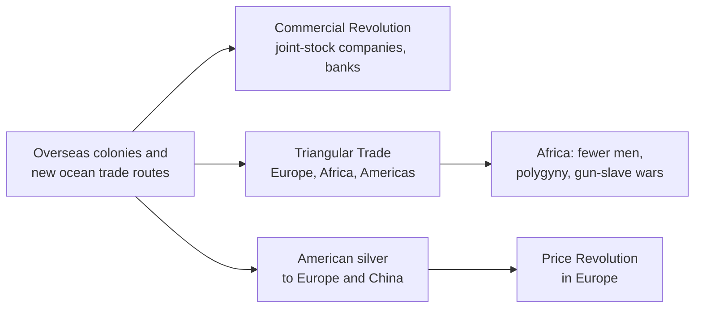

# AP World History: Modern — Topic 4.5 Summary: Maritime Empires Maintained and Developed (c. 1450–1750)

> Source: Summary of AP_WH_4.5_Notes_EN.md

**Unit 4: Transoceanic Interconnections (c. 1450–1750)**

---

## In One Sentence

Maritime empires grew stronger with new money tools such as **joint-stock companies**, royal **monopolies**, and American **silver**, and they changed the world through the **Atlantic slave trade**, a **global silver trade**, and the destruction of Native American records.

## The Big Picture

As European empires grew, Europe went through a **Commercial Revolution**, a big shift to an economy based on money and long-distance trade. The Dutch and the English created **joint-stock companies**, stock exchanges, and banks, while Spain and Portugal kept trade under royal control. The **Triangular Trade** linked Europe, Africa, and the Americas, and American **silver** flowed around the world, much of it to China. The slave trade changed African societies, Spanish rule destroyed many Native records, and rising prices in Europe became the **Price Revolution**.

## Key Points

### 1. New Ways to Pay for Empire (LO-H)

- A **joint-stock company** was a business owned by many investors who bought **shares**. They split the profits and the risks of long sea voyages.
- **Limited liability** meant an investor could lose only the money he put in. This made more middle-class people willing to invest.
- The most famous were the **British East India Company** (1600) and the **Dutch East India Company, or VOC** (1602). Spain and Portugal instead kept **royal monopolies**: only the crown, or a body it chose, could run the trade.

### 2. The Commercial Revolution and the Dutch (LO-H, LO-I)

- The Commercial Revolution had four drivers: **overseas colonies**, new ocean trade routes, **population growth** in Europe, and **inflation** (rising prices).
- Dutch merchants were the "**middlemen of Europe**," with fleets of light ships called **fluyts**. Amsterdam opened a **stock exchange** in 1602 and the **Bank of Amsterdam** in 1609.
- New stock markets also brought **speculation** (risky buying in hope of quick profit). In the early 1700s, the **South Sea Bubble** in Britain and the **Mississippi Bubble** in France burst and wiped out fortunes.

### 3. The Atlantic System and the Silver Trade (LO-I)

- The **Triangular Trade** had three legs. Europe sent guns, gunpowder, and cloth to Africa. Enslaved Africans were shipped to the Americas on the deadly **Middle Passage**. The Americas sent **sugar**, tobacco, and molasses to Europe.
- By the 1700s, **sugar** passed silver as the most profitable product of the Atlantic world.
- Silver from **Potosí** and Zacatecas went across the Atlantic to Europe, and across the Pacific on the **Manila Galleons** to Asia.
- China's **Single Whip Law** made people pay taxes in silver, so China pulled in the world's silver and paid for it with **silk, tea, and porcelain**.

### 4. Fighting Over Trade (LO-H)

- Rivalry over trade routes often turned into **armed conflict** between states.
- At the **Battle of Diu** (1509), the Portuguese navy defeated **Muslim fleets** and won control of Indian Ocean trade.
- Morocco needed money and sent an army with guns and cannons across the Sahara. At the **Battle of Tondibi** (1591), it crushed the larger army of the **Songhai Empire**, West Africa's greatest land empire.

### 5. Effects on Africa and the Americas (LO-J, LO-K)

- Slave traders took mostly young men: more than **two-thirds** of captives were male. In West Africa, this led to more **polygyny** (a man having several wives), and women took on farm and economic work once done by men.
- **Dahomey** and **Oyo** traded captives for European guns and had to keep raiding their neighbors. **Kongo** was weakened by civil war. American crops such as **manioc (cassava)**, maize, and peanuts helped Africa's population partly recover.
- Spain ruled New Spain and Peru through **viceroys** (royal governors), checked by royal courts called **audiencias**.
- Catholic friars such as **Diego de Landa** called Native religion demonic. They **burned Native books (codices)** and destroyed shrines, so many records of the past were lost forever.

## Must-Know Terms & People

| Term | What it is | Why it matters |
|---|---|---|
| Joint-stock company | Business owned by many investors who buy shares | Paid for trade and exploration; examples are the EIC and the VOC |
| Limited liability | Rule that investors can lose only what they put in | Made it safer for more people to invest |
| Triangular Trade | Three-legged Atlantic trade among Europe, Africa, and the Americas | Moved goods, wealth, and enslaved people |
| Middle Passage | The voyage of enslaved Africans across the Atlantic | The deadly middle leg of the Triangular Trade |
| Single Whip Law | Chinese law that made taxes payable in silver | Made China the main buyer of the world's silver |
| Price Revolution | Long period of rising prices in Europe | Caused by population growth and American silver |
| Battle of Tondibi | 1591 battle where Morocco's guns beat Songhai | Example of a war over trade; ended West Africa's greatest land empire |
| Polygyny | A man having several wives | Spread in West Africa because so many men were taken |

## Key Dates

| Year | Event |
|---|---|
| 1509 | Battle of Diu; Portugal defeats Muslim fleets |
| 1591 | Battle of Tondibi; Morocco defeats the Songhai Empire |
| 1600 | British East India Company founded |
| 1602 | Dutch East India Company (VOC) founded; Amsterdam stock exchange opens |
| 1609 | Bank of Amsterdam founded |
| Early 1700s | South Sea Bubble and Mississippi Bubble burst |

## How the Exam Asks About It

- **Legitimacy & consolidation:** Rulers used economic strategies to build power: royal monopolies in Spain and Portugal, chartered joint-stock companies in Britain and the Netherlands, and wars over trade, such as Morocco against Songhai. Spain kept control of its colonies through viceroys and audiencias.
- **Continuity, innovation, diversity:** Continuity: Spain and Portugal kept trade under the crown's direct control. Innovation: joint-stock companies with limited liability, and the Bank of Amsterdam. Diversity: the slave trade made Dahomey and Oyo stronger but left Kongo weaker.
- **Likely comparison:** The Dutch and British vs. Spain and Portugal. All of them used overseas trade to build wealth and power. But the Dutch and British raised money from private investors through joint-stock companies, while Spain and Portugal relied on royal monopolies and the crown's own borrowing.
- **Common trap:** Students think American silver stayed in Europe. The fix: much of it went on to **Asia**, across the Pacific or through European purchases, and China pulled in the most because its taxes were paid in silver.

## Check Yourself

1. What was a joint-stock company, and why did limited liability matter?

▶ Answer
It was a business owned by many investors who bought shares and split the profits and risks. Limited liability meant they could lose only what they invested, so more people were willing to invest.

2. Name the three legs of the Triangular Trade.

▶ Answer
Manufactured goods such as guns went from Europe to Africa. Enslaved Africans went to the Americas on the Middle Passage. Sugar, tobacco, and molasses went from the Americas to Europe.

3. How did the Atlantic slave trade change family life in West Africa?

▶ Answer
Traders took mostly men, so there were far fewer men than women. Polygyny spread, and women took on farm and economic work that men used to do.

