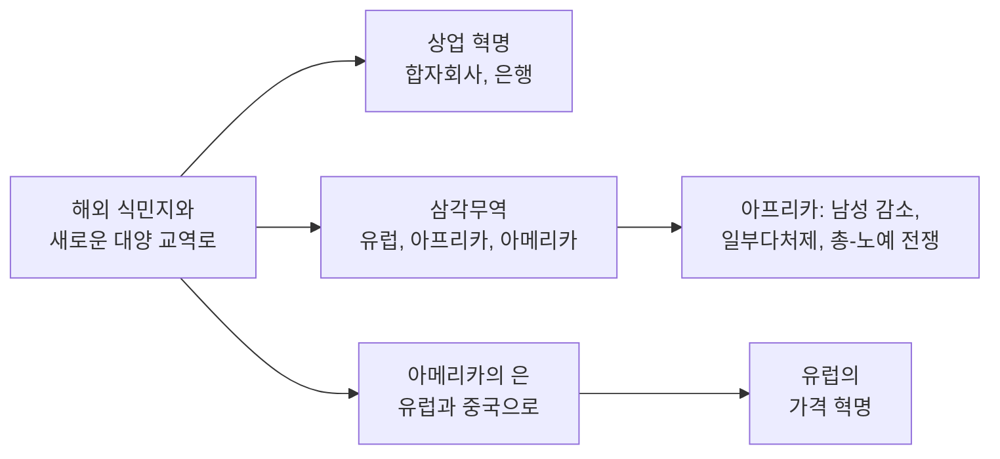

# AP 세계사: 모던 — 토픽 4.5 요약: 해양 제국의 유지와 발전 (Maritime Empires Maintained and Developed)

> 출처: AP_WH_4.5_Notes_KR.md 요약

**Unit 4: 대양 간 상호 연결 (Transoceanic Interconnections, c. 1450–1750)**

---

## 한 문장 요약

해양 제국은 **합자회사** (Joint-stock companies), 왕실 **전매권** (Monopolies), 아메리카의 **은** (Silver) 같은 새로운 돈의 수단으로 더 강해졌고, **대서양 노예 무역** (Atlantic slave trade), **전 지구적 은 교역**, 아메리카 원주민 기록의 파괴를 통해 세계를 바꾸었다.

## 큰 그림

유럽의 제국이 커지면서 유럽은 **상업 혁명** (Commercial Revolution), 곧 돈과 원거리 교역에 기반한 경제로의 큰 전환을 겪었다. 네덜란드와 영국은 **합자회사**, 증권거래소, 은행을 만들었고, 스페인과 포르투갈은 교역을 왕실의 통제 아래 두었다. **삼각무역** (Triangular Trade)은 유럽, 아프리카, 아메리카를 이었고, 아메리카의 **은**은 세계를 돌아 상당 부분이 중국으로 흘러갔다. 노예 무역은 아프리카 사회를 바꾸었고, 스페인의 지배는 원주민의 기록을 많이 파괴했으며, 유럽의 물가 상승은 **가격 혁명** (Price Revolution)이 되었다.

## 핵심 정리

### 1. 제국의 비용을 대는 새로운 방법 (LO-H)

- **합자회사** (Joint-stock company)는 **주식** (Shares)을 산 여러 투자자가 함께 소유한 사업체였다. 투자자들은 먼 항해의 이익과 위험을 나누어 가졌다.
- **유한책임** (Limited liability)은 투자자가 자기가 넣은 돈까지만 잃는다는 원칙이었다. 이 덕분에 더 많은 중산층이 투자하려 했다.
- 가장 유명한 회사는 **영국 동인도회사** (British East India Company, 1600)와 **네덜란드 동인도회사** (VOC, 1602)였다. 반면 스페인과 포르투갈은 **왕실 전매권**을 유지했다. 국왕이나 국왕이 고른 기관만 그 교역을 할 수 있었다.

### 2. 상업 혁명과 네덜란드 (LO-H, LO-I)

- 상업 혁명에는 네 가지 동인이 있었다. **해외 식민지**, 새로운 대양 교역로, 유럽의 **인구 증가**, 그리고 **인플레이션** (Inflation), 곧 물가 상승이다.
- 네덜란드 상인은 가벼운 배인 **플루이트선** (Fluyt) 선단으로 '**유럽의 중개자**' 역할을 했다. 암스테르담은 1602년 **증권거래소**를, 1609년 **암스테르담 은행** (Bank of Amsterdam)을 열었다.
- 새 주식 시장은 **투기** (Speculation), 곧 빠른 이익을 노린 위험한 매입도 불러왔다. 1700년대 초 영국의 **남해 거품 사건** (South Sea Bubble)과 프랑스의 **미시시피 거품 사건** (Mississippi Bubble)이 터져 많은 재산이 날아갔다.

### 3. 대서양 체제와 은 교역 (LO-I)

- **삼각무역**에는 세 구간이 있었다. 유럽은 총, 화약, 직물을 아프리카로 보냈다. 노예가 된 아프리카인은 죽음의 **중간 항로** (Middle Passage)를 거쳐 아메리카로 실려 갔다. 아메리카는 **설탕**, 담배, 당밀을 유럽으로 보냈다.
- 1700년대에 이르러 **설탕**이 은을 넘어 대서양 세계에서 가장 이익이 큰 상품이 되었다.
- **포토시** (Potosí)와 사카테카스 (Zacatecas)의 은은 대서양을 건너 유럽으로, 태평양을 건너 **마닐라 갈레온** (Manila Galleons)으로 아시아에 갔다.
- 중국의 **일조편법** (Single Whip Law)은 세금을 은으로 내게 했다. 그래서 중국은 세계의 은을 빨아들였고, 그 대가로 **비단, 차, 도자기**를 내주었다.

### 4. 교역을 둘러싼 싸움 (LO-H)

- 교역로를 둘러싼 경쟁은 자주 국가 간의 **무력 충돌**로 번졌다.
- **디우 해전** (Battle of Diu, 1509)에서 포르투갈 해군은 **무슬림 함대**를 물리치고 인도양 교역의 주도권을 쥐었다.
- 돈이 필요했던 모로코는 총과 대포로 무장한 군대를 사하라 너머로 보냈다. **톤디비 전투** (Battle of Tondibi, 1591)에서 모로코군은 수가 더 많은 **송가이 제국** (Songhai Empire)의 군대를 무찔렀다. 송가이는 서아프리카에서 가장 큰 육상 제국이었다.

### 5. 아프리카와 아메리카에 미친 영향 (LO-J, LO-K)

- 노예 상인은 주로 젊은 남성을 데려갔다. 포로의 **3분의 2** 이상이 남성이었다. 그 결과 서아프리카에서는 **일부다처제** (Polygyny), 곧 한 남성이 여러 아내를 두는 혼인이 늘었고, 여성이 원래 남성이 하던 농사와 경제 활동을 떠맡았다.
- **다호메이** (Dahomey)와 **오요** (Oyo)는 포로를 유럽의 총과 바꾸었고, 이웃을 계속 습격해야 했다. **콩고** (Kongo)는 내전으로 약해졌다. **마니옥(카사바)** (Manioc, cassava), 옥수수, 땅콩 같은 아메리카 작물은 아프리카의 인구가 일부 회복되도록 도왔다.
- 스페인은 **부왕** (Viceroys), 곧 왕의 대리 총독을 통해 누에바에스파냐 (New Spain)와 페루를 다스렸고, **아우디엔시아** (Audiencias)라는 왕립 법원이 부왕을 견제했다.
- **디에고 데 란다** (Diego de Landa) 같은 가톨릭 수도사들은 원주민 종교를 악마의 것으로 보았다. 그들은 **원주민의 책인 코덱스** (Codices)를 불태우고 성소를 부수어, 과거의 많은 기록이 영원히 사라졌다.

## 꼭 알아야 할 용어·인물

| 용어 | 무엇인가 | 왜 중요한가 |
|---|---|---|
| 합자회사 (Joint-stock company) | 주식을 산 여러 투자자가 소유한 사업체 | 교역과 탐험의 비용을 댔다. EIC와 VOC가 그 예이다 |
| 유한책임 (Limited liability) | 투자자가 넣은 돈까지만 잃는다는 원칙 | 더 많은 사람이 안심하고 투자하게 했다 |
| 삼각무역 (Triangular Trade) | 유럽, 아프리카, 아메리카를 잇는 세 구간의 대서양 교역 | 상품, 부, 노예가 된 사람들을 실어 날랐다 |
| 중간 항로 (Middle Passage) | 노예가 된 아프리카인이 대서양을 건넌 항해 | 삼각무역에서 가장 잔혹한 가운데 구간 |
| 일조편법 (Single Whip Law) | 세금을 은으로 내게 한 중국의 법 | 중국을 세계 은의 최대 구매자로 만들었다 |
| 가격 혁명 (Price Revolution) | 유럽에서 오래 이어진 물가 상승 | 인구 증가와 아메리카 은이 원인이었다 |
| 톤디비 전투 (Battle of Tondibi) | 1591년 모로코의 총이 송가이를 이긴 전투 | 교역을 둘러싼 전쟁의 예이다. 서아프리카 최대 육상 제국이 무너졌다 |
| 일부다처제 (Polygyny) | 한 남성이 여러 아내를 두는 혼인 | 많은 남성이 끌려가면서 서아프리카에서 늘었다 |

## 주요 연도

| 연도 | 사건 |
|---|---|
| 1509 | 디우 해전 (Battle of Diu), 포르투갈이 무슬림 함대를 물리침 |
| 1591 | 톤디비 전투 (Battle of Tondibi), 모로코가 송가이 제국을 물리침 |
| 1600 | 영국 동인도회사 (British East India Company) 설립 |
| 1602 | 네덜란드 동인도회사 (VOC) 설립, 암스테르담 증권거래소 개장 |
| 1609 | 암스테르담 은행 (Bank of Amsterdam) 설립 |
| 1700년대 초 | 남해 거품 사건 (South Sea Bubble)과 미시시피 거품 사건 (Mississippi Bubble)이 터짐 |

## 시험에서는 이렇게 묻는다

- **정당화와 공고화:** 통치자들은 경제 전략으로 권력을 키웠다. 스페인과 포르투갈의 왕실 전매권, 영국과 네덜란드의 특허 합자회사, 그리고 모로코와 송가이의 전쟁 같은 교역 전쟁이 그 예이다. 스페인은 부왕과 아우디엔시아를 통해 식민지를 장악했다.
- **연속성·혁신·다양성:** 연속성은 스페인과 포르투갈이 교역을 왕실의 직접 통제 아래 둔 것이다. 혁신은 유한책임을 갖춘 합자회사와 암스테르담 은행이다. 다양성은 노예 무역이 다호메이와 오요는 강하게, 콩고는 약하게 만든 것이다.
- **자주 나오는 비교:** 네덜란드·영국과 스페인·포르투갈. 모두 해외 교역으로 부와 권력을 키웠다. 그러나 네덜란드와 영국은 합자회사를 통해 민간 투자자에게서 돈을 모았고, 스페인과 포르투갈은 왕실 전매권과 왕실 자체의 차입에 기댔다.
- **자주 하는 실수:** 아메리카의 은이 유럽에 머물렀다고 쓰는 것이다. 바로잡기: 은의 상당 부분은 태평양을 건너거나 유럽의 구매 대금으로 **아시아**로 갔고, 세금을 은으로 걷은 중국이 가장 많이 빨아들였다.

## 스스로 확인하기

1. 합자회사란 무엇이며, 유한책임은 왜 중요했는가?

▶ 정답
주식을 산 여러 투자자가 소유하고 이익과 위험을 나눈 사업체였다. 유한책임 덕분에 투자자는 넣은 돈까지만 잃었으므로, 더 많은 사람이 투자하려 했다.

2. 삼각무역의 세 구간을 쓰라.

▶ 정답
총 같은 공산품이 유럽에서 아프리카로 갔다. 노예가 된 아프리카인이 중간 항로를 거쳐 아메리카로 갔다. 설탕, 담배, 당밀이 아메리카에서 유럽으로 갔다.

3. 대서양 노예 무역은 서아프리카의 가족 생활을 어떻게 바꾸었는가?

▶ 정답
상인들이 주로 남성을 데려가서 남성이 여성보다 훨씬 적어졌다. 일부다처제가 퍼졌고, 여성이 남성이 하던 농사와 경제 활동을 떠맡았다.

