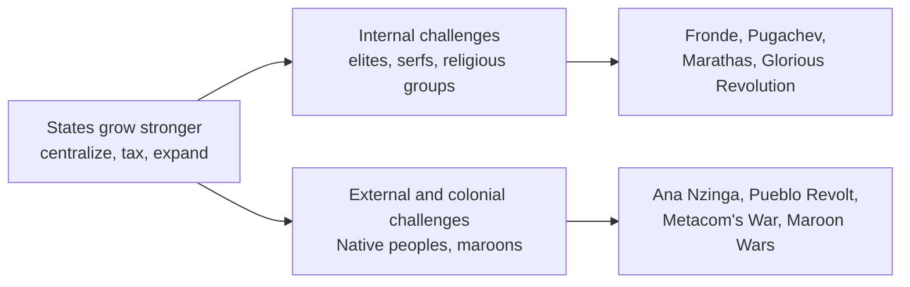

# AP World History: Modern — Topic 4.6 Summary: Internal and External Challenges to State Power (c. 1450–1750)

> Source: Summary of AP_WH_4.6_Notes_EN.md

**Unit 4: Transoceanic Interconnections (c. 1450–1750)**

---

## In One Sentence

As states **centralized** power, raised taxes, and built empires, they faced **internal** revolts from elites, peasants, and religious groups, and **external** resistance from Native peoples and enslaved Africans in the colonies.

## The Big Picture

From 1450 to 1750, rulers made their governments stronger and more **centralized** (power gathered in the central government). They raised taxes, controlled peasants, and pushed into new lands across the oceans. This caused **resistance**. Some challenges were **internal**, from elites, serfs, and religious groups inside the state. Others were **external** or colonial, from Native peoples and escaped enslaved Africans who fought European empires.

## Key Points

### 1. Africa: Ana Nzinga Against Portugal (LO-L)

- In the early 1600s, the Portuguese raided south-central Africa (today's Angola) for **slaves** to work on Brazil's sugar plantations.
- **Ana Nzinga** became ruler of **Ndongo** in 1624. She negotiated with Portugal and was baptized as a Christian, hoping to stop the slave raids.
- When Portugal broke the treaty, she moved inland, conquered **Matamba**, and made it a base against Portugal. She allied with the **Dutch**, gave freedom to runaway slaves, and kept Matamba independent for decades.

### 2. Russia: Serfs and Cossacks (LO-L)

- To keep the loyalty of the nobles (**boyars**), the tsars took rights away from peasants. The **Law of 1649** bound serfs to the land for good.
- **Cossacks** were runaway serfs and free horsemen of the southern steppes. The tsars hired them as soldiers, but they fought hard against **central control**.
- In 1774, the Cossack **Yemelyan Pugachev** led a huge revolt of serfs, Cossacks, and minorities against **Catherine the Great**. The army crushed it, and Catherine then gave nobles **even more control** over serfs.

### 3. Mughal India: The Marathas (LO-L)

- The Mughal Empire had a **Muslim** ruling elite, but most of its people were **Hindu**.
- Emperor **Aurangzeb** (r. 1658–1707) ended Akbar's religious tolerance. He brought back the **jizya** (a tax on non-Muslims) and destroyed Hindu temples.
- Hindu **Maratha** warriors, first led by **Shivaji**, fought the Mughals with guerrilla war (1680–1707). They built their own **Maratha Empire** and broke Mughal power in central India.

### 4. Resistance in the Americas (LO-L)

- In Spanish New Mexico, friars suppressed Native religion and officials forced Native people to work. In 1680, the religious leader **Popé** led the **Pueblo Revolt** and drove the Spanish south to El Paso.
- The Pueblo stayed free for **12 years**, until the Spanish came back in 1692. After that, the Spanish allowed more Native practices and asked for less labor.
- In **Metacom's War** (King Philip's War, 1675–1678), New England tribes led by Metacom fought English settlers who took their land. Metacom was killed, and the tribes of southern New England were almost fully defeated.
- **Maroons** were Africans who escaped slavery and built armed, independent towns in the mountains of the Caribbean. In Jamaica, **Queen Nanny** led them in the **Maroon Wars** (1728–1740), and Britain signed treaties that let them **rule themselves**.
- In Virginia in 1663, enslaved Africans and white indentured servants planned a revolt together to win their freedom (the **Gloucester County Rebellion**). It was betrayed and crushed before it began.

### 5. Challenges to Kings in Western Europe (LO-L)

- In France, the **Fronde** (1648–1653) was a set of revolts that tried to limit **absolutism** (a king ruling with no limits).
- In England, Parliament removed the Catholic King **James II** in the **Glorious Revolution** (1688–1689). His Protestant daughter **Mary II** and her Dutch husband **William of Orange** took the throne.
- The **English Bill of Rights** (1689) made England a **constitutional monarchy**, where Parliament stands above the king.

## Must-Know Terms & People

| Term | What it is | Why it matters |
|---|---|---|
| Ana Nzinga | Ruler of Ndongo and Matamba | Led decades of resistance to Portuguese slave raids |
| Cossacks | Free horsemen of the southern Russian steppes | Served the tsars but resisted central control |
| Pugachev Rebellion | 1774 revolt of serfs and Cossacks against Catherine the Great | Crushed; serfdom became even harsher |
| Marathas | Hindu warriors who fought the Mughals | Built the Maratha Empire and broke Mughal power |
| Pueblo Revolt | 1680 uprising led by Popé in New Mexico | Drove out the Spanish for 12 years |
| Metacom's War | 1675–1678 war of New England tribes against English settlers | Last major Native effort to stop land loss there |
| Maroons | Communities of Africans who escaped slavery | Example of organized resistance by enslaved people |
| Glorious Revolution | 1688–1689 removal of James II by Parliament | Led to the Bill of Rights and a constitutional monarchy |

## Key Dates

| Year | Event |
|---|---|
| 1624 | Ana Nzinga becomes ruler of Ndongo |
| 1648–1653 | The Fronde in France |
| 1675–1678 | Metacom's War in New England |
| 1680 | Pueblo Revolt drives the Spanish out of New Mexico |
| 1688–1689 | Glorious Revolution; English Bill of Rights (1689) |
| 1728–1740 | Maroon Wars in Jamaica |
| 1774 | Pugachev Rebellion in Russia |

## How the Exam Asks About It

- **Legitimacy & consolidation:** Russian tsars kept power by giving nobles more control over serfs in return for loyalty, and after Pugachev, Catherine did this again. England went the other way: Parliament limited the king with the Bill of Rights.
- **Continuity, innovation, diversity:** Continuity: Russian serfdom grew stronger instead of ending. Innovation: England's constitutional monarchy. Diversity: resistance came from many groups, including Cossacks and serfs, Hindu warriors, Native Americans, and enslaved Africans.
- **Likely comparison:** The Pueblo Revolt vs. Metacom's War. Both were Native revolts against European colonists. But the Pueblo won 12 years of freedom and better terms later, while Metacom was killed and his allies lost almost everything.
- **Common trap:** Students think every revolt failed. The fix: the Marathas built their own empire, the Pueblo stayed free for 12 years, and the Jamaican maroons won treaties that let them **rule themselves**.

## Check Yourself

1. How did Ana Nzinga resist the Portuguese?

▶ Answer
She first negotiated and was baptized to stop slave raids. When Portugal broke the treaty, she conquered Matamba, allied with the Dutch, and freed runaway slaves, keeping Matamba independent for decades.

2. Why did the Marathas fight the Mughal Empire?

▶ Answer
Aurangzeb ended Akbar's tolerance, brought back the jizya tax, and destroyed Hindu temples. The Hindu Marathas answered with guerrilla war and built their own empire.

3. Who were the maroons, and how did they challenge authority?

▶ Answer
They were Africans who escaped slavery and built armed, independent towns. In Jamaica, Queen Nanny led them against the British, who had to sign treaties recognizing their self-rule.

