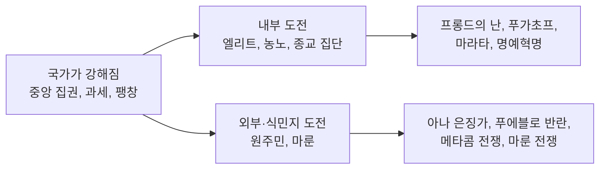

# AP 세계사: 모던 — 토픽 4.6 요약: 국가 권력에 대한 내부와 외부의 도전 (Internal and External Challenges to State Power)

> 출처: AP_WH_4.6_Notes_KR.md 요약

**Unit 4: 대양 간 상호 연결 (Transoceanic Interconnections, c. 1450–1750)**

---

## 한 문장 요약

국가들이 권력을 **중앙 집권화** (Centralization)하고, 세금을 늘리고, 제국을 세우자 엘리트, 농민, 종교 집단의 **내부** 반란과 식민지의 원주민과 노예가 된 아프리카인의 **외부** 저항이 일어났다.

## 큰 그림

1450년부터 1750년까지 통치자들은 정부를 더 강하고 더 **중앙 집권적**으로, 곧 권력이 중앙 정부에 모이도록 만들었다. 그들은 세금을 늘리고, 농민을 통제하고, 대양 너머의 새 땅으로 밀고 나갔다. 이것이 **저항**을 불렀다. 어떤 도전은 국가 안의 엘리트, 농노, 종교 집단에서 나온 **내부** 도전이었다. 다른 도전은 유럽 제국과 싸운 원주민과 탈출한 아프리카인 노예에게서 나온 **외부**, 곧 식민지의 도전이었다.

## 핵심 정리

### 1. 아프리카: 포르투갈에 맞선 아나 은징가 (LO-L)

- 1600년대 초 포르투갈은 브라질의 설탕 플랜테이션에 보낼 **노예**를 얻으려고 남중부 아프리카(오늘날의 앙골라)를 습격했다.
- **아나 은징가** (Ana Nzinga)는 1624년 **은동고** (Ndongo)의 통치자가 되었다. 그는 노예 약탈을 멈추게 하려고 포르투갈과 협상하고 기독교 세례를 받았다.
- 포르투갈이 협약을 어기자, 그는 내륙으로 옮겨 가 **마탐바** (Matamba)를 정복하고 반포르투갈 기지로 삼았다. 그는 **네덜란드**와 동맹을 맺고, 도망친 노예에게 자유를 주었으며, 수십 년 동안 마탐바의 독립을 지켰다.

### 2. 러시아: 농노와 카자크 (LO-L)

- 차르는 귀족인 **보야르** (Boyars)의 충성을 얻으려고 농민의 권리를 빼앗았다. **1649년 법전** (Law of 1649)은 농노를 토지에 영원히 묶었다.
- **카자크** (Cossacks)는 남부 초원의 도망 농노 출신 자유 기마 전사였다. 차르는 그들을 병사로 고용했지만, 카자크는 **중앙의 통제**에 거세게 맞섰다.
- 1774년 카자크 **예멜리얀 푸가초프** (Yemelyan Pugachev)가 농노, 카자크, 소수 민족을 이끌고 **예카테리나 대제** (Catherine the Great)에 맞서 큰 반란을 일으켰다. 군대가 이를 진압했고, 예카테리나는 그 뒤 귀족에게 농노를 지배할 권한을 **더 많이** 주었다.

### 3. 무굴 인도: 마라타 (LO-L)

- 무굴 제국 (Mughal Empire)은 **무슬림** 엘리트가 다스렸지만, 백성의 대다수는 **힌두교도**였다.
- **아우랑제브** (Aurangzeb, 재위 1658–1707) 황제는 악바르 (Akbar)의 종교적 관용을 끝냈다. 그는 **지즈야** (Jizya), 곧 비무슬림에게 매기는 세금을 되살리고 힌두 사원을 파괴했다.
- 처음에 **시바지** (Shivaji)가 이끈 힌두 **마라타** (Marathas) 전사들은 게릴라전으로 무굴과 싸웠다(1680–1707). 그들은 자신들의 **마라타 제국** (Maratha Empire)을 세우고 인도 중부에서 무굴의 힘을 무너뜨렸다.

### 4. 아메리카의 저항 (LO-L)

- 스페인령 뉴멕시코에서는 수도사들이 원주민 종교를 탄압하고 관리들이 원주민에게 노동을 강요했다. 1680년 종교 지도자 **포페** (Popé)가 **푸에블로 반란** (Pueblo Revolt)을 이끌어 스페인인을 남쪽의 엘파소 (El Paso)로 몰아냈다.
- 푸에블로는 1692년 스페인이 돌아올 때까지 **12년** 동안 자유를 지켰다. 그 뒤 스페인은 원주민의 관습을 더 허용하고 노동 요구를 줄였다.
- **메타콤 전쟁** (Metacom's War, 필립 왕 전쟁 King Philip's War, 1675–1678)에서 메타콤 (Metacom)이 이끈 뉴잉글랜드 부족들은 땅을 빼앗는 영국 정착민과 싸웠다. 메타콤은 죽었고, 남부 뉴잉글랜드의 부족들은 거의 완전히 굴복했다.
- **마룬** (Maroons)은 노예 상태에서 탈출해 카리브해의 산악 지대에 무장한 독립 마을을 세운 아프리카인이었다. 자메이카에서는 **내니 여왕** (Queen Nanny)이 **마룬 전쟁** (Maroon Wars, 1728–1740)에서 그들을 이끌었고, 영국은 그들이 **스스로 다스리도록** 인정하는 조약에 서명했다.
- 1663년 버지니아에서 노예가 된 아프리카인과 백인 계약 하인 (Indentured servants)이 함께 자유를 얻으려는 반란을 계획했다(**글로스터 카운티 반란** Gloucester County Rebellion). 이 계획은 배신으로 드러나 시작도 전에 진압되었다.

### 5. 서유럽에서 왕에게 맞선 도전 (LO-L)

- 프랑스의 **프롱드의 난** (Fronde, 1648–1653)은 **절대주의** (Absolutism), 곧 아무 제한 없이 다스리는 왕권을 억누르려 한 일련의 반란이었다.
- 영국에서는 **명예혁명** (Glorious Revolution, 1688–1689)으로 의회가 가톨릭 왕 **제임스 2세** (James II)를 몰아냈다. 그의 개신교도 딸 **메리 2세** (Mary II)와 그의 네덜란드인 남편 **빌럼** (William of Orange)이 왕위에 올랐다.
- **권리장전** (English Bill of Rights, 1689)은 영국을 의회가 왕보다 위에 서는 **입헌군주제** (Constitutional monarchy)로 만들었다.

## 꼭 알아야 할 용어·인물

| 용어 | 무엇인가 | 왜 중요한가 |
|---|---|---|
| 아나 은징가 (Ana Nzinga) | 은동고와 마탐바의 통치자 | 포르투갈의 노예 약탈에 맞서 수십 년간 저항을 이끌었다 |
| 카자크 (Cossacks) | 러시아 남부 초원의 자유 기마 전사 | 차르를 위해 싸웠지만 중앙의 통제에 맞섰다 |
| 푸가초프 반란 (Pugachev Rebellion) | 1774년 예카테리나 대제에 맞선 농노와 카자크의 반란 | 진압되었고, 농노제는 오히려 더 가혹해졌다 |
| 마라타 (Marathas) | 무굴에 맞서 싸운 힌두 전사들 | 마라타 제국을 세우고 무굴의 힘을 무너뜨렸다 |
| 푸에블로 반란 (Pueblo Revolt) | 1680년 뉴멕시코에서 포페가 이끈 봉기 | 스페인인을 12년 동안 몰아냈다 |
| 메타콤 전쟁 (Metacom's War) | 1675–1678년 뉴잉글랜드 부족과 영국 정착민의 전쟁 | 그 지역에서 땅을 지키려 한 원주민의 마지막 큰 시도 |
| 마룬 (Maroons) | 노예 상태에서 탈출한 아프리카인의 공동체 | 노예가 된 사람들의 조직적 저항의 예 |
| 명예혁명 (Glorious Revolution) | 1688–1689년 의회가 제임스 2세를 몰아낸 사건 | 권리장전과 입헌군주제로 이어졌다 |

## 주요 연도

| 연도 | 사건 |
|---|---|
| 1624 | 아나 은징가 (Ana Nzinga)가 은동고의 통치자가 됨 |
| 1648–1653 | 프랑스의 프롱드의 난 (Fronde) |
| 1675–1678 | 뉴잉글랜드의 메타콤 전쟁 (Metacom's War) |
| 1680 | 푸에블로 반란 (Pueblo Revolt)으로 스페인인이 뉴멕시코에서 쫓겨남 |
| 1688–1689 | 명예혁명 (Glorious Revolution), 권리장전 (English Bill of Rights, 1689) |
| 1728–1740 | 자메이카의 마룬 전쟁 (Maroon Wars) |
| 1774 | 러시아의 푸가초프 반란 (Pugachev Rebellion) |

## 시험에서는 이렇게 묻는다

- **정당화와 공고화:** 러시아의 차르는 충성의 대가로 귀족에게 농노를 지배할 권한을 더 주어 권력을 지켰고, 푸가초프 반란 뒤 예카테리나도 다시 그렇게 했다. 영국은 반대의 길을 갔다. 의회가 권리장전으로 왕을 제한했다.
- **연속성·혁신·다양성:** 연속성은 러시아 농노제가 끝나지 않고 오히려 강해진 것이다. 혁신은 영국의 입헌군주제이다. 다양성은 저항이 카자크와 농노, 힌두 전사, 아메리카 원주민, 노예가 된 아프리카인 등 여러 집단에서 나온 것이다.
- **자주 나오는 비교:** 푸에블로 반란과 메타콤 전쟁. 둘 다 유럽 식민자에 맞선 원주민의 반란이었다. 그러나 푸에블로는 12년의 자유와 그 뒤의 더 나은 조건을 얻었고, 메타콤은 죽고 그의 동맹들은 거의 모든 것을 잃었다.
- **자주 하는 실수:** 모든 반란이 실패했다고 쓰는 것이다. 바로잡기: 마라타는 자신들의 제국을 세웠고, 푸에블로는 12년 동안 자유를 지켰으며, 자메이카의 마룬은 **스스로 다스리도록** 인정하는 조약을 얻어 냈다.

## 스스로 확인하기

1. 아나 은징가는 포르투갈에 어떻게 저항했는가?

▶ 정답
처음에는 노예 약탈을 멈추려고 협상하고 세례를 받았다. 포르투갈이 협약을 어기자 마탐바를 정복하고, 네덜란드와 동맹을 맺고, 도망친 노예를 자유롭게 하여 수십 년 동안 마탐바의 독립을 지켰다.

2. 마라타는 왜 무굴 제국과 싸웠는가?

▶ 정답
아우랑제브가 악바르의 관용을 끝내고, 지즈야를 되살리고, 힌두 사원을 파괴했다. 힌두교도인 마라타는 게릴라전으로 맞섰고 자신들의 제국을 세웠다.

3. 마룬은 누구였으며, 권력에 어떻게 도전했는가?

▶ 정답
노예 상태에서 탈출해 무장한 독립 마을을 세운 아프리카인이었다. 자메이카에서는 내니 여왕이 그들을 이끌고 영국과 싸웠고, 영국은 그들의 자치를 인정하는 조약에 서명해야 했다.

