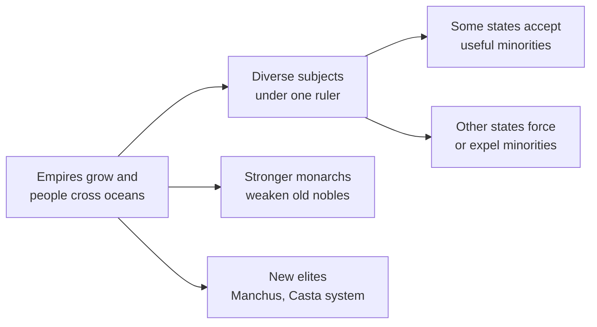

# AP World History: Modern — Topic 4.7 Summary: Changing Social Hierarchies (c. 1450–1750)

> Source: Summary of AP_WH_4.7_Notes_EN.md

**Unit 4: Transoceanic Interconnections (c. 1450–1750)**

---

## In One Sentence

From 1450 to 1750, some states **used** their minorities' skills (the Ottomans, the Mughals), others **pushed minorities down or out** (Spain, Qing China), strong monarchs **weakened the old nobles**, and new **elites** appeared, such as the Manchus in China and the race-based **Casta system** in the Americas.

## The Big Picture

Between 1450 and 1750, gunpowder empires and sea empires grew, and people moved across oceans. This changed who was at the top and bottom of society. Some rulers **accepted** religious and ethnic minorities because those groups were useful. Other rulers **forced** minorities to obey or drove them out. At the same time, monarchs grew stronger and old **nobles** lost some of their power. In the Americas, Europeans, Africans, and Native Americans mixed, and a new ladder of rank based on **ancestry** appeared: the Casta system.

## Key Points

### 1. Ottoman and Mughal Empires: Using Diversity

- The Ottomans welcomed **Sephardic Jews** (Jews from Spain) to Istanbul. As **dhimmi** (protected non-Muslims), minorities kept their faith but paid the **jizya** tax, lived in set quarters, and could not hold top offices.
- **Women's status varied by class.** In "**harem politics**," elite wives and mothers held real power. **Roxelana**, an enslaved captive, married Suleiman the Magnificent and put her son on the throne.
- In Mughal India, a Muslim minority ruled a Hindu majority. **Akbar** (1556–1605) **abolished the jizya**, funded Hindu temples, and held interfaith debates to unite the empire.

### 2. Qing China: A New Manchu Elite

- The **Manchus**, a minority from Manchuria, conquered China and founded the **Qing Dynasty** (1644–1912). They became a **new ruling elite**.
- Continuity: they kept the **civil service exams** and hired Han Chinese officials. But Manchus kept the top power.
- Han men had to wear the Manchu **queue** (shaved forehead, long braid) to show loyalty. Refusing meant **death**, and resistance was crushed with massacres.

### 3. Old Elites vs. Strong Rulers: Europe, Russia, Ottomans

- Europe expelled Jews (England 1290, France 1394, **Spain 1492**). Many Jews later became vital to **Dutch and English** trade and banking.
- **Existing elites** (old ruling groups) lost power: cannons broke nobles' castles, and **Louis XIV** made French nobles live at **Versailles** under watch. In England and the Netherlands, landowners kept power through **Parliament**. Ottoman sultans kept their cavalry elite loyal with **timars**.
- In Russia, **Ivan IV** crushed the **boyars** (old nobles). Yet the **Law of 1649** tied **serfs** to the land to keep the boyars loyal.

### 4. The Americas: The Casta System

- The **Casta system** ranked people by **ancestry** and skin color, and it set their legal rights.
- Top: **peninsulares** (born in Spain or Portugal) held the highest offices. Next: **criollos** (European parents, born in the Americas), rich but kept out of the top posts.
- Middle: mixed groups such as **mestizos** (European + Indigenous) and **mulattoes** (European + African). Bottom: **Indigenous peoples and enslaved Africans**, forced to work.

## Must-Know Terms & People

| Term | What it is | Why it matters |
|---|---|---|
| Dhimmi | Protected non-Muslim status in the Ottoman Empire | Minorities kept their faith but paid jizya and had limits |
| Harem politics | Power held by sultans' wives and mothers in the palace | Shows elite Ottoman women could shape politics |
| Akbar | Mughal emperor (1556–1605) | Abolished the jizya to unite Hindus and Muslims |
| Queue | Manchu braid forced on Han men | A sign of loyalty to the new Manchu elite |
| Timar | Ottoman grant of land revenue to cavalrymen | Kept the military elite loyal to the sultan |
| Boyars | Russia's old landowning nobles | An old elite crushed by Ivan IV but kept loyal by serfdom |
| Casta system | Ranking by ancestry in colonial Latin America | A new race-based social order |
| Peninsulares / Criollos | Iberian-born vs. American-born Europeans | Criollos were rich but shut out of top offices |

## Key Dates

| Year | Event |
|---|---|
| 1492 | Spain expels its Jews; Sephardic Jews scatter, many to the Ottoman Empire |
| 1556–1605 | Reign of Akbar in Mughal India |
| 1574 | Elizabeth I frees the last English serfs; serfdom fades in Western Europe |
| 1644 | Manchus found the Qing Dynasty |
| 1649 | Russia's Law of 1649 ties serfs to the land |

## How the Exam Asks About It

- **Legitimacy & consolidation:** Rulers kept power by using minorities' skills (Ottomans), tolerance (Akbar), forced loyalty signs (the queue), or control of nobles (Versailles, Ivan IV).
- **Continuity, innovation, diversity:** Continuity: the Qing kept the civil service exams. Innovation: the race-based Casta system. Diversity: accepting Jews (Ottomans) vs. expelling them (Spain).
- **Likely comparison:** Ottoman vs. Qing. Similarity: both ruled many peoples and used them in government. Difference: the Ottomans let minorities keep their ways for a tax; the Qing forced Han men to adopt the queue.
- **Common trap:** Students think every elite lost power to kings. Fix: power **fluctuated**. French nobles lost power, but English landowners kept it in Parliament, and Russian boyars gained serfs.

## Check Yourself

1. Why did the Ottomans welcome Sephardic Jews?

▶ Answer
The Jews brought useful skills in medicine, finance, and diplomacy. As dhimmi they kept their faith but paid the jizya and could not hold top offices.

2. How did the Qing show that the Manchus were the new elite?

▶ Answer
They kept Manchus in top power and forced Han men to wear the queue, with death for refusing. They still kept the civil service exams and hired Han officials.

3. Who was at the top of the Casta system, and who was just below?

▶ Answer
Peninsulares, born in Spain or Portugal, held the top offices. Criollos, of European descent but born in the Americas, were rich landowners but were kept out of the highest posts.

