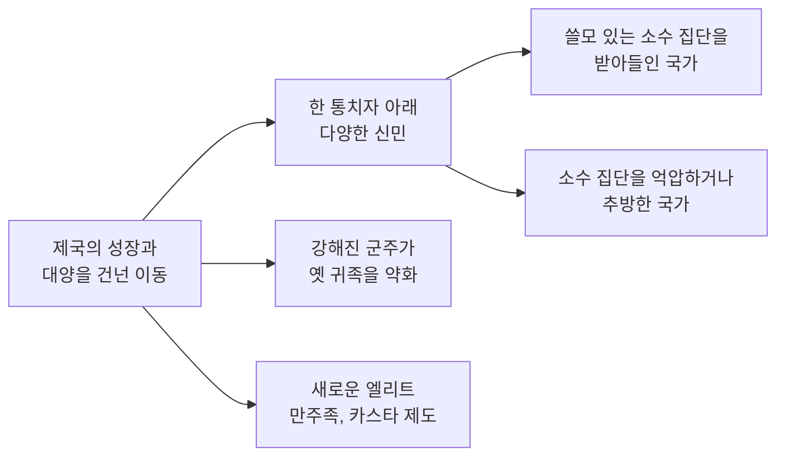

# AP 세계사: 모던 — 토픽 4.7 요약: 사회적 위계질서의 변화 (Changing Social Hierarchies)

> 출처: AP_WH_4.7_Notes_KR.md 요약

**Unit 4: 대양 간 상호 연결 (Transoceanic Interconnections, c. 1450–1750)**

---

## 한 문장 요약

1450–1750년에 어떤 국가는 소수 집단의 능력을 **활용**했고(오스만, 무굴), 어떤 국가는 소수 집단을 **억누르거나 내쫓았으며**(스페인, 청나라), 강력한 군주는 **옛 귀족을 약화**시켰고, 중국의 만주족과 아메리카의 인종 기반 **카스타 제도** (Casta system)처럼 새로운 **엘리트**가 나타났다.

## 큰 그림

1450년부터 1750년 사이 화약 제국과 해양 제국이 커졌고, 사람들이 대양을 건너 이동했다. 이 때문에 사회의 맨 위와 맨 아래에 누가 있는지가 바뀌었다. 어떤 통치자는 종교적·민족적 소수 집단이 쓸모 있었기 때문에 이들을 **받아들였다**. 다른 통치자는 소수 집단에게 복종을 **강요**하거나 그들을 쫓아냈다. 같은 시기에 군주는 더 강해졌고 옛 **귀족**은 권력의 일부를 잃었다. 아메리카에서는 유럽인, 아프리카인, 원주민이 섞이면서 **혈통**에 따른 새로운 신분 사다리, 곧 카스타 제도가 나타났다.

## 핵심 정리

### 1. 오스만 제국과 무굴 제국: 다양성의 활용

- 오스만 제국은 **세파르디 유대인 (Sephardic Jews)**(스페인 출신 유대인)을 이스탄불로 받아들였다. 소수 종교인은 **딤미 (Dhimmi)**(보호받는 비무슬림)로서 신앙을 지켰지만, **지즈야** (Jizya)세를 냈고 정해진 구역에 살았으며 최고위 관직에는 오를 수 없었다.
- **여성의 지위는 계층에 따라 달랐다.** "**하렘 정치 (Harem Politics)**"에서 상류층 부인과 모후는 실제 권력을 쥐었다. 노예 출신 **록셀라나** (Roxelana)는 쉴레이만 1세 (Suleiman the Magnificent)와 결혼하고 아들을 술탄 자리에 올렸다.
- 무굴 인도에서는 무슬림 소수가 힌두교 다수를 다스렸다. **악바르 대제** (Akbar the Great, 1556–1605)는 제국을 하나로 묶기 위해 **지즈야세를 폐지**하고, 힌두 사원을 재정 지원하고, 종교 간 토론을 열었다.

### 2. 청나라: 새로운 만주족 엘리트

- 만주에서 온 소수 민족 **만주족** (Manchus)이 중국을 정복하고 **청 왕조** (Qing Dynasty, 1644–1912)를 세웠다. 이들은 **새로운 지배 엘리트**가 되었다.
- 연속성: 청은 **과거제** (Civil service examinations)를 유지하고 한족 관리를 등용했다. 그러나 최고 권력은 만주족이 쥐었다.
- 한족 남성은 충성을 보이기 위해 만주족의 **변발 (Queue)**(이마를 깎고 머리를 길게 땋음)을 해야 했다. 거부하면 **사형**이었고, 저항은 학살로 진압되었다.

### 3. 옛 엘리트와 강한 통치자: 유럽, 러시아, 오스만

- 유럽은 유대인을 추방했다(잉글랜드 1290년, 프랑스 1394년, **스페인 1492년**). 이후 많은 유대인이 **네덜란드와 영국**의 상업과 금융에서 중요한 역할을 맡았다.
- **기존 엘리트 (Existing elites)**(오래된 지배 집단)는 권력을 잃었다. 화포가 귀족의 성채를 무너뜨렸고, **루이 14세** (Louis XIV)는 프랑스 귀족을 **베르사유** (Versailles)에 살게 하며 감시했다. 영국과 네덜란드에서는 지주들이 **의회** (Parliament)를 통해 권력을 지켰다. 오스만 술탄은 **티마르** (Timar)로 기병 엘리트의 충성을 유지했다.
- 러시아에서는 **이반 4세** (Ivan IV)가 **보야르 (Boyars)**(옛 귀족)를 짓눌렀다. 그러나 **1649년 법전** (Law of 1649)은 보야르의 충성을 얻으려고 **농노** (Serfs)를 토지에 묶었다.

### 4. 아메리카: 카스타 제도

- **카스타 제도**는 사람들을 **혈통**과 피부색에 따라 줄 세웠고, 그에 따라 법적 권리가 정해졌다.
- 맨 위: **페닌술라르 (Peninsulares)**(스페인·포르투갈 출생)가 최고위 관직을 차지했다. 그다음: **크리오요 (Criollos)**(유럽계, 아메리카 출생)는 부유했지만 최고위직에서는 배제되었다.
- 중간: **메스티소 (Mestizos)**(유럽인 + 원주민)와 **물라토 (Mulattoes)**(유럽인 + 아프리카인) 같은 혼혈 집단. 맨 아래: 강제 노동을 한 **원주민과 아프리카 노예**.

## 꼭 알아야 할 용어·인물

| 용어 | 무엇인가 | 왜 중요한가 |
|---|---|---|
| 딤미 (Dhimmi) | 오스만 제국에서 보호받는 비무슬림의 지위 | 신앙은 지켰지만 지즈야를 내고 제약을 받았다 |
| 하렘 정치 (Harem Politics) | 술탄의 부인과 모후가 궁정에서 쥔 권력 | 상류층 오스만 여성이 정치를 움직일 수 있었음을 보여 준다 |
| 악바르 (Akbar) | 무굴 황제 (1556–1605) | 지즈야를 폐지해 힌두교도와 무슬림을 하나로 묶었다 |
| 변발 (Queue) | 한족 남성에게 강요된 만주족의 땋은 머리 | 새로운 만주족 엘리트에 대한 충성의 표시였다 |
| 티마르 (Timar) | 기병에게 준 오스만의 토지 조세 징수권 | 군사 엘리트가 술탄에게 충성하게 했다 |
| 보야르 (Boyars) | 러시아의 전통 대토지 귀족 | 이반 4세에게 짓눌렸지만 농노제로 충성을 유지한 옛 엘리트 |
| 카스타 제도 (Casta system) | 식민지 라틴아메리카의 혈통에 따른 서열 | 인종에 기반한 새로운 사회 질서 |
| 페닌술라르 / 크리오요 (Peninsulares / Criollos) | 이베리아 출생 백인과 아메리카 출생 백인 | 크리오요는 부유했지만 최고위 관직에서 배제되었다 |

## 주요 연도

| 연도 | 사건 |
|---|---|
| 1492 | 스페인이 유대인을 추방했다. 세파르디 유대인이 흩어졌고 많은 수가 오스만 제국으로 갔다 |
| 1556–1605 | 무굴 인도의 악바르 (Akbar) 재위 |
| 1574 | 엘리자베스 1세 (Elizabeth I)가 잉글랜드의 마지막 농노를 해방했다. 서유럽에서 농노제가 사라져 갔다 |
| 1644 | 만주족이 청 왕조를 세웠다 |
| 1649 | 러시아의 1649년 법전이 농노를 토지에 묶었다 |

## 시험에서는 이렇게 묻는다

- **정당화와 공고화:** 통치자는 소수 집단의 능력 활용(오스만), 관용(악바르), 충성 표시의 강요(변발), 귀족 통제(베르사유, 이반 4세)로 권력을 지켰다.
- **연속성·혁신·다양성:** 연속성: 청은 과거제를 유지했다. 혁신: 인종 기반의 카스타 제도. 다양성: 유대인을 받아들인 오스만과 내쫓은 스페인.
- **자주 나오는 비교:** 오스만 대 청. 공통점: 둘 다 여러 민족을 다스리며 그들을 통치에 활용했다. 차이점: 오스만은 세금을 받는 대신 소수 집단이 자기 방식을 지키게 했고, 청은 한족 남성에게 변발을 강요했다.
- **자주 하는 실수:** 모든 엘리트가 왕에게 권력을 잃었다고 생각한다. 바로잡기: 권력은 **부침을 겪었다**. 프랑스 귀족은 권력을 잃었지만, 영국 지주는 의회에서 권력을 지켰고, 러시아 보야르는 농노를 얻었다.

## 스스로 확인하기

1. 오스만 제국은 왜 세파르디 유대인을 받아들였는가?

▶ 정답
유대인은 의학, 금융, 외교에서 쓸모 있는 능력을 가져왔다. 이들은 딤미로서 신앙을 지켰지만 지즈야를 냈고 최고위 관직에는 오를 수 없었다.

2. 청은 만주족이 새로운 엘리트라는 것을 어떻게 보여 주었는가?

▶ 정답
최고 권력을 만주족이 쥐었고, 한족 남성에게 변발을 강요하며 거부하면 사형에 처했다. 그러면서도 과거제를 유지하고 한족 관리를 등용했다.

3. 카스타 제도의 맨 위에는 누가 있었고, 바로 아래에는 누가 있었는가?

▶ 정답
스페인·포르투갈에서 태어난 페닌술라르가 최고위 관직을 차지했다. 유럽계이지만 아메리카에서 태어난 크리오요는 부유한 지주였지만 최고위직에서는 배제되었다.

