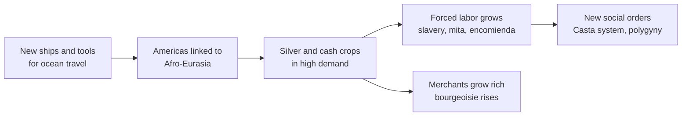

# AP World History: Modern — Topic 4.8 Summary: Continuity and Change (c. 1450–1750)

> Source: Summary of AP_WH_4.8_Notes_EN.md

**Unit 4: Transoceanic Interconnections (c. 1450–1750)**

---

## In One Sentence

From 1450 to 1750, ocean trade **linked the Americas to Afro-Eurasia**, and the demand for **silver and cash crops** greatly **expanded forced labor** and created **new social orders**, such as the Casta system and a rising European middle class, while Asian trade, peasant farming, and old elites **continued**.

## The Big Picture

The years 1450 to 1750 were the start of a **connected world economy**. The biggest change was that the Americas joined the trade networks of Africa, Asia, and Europe, through the **Columbian Exchange** and the **Atlantic System**. Silver from the Americas paid for trade around the world. Demand for **cash crops** (crops grown to sell, such as sugar and tobacco) and silver made **forced labor** bigger and harsher. Yet many things stayed the same: trade inside Asia, peasant farming, and the power of landowning nobles in Eurasia.

## Key Points

### 1. Trade: What Changed and What Stayed

- Ships crossed oceans with tools **borrowed from many cultures**: the **astrolabe**, the **magnetic compass**, and the **lateen sail**. New ships had special jobs, such as Portuguese **caravels** and Dutch **fluyts**.
- Change: Europeans became the main **ocean carriers** and built the **Atlantic System**, a three-way trade of European goods and guns, African forced labor, and American raw goods.
- Continuity: **trade inside Asia kept thriving**. Indian cotton and Chinese silk and porcelain stayed in demand. Europeans often worked as **middlemen** and had to follow the customs laws of strong Asian land empires.

### 2. Silver and the Rise of Capitalism

- Silver from **Potosí** and Zacatecas went across the Atlantic to Europe and across the Pacific on the **Manila Galleons** to China. It became the world's main money for trade. But too much silver caused **inflation** (rising prices), called the **Price Revolution**, in Spain and China.
- **Mercantilism** (kings controlling trade to pile up gold and silver) slowly gave way to **commercial capitalism**, where private investors drove trade.
- **Joint-stock companies** such as the **VOC** and **EIC** raised money from many investors with **limited liability** (investors could lose only what they put in).

### 3. Labor: Old Systems Stay, New Systems Grow

- Continuity: **serfdom** grew stronger in Russia with the **Law of 1649**, and peasant farming continued across Afro-Eurasia.
- Change: forced labor grew much **bigger and harsher** to serve world markets.
- The Americas used **chattel slavery** (people owned as property, passed to their children), **indentured servitude**, the Spanish **encomienda**, debt labor on **haciendas**, and the **mita** in silver mines.

### 4. Society: New Social Orders

- In the Americas, status depended on race and skin color in the **Casta system** (peninsulares at the top, then criollos, mestizos, mulattoes, and Indigenous peoples and enslaved Africans).
- In Europe, trade wealth built up a **bourgeoisie** (a middle class of merchants and investors) that paid for art, such as the work of Rembrandt.
- In West Africa, slave raids took many men, so **polygyny** (one man with several wives) spread and women's work changed.

## Must-Know Terms & People

| Term | What it is | Why it matters |
|---|---|---|
| Atlantic System | Trade network linking Europe, Africa, and the Americas | The biggest change in world trade in this period |
| Price Revolution | Inflation caused by the flood of American silver | Shows how silver changed economies in Spain and China |
| Commercial capitalism | An economy driven by private investment and trade | Slowly replaced king-run mercantilism |
| Joint-stock company | A company owned by many investors, such as the VOC or EIC | Raised huge sums for world trade |
| Chattel slavery | Slavery where people are property for life, passed to their children | Spread on a mass scale across the Atlantic |
| Mita | Forced labor in silver mines, adapted from the Inca | Linked the silver trade to forced labor |
| Bourgeoisie | Europe's rising middle class of merchants and investors | A new social group made rich by trade |
| Syncretism | The mixing of different religions or cultures | African beliefs and Catholicism mixed into Santería (Cuba), Vodou (Haiti), and Candomblé (Brazil) |

## Key Dates

| Year | Event |
|---|---|
| 1450–1500 | Portuguese and Spanish exploration links the hemispheres |
| 1500–1570 | American empires fall; encomienda and mita begin |
| 1570–1650 | Potosí silver peaks; Price Revolution; VOC and EIC founded |
| 1649 | Russia's Law of 1649 makes serfdom stronger |
| 1700–1750 | Britain rises as the leading commercial power |

## How the Exam Asks About It

- **Legitimacy & consolidation:** Kings used **mercantilism** and **chartered monopolies** (trade rights granted to companies) to pile up wealth. Landed nobles and monarchs stayed dominant in Eurasia.
- **Continuity, innovation, diversity:** Continuity: peasant farming and Russian serfdom. Innovation: joint-stock companies. Diversity: Santería, Vodou, and Candomblé show many ways African and Catholic beliefs mixed.
- **Likely comparison:** Russian serfdom vs. American chattel slavery. Similarity: both were forced labor. Difference: serfs were an old system tied to the land; chattel slaves were property for life, used on a much larger scale for world markets.
- **Common trap:** Students think Europeans took over all Asian trade. Fix: **trade inside Asia continued**, and Europeans often worked as middlemen under the laws of Asian land empires.

## Check Yourself

1. What was the biggest change in world trade from 1450 to 1750?

▶ Answer
The Americas were linked to Afro-Eurasia through the Columbian Exchange and the Atlantic System. Silver from the Americas became the world's main money for trade.

2. How did economic demand change labor in the Americas?

▶ Answer
Demand for sugar, tobacco, and silver made forced labor bigger and harsher. Chattel slavery, encomienda, haciendas, and the mita all spread.

3. Name one new social group in Europe and one social change in West Africa.

▶ Answer
In Europe, a bourgeoisie of merchants and investors grew rich from trade. In West Africa, slave raids took many men, so polygyny spread.

