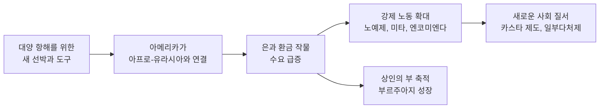

# AP 세계사: 모던 — 토픽 4.8 요약: 지속성과 변화 (Continuity and Change)

> 출처: AP_WH_4.8_Notes_KR.md 요약

**Unit 4: 대양 간 상호 연결 (Transoceanic Interconnections, c. 1450–1750)**

---

## 한 문장 요약

1450–1750년에 대양 무역은 **아메리카를 아프로-유라시아와 연결**했고, **은과 환금 작물**에 대한 수요는 **강제 노동을 크게 늘리고** 카스타 제도 (Casta system)와 성장하는 유럽 중간 계급 같은 **새로운 사회 질서**를 만들었으며, 그동안 아시아 무역, 농민 농업, 옛 엘리트는 **지속**되었다.

## 큰 그림

1450년부터 1750년까지는 **연결된 세계 경제**가 시작된 시기이다. 가장 큰 변화는 **콜럼버스 교환** (Columbian Exchange)과 **대서양 체제** (Atlantic System)를 통해 아메리카가 아프리카, 아시아, 유럽의 무역망에 합류한 것이다. 아메리카의 은은 전 세계 무역의 대금으로 쓰였다. **환금 작물 (Cash crops)**(설탕, 담배처럼 팔기 위해 기르는 작물)과 은에 대한 수요는 **강제 노동**을 더 크고 가혹하게 만들었다. 그러나 아시아 안의 무역, 농민 농업, 유라시아 토지 귀족의 권력처럼 그대로 남은 것도 많았다.

## 핵심 정리

### 1. 무역: 바뀐 것과 남은 것

- 배들은 **여러 문명에서 빌려 온 도구**로 대양을 건넜다. **아스트롤라베 (Astrolabe)**, **나침반 (Magnetic compass)**, **라틴 세일** (Lateen sail)이 그 예이다. 포르투갈의 **카라벨선** (Caravel)과 네덜란드의 **플루이트선** (Fluyt)처럼 새 배마다 맡은 역할이 있었다.
- 변화: 유럽인이 주요 **해상 운송자**가 되었고, 유럽의 상품과 총, 아프리카의 강제 노동력, 아메리카의 원자재를 잇는 삼각무역인 **대서양 체제**를 세웠다.
- 지속성: **아시아 안의 무역은 계속 번성했다**. 인도산 면직물과 중국산 비단·도자기는 여전히 수요가 많았다. 유럽인은 흔히 **중계 상인** (Middlemen)으로 활동했고 강력한 아시아 육상 제국의 관세 법을 따라야 했다.

### 2. 은과 자본주의의 등장

- **포토시** (Potosí)와 사카테카스 (Zacatecas)의 은은 대서양을 건너 유럽으로, **마닐라 갈레온** (Manila Galleons)을 타고 태평양을 건너 중국으로 갔다. 은은 세계 무역의 주요 화폐가 되었다. 그러나 너무 많은 은은 스페인과 중국에서 **가격 혁명** (Price Revolution)이라 불리는 **인플레이션 (Inflation)**(물가 상승)을 일으켰다.
- **중상주의 (Mercantilism)**(국왕이 무역을 통제해 금은을 쌓는 정책)는 점차 민간 투자자가 무역을 이끄는 **상업 자본주의** (Commercial Capitalism)로 바뀌었다.
- **VOC**와 **EIC** 같은 **합자회사** (Joint-stock companies)는 **유한책임 (Limited liability)**(투자자는 낸 돈만큼만 잃는다)을 바탕으로 많은 투자자에게서 돈을 모았다.

### 3. 노동: 옛 체제는 남고 새 체제는 커지다

- 지속성: 러시아에서는 **1649년 법전** (Law of 1649)으로 **농노제** (Serfdom)가 더 강해졌고, 아프로-유라시아 전역에서 농민 농업이 계속되었다.
- 변화: 강제 노동은 세계 시장에 물건을 대기 위해 훨씬 **더 크고 가혹해졌다**.
- 아메리카에서는 **동산 노예제 (Chattel Slavery)**(사람을 재산으로 소유하고 자녀에게 대물림), **계약 하인제 (Indentured Servitude)**, 스페인의 **엔코미엔다 (Encomienda)**, **하시엔다** (Hacienda)의 빚 노동, 은광의 **미타** (Mita)가 쓰였다.

### 4. 사회: 새로운 사회 질서

- 아메리카에서는 **카스타 제도**에서 인종과 피부색이 지위를 정했다(맨 위의 페닌술라르 (Peninsulares), 그다음 크리오요 (Criollos), 메스티소 (Mestizos), 물라토 (Mulattoes), 그리고 원주민과 아프리카 노예).
- 유럽에서는 무역으로 번 부가 **부르주아지 (Bourgeoisie)**(상인과 투자자로 이루어진 중간 계급)를 키웠고, 이들은 렘브란트 (Rembrandt) 같은 예술가의 작품에 돈을 댔다.
- 서아프리카에서는 노예 사냥이 많은 남성을 데려가서 **일부다처제 (Polygyny)**(한 남성이 여러 아내를 두는 것)가 늘고 여성의 일이 바뀌었다.

## 꼭 알아야 할 용어·인물

| 용어 | 무엇인가 | 왜 중요한가 |
|---|---|---|
| 대서양 체제 (Atlantic System) | 유럽, 아프리카, 아메리카를 잇는 무역망 | 이 시기 세계 무역의 가장 큰 변화이다 |
| 가격 혁명 (Price Revolution) | 아메리카 은이 쏟아져 들어와 생긴 인플레이션 | 은이 스페인과 중국의 경제를 어떻게 바꾸었는지 보여 준다 |
| 상업 자본주의 (Commercial Capitalism) | 민간 투자와 무역이 이끄는 경제 | 국왕 중심의 중상주의를 점차 대신했다 |
| 합자회사 (Joint-stock company) | VOC나 EIC처럼 많은 투자자가 함께 소유한 회사 | 세계 무역을 위해 막대한 자금을 모았다 |
| 동산 노예제 (Chattel Slavery) | 사람을 평생 재산으로 소유하고 자녀에게 대물림하는 노예제 | 대서양 전역에서 대규모로 퍼졌다 |
| 미타 (Mita) | 잉카 제도를 바꾸어 쓴 은광 강제 노동 | 은 무역과 강제 노동을 이어 주었다 |
| 부르주아지 (Bourgeoisie) | 상인과 투자자로 이루어진 유럽의 신흥 중간 계급 | 무역으로 부유해진 새로운 사회 집단이다 |
| 종교적 융합 (Syncretism) | 서로 다른 종교나 문화가 섞이는 것 | 아프리카 신앙과 가톨릭이 섞여 산테리아 (Santería, 쿠바), 부두 (Vodou, 아이티), 칸돔블레 (Candomblé, 브라질)가 생겼다 |

## 주요 연도

| 연도 | 사건 |
|---|---|
| 1450–1500 | 포르투갈과 스페인의 탐험으로 두 반구가 연결되었다 |
| 1500–1570 | 아메리카 제국들이 무너지고 엔코미엔다와 미타가 시작되었다 |
| 1570–1650 | 포토시 은 생산이 절정에 이르렀다. 가격 혁명이 일어났고 VOC와 EIC가 세워졌다 |
| 1649 | 러시아의 1649년 법전이 농노제를 강화했다 |
| 1700–1750 | 영국이 으뜸가는 상업 강국으로 떠올랐다 |

## 시험에서는 이렇게 묻는다

- **정당화와 공고화:** 국왕은 **중상주의**와 **특허 전매권 (Chartered Monopolies)**(회사에 준 무역 독점권)으로 부를 쌓았다. 유라시아에서는 토지 귀족과 군주가 계속 지배적 위치를 지켰다.
- **연속성·혁신·다양성:** 연속성: 농민 농업과 러시아 농노제. 혁신: 합자회사. 다양성: 산테리아, 부두, 칸돔블레는 아프리카 신앙과 가톨릭이 여러 방식으로 섞였음을 보여 준다.
- **자주 나오는 비교:** 러시아 농노제 대 아메리카 동산 노예제. 공통점: 둘 다 강제 노동이었다. 차이점: 농노제는 토지에 묶인 오래된 체제였고, 동산 노예는 평생 재산으로 취급되었으며 세계 시장을 위해 훨씬 큰 규모로 쓰였다.
- **자주 하는 실수:** 유럽인이 아시아 무역 전체를 장악했다고 생각한다. 바로잡기: **아시아 안의 무역은 계속되었고**, 유럽인은 흔히 아시아 육상 제국의 법 아래에서 중계 상인으로 활동했다.

## 스스로 확인하기

1. 1450–1750년 세계 무역에서 가장 큰 변화는 무엇이었는가?

▶ 정답
콜럼버스 교환과 대서양 체제를 통해 아메리카가 아프로-유라시아와 연결되었다. 아메리카의 은은 세계 무역의 주요 화폐가 되었다.

2. 경제적 수요는 아메리카의 노동을 어떻게 바꾸었는가?

▶ 정답
설탕, 담배, 은에 대한 수요가 강제 노동을 더 크고 가혹하게 만들었다. 동산 노예제, 엔코미엔다, 하시엔다, 미타가 모두 퍼졌다.

3. 유럽의 새로운 사회 집단 하나와 서아프리카의 사회 변화 하나를 들어 보라.

▶ 정답
유럽에서는 상인과 투자자로 이루어진 부르주아지가 무역으로 부유해졌다. 서아프리카에서는 노예 사냥이 많은 남성을 데려가서 일부다처제가 늘었다.

