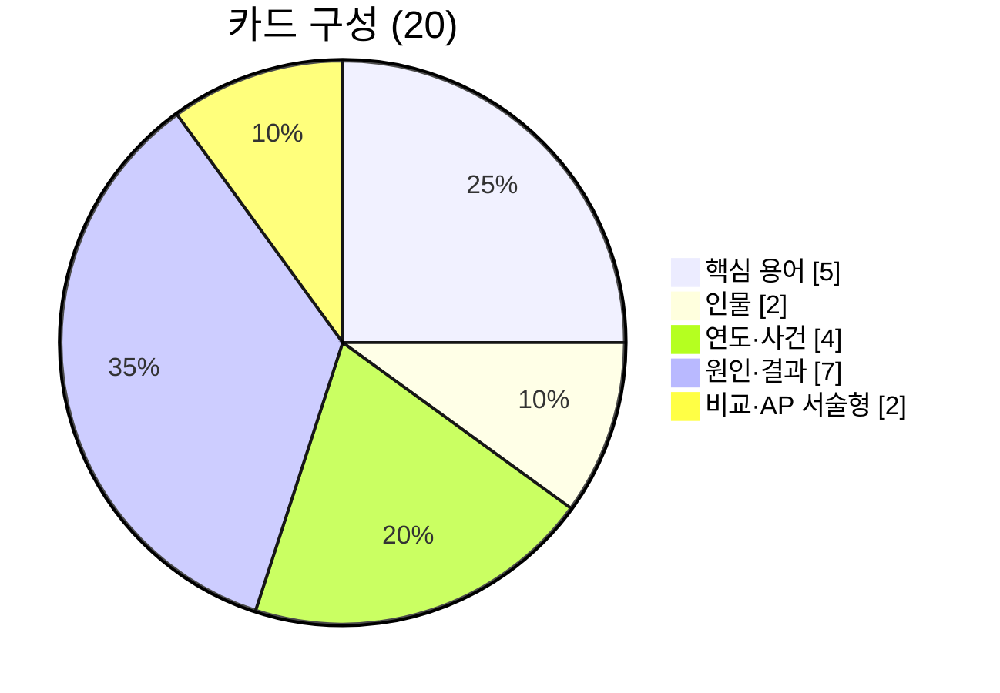

# Topic 5.10: 산업 시대의 연속성과 변화 (Continuity and Change in the Industrial Age) — 플래시카드 (Flashcards)

*Unit 5: 혁명의 시대 (Revolutions, c. 1750–c. 1900) · 20장*  
출처: 교재 『World History Modern: AP® Edition』 5.10 (pp. 351–356). 제공해 주신 텍스트를 제 말로 요약했습니다. (CED 추가) 표시는 그 텍스트에 없는 내용입니다.

## 카드 구성

*정답을 열지 않고 답할 수 있으면 체크하세요.*

## 핵심 용어

- [ ] **1. 연속성 (Continuity)과 변화 (Change)의 차이는?**
  

▶ 정답

  연속성은 한 시기 동안 그대로 유지된 것이고, 변화는 달라진 것이다.

  

- [ ] **2. 원시 산업 체제 (Proto-industrial system)란?**
  

▶ 정답

  여성이 약간의 돈을 벌던 가내 섬유업처럼, 공장 이전의 가정 생산.

  

- [ ] **3. 단체 교섭 (Collective bargaining)과 파업 (Strike)이란?**
  

▶ 정답

  노동조합의 방법. 노동자 전체를 대표해 소유주와 협상하는 것, 그리고 임금·조건·시간에 대한 양보를 얻으려고 일을 멈추는 것.

  

- [ ] **4. 노동당 (Labor parties)은 무엇을 주장했나?**
  

▶ 정답

  최저 임금, 노동 시간 단축, 유급 병가와 휴가, 근무 조건 개선, 건강·실업 보험.

  

- [ ] **5. 대량 생산 (Mass production)이란 무엇이며 소비자에게 어떤 영향을 주었나?**
  

▶ 정답

  기계로 똑같은 상품을 만드는 것. 소비재가 더 구하기 쉽고, 싸고, 다양해졌다.

  

## 인물

- [ ] **6. 비스마르크는 어떤 사회 개혁을 했으며 왜 했나?**
  

▶ 정답

  가장 포괄적인 노동자 보호 제도인 산재 보험·실업 보험·노령 연금. 사회주의자들이 더 강한 조치를 요구하지 못하게 하려고 만들었다.

  

- [ ] **7. 스미스와 마르크스는 자본주의를 어떻게 다르게 보았나?**
  

▶ 정답

  스미스: 사적 이윤 추구가 전반적 번영을 가져온다. 마르크스: 부르주아가 프롤레타리아를 착취하므로 노동자가 생산 수단을 장악해야 한다.

  

## 연도·사건

- [ ] **8. 1848년 파리·베를린·헝가리의 시위대는 무엇을 요구했나?**
  

▶ 정답

  파리: 언론 자유. 베를린: 군주를 견제할 의회. 헝가리: 오스트리아로부터의 자유.

  

- [ ] **9. 1900년대 초 서구 공업국 여성이 마침내 얻은 것은?**
  

▶ 정답

  투표권.

  

- [ ] **10. 1만여 년 전 — 산업 혁명은 어떤 이전의 변화와 비교되나?**
  

▶ 정답

  최초의 농업 혁명.

  

- [ ] **11. 1848년 '자본은 사회적 힘이다'라고 한 문헌은?**
  

▶ 정답

  마르크스와 엥겔스의 『공산당 선언』.

  

## 원인·결과

- [ ] **12. 서유럽은 왜 산업화를 주도했나?**
  

▶ 정답

  풍부한 자원, 대양 무역로, 금융 자본, 늘어나는 인구, 그리고 (이슬람 지식의 영향을 받은) 과학 혁명.

  

- [ ] **13. 원료 생산은 연속성과 변화를 어떻게 함께 보여 주었나?**
  

▶ 정답

  연속성: 같은 지역이 계속 광물·면화·향신료를 공급했다. 변화: 증기선·철도·전신이 새로운 내륙 공급지를 열고 비용을 낮췄다.

  

- [ ] **14. 중산층은 연속성과 변화를 어떻게 함께 보여 주었나?**
  

▶ 정답

  의사·변호사·상인은 중산층에 남았고(연속성), 공장·은행·보험·해운의 관리자가 더해졌다(변화).

  

- [ ] **15. 여성의 임금은 왜 가족에게 필수가 되었나?**
  

▶ 정답

  공장 임금이 너무 낮아 가족 모두가 일해야 했기 때문이다.

  

- [ ] **16. 왜 어떤 나라에서는 민주주의가 생기고 다른 나라에서는 생기지 않았나?**
  

▶ 정답

  중산층이 크고 경제적으로 중요한 나라에서는 민주주의가 생겼고, 작은 나라에서는 독재가 유지되었다.

  

- [ ] **17. 농업 시대와 비교해 노동자의 일상은 어떻게 바뀌었나?**
  

▶ 정답

  농민은 계절에 따라 일정을 정했지만, 공장 노동자의 삶은 비좁고 오염된 도시에서의 길고 임금이 낮은 근무를 중심으로 돌아갔다.

  

- [ ] **18. 투표권은 어떻게 확대되었으며 한계는 무엇이었나?**
  

▶ 정답

  입법(영국)이나 시위와 혁명을 통해 도시 거주자·토지가 없는 사람·노동자에게 확대되었지만, 남성에게만 해당되었다.

  

## 비교·AP 서술형

- [ ] **19. 산업 혁명은 연속성과 변화를 어떻게 함께 보여 주었는가? (Essential Question)**
  

▶ 정답

  **주장 (Claim):** 산업 혁명은 생산·계급·정치를 바꾸었지만, 원료 공급 구조, 성별 불평등, 국가 간 경쟁 같은 옛 양상은 계속되었다.  **근거 (Evidence):** 변화: 공장제와 대량 생산이 장인을 대체했고, 산업가가 귀족을 앞질렀으며, 남성 선거권이 넓어지고 비스마르크가 사회 보험을 만들었다. 연속성: 라틴아메리카·아프리카·아시아는 여전히 원료를 공급했고, 여성은 임금을 덜 받고 투표할 수 없었으며, 계몽주의의 자연권 사상과 국가 간 경쟁이 이어졌다.  **설명 (Reasoning):** 새 기술과 자본은 부를 만드는 방식과 부를 가진 사람을 바꾸었지만, 기존의 세계 무역 역할과 사회 위계는 사라지지 않고 산업화에 맞게 변형되었다.

  

- [ ] **20. 1750–1900년 산업화는 여성의 역할을 어느 정도까지 바꾸었는가?**
  

▶ 정답

  **주장 (Claim):** 산업화는 여성의 경제적 역할을 크게 바꾸었지만, 정치적 불평등과 임금 불평등은 거의 바꾸지 못했다.  **근거 (Evidence):** 보수 없는 농업 노동과 원시 산업의 적은 수입 대신, 남성만큼 가족에게 중요한 공장 임금이 생겼다. 그러나 여성은 여전히 임금을 덜 받고 고임금 직업에서 배제되었으며, 서구에서도 1900년대 초에야 투표권을 얻었다.  **설명 (Reasoning):** 낮은 공장 임금 때문에 여성의 소득이 꼭 필요해졌지만, 정치 권력을 남성에게 두는 법과 관습은 그만큼 빨리 바뀌지 않았다.

  

