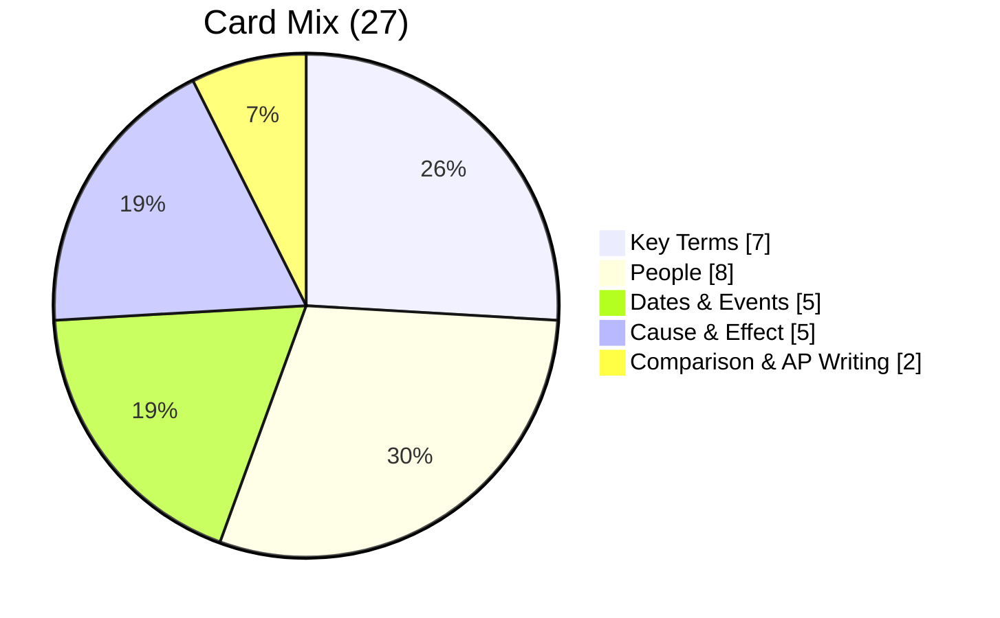

# Topic 5.1: The Enlightenment — Flashcards

*Unit 5: Revolutions (c. 1750–c. 1900) · 27 cards*  
Source: textbook World History Modern: AP® Edition, Topic 5.1 (pp. 275–281), summarized in my own words. Items marked (CED addition) are not in the textbook; they come from the College Board CED or standard references.

## Card Mix

*Check the box when you can answer without opening the card.*

## Key Terms

- [ ] **1. What is empiricism, and who promoted it?**
  

▶ Answer

  The belief that knowledge comes from sensed experience and experiments; Francis Bacon (1600s).

  

- [ ] **2. What does tabula rasa mean, and in which work did Locke present it?**
  

▶ Answer

  "Blank slate": people are shaped by environment and education, not ancestry; An Essay Concerning Human Understanding (1690).

  

- [ ] **3. Who were the philosophes?**
  

▶ Answer

  18th-century thinkers who popularized rational social, political, and economic ideas, such as Jefferson, Franklin, Adam Smith, and French writers.

  

- [ ] **4. What is Deism?**
  

▶ Answer

  Belief that a divinity set natural laws in motion like a watchmaker and does not interfere; laws are understood through science.

  

- [ ] **5. Define conservatism as the textbook does.**
  

▶ Answer

  Belief in traditional institutions, relying on practical experience rather than ideological theories such as human perfectibility.

  

- [ ] **6. What is classical liberalism?**
  

▶ Answer

  Belief in natural rights, constitutional government, laissez-faire, and less spending on armies and established churches.

  

- [ ] **7. What is the difference between utopian socialism and Fabian socialism?**
  

▶ Answer

  Utopian socialists built ideal communities; Fabians sought gradual change through Parliament.

  

## People

- [ ] **8. Contrast Hobbes and Locke on the social contract.**
  

▶ Answer

  Hobbes: give up rights to a strong government for order (Leviathan, 1651). Locke: citizens have the right and duty to revolt against unjust rule (1690).

  

- [ ] **9. How did Voltaire's exile in England shape his ideas?**
  

▶ Answer

  He came to admire constitutional monarchy and civil rights, then campaigned in France for religious liberty and judicial reform.

  

- [ ] **10. What two works did Rousseau publish in 1762?**
  

▶ Answer

  Emile, or On Education (child-rearing) and The Social Contract (the General Will).

  

- [ ] **11. Who was Thomas Paine?**
  

▶ Answer

  Author of Common Sense (1776), which urged American independence, and The Age of Reason (1794), which defended Deism and hurt his popularity.

  

- [ ] **12. Name three utopian socialists and one idea of each.**
  

▶ Answer

  Saint-Simon: scientists and businesses running efficient workplaces (proposed the Suez Canal). Fourier: 810 passions to make work enjoyable. Owen: communities at New Lanark and New Harmony.

  

- [ ] **13. What did Olympe de Gouges and Mary Wollstonecraft argue?**
  

▶ Answer

  De Gouges (1791): women's rights were left out of the Rights of Man. Wollstonecraft (1792): women deserve the same education as men.

  

- [ ] **14. Who organized the Seneca Falls Convention, and what document did they issue?**
  

▶ Answer

  Lucretia Mott and Elizabeth Cady Stanton; the Declaration of Sentiments.

  

- [ ] **15. Who led the Zionist movement?**
  

▶ Answer

  Theodor Herzl, an Austro-Hungarian Jew.

  

## Dates & Events

- [ ] **16. 1748, 1762, 1776 — name the key work of each year.**
  

▶ Answer

  1748: The Spirit of Laws. 1762: The Social Contract and Emile. 1776: The Wealth of Nations and Common Sense.

  

- [ ] **17. 1803, 1807, 1808 — what happened?**
  

▶ Answer

  Denmark, Britain, and the United States banned the slave trade.

  

- [ ] **18. 1861 — why is Russia's emancipation notable?**
  

▶ Answer

  Alexander II freed 23 million serfs, the largest single emancipation in history.

  

- [ ] **19. 1888 — what happened in Brazil?**
  

▶ Answer

  Brazil became the last country in the Americas to abolish slavery.

  

- [ ] **20. 1894 — what was the Dreyfus Affair?**
  

▶ Answer

  A Jewish French officer was convicted of treason on forged evidence; it revealed anti-Semitism in France and boosted Zionism.

  

## Cause & Effect

- [ ] **21. How did the Scientific Revolution lead to the Enlightenment?**
  

▶ Answer

  Success in finding natural laws through reason led thinkers to conclude that natural laws also govern society and politics.

  

- [ ] **22. Why did slavery usually end within about 30 years of the slave trade's end?**
  

▶ Answer

  Slave systems depended on a steady supply of new captives; the U.S. was an exception because its enslaved population kept growing.

  

- [ ] **23. What social problems led to new ideas in the 1800s, and what solutions were proposed?**
  

▶ Answer

  Urban slums, poor sanitation, and lack of representation; solutions ranged from government programs and private charity to socialism, while some conservatives blamed the poor.

  

- [ ] **24. Why did support for Zionism grow, and what obstacles did it face?**
  

▶ Answer

  Anti-Semitism, pogroms, and the Dreyfus Affair; obstacles were Ottoman control and the Palestinian Arabs already living there.

  

- [ ] **25. Why did nationalism threaten Europe's multiethnic empires?**
  

▶ Answer

  It held that people sharing a culture should live in their own independent nation-state, encouraging groups to break away.

  

## Comparison & AP Writing

- [ ] **26. How did the Enlightenment shape thinking that affected reform and revolution after 1750? (Essential Question)**
  

▶ Answer

  **Claim:** The Enlightenment replaced tradition and divine authority with reason and natural rights, giving people grounds to challenge monarchs and to demand broader reforms.  **Evidence:** Locke's right to revolt and Montesquieu's separation of powers shaped the American system; Paine's Common Sense (1776) urged independence; later, de Gouges (1791), Wollstonecraft (1792), and Seneca Falls (1848) applied the same ideas to women, and abolitionists won bans on the slave trade (1803–1808).  **Reasoning:** If government rests on reason and natural rights rather than tradition, then any group denied those rights can demand them, so the Enlightenment fueled both political revolutions and long-term social reform.

  

- [ ] **27. Compare utopian socialism and classical liberalism as responses to industrial society.**
  

▶ Answer

  **Claim:** Both grew from Enlightenment optimism that society could improve, but liberals relied on individual rights and free markets while utopian socialists relied on shared ownership.  **Evidence:** Classical liberals backed laissez-faire and Britain's Reform Bills (1832, 1867, 1884); Owen's New Lanark and New Harmony used communal property and community rules, and Fourier favored harmony over class struggle.  **Reasoning:** Liberals believed freeing individuals would solve problems, while utopian socialists believed cooperation and planning were needed to protect workers.

  

