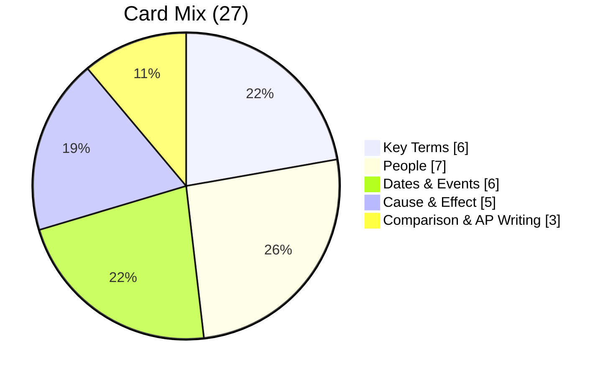

# Topic 5.2: Nationalism and Revolutions — Flashcards

*Unit 5: Revolutions (c. 1750–c. 1900) · 27 cards*  
Source: textbook World History Modern: AP® Edition, Topic 5.2 (pp. 285–296), from the text you provided, summarized in my own words. Items marked (CED addition) are not in that text.

## Card Mix

*Check the box when you can answer without opening the card.*

## Key Terms

- [ ] **1. Who were the physiocrats, and how did they influence the American Revolution?**
  

▶ Answer

  Economists whose free-market ideas gave colonists a defense against English mercantilism.

  

- [ ] **2. Who were the Maroons?**
  

▶ Answer

  People who had already escaped slavery; they joined the Haitian revolt.

  

- [ ] **3. What were caudillos?**
  

▶ Answer

  Strong regional leaders with loyal armies who made or broke governments and ignored representative government and the rule of law.

  

- [ ] **4. Define realpolitik and plebiscite.**
  

▶ Answer

  Realpolitik: practical politics based on power. Plebiscite: a popular referendum, used by Italian regions to join Piedmont.

  

- [ ] **5. What was Ottomanism, and why did it backfire?**
  

▶ Answer

  A movement (1870s–1880s) to unify the empire by minimizing differences, especially through state-controlled schools; it made subject peoples more aware of their differences and more eager for independence.

  

- [ ] **6. List the Latin American social classes from top to bottom.**
  

▶ Answer

  Peninsulares, creoles, mestizos, then enslaved Africans, indigenous people, and mulattoes.

  

## People

- [ ] **7. Why did Edmund Burke and Joseph de Maistre oppose revolution?**
  

▶ Answer

  As conservatives, they saw revolutions as bloody, disruptive, and unlikely to produce good results.

  

- [ ] **8. What did Toussaint L'Ouverture's 1801 constitution do?**
  

▶ Answer

  Granted equality and citizenship to all residents and made him governor for life; land reform then divided plantations among formerly enslaved and free black people.

  

- [ ] **9. What were Simón Bolívar's political goals?**
  

▶ Answer

  Independence from Spain and a U.S.-style federation (Gran Colombia) based on Enlightenment ideals; as a liberal he favored free markets and abolition.

  

- [ ] **10. Why was Manuela Sáenz called "Liberator of the Liberator"?**
  

▶ Answer

  She fought alongside Bolívar, rose to colonel, and once saved his life.

  

- [ ] **11. Who was Lola Rodríguez de Tió?**
  

▶ Answer

  A Puerto Rican poet who criticized Spanish rule and wrote lyrics for "La Borinqueña"; she was repeatedly exiled for her writings.

  

- [ ] **12. What did José Rizal and the Propaganda Movement want?**
  

▶ Answer

  Greater autonomy for the Philippines — not revolution or independence.

  

- [ ] **13. How did Cavour and Bismarck both use realpolitik?**
  

▶ Answer

  Cavour maneuvered Napoleon III into war with Austria; Bismarck manipulated Austria and France into three wars that unified Germany.

  

## Dates & Events

- [ ] **14. July 14, 1789 — what happened?**
  

▶ Answer

  A Paris crowd stormed the Bastille, a symbol of royal abuse; the king had to accept a government led by the National Assembly.

  

- [ ] **15. 1804 — what made Haiti's independence unique?**
  

▶ Answer

  First independent country in Latin America, first black-led country in the Western Hemisphere, and the only country made permanently independent by a slave uprising.

  

- [ ] **16. 1864, 1866, 1870, 1871 — what happened?**
  

▶ Answer

  Prussia's wars with Denmark, Austria, and France, then the founding of the German Empire.

  

- [ ] **17. 1827 — how did Greece secure independence?**
  

▶ Answer

  A British, French, and Russian fleet destroyed an Ottoman fleet.

  

- [ ] **18. 1840 and 1872 — what happened in New Zealand?**
  

▶ Answer

  Britain annexed New Zealand (1840); by 1872 Britain had won the New Zealand Wars against the Maori.

  

- [ ] **19. 1868 and 1896 — what uprisings began against Spain?**
  

▶ Answer

  Uprisings in Puerto Rico and Cuba (1868) and the Philippine Revolution (1896).

  

## Cause & Effect

- [ ] **20. What were two causes of the French Revolution?**
  

▶ Answer

  Debt from wars (including aid to the Americans) and unequal voting in the Estates-General, which led commoners to form the National Assembly.

  

- [ ] **21. Why did creole revolutionaries refuse help from mestizos, indigenous people, and mulattoes?**
  

▶ Answer

  They feared the masses after seeing Haiti's slave uprising and the Reign of Terror.

  

- [ ] **22. Why did the creole revolutions bring limited social change?**
  

▶ Answer

  Creoles stayed a conservative upper class; Peru barred non-Spanish readers from voting until 1860, and women still could not vote or sign contracts.

  

- [ ] **23. How did Rizal's execution affect the Philippines?**
  

▶ Answer

  It shocked Filipinos and helped spur the first nationalist movement strong enough to challenge Spain — the Philippine Revolution (1896).

  

- [ ] **24. What were the global consequences of Italian and German unification?**
  

▶ Answer

  Two new powers joined competing alliances, and extreme nationalism later led to World War I; Italian poverty also drove emigration to the U.S. and Argentina.

  

## Comparison & AP Writing

- [ ] **25. Compare the Haitian and French revolutions.**
  

▶ Answer

  **Claim:** Both grew from the Enlightenment idea of natural rights, but the Haitian Revolution was more radical because it was led by people with no rights at all.  **Evidence:** French commoners rebelled against the legal estates and abolished feudalism (1789); in Haiti, enslaved Africans and Maroons ended slavery, redistributed plantations (1801), and won independence (1804).  **Reasoning:** Because the restraint in Haiti — slavery — was far more severe, its revolution overturned the whole social and colonial order, not just the political system.

  

- [ ] **26. Trace the connections between creole elites and revolutions in Latin America. (textbook Connect task)**
  

▶ Answer

  **Claim:** Creole elites led the Latin American revolutions to gain power for themselves, which also limited how much the revolutions changed society.  **Evidence:** Educated creoles knew the ideas of the American and French revolutions, opposed Spanish mercantilism, and resented peninsulares' hold on top jobs; Bolívar created Gran Colombia, yet creoles refused help from the masses, and afterward caudillos dominated, Peru restricted voting until 1860, and creoles remained a conservative upper class.  **Reasoning:** Because elites fought mainly for their own economic and political power and feared a Haiti-style uprising, independence changed who ruled more than how society was organized.

  

- [ ] **27. Compare the unification of Italy and Germany.**
  

▶ Answer

  **Claim:** Both were driven by nationalism and led by realpolitik statesmen, but Italy relied more on popular movements while Germany relied on Prussian military power.  **Evidence:** Cavour used diplomacy, plebiscites, Mazzini's Risorgimento, and Garibaldi's Red Shirts; Bismarck engineered three wars (1864, 1866, 1870) and founded the German Empire in 1871.  **Reasoning:** Italy's regional divisions and the Pope required popular support and alliances, whereas Prussia's strong army let Bismarck unify Germany mainly through war.

  

