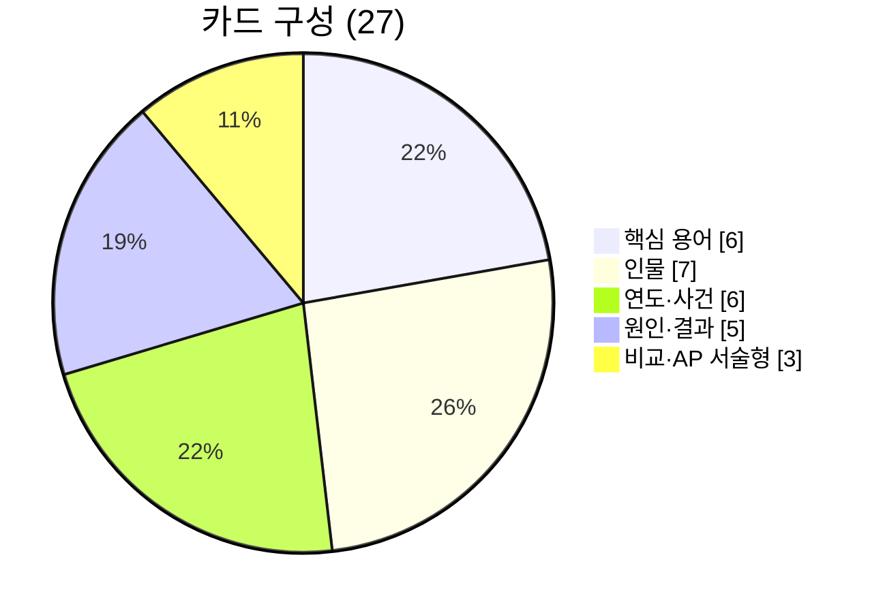

# Topic 5.2: 민족주의와 혁명 (Nationalism and Revolutions) — 플래시카드 (Flashcards)

*Unit 5: 혁명의 시대 (Revolutions, c. 1750–c. 1900) · 27장*  
출처: 교재 『World History Modern: AP® Edition』 5.2 (pp. 285–296). 제공해 주신 텍스트를 제 말로 요약했습니다. (CED 추가) 표시는 그 텍스트에 없는 내용입니다.

## 카드 구성

*정답을 열지 않고 답할 수 있으면 체크하세요.*

## 핵심 용어

- [ ] **1. 중농주의자 (Physiocrats)는 누구이며 미국 혁명에 어떤 영향을 주었나?**
  

▶ 정답

  자유 시장 사상으로 식민지인들이 영국의 중상주의에 맞설 근거를 준 경제학자들.

  

- [ ] **2. 마룬 (Maroons)은 누구였나?**
  

▶ 정답

  이미 노예 상태에서 탈출한 사람들. 아이티 봉기에 합류했다.

  

- [ ] **3. 카우디요 (Caudillos)란?**
  

▶ 정답

  충성스러운 군대를 거느리고 정부를 세우거나 무너뜨렸으며 대의 정치와 법치를 무시한 지역 기반의 강력한 지도자.

  

- [ ] **4. 현실 정치 (Realpolitik)와 국민 투표 (Plebiscite)를 정의하라.**
  

▶ 정답

  현실 정치: 힘에 기반한 실용 정치. 국민 투표: 이탈리아 여러 지역이 피에몬테 합류를 결정할 때 쓴 주민 직접 투표.

  

- [ ] **5. 오스만주의 (Ottomanism)란 무엇이며 왜 역효과를 냈나?**
  

▶ 정답

  특히 국가가 통제하는 학교를 통해 차이를 줄여 제국을 통합하려 한 운동(1870–1880년대). 피지배 민족이 차이를 더 의식하고 독립을 더 원하게 만들었다.

  

- [ ] **6. 라틴아메리카 사회 계층을 위에서부터 나열하라.**
  

▶ 정답

  페닌술라레스, 크리오요, 메스티소, 그리고 아프리카 노예·원주민·물라토.

  

## 인물

- [ ] **7. 에드먼드 버크와 조제프 드 메스트르는 왜 혁명에 반대했나?**
  

▶ 정답

  보수주의자로서 혁명이 잔혹하고 혼란스러우며 좋은 결과를 내기 어렵다고 보았다.

  

- [ ] **8. 투생 루베르튀르의 1801년 헌법은 무엇을 했나?**
  

▶ 정답

  모든 주민에게 평등과 시민권을 주고 그를 종신 총독으로 정했다. 이어 토지 개혁으로 플랜테이션을 해방 노예와 자유 흑인에게 나누었다.

  

- [ ] **9. 시몬 볼리바르의 정치적 목표는?**
  

▶ 정답

  스페인으로부터의 독립과 계몽사상에 기반한 미국식 연방(그란 콜롬비아). 자유주의자로서 자유 시장과 노예제 폐지를 지지했다.

  

- [ ] **10. 마누엘라 사엔스는 왜 '해방자의 해방자'라고 불렸나?**
  

▶ 정답

  볼리바르와 함께 싸워 대령이 되었고, 그의 목숨을 구한 적이 있다.

  

- [ ] **11. 롤라 로드리게스 데 티오는 누구인가?**
  

▶ 정답

  스페인 지배를 비판하고 「라 보린케냐」의 가사를 쓴 푸에르토리코 시인. 글 때문에 여러 차례 망명했다.

  

- [ ] **12. 호세 리살과 선전 운동이 원한 것은?**
  

▶ 정답

  혁명이나 독립이 아니라 필리핀의 더 큰 자치.

  

- [ ] **13. 카보우르와 비스마르크는 어떻게 현실 정치를 활용했나?**
  

▶ 정답

  카보우르는 나폴레옹 3세를 오스트리아와의 전쟁으로 끌어들였고, 비스마르크는 오스트리아와 프랑스를 조종해 세 번의 전쟁으로 독일을 통일했다.

  

## 연도·사건

- [ ] **14. 1789년 7월 14일에 일어난 일은?**
  

▶ 정답

  파리 군중이 왕정 폐해의 상징인 바스티유를 습격했고, 국왕은 국민 의회가 이끄는 정부를 받아들여야 했다.

  

- [ ] **15. 1804년 아이티 독립은 왜 특별했나?**
  

▶ 정답

  라틴아메리카 최초의 독립국, 서반구 최초의 흑인 주도 국가, 노예 봉기로 영구 독립한 유일한 나라.

  

- [ ] **16. 1864·1866·1870·1871년에 일어난 일은?**
  

▶ 정답

  프로이센의 덴마크·오스트리아·프랑스 전쟁, 그리고 독일 제국 수립.

  

- [ ] **17. 1827년 그리스는 어떻게 독립을 확보했나?**
  

▶ 정답

  영국·프랑스·러시아 연합 함대가 오스만 함대를 격파했다.

  

- [ ] **18. 1840년과 1872년 뉴질랜드에서 일어난 일은?**
  

▶ 정답

  영국이 뉴질랜드를 병합했고(1840), 1872년까지 마오리족과의 뉴질랜드 전쟁에서 승리했다.

  

- [ ] **19. 1868년과 1896년 스페인에 맞서 시작된 봉기는?**
  

▶ 정답

  푸에르토리코와 쿠바의 봉기(1868), 필리핀 혁명(1896).

  

## 원인·결과

- [ ] **20. 프랑스 혁명의 원인 두 가지는?**
  

▶ 정답

  전쟁 부채(미국 지원 포함)와 삼부회의 불평등한 투표. 이로 인해 평민이 국민 의회를 만들었다.

  

- [ ] **21. 크리오요 혁명가들은 왜 메스티소·원주민·물라토의 도움을 거부했나?**
  

▶ 정답

  아이티의 노예 봉기와 공포 정치를 보고 대중을 두려워했기 때문이다.

  

- [ ] **22. 크리오요 혁명은 왜 사회 변화가 제한적이었나?**
  

▶ 정답

  크리오요가 보수적인 상류층으로 남았다. 페루는 스페인어를 읽지 못하는 사람의 투표를 1860년까지 막았고, 여성은 여전히 투표나 계약을 할 수 없었다.

  

- [ ] **23. 리살의 처형은 필리핀에 어떤 영향을 주었나?**
  

▶ 정답

  필리핀인들에게 충격을 주었고, 스페인에 맞설 만큼 강한 최초의 민족주의 운동인 필리핀 혁명(1896)을 촉발했다.

  

- [ ] **24. 이탈리아와 독일 통일의 세계적 결과는?**
  

▶ 정답

  두 신흥 강국이 경쟁하는 동맹에 들어갔고, 극단적 민족주의가 훗날 제1차 세계 대전으로 이어졌다. 이탈리아의 빈곤은 미국과 아르헨티나로의 이민을 낳았다.

  

## 비교·AP 서술형

- [ ] **25. 아이티 혁명과 프랑스 혁명을 비교하라.**
  

▶ 정답

  **주장 (Claim):** 두 혁명 모두 계몽주의의 자연권 사상에서 나왔지만, 아이티 혁명은 아무 권리도 없던 사람들이 이끌었기 때문에 더 급진적이었다.  **근거 (Evidence):** 프랑스 평민은 법적 신분제에 맞서 봉기해 봉건제를 폐지했다(1789). 아이티에서는 아프리카 노예와 마룬이 노예제를 끝내고 플랜테이션을 재분배했으며(1801) 독립을 이루었다(1804).  **설명 (Reasoning):** 아이티의 제약인 노예제가 훨씬 혹독했기 때문에, 그 혁명은 정치 체제뿐 아니라 사회 질서와 식민 질서 전체를 뒤엎었다.

  

- [ ] **26. 크리오요 엘리트와 라틴아메리카 혁명의 관계를 추적하라. (교재 Connect 과제)**
  

▶ 정답

  **주장 (Claim):** 크리오요 엘리트는 자신들의 권력을 얻기 위해 라틴아메리카 혁명을 이끌었고, 그 때문에 혁명이 사회를 바꾼 정도도 제한되었다.  **근거 (Evidence):** 교육받은 크리오요는 미국 혁명과 프랑스 혁명의 사상을 알았고, 스페인의 중상주의에 반대했으며, 페닌술라레스의 고위직 독점에 분노했다. 볼리바르는 그란 콜롬비아를 세웠지만 크리오요는 대중의 도움을 거부했다. 그 후 카우디요가 지배했고, 페루는 1860년까지 투표를 제한했으며, 크리오요는 보수적 상류층으로 남았다.  **설명 (Reasoning):** 엘리트가 주로 자신의 경제적·정치적 권력을 위해 싸웠고 아이티식 봉기를 두려워했기 때문에, 독립은 사회 구조보다 통치자를 바꾸었다.

  

- [ ] **27. 이탈리아 통일과 독일 통일을 비교하라.**
  

▶ 정답

  **주장 (Claim):** 두 통일 모두 민족주의가 이끌었고 현실 정치가가 주도했지만, 이탈리아는 대중 운동에, 독일은 프로이센의 군사력에 더 의존했다.  **근거 (Evidence):** 카보우르는 외교, 국민 투표, 마치니의 리소르지멘토, 가리발디의 붉은 셔츠단을 활용했다. 비스마르크는 세 번의 전쟁(1864, 1866, 1870)을 일으켜 1871년 독일 제국을 세웠다.  **설명 (Reasoning):** 이탈리아는 지역 분열과 교황 때문에 대중의 지지와 동맹이 필요했지만, 프로이센은 강한 군대가 있어 비스마르크가 주로 전쟁으로 통일할 수 있었다.

  

