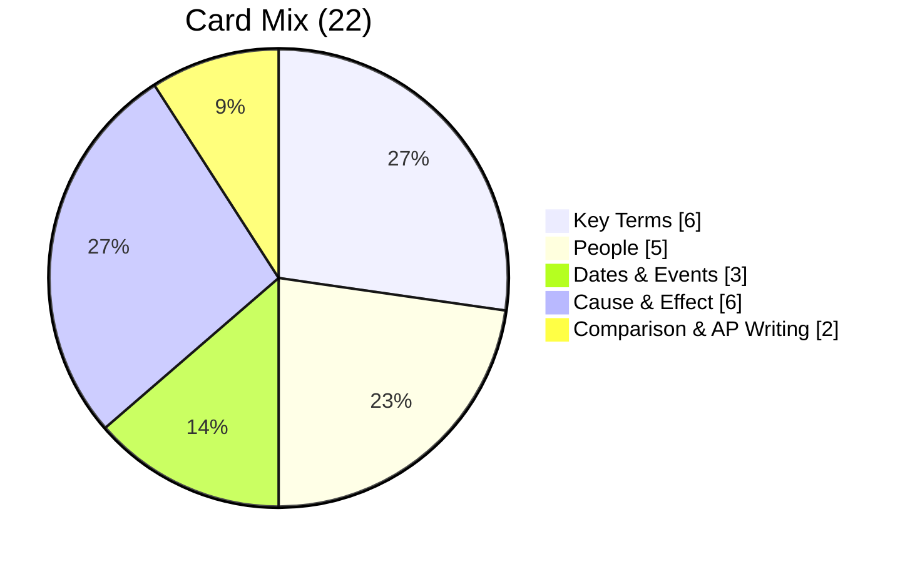

# Topic 5.3: Industrial Revolution Begins — Flashcards

*Unit 5: Revolutions (c. 1750–c. 1900) · 22 cards*  
Source: textbook World History Modern: AP® Edition, Topic 5.3 (pp. 297–303), from the text you provided, summarized in my own words. Items marked (CED addition) are not in that text.

## Card Mix

*Check the box when you can answer without opening the card.*

## Key Terms

- [ ] **1. Define industrialization as the textbook does.**
  

▶ Answer

  The increased mechanization of production and the social changes that accompanied it.

  

- [ ] **2. What was the cottage industry (putting-out) system?**
  

▶ Answer

  Merchants gave raw cotton to women who spun it into cloth in their homes.

  

- [ ] **3. What is division of labor?**
  

▶ Answer

  Each worker specializes in one task instead of making a whole product; it grew from interchangeable parts.

  

- [ ] **4. What are interchangeable parts?**
  

▶ Answer

  Identical parts, so a broken component can be replaced with a new, matching one.

  

- [ ] **5. What was the enclosure movement?**
  

▶ Answer

  The government fenced off the commons for those who paid or bought the land, leaving many farmers landless.

  

- [ ] **6. What is capital?**
  

▶ Answer

  Money available to invest in businesses.

  

## People

- [ ] **7. What did James Hargreaves invent?**
  

▶ Answer

  The spinning jenny (1760s), which spun more than one thread at a time.

  

- [ ] **8. Why is Richard Arkwright called the father of the factory system?**
  

▶ Answer

  His water frame (1769) was too bulky for homes, so textile production moved into factories.

  

- [ ] **9. What did Eli Whitney contribute according to the textbook?**
  

▶ Answer

  A system of interchangeable parts for U.S. military firearms (1798).

  

- [ ] **10. How did Henry Ford extend the division of labor?**
  

▶ Answer

  He developed the moving assembly line for Model T cars in the early 1900s.

  

- [ ] **11. What did Adam Smith's pin-making example show?**
  

▶ Answer

  Dividing pin-making into about 18 operations — an early picture of factory division of labor.

  

## Dates & Events

- [ ] **12. Early 1700s — what changed in agriculture?**
  

▶ Answer

  Crop rotation and the seed drill increased food production (agricultural revolution).

  

- [ ] **13. 1769 — what invention moved textiles into factories?**
  

▶ Answer

  Arkwright's water frame.

  

- [ ] **14. 1798 — what manufacturing system was created?**
  

▶ Answer

  Whitney's interchangeable parts for firearms.

  

## Cause & Effect

- [ ] **15. Why did Britain build its own cotton industry?**
  

▶ Answer

  Indian cotton imports were in high demand, and wool and flax could not compete; investors wanted to produce cotton cloth themselves.

  

- [ ] **16. How did the agricultural revolution support industrialization?**
  

▶ Answer

  More food and better medicine increased population, providing workers and consumers, and fewer people were needed on farms.

  

- [ ] **17. How did enclosure lead to urbanization?**
  

▶ Answer

  Landless farmers moved to cities such as Manchester and Liverpool, where they became the industrial workforce.

  

- [ ] **18. Why was coal vital to industrialization?**
  

▶ Answer

  It powered steam engines and was needed to separate iron from ore, enabling iron and steel for bridges, buildings, and ships.

  

- [ ] **19. How did the trans-Atlantic slave trade contribute to British industrialization?**
  

▶ Answer

  It gave British capitalists excess capital to invest, and enslaved labor in the Americas grew the raw cotton.

  

- [ ] **20. Why did protection of private property matter?**
  

▶ Answer

  Entrepreneurs needed assurance that businesses they built would not be taken by rivals or the government.

  

## Comparison & AP Writing

- [ ] **21. Explain the extent to which environmental factors caused Britain to industrialize first.**
  

▶ Answer

  **Claim:** Environmental factors were essential, but human and institutional factors were equally necessary.  **Evidence:** Britain had coal, rivers, and an Atlantic location; it also had slave-trade capital, colonial timber, the strongest fleet, legal protection of property, and workers pushed into cities by enclosure.  **Reasoning:** Geography supplied energy and transport, but without capital, secure property, and labor, those resources could not have been turned into factories.

  

- [ ] **22. Compare the cottage industry and the factory system.**
  

▶ Answer

  **Claim:** Both produced cotton cloth for market, but factories replaced home production because they were far faster.  **Evidence:** In the cottage industry, women spun at home with some independence and near their children; Arkwright's water frame (1769) moved production into factories with machines and specialized workers.  **Reasoning:** Investors demanded faster output, and bulky water-powered machines could only work in factories, so efficiency won over workers' independence.

  

