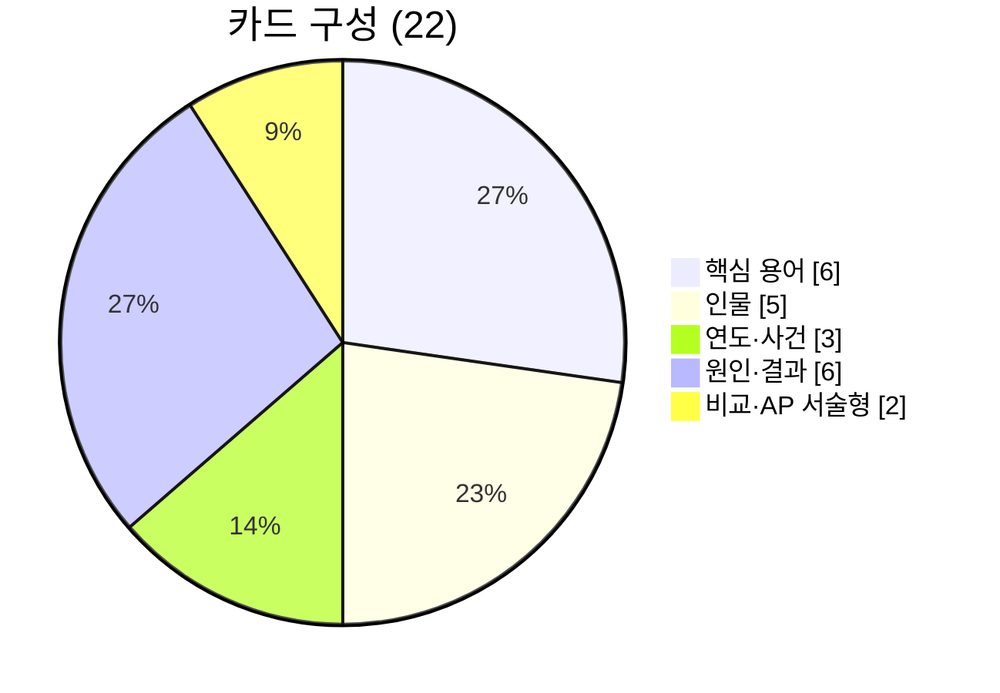

# Topic 5.3: 산업 혁명의 시작 (Industrial Revolution Begins) — 플래시카드 (Flashcards)

*Unit 5: 혁명의 시대 (Revolutions, c. 1750–c. 1900) · 22장*  
출처: 교재 『World History Modern: AP® Edition』 5.3 (pp. 297–303). 제공해 주신 텍스트를 제 말로 요약했습니다. (CED 추가) 표시는 그 텍스트에 없는 내용입니다.

## 카드 구성

*정답을 열지 않고 답할 수 있으면 체크하세요.*

## 핵심 용어

- [ ] **1. 교재의 정의에 따라 산업화 (Industrialization)를 설명하라.**
  

▶ 정답

  생산의 기계화가 늘어난 것과 그에 따른 사회 변화.

  

- [ ] **2. 가내 공업 (선대제)이란?**
  

▶ 정답

  상인이 원면을 주면 여성들이 집에서 실을 잣고 천을 만든 방식.

  

- [ ] **3. 분업 (Division of labor)이란?**
  

▶ 정답

  노동자가 제품 전체가 아니라 한 가지 작업만 전문으로 하는 것. 호환 부품에서 발전했다.

  

- [ ] **4. 호환 부품 (Interchangeable parts)이란?**
  

▶ 정답

  똑같이 만든 부품이라 고장 난 부품을 같은 새 부품으로 바꿀 수 있는 것.

  

- [ ] **5. 인클로저 운동 (Enclosure movement)이란?**
  

▶ 정답

  정부가 공유지에 울타리를 쳐 비용을 내거나 땅을 산 사람만 쓰게 한 것. 많은 농민이 땅을 잃었다.

  

- [ ] **6. 자본 (Capital)이란?**
  

▶ 정답

  사업에 투자할 수 있는 돈.

  

## 인물

- [ ] **7. 제임스 하그리브스는 무엇을 발명했나?**
  

▶ 정답

  한 번에 여러 가닥의 실을 잣는 제니 방적기(1760년대).

  

- [ ] **8. 리처드 아크라이트는 왜 공장제의 아버지라 불리나?**
  

▶ 정답

  그의 수력 방적기(1769)는 집에 두기에 너무 커서 섬유 생산이 공장으로 옮겨 갔다.

  

- [ ] **9. 교재에 따르면 엘리 휘트니의 공헌은?**
  

▶ 정답

  미군 총기를 위한 호환 부품 체계(1798).

  

- [ ] **10. 헨리 포드는 분업을 어떻게 발전시켰나?**
  

▶ 정답

  1900년대 초 모델 T 자동차를 위한 이동식 조립 라인을 개발했다.

  

- [ ] **11. 애덤 스미스의 핀 제조 사례가 보여 준 것은?**
  

▶ 정답

  핀 만들기를 약 18개 공정으로 나눈 것으로, 공장 분업을 보여 주는 초기 사례다.

  

## 연도·사건

- [ ] **12. 1700년대 초 농업에서 바뀐 것은?**
  

▶ 정답

  윤작과 파종기가 식량 생산을 늘렸다 (농업 혁명).

  

- [ ] **13. 1769년 섬유 생산을 공장으로 옮긴 발명은?**
  

▶ 정답

  아크라이트의 수력 방적기.

  

- [ ] **14. 1798년 만들어진 생산 체계는?**
  

▶ 정답

  휘트니의 총기 호환 부품 체계.

  

## 원인·결과

- [ ] **15. 영국은 왜 자국 면직물 산업을 세웠나?**
  

▶ 정답

  인도 면직물 수입품의 인기가 높았고 양모와 아마는 경쟁이 되지 않아서, 투자자들이 직접 면직물을 생산하려 했다.

  

- [ ] **16. 농업 혁명은 산업화를 어떻게 뒷받침했나?**
  

▶ 정답

  식량과 의료 개선으로 인구가 늘어 노동자와 소비자가 생겼고, 농사에 필요한 인원은 줄었다.

  

- [ ] **17. 인클로저는 어떻게 도시화로 이어졌나?**
  

▶ 정답

  땅을 잃은 농민들이 맨체스터와 리버풀 같은 도시로 가서 산업 노동력이 되었다.

  

- [ ] **18. 석탄은 왜 산업화에 필수적이었나?**
  

▶ 정답

  증기 기관을 움직였고 철광석에서 철을 분리하는 데 필요해, 다리·건물·배를 만들 철과 강철을 가능하게 했다.

  

- [ ] **19. 대서양 노예 무역은 영국 산업화에 어떻게 기여했나?**
  

▶ 정답

  영국 자본가에게 투자할 잉여 자본을 주었고, 아메리카의 노예 노동이 원면을 재배했다.

  

- [ ] **20. 사유 재산 보호는 왜 중요했나?**
  

▶ 정답

  기업가는 자신이 세운 사업을 경쟁자나 정부에 빼앗기지 않는다는 확신이 필요했다.

  

## 비교·AP 서술형

- [ ] **21. 환경적 요인이 영국을 최초의 산업국으로 만든 정도를 설명하라.**
  

▶ 정답

  **주장 (Claim):** 환경적 요인은 필수적이었지만, 인적·제도적 요인도 똑같이 필요했다.  **근거 (Evidence):** 영국에는 석탄, 강, 대서양 입지가 있었다. 동시에 노예 무역 자본, 식민지 목재, 최강의 함대, 재산의 법적 보호, 인클로저로 도시에 밀려난 노동자도 있었다.  **설명 (Reasoning):** 지리는 에너지와 운송을 제공했지만, 자본·안전한 재산권·노동력이 없었다면 그 자원을 공장으로 바꿀 수 없었다.

  

- [ ] **22. 가내 공업과 공장제를 비교하라.**
  

▶ 정답

  **주장 (Claim):** 둘 다 시장에 팔 면직물을 생산했지만, 공장이 훨씬 빨랐기 때문에 가정 생산을 대체했다.  **근거 (Evidence):** 가내 공업에서는 여성이 어느 정도 자율성을 가지고 아이들 곁에서 실을 자았다. 아크라이트의 수력 방적기(1769)는 기계와 전문화된 노동자가 있는 공장으로 생산을 옮겼다.  **설명 (Reasoning):** 투자자들은 더 빠른 생산을 원했고 크고 물로 움직이는 기계는 공장에서만 쓸 수 있었기 때문에, 효율이 노동자의 자율성을 이겼다.

  

