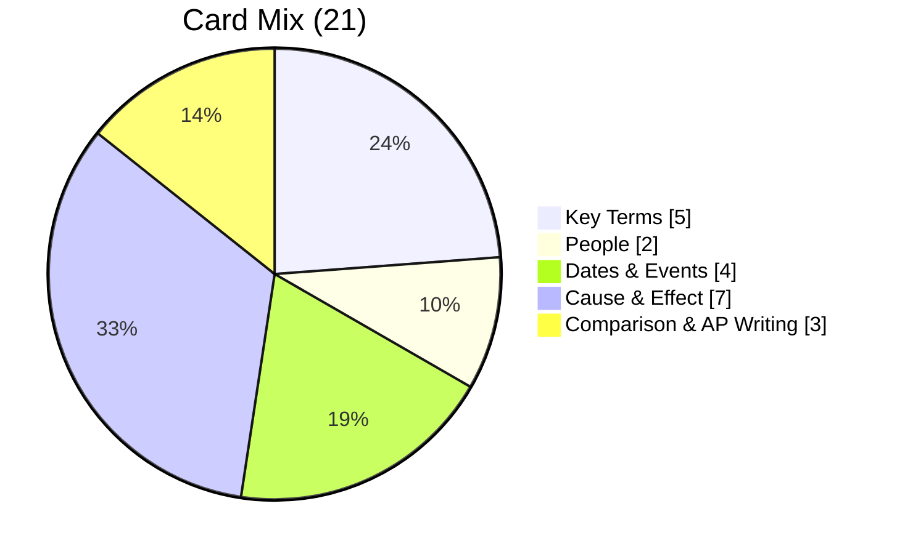

# Topic 5.4: Industrialization Spreads — Flashcards

*Unit 5: Revolutions (c. 1750–c. 1900) · 21 cards*  
Source: textbook World History Modern: AP® Edition, Topic 5.4 (pp. 304–309), from the text you provided, summarized in my own words. Items marked (CED addition) are not in that text.

## Card Mix

*Check the box when you can answer without opening the card.*

## Key Terms

- [ ] **1. What is human capital, and why did it matter in the U.S.?**
  

▶ Answer

  The workforce; immigrants from Europe and East Asia and rural migrants supplied U.S. factories.

  

- [ ] **2. What is defensive modernization?**
  

▶ Answer

  Consciously adopting Western technology and institutions in order to protect one's traditional culture, as Japan did.

  

- [ ] **3. What was company rule in India?**
  

▶ Answer

  Control of parts of India by the British East India Company from 1757 to 1858.

  

- [ ] **4. What was the Arms Act of 1878?**
  

▶ Answer

  A British law, passed out of fear of another uprising, that restricted Indian access to minerals and the production of firearms.

  

- [ ] **5. What happened to the global share of Middle Eastern and Asian manufacturing?**
  

▶ Answer

  These regions still manufactured goods, but their share of global manufacturing declined.

  

## People

- [ ] **6. Who was John Aikin, and what did he observe in 1795?**
  

▶ Answer

  A writer describing Manchester; he said trade's demands could not have been met without spinning machines.

  

- [ ] **7. Who pressured the British government to tax Bombay's textile mills?**
  

▶ Answer

  Owners of textile mills in Lancashire ("Lancaster"), who faced competition from Bombay's 80+ mills.

  

## Dates & Events

- [ ] **8. 1871 — how did this date affect German industry?**
  

▶ Answer

  Germany unified and quickly became a leading producer of steel and coal.

  

- [ ] **9. By 1900 — name two facts about Russian industry.**
  

▶ Answer

  Over 36,000 miles of railroad, and fourth-largest steel producer in the world.

  

- [ ] **10. 1830 and 1863 — what happened to the Indian Navy?**
  

▶ Answer

  Britain designated East India Company ships as the Indian Navy (1830) and disbanded it by 1863 as the Royal Navy took control of the Indian Ocean.

  

- [ ] **11. 1857 — how did the rebellion affect Indian mining?**
  

▶ Answer

  Britain closed mines it believed were being used to extract lead for ammunition.

  

## Cause & Effect

- [ ] **12. Why was French industrialization delayed?**
  

▶ Answer

  Sparsely populated cities limited labor, and the Revolution (1789–1799) and later wars absorbed elites' attention and capital.

  

- [ ] **13. Why was German industrialization delayed, and what changed it?**
  

▶ Answer

  Political fragmentation into small states; unification in 1871 allowed rapid growth in steel and coal.

  

- [ ] **14. What brought so many immigrants to U.S. factories?**
  

▶ Answer

  Political upheaval and widespread poverty in Europe and East Asia.

  

- [ ] **15. Why did Russia remain mostly agricultural despite its railroads?**
  

▶ Answer

  Industry grew mainly in the 1890s around railroads, and the broader economy stayed agricultural until after 1917.

  

- [ ] **16. How did British rule affect Indian mining and metalworking?**
  

▶ Answer

  Steep tariffs, mine closures after 1857, and the Arms Act of 1878 nearly eliminated them; crude methods later made India's minerals seem inaccessible.

  

- [ ] **17. Why did Egypt lose its textile markets?**
  

▶ Answer

  By the mid-1800s, massive European textile production outcompeted Egyptian goods abroad and at home.

  

- [ ] **18. How did Japan's isolation shape its industrialization?**
  

▶ Answer

  Despite little contact with Europe since the 1600s, Japan chose defensive modernization to protect its culture and became the first Asian country to industrialize.

  

## Comparison & AP Writing

- [ ] **19. Explain how British colonial policy changed manufacturing in India. **
  

▶ Answer

  **Claim:** British colonial policy deliberately weakened Indian manufacturing to protect British industry and security.  **Evidence:** Mismanagement ended Indian shipbuilding (navy disbanded by 1863); tariffs, mine closures after 1857, and the 1878 Arms Act wiped out mining in Rajasthan; and a 5% "equalizing" tax cut the profits of Bombay's 80+ textile mills.  **Reasoning:** Because Britain controlled India's government, it could use taxes and laws to remove competition with British mills and prevent Indians from making weapons, shrinking India's share of world manufacturing.

  

- [ ] **20. Compare industrialization in the United States and Russia.**
  

▶ Answer

  **Claim:** Both built large railroad networks and heavy industry, but the U.S. became a leading industrial force while Russia stayed mostly agricultural.  **Evidence:** The U.S. drew on a huge immigrant and rural-migrant workforce and was a leading industrial power by 1900; Russia built 36,000+ miles of railroad and was fourth in steel by 1900, but its economy stayed agricultural until after 1917.  **Reasoning:** The U.S. had abundant labor feeding factories across the economy, while Russian industry was concentrated around railroads and exports in the 1890s.

  

- [ ] **21. Identify similarities in how Britain treated its colonies in South Asia and the Americas. (textbook Connect task)**
  

▶ Answer

  **Claim:** In both regions Britain used its control to make colonies serve British industry and trade.  **Evidence:** In India, tariffs, mine closures, the Arms Act (1878), and a 5% tax on Bombay mills protected British manufacturers; in the American colonies, mercantilism required colonists to trade mainly with Britain, which colonists opposed (see 5.2).  **Reasoning:** Britain treated colonies as suppliers of raw materials and markets for British goods, limiting local manufacturing that could compete — a pattern that caused resentment in both places.

  

