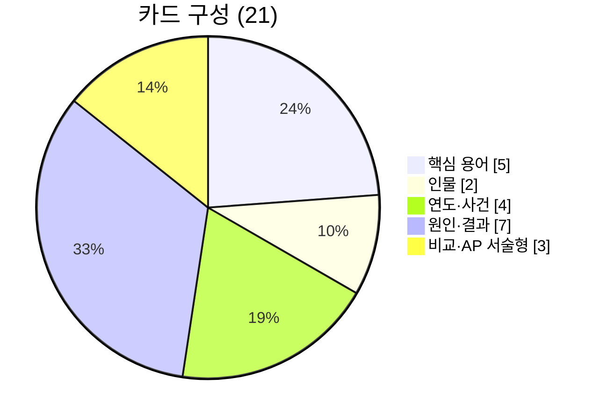

# Topic 5.4: 산업화의 확산 (Industrialization Spreads) — 플래시카드 (Flashcards)

*Unit 5: 혁명의 시대 (Revolutions, c. 1750–c. 1900) · 21장*  
출처: 교재 『World History Modern: AP® Edition』 5.4 (pp. 304–309). 제공해 주신 텍스트를 제 말로 요약했습니다. (CED 추가) 표시는 그 텍스트에 없는 내용입니다.

## 카드 구성

*정답을 열지 않고 답할 수 있으면 체크하세요.*

## 핵심 용어

- [ ] **1. 인적 자본 (Human capital)이란 무엇이며 미국에서 왜 중요했나?**
  

▶ 정답

  노동력. 유럽·동아시아 이민자와 농촌 이주민이 미국 공장의 노동력이 되었다.

  

- [ ] **2. 방어적 근대화 (Defensive modernization)란?**
  

▶ 정답

  일본처럼 전통문화를 지키기 위해 서구의 기술과 제도를 의식적으로 받아들이는 것.

  

- [ ] **3. 인도의 회사 통치 (Company rule)란?**
  

▶ 정답

  1757–1858년 영국 동인도 회사가 인도 일부를 지배한 것.

  

- [ ] **4. 1878년 무기법 (Arms Act)이란?**
  

▶ 정답

  또 다른 봉기를 두려워한 영국이 인도의 광물 접근과 총기 생산을 제한한 법.

  

- [ ] **5. 중동과 아시아의 세계 제조업 비중은 어떻게 되었나?**
  

▶ 정답

  이 지역들은 여전히 제조업을 했지만, 세계 제조업에서 차지하는 비중은 줄었다.

  

## 인물

- [ ] **6. 존 에이킨은 누구이며 1795년 무엇을 관찰했나?**
  

▶ 정답

  맨체스터를 묘사한 저술가. 방적기가 없었다면 무역의 수요를 감당할 수 없었을 것이라고 했다.

  

- [ ] **7. 봄베이 섬유 공장에 세금을 물리도록 영국 정부에 압력을 넣은 사람들은?**
  

▶ 정답

  봄베이의 80개 넘는 공장과 경쟁하던 랭커셔('Lancaster')의 섬유 공장주들.

  

## 연도·사건

- [ ] **8. 1871년은 독일 산업에 어떤 영향을 주었나?**
  

▶ 정답

  독일이 통일되어 빠르게 철강과 석탄의 주요 생산국이 되었다.

  

- [ ] **9. 1900년경 러시아 산업에 관한 사실 두 가지는?**
  

▶ 정답

  3만 6천 마일이 넘는 철도, 세계 4위의 강철 생산국.

  

- [ ] **10. 1830년과 1863년 인도 해군에 일어난 일은?**
  

▶ 정답

  영국이 동인도 회사의 배를 인도 해군으로 지정했고(1830), 영국 해군이 인도양을 장악하면서 1863년까지 해체했다.

  

- [ ] **11. 1857년 봉기는 인도 광업에 어떤 영향을 주었나?**
  

▶ 정답

  영국이 탄약용 납을 캐는 데 쓰인다고 의심한 광산을 폐쇄했다.

  

## 원인·결과

- [ ] **12. 프랑스의 산업화는 왜 늦어졌나?**
  

▶ 정답

  도시 인구가 적어 노동력이 부족했고, 혁명(1789–1799)과 이후 전쟁이 엘리트의 관심과 자본을 빼앗았다.

  

- [ ] **13. 독일의 산업화는 왜 늦어졌고 무엇이 그것을 바꾸었나?**
  

▶ 정답

  작은 국가들로의 정치적 분열. 1871년 통일로 철강과 석탄이 빠르게 성장했다.

  

- [ ] **14. 무엇이 많은 이민자를 미국 공장으로 이끌었나?**
  

▶ 정답

  유럽과 동아시아의 정치적 격변과 만연한 빈곤.

  

- [ ] **15. 러시아는 철도를 놓고도 왜 대부분 농업 중심으로 남았나?**
  

▶ 정답

  산업은 주로 1890년대 철도를 중심으로 성장했고, 경제 전체는 1917년 이후까지 농업 중심이었다.

  

- [ ] **16. 영국의 지배는 인도의 광업과 금속 가공에 어떤 영향을 주었나?**
  

▶ 정답

  높은 관세, 1857년 이후 광산 폐쇄, 1878년 무기법으로 거의 사라졌다. 이후 원시적인 방법 때문에 인도의 광물은 접근하기 어렵다는 인상이 생겼다.

  

- [ ] **17. 이집트는 왜 섬유 시장을 잃었나?**
  

▶ 정답

  1800년대 중반 유럽의 대규모 섬유 생산이 해외와 국내에서 이집트 상품을 밀어냈다.

  

- [ ] **18. 일본의 고립은 산업화에 어떤 영향을 주었나?**
  

▶ 정답

  1600년대 이후 유럽과의 접촉이 적었지만, 문화를 지키려고 방어적 근대화를 택해 아시아 최초의 산업국이 되었다.

  

## 비교·AP 서술형

- [ ] **19. 영국의 식민 정책이 인도의 제조업을 어떻게 바꾸었는지 설명하라.**
  

▶ 정답

  **주장 (Claim):** 영국의 식민 정책은 영국 산업과 안보를 지키기 위해 인도의 제조업을 의도적으로 약화시켰다.  **근거 (Evidence):** 관리 실패로 인도 조선업이 끝났고(1863년까지 해군 해체), 관세·1857년 이후 광산 폐쇄·1878년 무기법이 라자스탄의 광업을 없앴다. 5% '균등화' 세금은 봄베이의 80여 개 섬유 공장의 수익을 줄였다.  **설명 (Reasoning):** 영국이 인도 정부를 장악하고 있었기 때문에 세금과 법을 이용해 영국 공장의 경쟁자를 없애고 인도인의 무기 생산을 막을 수 있었다. 그 결과 세계 제조업에서 인도의 비중이 줄었다.

  

- [ ] **20. 미국과 러시아의 산업화를 비교하라.**
  

▶ 정답

  **주장 (Claim):** 두 나라 모두 큰 철도망과 중공업을 건설했지만, 미국은 세계적 공업 강국이 되었고 러시아는 대부분 농업 중심으로 남았다.  **근거 (Evidence):** 미국은 많은 이민자와 농촌 이주민 노동력을 바탕으로 1900년 세계적 공업 강국이 되었다. 러시아는 1900년까지 3만 6천 마일 넘는 철도를 놓고 강철 세계 4위가 되었지만, 1917년 이후까지 경제는 농업 중심이었다.  **설명 (Reasoning):** 미국은 풍부한 노동력이 경제 전반의 공장을 채웠지만, 러시아의 산업은 1890년대 철도와 수출 주변에 집중되어 있었다.

  

- [ ] **21. 영국이 남아시아 식민지와 아메리카 식민지를 대한 방식의 공통점을 찾아라. (교재 Connect 과제)**
  

▶ 정답

  **주장 (Claim):** 두 지역 모두에서 영국은 지배력을 이용해 식민지가 영국 산업과 무역에 봉사하도록 만들었다.  **근거 (Evidence):** 인도에서는 관세, 광산 폐쇄, 무기법(1878), 봄베이 공장에 대한 5% 세금이 영국 제조업자를 보호했다. 아메리카 식민지에서는 중상주의가 식민지인에게 주로 영국과 무역하도록 요구했고, 식민지인들은 이에 반대했다(5.2 참고).  **설명 (Reasoning):** 영국은 식민지를 원료 공급지이자 영국 상품의 시장으로 보고 경쟁이 될 수 있는 현지 제조업을 제한했다. 이 방식은 두 지역 모두에서 반감을 낳았다.

  

