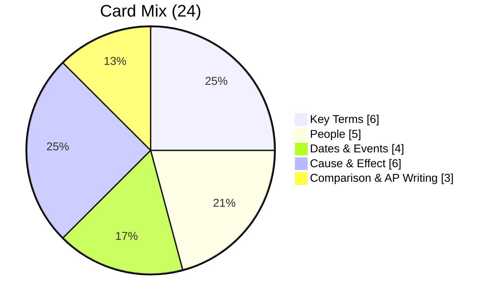

# Topic 5.5: Technology in the Industrial Age — Flashcards

*Unit 5: Revolutions (c. 1750–c. 1900) · 24 cards*  
Source: textbook World History Modern: AP® Edition, Topic 5.5 (pp. 310–316), from the text you provided, summarized in my own words. Items marked (CED addition) are not in that text.

## Card Mix

*Check the box when you can answer without opening the card.*

## Key Terms

- [ ] **1. What was the second industrial revolution?**
  

▶ Answer

  A wave of innovation in the late 1800s–early 1900s in steel, chemicals, precision machinery, and electronics, led by the U.S., Britain, and Germany.

  

- [ ] **2. What were coaling stations, and where were they?**
  

▶ Answer

  Refueling ports for steamships at key points on trade routes, such as Cape Colony in South Africa and Pacific islands.

  

- [ ] **3. What is coke, and why did it matter?**
  

▶ Answer

  A refined form of coal that made much larger iron furnaces possible.

  

- [ ] **4. Contrast cast iron and wrought iron.**
  

▶ Answer

  Cast iron was strong but brittle; wrought iron (Cort, 1794) was less strong but much more workable.

  

- [ ] **5. What was the Bessemer Process?**
  

▶ Answer

  A method (1856) of blasting molten metal with air to remove impurities, allowing mass production of steel.

  

- [ ] **6. How did the main use of petroleum change?**
  

▶ Answer

  At first kerosene for lighting and heaters; after automobiles appeared in the early 1900s, gasoline became more important.

  

## People

- [ ] **7. What did James Watt's steam engine do, according to the textbook?**
  

▶ Answer

  Made in 1765, it cheaply harnessed coal to make steam that powered textile machinery; within 50 years steam powered trains.

  

- [ ] **8. What did Henry Cort patent?**
  

▶ Answer

  A process for making wrought iron (1794).

  

- [ ] **9. What did Bell and Edison each contribute to the telephone?**
  

▶ Answer

  Bell received the telephone patent (1876); Edison's refined voice transmitter (1886) made phones practical.

  

- [ ] **10. What did Guglielmo Marconi achieve in 1901?**
  

▶ Answer

  He sent and received a radio signal across the Atlantic Ocean.

  

- [ ] **11. How did Ralph Waldo Emerson view railroads?**
  

▶ Answer

  As "a magician's rod" that awakened the energies of land and water — though he later grew troubled by technology.

  

## Dates & Events

- [ ] **12. 1856 — what made mass production of steel possible?**
  

▶ Answer

  The Bessemer Process.

  

- [ ] **13. 1869 — what U.S. railroad was completed?**
  

▶ Answer

  The Transcontinental Railroad, connecting the Atlantic and Pacific.

  

- [ ] **14. 1882 — what opened in London?**
  

▶ Answer

  The first public power station.

  

- [ ] **15. 1876 and 1901 — what communication milestones occurred?**
  

▶ Answer

  Bell's telephone patent (1876) and Marconi's transatlantic radio signal (1901).

  

## Cause & Effect

- [ ] **16. Why was coal-powered steam better than water or wind power?**
  

▶ Answer

  It was mobile and dependable: engines could be built anywhere and turned on or off as needed.

  

- [ ] **17. How did steamships change world trade?**
  

▶ Answer

  Ships no longer depended on wind, river travel upstream became fast, sailing ships were replaced, and coaling stations became strategic points.

  

- [ ] **18. What effects did electrification have by the 1890s?**
  

▶ Answer

  Street lighting and electric streetcars, and later instant communication through telephone and radio.

  

- [ ] **19. How did new technology change patterns of trade and migration?**
  

▶ Answer

  Earlier trade centered on coasts; railroads, steamships, and the telegraph opened interior regions worldwide, increasing trade and migration.

  

- [ ] **20. Why did industrialized countries establish colonies?**
  

▶ Answer

  Intensified industrialization increased their need for resources, so they sought to protect access to resources and markets.

  

- [ ] **21. What made the U.S. an industrial nation, according to the textbook?**
  

▶ Answer

  Vast natural resources (timber, coal, iron, oil) and efficient, publicly subsidized transport such as railroads and canals.

  

## Comparison & AP Writing

- [ ] **22. Compare the first and second industrial revolutions.**
  

▶ Answer

  **Claim:** Both transformed production through new energy and materials, but the second added new industries and was led by more countries.  **Evidence:** The first centered on textiles, steam power, and iron (Watt 1765, Cort 1794); the second, led by the U.S., Britain, and Germany, centered on steel (Bessemer 1856), chemicals, oil, electricity (1882 power station), and the telephone (1876).  **Reasoning:** New chemical and electrical knowledge created entirely new products and energy sources, expanding industry beyond Britain's original strengths.

  

- [ ] **23. Explain how transportation and communication technology contributed to global economic integration from 1750 to 1900.**
  

▶ Answer

  **Claim:** Railroads, steamships, and the telegraph linked the world's producers, consumers, and investors for the first time.  **Evidence:** Steamships replaced sailing ships and relied on coaling stations such as Cape Colony; the Transcontinental Railroad (1869) opened the U.S. interior; the telegraph allowed immediate communication.  **Reasoning:** Faster, cheaper, and more reliable transport and communication opened interior regions and made long-distance trade and investment profitable, which also pushed industrial states to seek colonies.

  

- [ ] **24. Describe how the Silk Roads set the stage for the industrial developments of the 1800s. (textbook Connect task)**
  

▶ Answer

  **Claim:** The Silk Roads created long-distance trade networks, demand, and exchanges of technology that industrial-age transport later expanded.  **Evidence:** Silk Road trade spread goods such as textiles and technologies across Eurasia (Topic 2.1); in the 1800s railroads such as the Trans-Siberian, steamships, and the telegraph moved goods and information along and beyond the same routes, opening interior regions that caravans once crossed.  **Reasoning:** Industrial technology did not create global exchange from nothing; it sped up and widened networks of trade, demand, and contact that the Silk Roads had already established.

  

