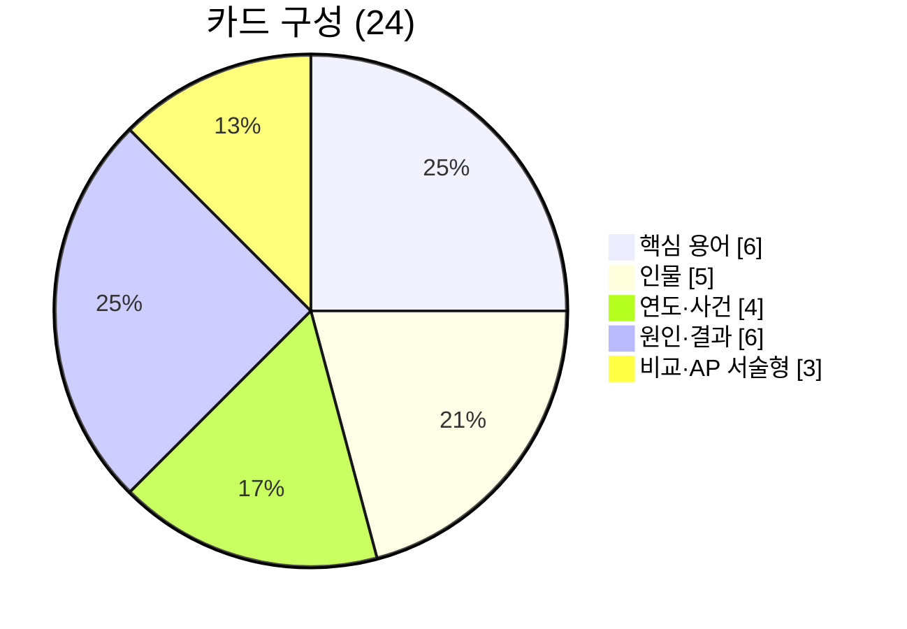

# Topic 5.5: 산업 시대의 기술 (Technology in the Industrial Age) — 플래시카드 (Flashcards)

*Unit 5: 혁명의 시대 (Revolutions, c. 1750–c. 1900) · 24장*  
출처: 교재 『World History Modern: AP® Edition』 5.5 (pp. 310–316). 제공해 주신 텍스트를 제 말로 요약했습니다. (CED 추가) 표시는 그 텍스트에 없는 내용입니다.

## 카드 구성

*정답을 열지 않고 답할 수 있으면 체크하세요.*

## 핵심 용어

- [ ] **1. 제2차 산업 혁명 (Second industrial revolution)이란?**
  

▶ 정답

  미국·영국·독일이 주도한 1800년대 후반–1900년대 초 강철·화학·정밀 기계·전자의 혁신 물결.

  

- [ ] **2. 석탄 보급소 (Coaling stations)란 무엇이며 어디에 있었나?**
  

▶ 정답

  남아프리카의 케이프 식민지나 태평양 섬처럼 무역로 요충지에 있던 증기선 연료 보급 항구.

  

- [ ] **3. 코크스 (Coke)란 무엇이며 왜 중요했나?**
  

▶ 정답

  훨씬 큰 제철 용광로를 가능하게 한 정제된 석탄.

  

- [ ] **4. 주철 (Cast iron)과 연철 (Wrought iron)을 대조하라.**
  

▶ 정답

  주철은 단단하지만 잘 부서졌고, 연철(코트, 1794)은 덜 단단하지만 훨씬 가공하기 쉬웠다.

  

- [ ] **5. 베서머 공법 (Bessemer Process)이란?**
  

▶ 정답

  녹은 금속에 공기를 불어 넣어 불순물을 없애 강철을 대량 생산할 수 있게 한 방법(1856).

  

- [ ] **6. 석유의 주요 용도는 어떻게 바뀌었나?**
  

▶ 정답

  처음에는 조명과 난방용 등유였고, 1900년대 초 자동차가 등장한 뒤 휘발유가 더 중요해졌다.

  

## 인물

- [ ] **7. 교재에 따르면 제임스 와트의 증기 기관은 무엇을 했나?**
  

▶ 정답

  1765년에 만들어졌고, 석탄으로 값싸게 증기를 만들어 섬유 기계를 돌렸다. 50년 안에 증기가 기차를 움직였다.

  

- [ ] **8. 헨리 코트가 특허를 받은 것은?**
  

▶ 정답

  연철 제조법(1794).

  

- [ ] **9. 벨과 에디슨은 전화에 각각 어떤 기여를 했나?**
  

▶ 정답

  벨은 전화 특허를 받았고(1876), 에디슨의 개량 송화기(1886)가 전화를 실용적으로 만들었다.

  

- [ ] **10. 굴리엘모 마르코니는 1901년 무엇을 이루었나?**
  

▶ 정답

  대서양 너머로 무선 신호를 주고받았다.

  

- [ ] **11. 랠프 월도 에머슨은 철도를 어떻게 보았나?**
  

▶ 정답

  땅과 물의 잠든 힘을 깨우는 '마법사의 지팡이'로 보았다. 그러나 나중에는 기술을 걱정하게 되었다.

  

## 연도·사건

- [ ] **12. 1856년 강철의 대량 생산을 가능하게 한 것은?**
  

▶ 정답

  베서머 공법.

  

- [ ] **13. 1869년 완공된 미국 철도는?**
  

▶ 정답

  대서양과 태평양을 잇는 대륙 횡단 철도.

  

- [ ] **14. 1882년 런던에서 문을 연 것은?**
  

▶ 정답

  최초의 공공 발전소.

  

- [ ] **15. 1876년과 1901년의 통신 이정표는?**
  

▶ 정답

  벨의 전화 특허(1876)와 마르코니의 대서양 횡단 무선 신호(1901).

  

## 원인·결과

- [ ] **16. 석탄 증기는 왜 수력이나 풍력보다 나았나?**
  

▶ 정답

  이동 가능하고 믿을 수 있었다. 엔진은 어디에나 지을 수 있고 필요할 때 켜고 끌 수 있었다.

  

- [ ] **17. 증기선은 세계 무역을 어떻게 바꾸었나?**
  

▶ 정답

  배가 더 이상 바람에 의존하지 않았고, 강 상류로의 이동이 빨라졌으며, 범선이 대체되고, 석탄 보급소가 전략적 요충지가 되었다.

  

- [ ] **18. 1890년대까지 전기화는 어떤 결과를 낳았나?**
  

▶ 정답

  가로등과 전차, 이후 전화와 라디오를 통한 즉각적인 통신.

  

- [ ] **19. 새 기술은 무역과 이주의 양상을 어떻게 바꾸었나?**
  

▶ 정답

  이전의 무역은 해안 중심이었지만, 철도·증기선·전신이 세계의 내륙을 열어 무역과 이주를 늘렸다.

  

- [ ] **20. 공업국들은 왜 식민지를 세웠나?**
  

▶ 정답

  산업화가 심화되며 자원이 더 필요해졌고, 자원과 시장에 대한 접근을 지키려 했기 때문이다.

  

- [ ] **21. 교재에 따르면 무엇이 미국을 공업국으로 만들었나?**
  

▶ 정답

  막대한 천연자원(목재, 석탄, 철, 석유)과 철도·운하처럼 공공 보조를 받은 효율적인 운송.

  

## 비교·AP 서술형

- [ ] **22. 제1차와 제2차 산업 혁명을 비교하라.**
  

▶ 정답

  **주장 (Claim):** 두 혁명 모두 새로운 에너지와 소재로 생산을 바꾸었지만, 제2차는 새로운 산업을 더했고 더 많은 나라가 주도했다.  **근거 (Evidence):** 제1차는 섬유·증기 동력·철(와트 1765, 코트 1794)이 중심이었다. 미국·영국·독일이 주도한 제2차는 강철(베서머 1856), 화학, 석유, 전기(1882년 발전소), 전화(1876)가 중심이었다.  **설명 (Reasoning):** 새로운 화학·전기 지식이 완전히 새로운 제품과 에너지원을 만들어, 산업이 영국의 원래 강점을 넘어 확장되었다.

  

- [ ] **23. 1750–1900년 운송·통신 기술이 세계 경제 통합에 어떻게 기여했는지 설명하라.**
  

▶ 정답

  **주장 (Claim):** 철도·증기선·전신은 역사상 처음으로 세계의 생산자·소비자·투자자를 연결했다.  **근거 (Evidence):** 증기선은 범선을 대체했고 케이프 식민지 같은 석탄 보급소에 의존했다. 대륙 횡단 철도(1869)는 미국 내륙을 열었고, 전신은 즉각적인 통신을 가능하게 했다.  **설명 (Reasoning):** 더 빠르고 싸고 믿을 수 있는 운송과 통신이 내륙 지역을 열고 원거리 무역과 투자를 수익성 있게 만들었다. 이는 공업국이 식민지를 찾게 만든 원인이기도 했다.

  

- [ ] **24. 실크로드가 1800년대 산업 발전의 무대를 어떻게 마련했는지 설명하라. (교재 Connect 과제)**
  

▶ 정답

  **주장 (Claim):** 실크로드는 장거리 무역망, 수요, 기술 교류를 만들어 냈고, 산업 시대의 운송 수단이 이를 확장했다.  **근거 (Evidence):** 실크로드 무역은 직물 같은 상품과 기술을 유라시아 전역에 퍼뜨렸다(2.1). 1800년대에는 시베리아 횡단 철도 같은 철도, 증기선, 전신이 같은 경로와 그 너머로 상품과 정보를 옮겼고, 한때 대상이 건너던 내륙 지역을 열었다.  **설명 (Reasoning):** 산업 기술이 세계적 교류를 무에서 만든 것이 아니다. 실크로드가 이미 만들어 둔 무역·수요·접촉의 네트워크를 더 빠르고 넓게 만들었다.

  

