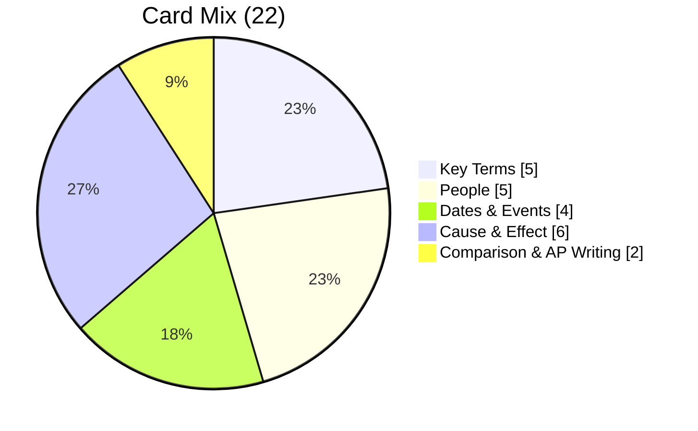

# Topic 5.6: Industrialization: Government's Role — Flashcards

*Unit 5: Revolutions (c. 1750–c. 1900) · 22 cards*  
Source: textbook World History Modern: AP® Edition, Topic 5.6 (pp. 317–324), from the text you provided, summarized in my own words. Items marked (CED addition) are not in that text.

## Card Mix

*Check the box when you can answer without opening the card.*

## Key Terms

- [ ] **1. What is state-sponsored industrialization?**
  

▶ Answer

  Industrial growth planned and funded by the government, as under Muhammad Ali in Egypt and the Meiji state in Japan.

  

- [ ] **2. Why was the Ottoman Empire called "the sick man of Europe"?**
  

▶ Answer

  It had not adopted Western technology or Enlightenment ideas, suffered rampant corruption and ethnic nationalist unrest, and was declining rapidly.

  

- [ ] **3. Who were the Mamluks?**
  

▶ Answer

  Formerly enslaved Turks who formed a military class and ruled Egypt for about 600 years.

  

- [ ] **4. What was the Charter Oath?**
  

▶ Answer

  The 1868 statement by which Japan formally abolished feudalism (per the textbook).

  

- [ ] **5. What were zaibatsu?**
  

▶ Answer

  Powerful Japanese family business organizations, like U.S. conglomerates, that bought state-built industries once they flourished.

  

## People

- [ ] **6. How did Muhammad Ali come to power in Egypt?**
  

▶ Answer

  An Albanian Ottoman officer, he rose to prominence fighting the Mamluks after 1801; local leaders chose him as governor, and the sultan had to agree.

  

- [ ] **7. Name four of Muhammad Ali's reforms.**
  

▶ Answer

  A European-model army; schools and officers sent to France; the first newspaper in the Islamic world; state-run textile, arms, and shipbuilding industries.

  

- [ ] **8. What did Commodore Matthew Perry do?**
  

▶ Answer

  He sailed into Edo Bay in 1853 asking for trade and returned in 1854 with more ships, forcing Japan to trade with the U.S.

  

- [ ] **9. What did Emperor Meiji say Japan's goal was in his 1871 letter to Ulysses Grant?**
  

▶ Answer

  To select the institutions of enlightened nations best suited to Japan and adopt them gradually, so as to be equal with them.

  

- [ ] **10. What is the story of Toyoda Loom Works?**
  

▶ Answer

  A carpenter founded it in 1906 to make an automatic loom; it prospered, changed its name, and became Toyota Motor Company.

  

## Dates & Events

- [ ] **11. 1600–1854 — what was Japan's foreign policy?**
  

▶ Answer

  Near isolation: very little contact with the rest of the world.

  

- [ ] **12. 1853 and 1854 — what happened in Japan?**
  

▶ Answer

  Perry arrived asking for trade privileges (1853) and returned with more warships to force trade (1854).

  

- [ ] **13. 1868 — what happened in Japan?**
  

▶ Answer

  Reformers overthrew the shogun and restored the emperor (Meiji Restoration); the Charter Oath abolished feudalism.

  

- [ ] **14. 1799–1815 — why did Egypt profit during these years?**
  

▶ Answer

  During the Napoleonic Wars European wheat prices were high, and the state controlled large amounts of farm produce.

  

## Cause & Effect

- [ ] **15. Why did Japan end its isolation?**
  

▶ Answer

  Western powers wanted markets and refueling stations for coal-powered ships, and Perry's warships forced Japan to open.

  

- [ ] **16. Why did Japanese reformers support the Meiji Restoration?**
  

▶ Answer

  They saw Britain humiliate China in the Opium Wars and feared Japan could not defend itself without adopting Western technology and methods.

  

- [ ] **17. How did Muhammad Ali's tax policy support industrialization?**
  

▶ Answer

  Very high taxes forced peasants to give land to the state, which then controlled cotton exports and used the profits to fund factories and the military.

  

- [ ] **18. How did the Meiji government pay for its reforms, and what was the effect?**
  

▶ Answer

  A high agricultural tax; it stimulated rapid economic growth and funded a bureaucracy centered in Tokyo.

  

- [ ] **19. What negative effect did Japan copy from Western industrialization?**
  

▶ Answer

  Abuse and exploitation of female mill workers, similar to what British women had experienced decades earlier.

  

- [ ] **20. Why did China fail to industrialize effectively in this period?**
  

▶ Answer

  It was less willing to accept European influence and goods, and its weakened government could not promote industry while Western powers expanded.

  

## Comparison & AP Writing

- [ ] **21. Compare state-sponsored industrialization in Egypt and Japan.**
  

▶ Answer

  **Claim:** Both states used government power to modernize the military and build industry, but Japan's reforms were broader and more lasting.  **Evidence:** Muhammad Ali built a European-model army, textile and arms factories, and Alexandria shipyards funded by state-controlled cotton; Meiji Japan abolished feudalism (1868), adopted a Prussian-style constitution and army, built schools and railroads, and subsidized key industries with a high land tax.  **Reasoning:** Egypt's reforms centered on one ruler and cotton profits, while Japan changed its political, legal, and educational institutions and later added private zaibatsu investment, so its industrialization could sustain itself.

  

- [ ] **22. Compare Japan's industrialization with developments in the West. (textbook Connect task)**
  

▶ Answer

  **Claim:** Japan followed the same basic path as Britain but compressed it into less than half a century through state direction.  **Evidence:** Britain's industrialization was led by private investors using capital from trade and empire over about a century; Japan's government studied Western institutions, subsidized silk, weapons, and shipbuilding, and funded growth with a high agricultural tax before selling industries to zaibatsu. In both, female mill workers faced abuse and exploitation.  **Reasoning:** Because Japan was industrializing to avoid domination, the state took the role private capital had played in Britain — speeding change, but reproducing the same social problems.

  

