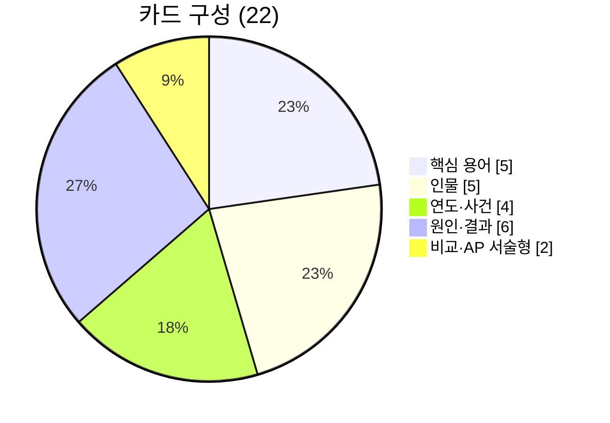

# Topic 5.6: 산업화와 정부의 역할 (Industrialization: Government's Role) — 플래시카드 (Flashcards)

*Unit 5: 혁명의 시대 (Revolutions, c. 1750–c. 1900) · 22장*  
출처: 교재 『World History Modern: AP® Edition』 5.6 (pp. 317–324). 제공해 주신 텍스트를 제 말로 요약했습니다. (CED 추가) 표시는 그 텍스트에 없는 내용입니다.

## 카드 구성

*정답을 열지 않고 답할 수 있으면 체크하세요.*

## 핵심 용어

- [ ] **1. 국가 주도 산업화 (State-sponsored industrialization)란?**
  

▶ 정답

  이집트의 무함마드 알리와 일본 메이지 정부처럼 정부가 계획하고 자금을 대는 산업 성장.

  

- [ ] **2. 오스만 제국은 왜 '유럽의 병자'라고 불렸나?**
  

▶ 정답

  서구 기술과 계몽사상을 받아들이지 않았고, 만연한 부패와 민족주의 소요로 빠르게 쇠퇴하고 있었기 때문이다.

  

- [ ] **3. 맘루크 (Mamluks)는 누구였나?**
  

▶ 정답

  군사 계급을 이루어 약 600년 동안 이집트를 다스린 노예 출신 튀르크인.

  

- [ ] **4. 5개조 서문 (Charter Oath)이란?**
  

▶ 정답

  일본이 봉건제를 공식 폐지한 1868년의 선언 (교재 기준).

  

- [ ] **5. 재벌 (Zaibatsu)이란?**
  

▶ 정답

  미국의 대기업 집단과 비슷한 강력한 일본 가족 기업 조직. 국가가 세운 산업이 번창하면 이를 사들였다.

  

## 인물

- [ ] **6. 무함마드 알리는 어떻게 이집트의 권력을 잡았나?**
  

▶ 정답

  알바니아 출신 오스만 장교로, 1801년 이후 맘루크와 싸우며 두각을 나타냈다. 지역 지도자들이 그를 총독으로 뽑자 술탄은 동의해야 했다.

  

- [ ] **7. 무함마드 알리의 개혁 네 가지를 들라.**
  

▶ 정답

  유럽식 군대, 학교 설립과 프랑스 장교 유학, 이슬람 세계 최초의 신문, 국영 섬유·무기·조선 산업.

  

- [ ] **8. 매슈 페리 제독은 무엇을 했나?**
  

▶ 정답

  1853년 에도만에 들어와 무역을 요구했고, 1854년 더 많은 배를 이끌고 돌아와 일본이 미국과 무역하게 만들었다.

  

- [ ] **9. 메이지 천황은 1871년 그랜트에게 보낸 편지에서 일본의 목표를 무엇이라고 했나?**
  

▶ 정답

  개화된 나라들의 제도 중 일본에 가장 맞는 것을 골라 점진적으로 받아들여, 그들과 대등해지는 것.

  

- [ ] **10. 도요다 직기 제작소의 이야기는?**
  

▶ 정답

  한 목수가 자동 직기를 만들려고 1906년에 세웠다. 번창해 이름을 바꾸고 도요타 자동차가 되었다.

  

## 연도·사건

- [ ] **11. 1600–1854년 일본의 대외 정책은?**
  

▶ 정답

  거의 고립: 바깥 세계와 거의 접촉하지 않았다.

  

- [ ] **12. 1853년과 1854년 일본에서 일어난 일은?**
  

▶ 정답

  페리가 무역 특권을 요구하며 도착했고(1853), 더 많은 군함을 이끌고 돌아와 무역을 강요했다(1854).

  

- [ ] **13. 1868년 일본에서 일어난 일은?**
  

▶ 정답

  개혁가들이 쇼군을 무너뜨리고 천황을 복권시켰다(메이지 유신). 5개조 서문이 봉건제를 폐지했다.

  

- [ ] **14. 1799–1815년 이집트가 이익을 얻은 이유는?**
  

▶ 정답

  나폴레옹 전쟁 동안 유럽의 밀값이 높았고, 국가가 많은 농산물을 통제하고 있었다.

  

## 원인·결과

- [ ] **15. 일본은 왜 고립을 끝냈나?**
  

▶ 정답

  서구 열강은 시장과 석탄선의 연료 보급지를 원했고, 페리의 군함이 일본의 개항을 강요했다.

  

- [ ] **16. 일본 개혁가들은 왜 메이지 유신을 지지했나?**
  

▶ 정답

  아편 전쟁에서 영국이 중국을 굴복시키는 것을 보고, 서구 기술과 방식을 받아들이지 않으면 일본이 스스로를 지킬 수 없다고 두려워했다.

  

- [ ] **17. 무함마드 알리의 조세 정책은 산업화를 어떻게 뒷받침했나?**
  

▶ 정답

  매우 높은 세금으로 농민들이 땅을 국가에 넘겼고, 국가는 면화 수출을 통제해 그 이익으로 공장과 군대에 자금을 댔다.

  

- [ ] **18. 메이지 정부는 개혁 자금을 어떻게 마련했으며 그 결과는?**
  

▶ 정답

  높은 농업세. 급속한 경제 성장을 이끌었고 도쿄 중심의 관료제 재원이 되었다.

  

- [ ] **19. 일본이 서구 산업화에서 함께 들여온 부정적 결과는?**
  

▶ 정답

  수십 년 전 영국 여성들이 겪은 것과 비슷한, 여성 방적 공장 노동자에 대한 학대와 착취.

  

- [ ] **20. 이 시기 중국은 왜 효과적으로 산업화하지 못했나?**
  

▶ 정답

  유럽의 영향과 상품을 받아들이는 데 소극적이었고, 서구 열강이 팽창하는 동안 약해진 정부가 산업을 육성하지 못했다.

  

## 비교·AP 서술형

- [ ] **21. 이집트와 일본의 국가 주도 산업화를 비교하라.**
  

▶ 정답

  **주장 (Claim):** 두 나라 모두 정부 권력으로 군대를 근대화하고 산업을 세웠지만, 일본의 개혁이 더 폭넓고 오래 지속되었다.  **근거 (Evidence):** 무함마드 알리는 국가가 통제하는 면화 수익으로 유럽식 군대, 섬유·무기 공장, 알렉산드리아 조선소를 만들었다. 메이지 일본은 봉건제를 폐지하고(1868) 프로이센식 헌법과 군대를 도입했으며, 높은 토지세로 학교·철도를 건설하고 핵심 산업에 보조금을 주었다.  **설명 (Reasoning):** 이집트의 개혁은 한 통치자와 면화 수익에 집중되었지만, 일본은 정치·법·교육 제도를 바꾸고 이후 재벌의 민간 투자를 더했기 때문에 산업화가 스스로 지속될 수 있었다.

  

- [ ] **22. 일본의 산업화를 서구의 발전과 비교하라. (교재 Connect 과제)**
  

▶ 정답

  **주장 (Claim):** 일본은 영국과 같은 기본 경로를 따랐지만, 국가의 주도로 이를 반세기도 안 되는 기간에 압축했다.  **근거 (Evidence):** 영국의 산업화는 약 한 세기에 걸쳐 무역과 제국에서 얻은 자본을 쓰는 민간 투자자가 이끌었다. 일본 정부는 서구 제도를 연구하고 비단·무기·조선에 보조금을 주었으며, 높은 농업세로 성장 자금을 마련한 뒤 산업을 재벌에 매각했다. 두 나라 모두 여성 방적공이 학대와 착취를 겪었다.  **설명 (Reasoning):** 일본은 지배를 피하려고 산업화했기 때문에, 영국에서 민간 자본이 하던 역할을 국가가 맡았다. 그 결과 변화는 빨라졌지만 같은 사회 문제가 되풀이되었다.

  

