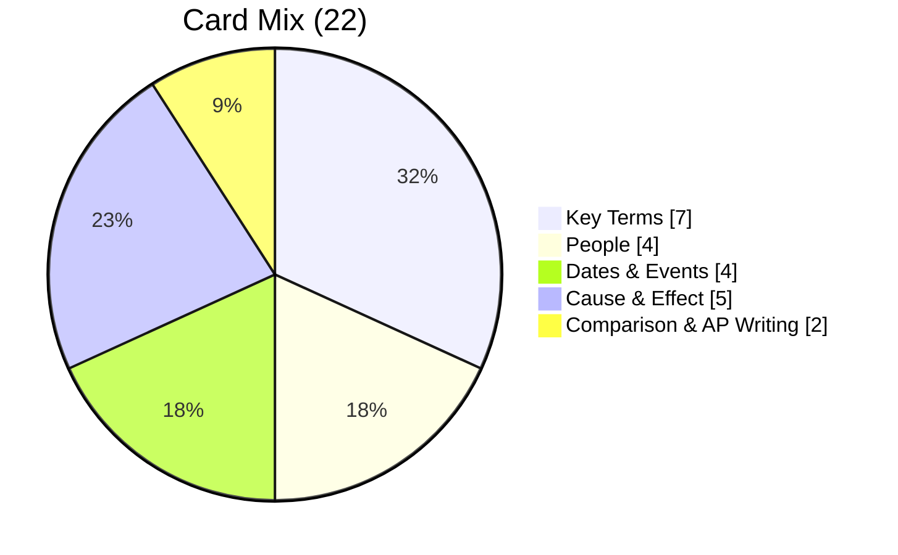

# Topic 5.7: Economic Developments and Innovations — Flashcards

*Unit 5: Revolutions (c. 1750–c. 1900) · 22 cards*  
Source: textbook World History Modern: AP® Edition, Topic 5.7 (pp. 325–331), from the text you provided, summarized in my own words. Items marked (CED addition) are not in that text.

## Card Mix

*Check the box when you can answer without opening the card.*

## Key Terms

- [ ] **1. What is laissez-faire, and what did it replace?**
  

▶ Answer

  "Leave alone": minimal government involvement in commerce and lower tariffs; it replaced mercantilism (economic protectionism).

  

- [ ] **2. Define a corporation.**
  

▶ Answer

  A business chartered by a government as a legal entity owned by stockholders.

  

- [ ] **3. What are dividends?**
  

▶ Answer

  Sums of money a corporation pays its stockholders when it makes a profit.

  

- [ ] **4. What happens to stockholders if a corporation goes bankrupt?**
  

▶ Answer

  They are not liable for the losses; the most they can lose is what they paid for the stock (limited liability).

  

- [ ] **5. How does a corporation differ from a sole proprietorship and a partnership?**
  

▶ Answer

  A sole proprietorship has one owner and a partnership a small group; a corporation is a more flexible structure for large-scale activity that spreads risk among many investors.

  

- [ ] **6. What is a monopoly? Give two examples.**
  

▶ Answer

  Control of a business with all competition eliminated: Krupp in German steel and Rockefeller in U.S. oil.

  

- [ ] **7. What is disposable income, and why did advertisers target it?**
  

▶ Answer

  Money for nonessential goods; the middle class had it, and consumption needed to keep up with production.

  

## People

- [ ] **8. What did Adam Smith argue about human nature and the economy?**
  

▶ Answer

  Humans are naturally transactional ("an animal that makes bargains"), so private enterprise and free markets should drive the economy (The Wealth of Nations, 1776).

  

- [ ] **9. Who was Alfred Krupp?**
  

▶ Answer

  A German industrialist in Essen who used the Bessemer process to gain a monopoly in German steel.

  

- [ ] **10. What was Cecil Rhodes's Cape-to-Cairo railroad plan?**
  

▶ Answer

  The founder of De Beers backed a railroad linking British colonies from Cape Town to Cairo for governance and war; it was never finished because Britain did not control all the land.

  

- [ ] **11. Who created a monopoly in the U.S. oil industry?**
  

▶ Answer

  John D. Rockefeller.

  

## Dates & Events

- [ ] **12. 1776 — what text became foundational for capitalism?**
  

▶ Answer

  Adam Smith's The Wealth of Nations.

  

- [ ] **13. 1865 — what bank opened in Hong Kong?**
  

▶ Answer

  HSBC, the British-owned Hong Kong and Shanghai Banking Corporation.

  

- [ ] **14. 1880s — what changed in bicycles?**
  

▶ Answer

  The chain-driven safety bicycle replaced the dangerous penny-farthing.

  

- [ ] **15. By 1890 — where did Unilever (the textbook's name) have soap factories?**
  

▶ Answer

  Australia, Switzerland, the United States, and beyond.

  

## Cause & Effect

- [ ] **16. Why did corporations make investment more attractive?**
  

▶ Answer

  They spread risk among many stockholders and limited each investor's loss, replacing high-risk single entrepreneurs.

  

- [ ] **17. How did corporations gain political power?**
  

▶ Answer

  Their economic decisions, such as where to build a factory, could create thousands of jobs for a community.

  

- [ ] **18. How did transnational companies exploit colonial labor and resources?**
  

▶ Answer

  African railway workers were paid far less than Europeans, and Unilever ran huge palm-oil plantations in the Belgian Congo.

  

- [ ] **19. How did Lloyd's of London and banks reduce business risk?**
  

▶ Answer

  Lloyd's helped establish marine insurance; banks offered safe deposits and loans to build factories and hire workers.

  

- [ ] **20. Why did companies and governments promote sports and public parks?**
  

▶ Answer

  Companies believed sports taught self-discipline and rule-following; parks and music halls mixed classes so lower classes might copy "civilized" behavior.

  

## Comparison & AP Writing

- [ ] **21. Explain how new economic institutions contributed to change from 1750 to 1900.**
  

▶ Answer

  **Claim:** Corporations, transnational companies, banks, and insurance concentrated capital and power and tied the world economy together.  **Evidence:** Limited-liability corporations spread risk and dominated banking and manufacturing; HSBC (1865) financed Asian trade; Unilever drew palm oil from West Africa and the Congo for factories on several continents; Lloyd's helped create marine insurance.  **Reasoning:** By lowering risk and pooling money from many investors, these institutions funded business on a new scale, which increased consumer goods but also let companies exploit colonial labor and resources.

  

- [ ] **22. Defend or refute: Mercantilism was necessary for the eventual growth of transnational companies. (textbook Connect task)**
  

▶ Answer

  **Claim:** Defend: mercantilism laid the foundations — colonies, trade networks, and capital — that later transnational companies used, even though they grew under laissez-faire.  **Evidence:** Mercantilist empires built colonies and chartered trading companies (Topic 4.4); HSBC opened in the British colony of Hong Kong (1865), Unilever relied on palm oil from British West Africa, and Rhodes's De Beers depended on British-held African colonies.  **Reasoning:** Transnational companies needed the colonial territories, shipping routes, and accumulated capital that mercantilism had created; laissez-faire then let them expand across borders with fewer restrictions.

  

