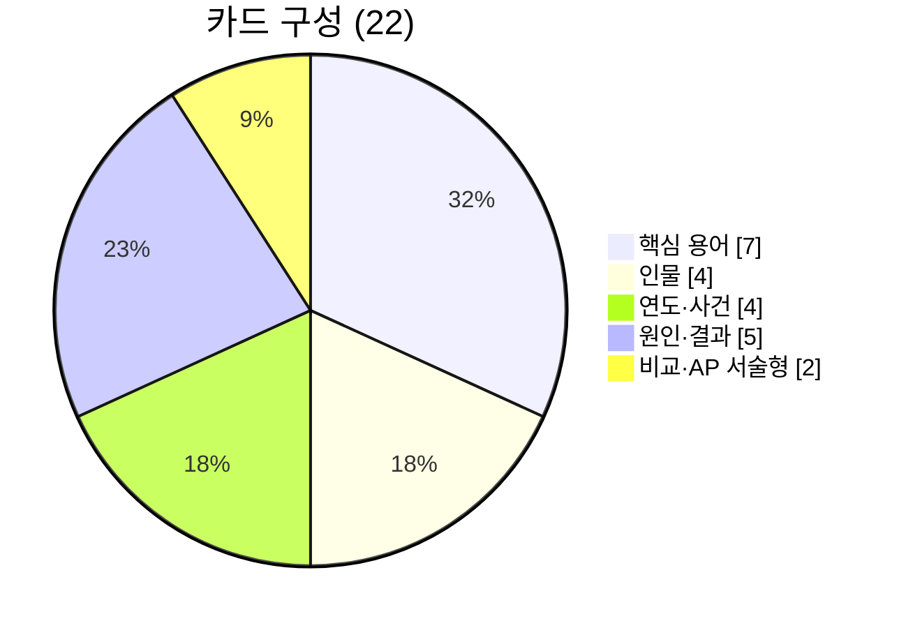

# Topic 5.7: 경제 발전과 혁신 (Economic Developments and Innovations) — 플래시카드 (Flashcards)

*Unit 5: 혁명의 시대 (Revolutions, c. 1750–c. 1900) · 22장*  
출처: 교재 『World History Modern: AP® Edition』 5.7 (pp. 325–331). 제공해 주신 텍스트를 제 말로 요약했습니다. (CED 추가) 표시는 그 텍스트에 없는 내용입니다.

## 카드 구성

*정답을 열지 않고 답할 수 있으면 체크하세요.*

## 핵심 용어

- [ ] **1. 자유방임 (Laissez-faire)이란 무엇이며 무엇을 대체했나?**
  

▶ 정답

  '내버려 두라': 상업에 대한 정부 개입을 최소화하고 관세를 낮추는 것. 중상주의(경제적 보호주의)를 대체했다.

  

- [ ] **2. 기업 (Corporation)을 정의하라.**
  

▶ 정답

  정부가 법인으로 인가하고 주주가 소유하는 사업체.

  

- [ ] **3. 배당금 (Dividends)이란?**
  

▶ 정답

  기업이 이익을 냈을 때 주주에게 지급하는 돈.

  

- [ ] **4. 기업이 파산하면 주주는 어떻게 되나?**
  

▶ 정답

  손실에 책임지지 않는다. 최대 손실은 주식을 산 금액이다(유한 책임).

  

- [ ] **5. 기업은 개인 사업, 동업과 어떻게 다른가?**
  

▶ 정답

  개인 사업은 소유주가 한 명, 동업은 소수다. 기업은 많은 투자자에게 위험을 나누는, 대규모 활동에 더 유연한 구조다.

  

- [ ] **6. 독점 (Monopoly)이란? 예를 두 가지 들라.**
  

▶ 정답

  경쟁을 모두 없애고 사업을 지배하는 것. 독일 철강의 크루프, 미국 석유의 록펠러.

  

- [ ] **7. 가처분 소득 (Disposable income)이란 무엇이며 광고주는 왜 이를 노렸나?**
  

▶ 정답

  필수품이 아닌 상품에 쓸 수 있는 돈. 중산층에게 이런 소득이 있었고, 소비가 생산을 따라가야 했다.

  

## 인물

- [ ] **8. 애덤 스미스는 인간 본성과 경제에 대해 무엇을 주장했나?**
  

▶ 정답

  인간은 본래 거래하는 존재('흥정하는 동물')이므로 민간 기업과 자유 시장이 경제를 이끌어야 한다(『국부론』, 1776).

  

- [ ] **9. 알프레트 크루프는 누구인가?**
  

▶ 정답

  베서머 공법을 이용해 독일 철강을 독점한 에센의 독일 기업가.

  

- [ ] **10. 세실 로즈의 케이프-카이로 철도 계획이란?**
  

▶ 정답

  드비어스 창립자가 통치와 전쟁을 위해 케이프타운에서 카이로까지 영국 식민지를 잇는 철도를 후원했다. 영국이 모든 땅을 차지하지 못해 완성되지 않았다.

  

- [ ] **11. 미국 석유 산업을 독점한 사람은?**
  

▶ 정답

  존 D. 록펠러.

  

## 연도·사건

- [ ] **12. 1776년 자본주의의 기초 문헌이 된 책은?**
  

▶ 정답

  애덤 스미스의 『국부론』.

  

- [ ] **13. 1865년 홍콩에서 문을 연 은행은?**
  

▶ 정답

  영국 소유의 홍콩상하이은행 (HSBC).

  

- [ ] **14. 1880년대 자전거에 어떤 변화가 있었나?**
  

▶ 정답

  체인으로 움직이는 안전 자전거가 위험한 페니파딩을 대체했다.

  

- [ ] **15. 1890년경 유니레버(교재 표기)의 비누 공장은 어디에 있었나?**
  

▶ 정답

  오스트레일리아, 스위스, 미국 등.

  

## 원인·결과

- [ ] **16. 기업은 왜 투자를 더 매력적으로 만들었나?**
  

▶ 정답

  위험을 많은 주주에게 나누고 투자자 각자의 손실을 제한해, 높은 위험을 혼자 지던 기업가 체제를 대신했다.

  

- [ ] **17. 기업은 어떻게 정치적 힘을 얻었나?**
  

▶ 정답

  공장을 어디에 지을지 같은 경제적 결정으로 한 지역에 수천 개의 일자리를 만들 수 있었다.

  

- [ ] **18. 다국적 기업은 식민지의 노동과 자원을 어떻게 착취했나?**
  

▶ 정답

  아프리카 철도 노동자는 유럽인보다 훨씬 적은 임금을 받았고, 유니레버는 벨기에령 콩고에서 거대한 팜유 플랜테이션을 운영했다.

  

- [ ] **19. 런던의 로이즈와 은행은 어떻게 사업 위험을 줄였나?**
  

▶ 정답

  로이즈는 해상 보험을 확립하는 데 기여했고, 은행은 안전한 예금과 공장·고용을 위한 대출을 제공했다.

  

- [ ] **20. 기업과 정부는 왜 스포츠와 공원을 장려했나?**
  

▶ 정답

  기업은 스포츠가 자기 절제와 규칙 준수를 가르친다고 믿었다. 공원과 뮤직홀은 계급을 섞어 하층 계급이 '교양 있는' 행동을 따라 하게 하려 했다.

  

## 비교·AP 서술형

- [ ] **21. 1750–1900년 새로운 경제 제도가 변화에 어떻게 기여했는지 설명하라.**
  

▶ 정답

  **주장 (Claim):** 기업, 다국적 기업, 은행, 보험은 자본과 권력을 집중시키고 세계 경제를 하나로 묶었다.  **근거 (Evidence):** 유한 책임 기업은 위험을 나누며 은행업과 제조업을 지배했다. HSBC(1865)는 아시아 무역에 자금을 댔고, 유니레버는 서아프리카와 콩고의 팜유로 여러 대륙의 공장을 운영했다. 로이즈는 해상 보험을 만드는 데 기여했다.  **설명 (Reasoning):** 이 제도들은 위험을 낮추고 많은 투자자의 돈을 모아 전에 없던 규모의 사업에 자금을 댔다. 그 결과 소비재가 늘었지만, 기업이 식민지의 노동과 자원을 착취할 수도 있게 되었다.

  

- [ ] **22. 주장을 옹호하거나 반박하라: 중상주의는 다국적 기업이 성장하는 데 필요했다. (교재 Connect 과제)**
  

▶ 정답

  **주장 (Claim):** 옹호: 다국적 기업은 자유방임 아래에서 성장했지만, 그 기반이 된 식민지·무역망·자본은 중상주의가 마련했다.  **근거 (Evidence):** 중상주의 제국은 식민지와 국가 인가 무역 회사를 만들었다(4.4). HSBC는 영국 식민지 홍콩에서 문을 열었고(1865), 유니레버는 영국령 서아프리카의 팜유에 의존했으며, 로즈의 드비어스는 영국이 차지한 아프리카 식민지에 기대고 있었다.  **설명 (Reasoning):** 다국적 기업에는 중상주의가 만들어 둔 식민지, 해운 항로, 축적된 자본이 필요했다. 이후 자유방임은 이들이 적은 규제로 국경을 넘어 확장하게 해 주었다.

  

