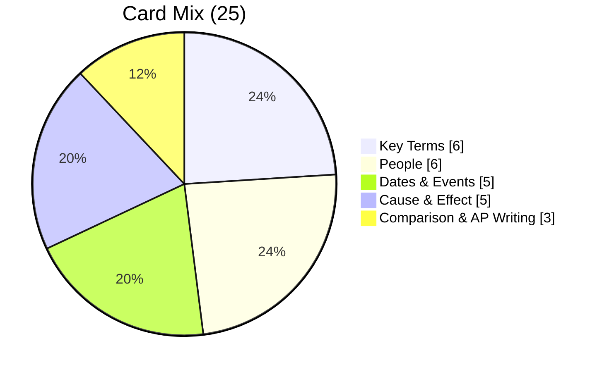

# Topic 5.8: Reactions to the Industrial Economy — Flashcards

*Unit 5: Revolutions (c. 1750–c. 1900) · 25 cards*  
Source: textbook World History Modern: AP® Edition, Topic 5.8 (pp. 332–342), from the text you provided, summarized in my own words. Items marked (CED addition) are not in that text.

## Card Mix

*Check the box when you can answer without opening the card.*

## Key Terms

- [ ] **1. What was the Sadler Report?**
  

▶ Answer

  A British parliamentary study (1833 per the textbook) describing harsh factory conditions, which built support for reform.

  

- [ ] **2. What is utilitarianism?**
  

▶ Answer

  Mill's philosophy seeking "the greatest good for the greatest number" through gradual reform of capitalism.

  

- [ ] **3. Define proletariat, bourgeoisie, and means of production.**
  

▶ Answer

  Proletariat: working class; bourgeoisie: middle class and investors who own factories; means of production: machines, factories, mines, and land.

  

- [ ] **4. What was the Hatt-i Humayun?**
  

▶ Answer

  The 1856 Ottoman Reform Edict declaring equality for all men in education, office, and justice regardless of religion, and regulating the millets.

  

- [ ] **5. What were the millets?**
  

▶ Answer

  Separate legal courts of religious communities, each using its own religious laws.

  

- [ ] **6. What was the Self-Strengthening Movement's strategy?**
  

▶ Answer

  Graft modern technology and ideas onto Chinese tradition, mainly military technology, shipyards, and arsenals, instead of major change.

  

## People

- [ ] **7. Who was "Mother" Jones?**
  

▶ Answer

  Mary Harris Jones (1837–1930), a labor organizer who described coal miners' severe deprivation.

  

- [ ] **8. How did John Stuart Mill want to change industrial society?**
  

▶ Answer

  Through legal reforms allowing unions, limiting child labor, and ensuring safe factories — reforming capitalism, not replacing it.

  

- [ ] **9. How did Marx differ from the utopian socialists?**
  

▶ Answer

  He scorned them for escaping problems and called his own approach "scientific socialism," based on how the world actually worked.

  

- [ ] **10. What were Mahmud II's main reforms?**
  

▶ Answer

  Abolished the Janissaries (1826) and the feudal system (1831), centralized taxes to pay the army, and built roads, a postal service, and European-style ministries.

  

- [ ] **11. Why was Abdulhamid called the "Red Sultan"?**
  

▶ Answer

  His government stirred anger against minorities, leading to the Hamidian massacres (1894–1896) of 100,000–250,000 Armenians.

  

- [ ] **12. Who were Kang Youwei and Empress Dowager Cixi?**
  

▶ Answer

  Kang persuaded Emperor Guangxu to launch the Hundred Days of Reform; Cixi, a conservative, staged a coup, imprisoned the emperor, and repealed the reforms.

  

## Dates & Events

- [ ] **13. 1832, 1867, 1884, 1918, 1928 — what happened to British voting rights?**
  

▶ Answer

  Reform bills expanded the male vote; all men gained the vote in 1918 and women equal suffrage in 1928.

  

- [ ] **14. 1843 and 1881 — what changed for British children?**
  

▶ Answer

  Children under 10 were banned from coal mines (1843), and school became mandatory for ages 5–10 (1881).

  

- [ ] **15. 1848 — what did Marx and Engels publish?**
  

▶ Answer

  The Communist Manifesto, a critique of capitalism.

  

- [ ] **16. 1826 and 1856 — what Ottoman reforms occurred?**
  

▶ Answer

  Mahmud II abolished the Janissaries (1826); the Hatt-i Humayun declared legal equality (1856).

  

- [ ] **17. 1871 — what happened to Japan's samurai?**
  

▶ Answer

  They received a final lump-sum payment and their class was legally dissolved (per the textbook).

  

## Cause & Effect

- [ ] **18. What were the effects of labor unions?**
  

▶ Answer

  They won minimum wages, hour limits, overtime pay, and the five-day week, and sparked a wider push for working-class voting rights.

  

- [ ] **19. How did Ottoman reforms affect women?**
  

▶ Answer

  Mostly negatively: secular law ended women's right to pass property through trusts, new industrial jobs went to men, and the 1839 Tanzimat did not mention women.

  

- [ ] **20. Why did both Balkan Christians and Muslims protest the 1856 edict?**
  

▶ Answer

  Christians feared losing the autonomy of their millets; Muslims felt the reforms conflicted with traditional values.

  

- [ ] **21. Why did Cixi block railroads and telegraphs?**
  

▶ Answer

  She feared foreign influence and resisted technology that would extend foreigners' reach into China.

  

- [ ] **22. Why did some samurai resist Meiji reforms?**
  

▶ Answer

  They lost their class, swords, and status, and wanted to keep traditional dress, hair, and local autonomy.

  

## Comparison & AP Writing

- [ ] **23. Compare the responses of the Ottoman Empire, China, and Japan to industrialization.**
  

▶ Answer

  **Claim:** All three reformed to strengthen themselves against industrial powers, but they differed in timing, leadership, and depth of change.  **Evidence:** The Ottomans started earliest (Mahmud II, 1826; Tanzimat, 1839–1876), but Abdulhamid grew conservative and exiled the Young Turks; China's Self-Strengthening only grafted technology onto tradition and Cixi repealed the Hundred Days of Reform before later accepting civil-service change; Japan changed rapidly after 1868, provoking samurai resistance.  **Reasoning:** Japan's leaders committed to deep institutional change, while Ottoman and Qing rulers feared that reform would weaken their own power, so their reforms stayed partial.

  

- [ ] **24. Compare utopian and Marxist thought. (textbook Connect task)**
  

▶ Answer

  **Claim:** Both rejected capitalism as basically flawed, but utopian socialists sought peaceful model communities while Marx called for workers to seize the means of production.  **Evidence:** Owen, Fourier, and Saint-Simon built or proposed harmonious communities (5.1); Marx's Communist Manifesto (1848) described class conflict between proletariat and bourgeoisie and predicted socialism, then communism. Marx scorned utopians for escaping problems.  **Reasoning:** Utopians believed example and cooperation could change society, while Marx believed capitalism's structure made class conflict unavoidable, so only workers taking control could end exploitation.

  

- [ ] **25. Explain how reformers and workers in Britain changed industrial society.**
  

▶ Answer

  **Claim:** Through reports, unions, and laws, British reformers gradually improved working conditions and expanded political rights.  **Evidence:** The Sadler Report exposed factory conditions; unions won wages, hour limits, and overtime; reform bills (1832, 1867, 1884) led to votes for all men (1918) and women (1928); laws banned young children from mines (1843) and required schooling (1881).  **Reasoning:** Publicizing abuses and organizing workers created political pressure, and wider voting rights gave workers power to demand further reform — the gradual path Mill favored.

  

