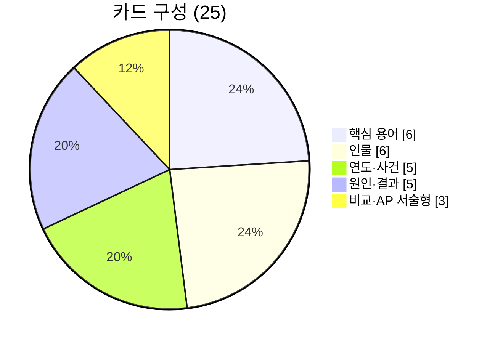

# Topic 5.8: 산업 경제에 대한 반응 (Reactions to the Industrial Economy) — 플래시카드 (Flashcards)

*Unit 5: 혁명의 시대 (Revolutions, c. 1750–c. 1900) · 25장*  
출처: 교재 『World History Modern: AP® Edition』 5.8 (pp. 332–342). 제공해 주신 텍스트를 제 말로 요약했습니다. (CED 추가) 표시는 그 텍스트에 없는 내용입니다.

## 카드 구성

*정답을 열지 않고 답할 수 있으면 체크하세요.*

## 핵심 용어

- [ ] **1. 새들러 보고서 (Sadler Report)란?**
  

▶ 정답

  혹독한 공장 환경을 기록해 개혁에 대한 지지를 모은 영국 의회 보고서(교재 기준 1833년).

  

- [ ] **2. 공리주의 (Utilitarianism)란?**
  

▶ 정답

  자본주의의 점진적 개혁을 통해 '최대 다수의 최대 행복'을 추구한 밀의 철학.

  

- [ ] **3. 프롤레타리아, 부르주아, 생산 수단을 정의하라.**
  

▶ 정답

  프롤레타리아: 노동 계급. 부르주아: 공장을 소유한 중산층과 투자자. 생산 수단: 기계, 공장, 광산, 토지.

  

- [ ] **4. 하트이 휘마윤 (Hatt-i Humayun)이란?**
  

▶ 정답

  종교와 관계없이 모든 남성의 교육·관직·사법상 평등을 선언하고 밀레트를 규제한 1856년 오스만 개혁 칙령.

  

- [ ] **5. 밀레트 (Millets)란?**
  

▶ 정답

  종교 공동체마다 자신의 종교법을 쓰는 분리된 법정.

  

- [ ] **6. 양무운동의 전략은?**
  

▶ 정답

  큰 변화 대신 근대 기술과 사상, 주로 군사 기술·조선소·무기 공장을 중국 전통에 접목하는 것.

  

## 인물

- [ ] **7. '마더' 존스는 누구인가?**
  

▶ 정답

  광부들의 심각한 고통을 알린 노동 운동가 메리 해리스 존스(1837–1930).

  

- [ ] **8. 존 스튜어트 밀은 산업 사회를 어떻게 바꾸려 했나?**
  

▶ 정답

  노동조합 허용, 아동 노동 제한, 안전한 공장을 위한 법 개혁. 자본주의를 대체하지 않고 개혁하려 했다.

  

- [ ] **9. 마르크스는 유토피아 사회주의자와 어떻게 달랐나?**
  

▶ 정답

  그는 그들이 문제에서 도피한다고 경멸했고, 세상이 실제로 작동하는 방식에 근거한 자신의 방식을 '과학적 사회주의'라 불렀다.

  

- [ ] **10. 마흐무트 2세의 주요 개혁은?**
  

▶ 정답

  예니체리(1826)와 봉건 제도(1831)를 폐지하고, 세금을 중앙으로 모아 군대에 급여를 주었으며, 도로·우편·유럽식 부처를 만들었다.

  

- [ ] **11. 압뒬하미트는 왜 '붉은 술탄'이라 불렸나?**
  

▶ 정답

  그의 정부가 소수 민족에 대한 증오를 부추겨 아르메니아인 10만–25만 명이 죽은 하미디예 학살(1894–1896)로 이어졌다.

  

- [ ] **12. 캉유웨이와 서태후는 누구인가?**
  

▶ 정답

  캉유웨이는 광서제를 설득해 무술변법을 시작하게 했다. 보수파 서태후는 정변으로 황제를 가두고 개혁을 폐지했다.

  

## 연도·사건

- [ ] **13. 1832·1867·1884·1918·1928년 영국 선거권에 일어난 일은?**
  

▶ 정답

  선거법 개정으로 남성 투표권이 확대되었고, 1918년 모든 남성, 1928년 여성이 동등한 선거권을 얻었다.

  

- [ ] **14. 1843년과 1881년 영국 아동에게 무엇이 바뀌었나?**
  

▶ 정답

  10세 미만 아동의 탄광 노동이 금지되었고(1843), 5–10세 의무 교육이 시작되었다(1881).

  

- [ ] **15. 1848년 마르크스와 엥겔스가 발표한 것은?**
  

▶ 정답

  자본주의를 비판한 『공산당 선언』.

  

- [ ] **16. 1826년과 1856년 오스만에서 일어난 개혁은?**
  

▶ 정답

  마흐무트 2세가 예니체리를 폐지했고(1826), 하트이 휘마윤이 법적 평등을 선언했다(1856).

  

- [ ] **17. 1871년 일본의 사무라이에게 일어난 일은?**
  

▶ 정답

  마지막 일시금을 받고 신분이 법적으로 폐지되었다(교재 기준).

  

## 원인·결과

- [ ] **18. 노동조합의 결과는?**
  

▶ 정답

  최저 임금, 노동 시간 제한, 초과 근무 수당, 주 5일 근무를 얻었고, 노동 계급의 선거권 확대 운동을 일으켰다.

  

- [ ] **19. 오스만 개혁은 여성에게 어떤 영향을 주었나?**
  

▶ 정답

  대체로 부정적이었다. 세속 법이 신탁을 통한 여성의 재산 상속권을 없앴고, 새 산업 일자리는 남성에게 갔으며, 1839년 탄지마트는 여성을 언급하지 않았다.

  

- [ ] **20. 발칸 기독교도와 무슬림은 왜 모두 1856년 칙령에 반대했나?**
  

▶ 정답

  기독교도는 밀레트의 자치를 잃을까 두려워했고, 무슬림은 개혁이 전통적 가치와 어긋난다고 느꼈다.

  

- [ ] **21. 서태후는 왜 철도와 전신을 막았나?**
  

▶ 정답

  외국의 영향력을 두려워해, 외국인의 힘이 중국 안으로 뻗치게 할 기술에 저항했다.

  

- [ ] **22. 일부 사무라이는 왜 메이지 개혁에 저항했나?**
  

▶ 정답

  신분·칼·지위를 잃었고, 전통 복장과 머리 모양, 지방 자치를 지키고 싶었기 때문이다.

  

## 비교·AP 서술형

- [ ] **23. 산업화에 대한 오스만 제국, 중국, 일본의 대응을 비교하라.**
  

▶ 정답

  **주장 (Claim):** 세 나라 모두 공업 강국에 맞서 스스로를 강화하려고 개혁했지만, 시기·지도력·변화의 깊이가 달랐다.  **근거 (Evidence):** 오스만은 가장 일찍 시작했지만(마흐무트 2세 1826, 탄지마트 1839–1876), 압뒬하미트는 보수화되어 청년 튀르크당을 추방했다. 중국의 양무운동은 기술만 전통에 접목했고, 서태후는 무술변법을 폐지한 뒤에야 관료제 개혁을 받아들였다. 일본은 1868년 이후 빠르게 변해 사무라이의 저항을 불렀다.  **설명 (Reasoning):** 일본의 지도자들은 깊은 제도 변화를 택했지만, 오스만과 청의 통치자들은 개혁이 자신의 권력을 약화시킬까 두려워했기 때문에 개혁이 부분적인 데 그쳤다.

  

- [ ] **24. 유토피아 사상과 마르크스주의를 비교하라. (교재 Connect 과제)**
  

▶ 정답

  **주장 (Claim):** 둘 다 자본주의에 근본적 결함이 있다고 보았지만, 유토피아 사회주의자는 평화로운 모범 공동체를, 마르크스는 노동자의 생산 수단 장악을 추구했다.  **근거 (Evidence):** 오언·푸리에·생시몽은 조화로운 공동체를 세우거나 제안했다(5.1). 마르크스의 『공산당 선언』(1848)은 프롤레타리아와 부르주아의 계급 갈등을 설명하고 사회주의와 공산주의의 도래를 예측했다. 마르크스는 유토피아주의자가 문제에서 도피한다고 경멸했다.  **설명 (Reasoning):** 유토피아주의자는 모범과 협력으로 사회를 바꿀 수 있다고 믿었지만, 마르크스는 자본주의의 구조 때문에 계급 갈등이 피할 수 없다고 보았다. 그래서 노동자가 권력을 잡아야만 착취가 끝난다고 생각했다.

  

- [ ] **25. 영국의 개혁가와 노동자가 산업 사회를 어떻게 바꾸었는지 설명하라.**
  

▶ 정답

  **주장 (Claim):** 보고서, 노동조합, 법을 통해 영국의 개혁가들은 노동 조건을 점차 개선하고 정치적 권리를 확대했다.  **근거 (Evidence):** 새들러 보고서가 공장 실태를 폭로했고, 노동조합은 임금·노동 시간 제한·초과 근무 수당을 얻었다. 선거법 개정(1832, 1867, 1884)은 모든 남성(1918)과 여성(1928)의 투표권으로 이어졌고, 법이 어린 아동의 탄광 노동을 금지하고(1843) 교육을 의무화했다(1881).  **설명 (Reasoning):** 폐해를 알리고 노동자를 조직하자 정치적 압력이 생겼고, 넓어진 선거권은 노동자에게 추가 개혁을 요구할 힘을 주었다. 이는 밀이 선호한 점진적 개혁의 길이었다.

  

