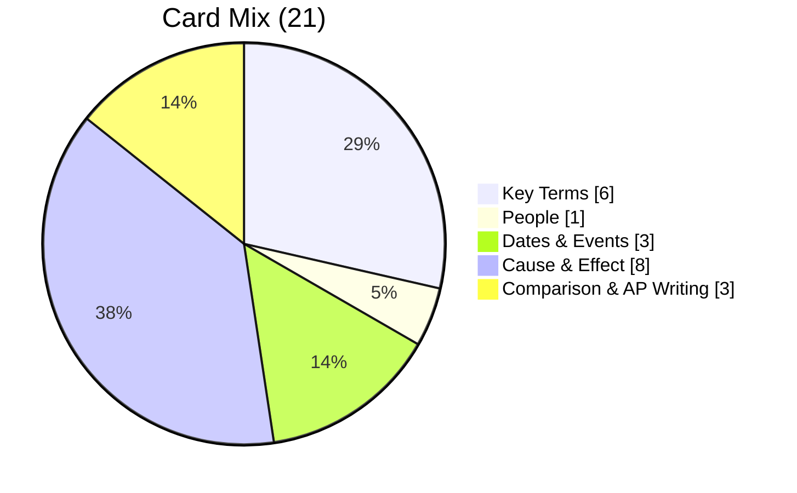

# Topic 5.9: Society and the Industrial Age — Flashcards

*Unit 5: Revolutions (c. 1750–c. 1900) · 21 cards*  
Source: textbook World History Modern: AP® Edition, Topic 5.9 (pp. 343–350), from the text you provided, summarized in my own words. Items marked (CED addition) are not in that text.

## Card Mix

*Check the box when you can answer without opening the card.*

## Key Terms

- [ ] **1. What were tenements and slums?**
  

▶ Answer

  Tenements: crowded, shoddy apartment buildings, often owned by factory owners; slums: city areas where low-income families were forced to live, with polluted water and open sewers.

  

- [ ] **2. Who were white-collar workers?**
  

▶ Answer

  Literate middle-class office workers: factory and office managers, small business owners, and professionals.

  

- [ ] **3. Who were the "captains of industry"?**
  

▶ Answer

  Industrialists and owners of large corporations at the top of society, who overshadowed the landed aristocracy.

  

- [ ] **4. What was the cult of domesticity?**
  

▶ Answer

  A late-1800s ideal, spread by advertising and pamphlets, of women as pious, submissive, pure, and domestic homemakers.

  

- [ ] **5. What is smog?**
  

▶ Answer

  Smoke and fog from coal-burning factories that caused deadly respiratory problems.

  

- [ ] **6. What was the second wave of colonization?**
  

▶ Answer

  New colonial expansion by industrial states seeking raw materials such as cotton and rubber.

  

## People

- [ ] **7. What contrast did Charles Dickens show in Oliver Twist (1839)?**
  

▶ Answer

  The prosperous, well-housed middle class versus the homeless, starving urban poor.

  

## Dates & Events

- [ ] **8. 1848 — what happened at Seneca Falls?**
  

▶ Answer

  About 300 people met to call for equality for women.

  

- [ ] **9. 1840s — what did Britain ban in coal mines?**
  

▶ Answer

  Hiring women to work in coal mines.

  

- [ ] **10. First half of the 1800s — how did cities grow?**
  

▶ Answer

  Rapidly and with little government planning, creating slums and ecological damage.

  

## Cause & Effect

- [ ] **11. Why were factory workers seen as easily replaceable?**
  

▶ Answer

  Interchangeable parts and the division of labor meant workers did one simple task and needed fewer skills than artisans.

  

- [ ] **12. Why did families send children to work?**
  

▶ Answer

  Factory wages were so low that families needed children's income.

  

- [ ] **13. Why did factory owners prefer to hire women?**
  

▶ Answer

  They could pay women about half of what they paid men.

  

- [ ] **14. How did industrialization change family life?**
  

▶ Answer

  Large machines made home work impossible, so family members left home for long workdays instead of working near each other.

  

- [ ] **15. What caused disease to spread in industrial cities, and how did cities respond?**
  

▶ Answer

  Crowded tenements, polluted water, and open sewers spread cholera; cities passed public health acts for drainage, sewers, clean water, and rubbish removal.

  

- [ ] **16. How did industrialization spur feminism?**
  

▶ Answer

  When men left communities for jobs, women who stayed gained new opportunities, leading to calls for equality such as Seneca Falls.

  

- [ ] **17. Why did people keep moving to cities despite poor conditions?**
  

▶ Answer

  Rural poverty and the wealth and opportunities of the urban middle class; many did find a better life.

  

- [ ] **18. How did industrialization increase global inequality?**
  

▶ Answer

  Early industrializers exploited overseas resources, undercut industry in Egypt, China, and India, and began a second wave of colonization.

  

## Comparison & AP Writing

- [ ] **19. Explain the extent to which industrialization changed social hierarchies from 1750 to 1900.**
  

▶ Answer

  **Claim:** Industrialization greatly changed who was at the top and created new classes, but it did not end inequality.  **Evidence:** Captains of industry overshadowed the landed aristocracy; a literate white-collar middle class of managers and professionals grew; the working class did low-skilled work 14 hours a day for low wages; women were paid half of men's wages.  **Reasoning:** Wealth from industry replaced land as the source of status, but because workers were seen as replaceable and competition kept wages low, a new and unequal relationship formed between owners and workers.

  

- [ ] **20. Compare the effects of industrialization on working-class and middle-class women.**
  

▶ Answer

  **Claim:** Both groups were limited by gender roles, but working-class women faced hard, low-paid labor while middle-class women were confined to the home.  **Evidence:** Working-class women worked in mines and textile mills for half of men's pay and still did housework; middle-class women were spared factory work but lived within the cult of domesticity, where a stay-at-home wife was a status symbol.  **Reasoning:** Class decided how gender roles were experienced: only middle-class families could live on one income, while working-class families needed every member's wages.

  

- [ ] **21. Examine changes in class structure from 17th-century Europe to the second industrial revolution. (textbook Connect task)**
  

▶ Answer

  **Claim:** Class structure shifted from a hierarchy based on land and birth to one based on industrial wealth and occupation.  **Evidence:** In the 1600s landed aristocrats sat at the top, with merchants and artisans below and peasants at the bottom (Topic 4.7); by the late 1800s captains of industry overshadowed aristocrats, a white-collar middle class of managers and professionals grew, and low-skilled factory workers replaced artisans and peasants at the bottom.  **Reasoning:** Industrial production made investment and management the main sources of wealth, while machines and division of labor reduced the value of craft skills, reshaping every level of the hierarchy.

  

