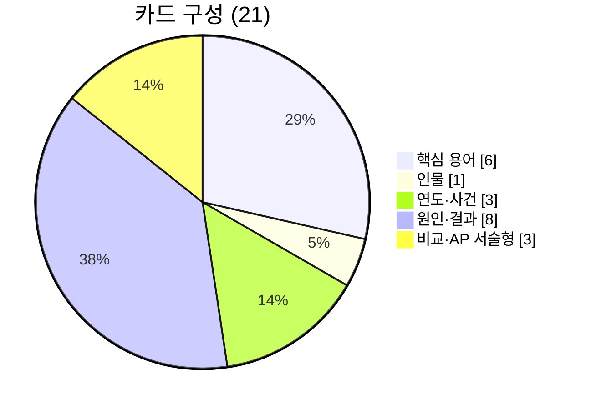

# Topic 5.9: 산업 시대의 사회 (Society and the Industrial Age) — 플래시카드 (Flashcards)

*Unit 5: 혁명의 시대 (Revolutions, c. 1750–c. 1900) · 21장*  
출처: 교재 『World History Modern: AP® Edition』 5.9 (pp. 343–350). 제공해 주신 텍스트를 제 말로 요약했습니다. (CED 추가) 표시는 그 텍스트에 없는 내용입니다.

## 카드 구성

*정답을 열지 않고 답할 수 있으면 체크하세요.*

## 핵심 용어

- [ ] **1. 공동 주택 (Tenements)과 빈민가 (Slums)란?**
  

▶ 정답

  공동 주택: 흔히 공장주가 소유한 비좁고 부실한 아파트. 빈민가: 저소득 가정이 살 수밖에 없던, 오염된 물과 노천 하수도가 있는 도시 지역.

  

- [ ] **2. 화이트칼라 노동자 (White-collar workers)는 누구였나?**
  

▶ 정답

  글을 읽을 줄 아는 중산층 사무직 노동자. 공장·사무실 관리자, 소상공인, 전문직.

  

- [ ] **3. '산업계의 거물 (captains of industry)'은 누구였나?**
  

▶ 정답

  토지 귀족을 압도한, 사회 꼭대기의 산업가와 대기업 소유주.

  

- [ ] **4. 가정 숭배 (Cult of domesticity)란?**
  

▶ 정답

  광고와 소책자를 통해 퍼진 1800년대 후반의 이상. 여성을 경건하고 순종적이며 순결하고 가정적인 주부로 여겼다.

  

- [ ] **5. 스모그 (Smog)란?**
  

▶ 정답

  치명적인 호흡기 질환을 일으킨, 석탄 공장의 연기와 안개.

  

- [ ] **6. 제2차 식민지화 (Second wave of colonization)란?**
  

▶ 정답

  면화·고무 같은 원료를 찾던 공업국의 새로운 식민지 팽창.

  

## 인물

- [ ] **7. 찰스 디킨스는 『올리버 트위스트』(1839)에서 어떤 대비를 보여 주었나?**
  

▶ 정답

  번영하고 집이 있는 중산층과, 집 없이 굶주리는 도시 빈민의 대비.

  

## 연도·사건

- [ ] **8. 1848년 세네카 폴스에서 일어난 일은?**
  

▶ 정답

  약 300명이 모여 여성의 평등을 요구했다.

  

- [ ] **9. 1840년대 영국은 탄광에서 무엇을 금지했나?**
  

▶ 정답

  탄광에 여성을 고용하는 것.

  

- [ ] **10. 1800년대 전반 도시는 어떻게 성장했나?**
  

▶ 정답

  정부 계획 없이 급속히 성장해 빈민가와 환경 피해를 낳았다.

  

## 원인·결과

- [ ] **11. 공장 노동자는 왜 쉽게 대체할 수 있다고 여겨졌나?**
  

▶ 정답

  호환 부품과 분업 때문에 노동자는 단순한 작업 하나만 했고, 장인보다 기술이 덜 필요했다.

  

- [ ] **12. 가족들은 왜 아이들을 일터에 보냈나?**
  

▶ 정답

  공장 임금이 너무 낮아 아이들의 수입이 필요했다.

  

- [ ] **13. 공장주들은 왜 여성 고용을 선호했나?**
  

▶ 정답

  여성에게는 남성 임금의 절반 정도만 줘도 되었기 때문이다.

  

- [ ] **14. 산업화는 가족생활을 어떻게 바꾸었나?**
  

▶ 정답

  큰 기계 때문에 집에서 일할 수 없게 되어, 가족들이 함께 가까이서 일하는 대신 긴 노동을 위해 집을 떠났다.

  

- [ ] **15. 공업 도시에서 질병이 퍼진 원인과 도시의 대응은?**
  

▶ 정답

  비좁은 공동 주택, 오염된 물, 노천 하수도가 콜레라를 퍼뜨렸다. 도시는 배수·하수도·깨끗한 물·쓰레기 수거를 위한 공중 보건법을 만들었다.

  

- [ ] **16. 산업화는 어떻게 페미니즘을 자극했나?**
  

▶ 정답

  남성이 일자리를 찾아 떠나자 남은 여성에게 새로운 기회가 생겼고, 이는 세네카 폴스 같은 평등 요구로 이어졌다.

  

- [ ] **17. 열악한 환경에도 사람들은 왜 계속 도시로 이주했나?**
  

▶ 정답

  농촌의 빈곤, 그리고 도시 중산층의 부와 기회 때문이다. 실제로 많은 이가 더 나은 삶을 찾았다.

  

- [ ] **18. 산업화는 세계적 불평등을 어떻게 키웠나?**
  

▶ 정답

  먼저 산업화한 나라들이 해외 자원을 착취하고, 이집트·중국·인도의 산업을 무너뜨렸으며, 제2차 식민지화를 시작했다.

  

## 비교·AP 서술형

- [ ] **19. 1750–1900년 산업화가 사회적 위계를 바꾼 정도를 설명하라.**
  

▶ 정답

  **주장 (Claim):** 산업화는 사회 꼭대기에 있는 사람을 크게 바꾸고 새 계급을 만들었지만, 불평등을 없애지는 못했다.  **근거 (Evidence):** 산업계의 거물이 토지 귀족을 압도했고, 관리자와 전문직으로 이루어진 글을 읽는 화이트칼라 중산층이 성장했다. 노동 계급은 하루 14시간 저숙련 노동을 하며 낮은 임금을 받았고, 여성은 남성 임금의 절반을 받았다.  **설명 (Reasoning):** 토지 대신 산업에서 얻은 부가 지위의 원천이 되었다. 그러나 노동자는 대체 가능하다고 여겨졌고 경쟁 때문에 임금이 낮게 유지되어, 소유주와 노동자 사이에 새롭고 불평등한 관계가 생겼다.

  

- [ ] **20. 산업화가 노동 계급 여성과 중산층 여성에게 끼친 영향을 비교하라.**
  

▶ 정답

  **주장 (Claim):** 두 집단 모두 성 역할에 묶였지만, 노동 계급 여성은 고되고 임금이 낮은 노동을, 중산층 여성은 가정에 갇힌 삶을 겪었다.  **근거 (Evidence):** 노동 계급 여성은 남성 임금의 절반을 받으며 탄광과 섬유 공장에서 일했고, 집안일도 했다. 중산층 여성은 공장 노동을 면했지만, 집에 있는 아내가 지위의 상징인 가정 숭배 안에서 살았다.  **설명 (Reasoning):** 계급이 성 역할을 경험하는 방식을 결정했다. 중산층 가정만 한 사람의 수입으로 살 수 있었고, 노동 계급 가정은 모든 구성원의 임금이 필요했다.

  

- [ ] **21. 17세기 유럽에서 제2차 산업 혁명까지 계급 구조의 변화를 검토하라. (교재 Connect 과제)**
  

▶ 정답

  **주장 (Claim):** 계급 구조는 토지와 출생에 기반한 위계에서 산업적 부와 직업에 기반한 위계로 바뀌었다.  **근거 (Evidence):** 1600년대에는 토지 귀족이 맨 위에, 그 아래 상인과 장인이, 맨 아래 농민이 있었다(4.7). 1800년대 후반에는 산업계의 거물이 귀족을 압도했고, 관리자와 전문직으로 이루어진 화이트칼라 중산층이 성장했으며, 저숙련 공장 노동자가 장인과 농민을 대신해 맨 아래가 되었다.  **설명 (Reasoning):** 산업 생산은 투자와 관리를 부의 주요 원천으로 만들었고, 기계와 분업은 장인 기술의 가치를 떨어뜨려 위계의 모든 층을 바꾸었다.

  

