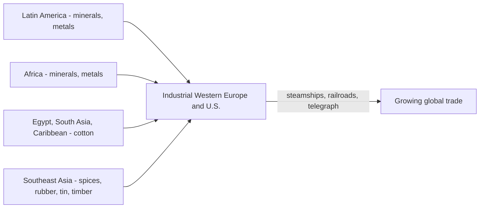
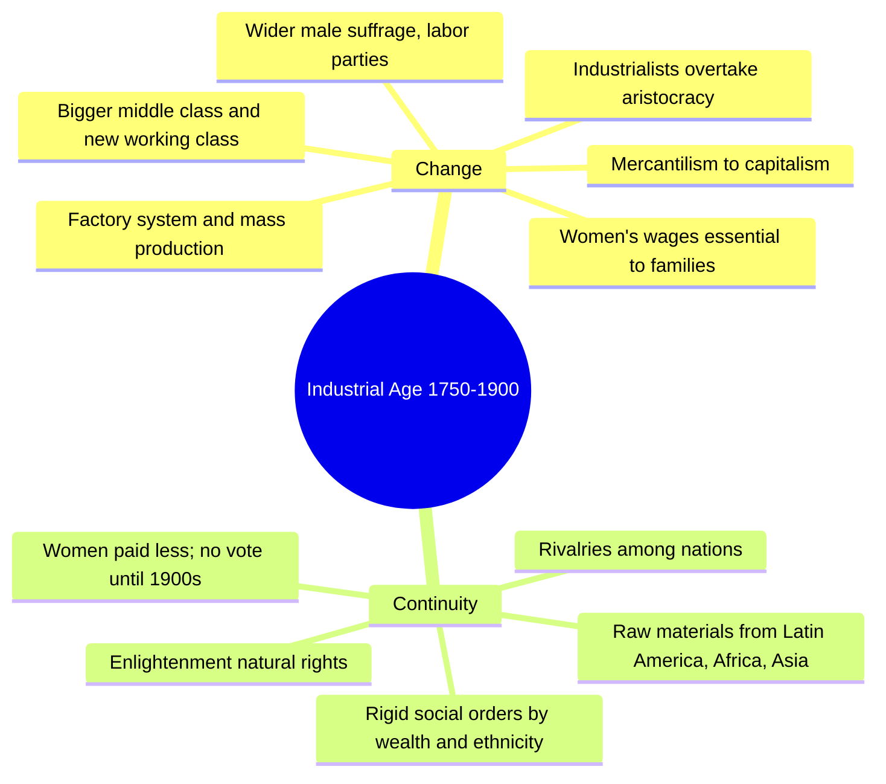

# AP World History: Modern — Topic 5.10: Continuity and Change in the Industrial Age

*Unit 5: Revolutions (c. 1750–c. 1900)*

> **Focus Question:** How did the Industrial Revolution demonstrate both continuity and change?
>
> **Learning Objective:** K: Explain the extent to which industrialization brought change from 1750 to 1900.

Source: textbook World History Modern: AP® Edition, Topic 5.10 (pp. 351–356), from the text you provided, summarized in my own words. Items marked (CED addition) are not in that text.

## Big Picture

- The Industrial Revolution brought economic, social, cultural, political, and environmental changes unmatched since the first Agricultural Revolution over 10,000 years earlier.
- Changes: how goods were made, how people earned a living, how businesses were organized; a bigger middle class, a factory working class, and women in the factory workforce.
- Continuities: Enlightenment ideas kept shaping politics, rivalries among nations continued, and rigid social orders based on economic or ethnic status persisted.
- Marx and Engels (Communist Manifesto, 1848): "Capital is... not a personal, it is a social power."

## 1. Economic Changes

- Western Europe led because of natural resources, transoceanic trade routes, financial capital, and a growing population.
- The Scientific Revolution, influenced by knowledge transferred from the Islamic world, led to the factory system and mass production.
- Skilled artisans crafting unique products at their own pace gave way to unskilled assembly-line workers making identical goods; consumer goods became more available, affordable, and varied.
- Western Europe shifted from mercantilism to capitalism; Smith said private profit would bring general prosperity, while Marx said the bourgeoisie exploited the proletariat and called on workers to take the means of production.

## 2. Industrialization Around the World and Raw Materials

- The U.S., Russia, and Japan increased industrial production and built railroads; Japan and Egypt used state-sponsored modernization with varying success.
- Western Europe and the U.S. continued to dominate the global economy, while Middle Eastern and Asian manufacturing declined.
- Continuity in raw materials: Latin America and Africa supplied minerals and metals; Egypt, South Asia, and the Caribbean exported cotton; Southeast Asia supplied spices plus rubber, tin, and timber.
- Change: steamships, interior railroads, and the telegraph opened untapped resources and made moving goods and people cheaper, increasing global trade.

## 3. Social Continuities and Changes

- Western Europe shifted from a mostly rural farming population to industrial cities, helped by Watt's steam engine.
- Physical labor: a working class with low wages, long hours, squalid housing, and lives built around factory jobs — unlike farmers who set schedules by the seasons; workers formed unions using strikes and collective bargaining.
- Office labor: the middle class kept its doctors, lawyers, and shopkeepers (continuity) and added managers in factories, banks, insurance, shipping, and trading companies (change).
- The wealthy: owners who earned from investments rather than land overtook the aristocracy in wealth and prestige.
- Gender: in farming, women's labor was rarely paid; in proto-industry they earned a little from textiles; under industrialization a woman's income became as important as a man's, yet women were paid less and denied high-wage jobs.

## 4. Political Continuities and Changes

- Continuity: like Enlightenment thinkers, people demanded natural rights — to petition, protest, and rebel — sometimes based on nationalism.
- Change: movements were tied to the interests of the growing middle and working classes; labor leaders proposed international unions, but most protests sought the vote and an end to aristocratic privilege.
- Revolutions of 1848: Paris demanded press freedom; Berlin a parliament to check the monarch; Hungarian cities freedom from Austria.
- Voting rights spread to city dwellers, non-landowners, and eventually workers — but only men; women in Western industrial countries won the vote in the early 1900s.
- Rights came through legislation (Britain) or through protest and revolution; where the middle class was large, democracy emerged, and where it was small, dictatorships remained.
- Bismarck's Germany created the most comprehensive worker protections — accident insurance, unemployment insurance, and old-age pensions — to head off socialist demands; these reforms spread worldwide.
- Labor parties emerged, pushing for minimum wages, shorter days, paid sick and holiday leave, and health and unemployment insurance.

## 5. Continuities in Coerced Labor

- Slavery continued in the U.S. until 1865 and Brazil until 1888; Russian serfdom lasted until 1861 (see 5.1). *(CED addition)*
- Indentured labor from India and China replaced enslaved labor on many plantations after abolition. *(CED addition)*

## Comparison: Continuity and Change, 1750–1900 (textbook)

| Category | Change | Continuity |
|---|---|---|
| Production | Factory system, mass production, assembly lines | — |
| Economic system | Mercantilism to capitalism | Western Europe and U.S. dominate |
| Raw materials | Steam and rail reach untapped interiors | Same regions supply minerals, cotton, spices |
| Classes | New working class; industrialists overtake aristocrats | Doctors, lawyers, shopkeepers stay middle class; rigid social orders |
| Women | Wages essential to families | Paid less; denied high-wage jobs; no vote |
| Politics | Wider male suffrage; labor parties; Bismarck's insurance | Enlightenment natural rights; rivalries among nations |

## Comparison: Revolutions of 1848: What People Demanded

| City / region | Demand | Type of goal |
|---|---|---|
| Paris | Freedom of the press | Liberal rights |
| Berlin | A parliament to check the monarch | Constitutional government |
| Hungarian cities | Freedom from Austrian control | Nationalism |

## Key Terms

| Term | Definition |
|---|---|
| **Continuity** | Something that stays the same over time |
| **Change over time** | AP reasoning skill: how and why things changed |
| **Agricultural Revolution (first)** | Shift to farming over 10,000 years ago |
| **Mass production** | Making large numbers of identical goods by machine |
| **Automation** | Use of machines that reduce the need for skilled labor |
| **Proto-industrial system** | Pre-factory home production, such as cottage textiles |
| **Collective bargaining** | Unions negotiating with owners for all workers |
| **Strike** | Workers stopping work to win concessions |
| **Revolutions of 1848** | European uprisings for press freedom, parliaments, and national freedom |
| **Labor party** | Political party representing the working class |
| **Social insurance** | Accident, unemployment, and old-age protection (Bismarck) |
| **Coerced labor** | Labor forced through slavery, serfdom, or debt |

## Notes on Sources

- The textbook says factories were built in cities "mainly due to a new steam engine design invented by James Watt"; Watt improved an existing engine (Newcomen's) rather than inventing it.
- "Women would not gain the right to vote in Western industrial countries until the early 20th century" — consistent with 5.8's British dates (1918 partial, 1928 equal).
- The text calls the uprisings "the Revolution of 1848" (singular); they are usually called the Revolutions of 1848.
- The textbook does not discuss slavery, serfdom, or indentured labor in 5.10; that section is a (CED addition) because coerced labor is a common AP continuity example.
