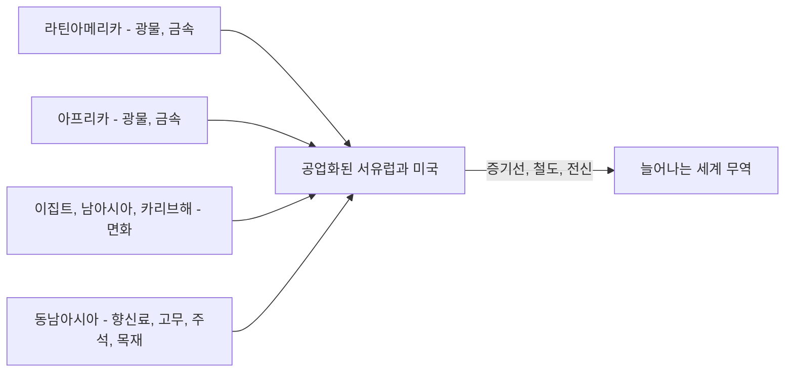
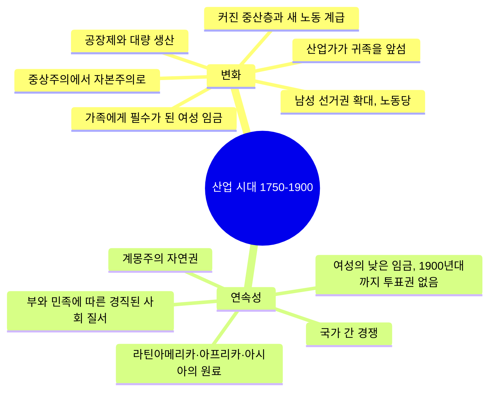

# AP World History: Modern — Topic 5.10: 산업 시대의 연속성과 변화 (Continuity and Change in the Industrial Age)

*Unit 5: 혁명의 시대 (Revolutions, c. 1750–c. 1900)*

> **핵심 질문 (Focus Question):** 산업 혁명은 연속성과 변화를 어떻게 함께 보여 주었는가?
>
> **학습 목표 (Learning Objective):** K: 1750–1900년 산업화가 어느 정도까지 변화를 가져왔는지 설명한다.

출처: 교재 『World History Modern: AP® Edition』 5.10 (pp. 351–356). 제공해 주신 텍스트를 제 말로 요약했습니다. (CED 추가) 표시는 그 텍스트에 없는 내용입니다.

## 큰 그림 요약 (Big Picture)

- 산업 혁명은 1만 년도 더 전의 최초 농업 혁명 이후 볼 수 없었던 경제·사회·문화·정치·환경의 변화를 가져왔다.
- 변화: 상품을 만드는 방식, 생계를 꾸리는 방식, 기업의 조직 방식. 더 커진 중산층, 공장 노동 계급, 공장 노동력이 된 여성.
- 연속성: 계몽사상이 계속 정치를 형성했고, 국가 간 경쟁이 이어졌으며, 경제적·민족적 지위에 기반한 경직된 사회 질서가 유지되었다.
- 마르크스와 엥겔스 (『공산당 선언』, 1848): '자본은 개인의 힘이 아니라 사회적 힘이다.'

## 1. 경제적 변화

- 서유럽은 천연자원, 대양 무역로, 금융 자본, 늘어나는 인구 덕분에 산업화를 주도했다.
- 이슬람 세계에서 전해진 지식의 영향을 받은 과학 혁명이 공장제와 대량 생산으로 이어졌다.
- 자기 속도로 독특한 제품을 만들던 숙련 장인 대신, 똑같은 상품을 만드는 비숙련 조립 라인 노동자가 등장했다. 소비재는 더 구하기 쉽고, 싸고, 다양해졌다.
- 서유럽은 중상주의에서 자본주의로 바뀌었다. 스미스는 사적 이윤 추구가 전반적 번영을 가져온다고 했고, 마르크스는 부르주아가 프롤레타리아를 착취한다며 노동자가 생산 수단을 장악하라고 촉구했다.

## 2. 세계의 산업화와 원료

- 미국·러시아·일본은 공업 생산을 늘리고 철도를 놓았다. 일본과 이집트는 국가 주도 근대화를 추진했지만 성공의 정도가 달랐다.
- 서유럽과 미국은 세계 경제를 계속 지배했고, 중동과 아시아의 제조업은 쇠퇴했다.
- 원료의 연속성: 라틴아메리카와 아프리카는 광물과 금속을, 이집트·남아시아·카리브해는 면화를, 동남아시아는 향신료와 함께 고무·주석·목재를 공급했다.
- 변화: 증기선, 내륙 철도, 전신이 아직 개발되지 않은 자원을 열고 상품과 사람의 이동을 싸게 만들어 세계 무역을 늘렸다.

## 3. 사회적 연속성과 변화

- 서유럽은 대부분 농촌에서 농사짓던 사회에서, 와트의 증기 기관에 힘입어 공업 도시 중심 사회로 바뀌었다.
- 육체노동: 낮은 임금, 긴 노동 시간, 비참한 주거 속에서 공장 일을 중심으로 사는 노동 계급. 계절에 따라 일정을 정하던 농민과 달랐다. 노동자들은 파업과 단체 교섭을 하는 노동조합을 만들었다.
- 사무 노동: 중산층에는 의사·변호사·상점 주인이 그대로 있었고(연속성), 공장·은행·보험·해운·무역 회사의 관리자가 새로 더해졌다(변화).
- 부유층: 토지가 아니라 투자로 돈을 번 소유주들이 부와 명성에서 귀족을 앞질렀다.
- 성별: 농업에서 여성의 노동은 거의 보수를 받지 못했고, 원시 산업 단계에서는 섬유로 약간의 돈을 벌었다. 산업화 이후 여성의 소득은 남성만큼 중요해졌지만, 여성은 여전히 임금을 덜 받고 고임금 일자리에서 배제되었다.

## 4. 정치적 연속성과 변화

- 연속성: 계몽사상가들처럼 사람들은 청원·시위·저항할 수 있는 자연권을 요구했고, 때로는 민족주의에 기반했다.
- 변화: 운동은 성장하는 중산층과 노동 계급의 이익과 연결되었다. 노동 지도자들은 국제적 노동조합을 제안했지만, 대부분의 시위는 투표권과 귀족 특권의 철폐를 요구했다.
- 1848년 혁명: 파리는 언론 자유를, 베를린은 군주를 견제할 의회를, 헝가리 도시들은 오스트리아로부터의 자유를 요구했다.
- 투표권은 도시 거주자, 토지가 없는 사람, 결국 노동자에게까지 확대되었다. 그러나 남성에게만 해당되었고, 서구 공업국 여성은 1900년대 초에야 투표권을 얻었다.
- 권리는 입법(영국)이나 시위와 혁명을 통해 얻어졌다. 중산층이 큰 나라에서는 민주주의가 생겼고, 중산층이 작은 나라에서는 독재가 유지되었다.
- 비스마르크의 독일은 사회주의자의 요구를 막기 위해 가장 포괄적인 노동자 보호 제도(산재 보험, 실업 보험, 노령 연금)를 만들었고, 이 개혁은 전 세계로 퍼졌다.
- 노동당이 등장해 최저 임금, 노동 시간 단축, 유급 병가와 휴가, 건강·실업 보험을 요구했다.

## 5. 강제 노동의 연속성

- 노예제는 미국에서 1865년, 브라질에서 1888년까지 이어졌고, 러시아 농노제는 1861년까지 지속되었다 (5.1 참고). *(CED 추가)*
- 노예제 폐지 후 많은 플랜테이션에서 인도·중국 출신 계약 노동이 노예 노동을 대신했다. *(CED 추가)*

## 비교표 (Comparison): 연속성과 변화, 1750–1900 (교재 기준)

| 분야 | 변화 | 연속성 |
|---|---|---|
| 생산 | 공장제, 대량 생산, 조립 라인 | — |
| 경제 체제 | 중상주의에서 자본주의로 | 서유럽과 미국의 지배 |
| 원료 | 증기와 철도로 미개발 내륙에 접근 | 같은 지역이 광물·면화·향신료 공급 |
| 계급 | 새 노동 계급, 산업가가 귀족을 앞섬 | 의사·변호사·상인은 중산층에 남음, 경직된 사회 질서 |
| 여성 | 가족에게 필수가 된 임금 | 낮은 임금, 고임금 직업 배제, 투표권 없음 |
| 정치 | 남성 선거권 확대, 노동당, 비스마르크의 보험 | 계몽주의 자연권, 국가 간 경쟁 |

## 비교표 (Comparison): 1848년 혁명: 사람들이 요구한 것

| 도시·지역 | 요구 | 목표 유형 |
|---|---|---|
| 파리 | 언론의 자유 | 자유주의적 권리 |
| 베를린 | 군주를 견제할 의회 | 입헌 정부 |
| 헝가리 도시들 | 오스트리아 지배로부터의 자유 | 민족주의 |

## 핵심 용어 (Key Terms)

| 용어 | 뜻 |
|---|---|
| **연속성 (Continuity)** | 시간이 지나도 그대로 유지되는 것 |
| **시간에 따른 변화 (Change over time)** | 무엇이 어떻게, 왜 변했는지 파악하는 AP 사고 기능 |
| **최초의 농업 혁명 (Agricultural Revolution (first))** | 1만여 년 전 농경으로의 전환 |
| **대량 생산 (Mass production)** | 기계로 똑같은 상품을 대량으로 만드는 것 |
| **자동화 (Automation)** | 숙련 노동의 필요를 줄이는 기계의 사용 |
| **원시 산업 체제 (Proto-industrial system)** | 가내 섬유업처럼 공장 이전의 가정 생산 |
| **단체 교섭 (Collective bargaining)** | 노동조합이 노동자 전체를 대표해 소유주와 협상하는 것 |
| **파업 (Strike)** | 요구를 얻기 위해 노동자가 일을 멈추는 것 |
| **1848년 혁명 (Revolutions of 1848)** | 언론 자유·의회·민족 자유를 요구한 유럽의 봉기 |
| **노동당 (Labor party)** | 노동 계급을 대표하는 정당 |
| **사회 보험 (Social insurance)** | 산재·실업·노령 보장 (비스마르크) |
| **강제 노동 (Coerced labor)** | 노예제·농노제·부채를 통해 강요된 노동 |

## 출처 메모 (교재 vs. 일반 자료)

- 교재는 공장이 '주로 제임스 와트가 발명한 새 증기 기관 설계 때문에' 도시에 세워졌다고 씁니다. 와트는 증기 기관을 발명한 것이 아니라 기존(뉴커먼의) 기관을 개량했습니다.
- '서구 공업국 여성은 20세기 초에야 투표권을 얻었다'는 5.8의 영국 연도(1918년 일부, 1928년 동등)와 일치합니다.
- 텍스트는 이 봉기를 단수형 'Revolution of 1848'으로 부르지만, 보통 복수형 Revolutions of 1848이라고 합니다.
- 교재 5.10은 노예제·농노제·계약 노동을 다루지 않습니다. 강제 노동은 AP에서 자주 쓰이는 연속성 사례라서 (CED 추가)로 넣었습니다.
