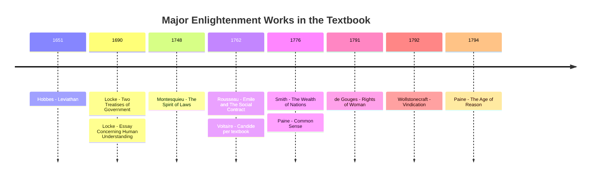
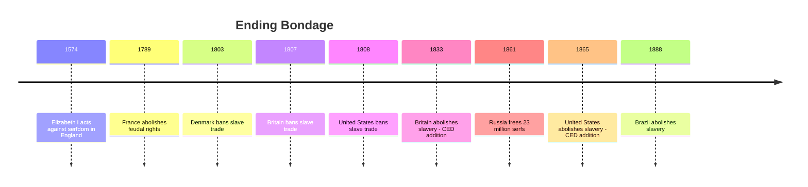
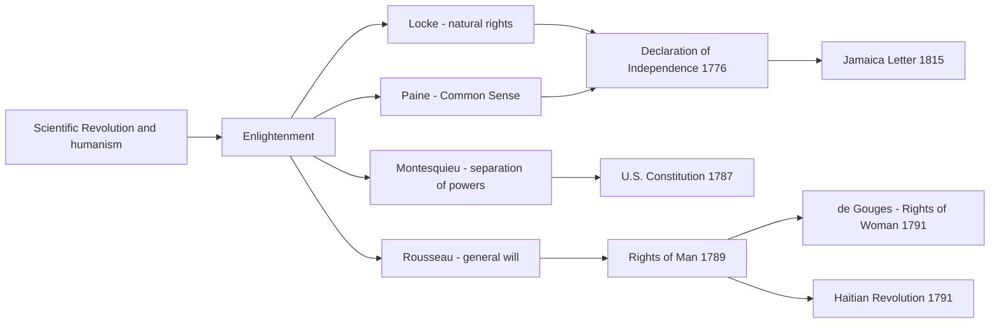
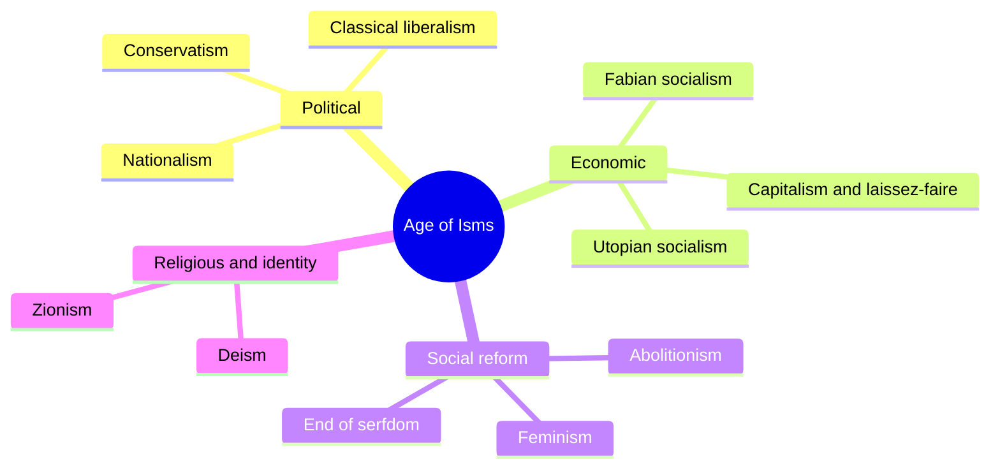

# AP World History: Modern — Topic 5.1: The Enlightenment

*Unit 5: Revolutions (c. 1750–c. 1900)*

> **Focus Question:** How did the Enlightenment shape the intellectual and ideological thinking that affected reform and revolution after 1750?
>
> **Learning Objective:** A: Explain the intellectual and ideological context in which revolutions swept the Atlantic world from 1750 to 1900. B: Explain how the Enlightenment affected societies over time.

Source: textbook World History Modern: AP® Edition, Topic 5.1 (pp. 275–281), summarized in my own words. Items marked (CED addition) are not in the textbook; they come from the College Board CED or standard references.

## Big Picture

- In the 1600s–1700s, thinkers such as Descartes put reason above tradition and the individual above community values; this shift is called the Enlightenment.
- Its ideals — individualism, freedom, self-determination — challenged monarchs and church leaders and planted the seeds of revolution.
- Many new "isms" followed (liberalism, socialism, conservatism, feminism, abolitionism, Zionism), so the era is called the "Age of Isms."
- Revolutions usually had two aims: independence from imperial powers and constitutional representation; nationalism threatened Europe's multiethnic empires.
- Over time, the same ideas were used to demand women's rights, the end of slavery, and the end of serfdom.

## 1. An Age of New Ideas

- Grew out of the Scientific Revolution and Renaissance humanism; it was optimistic that applying reason to natural laws would bring progress.
- Thinkers did not deny God but stressed human achievement; they concluded natural laws also governed society and politics.
- Traditional religion did not disappear, but it became less dominant.
- Nationalism: intense loyalty to people who share one's language and culture; the idea that each culture should have its own nation-state.

## 2. New Ideas and Their Roots

- Francis Bacon (1600s): empiricism — knowledge comes from sensed experience and experiments, not from tradition or religious authority.
- Thomas Hobbes, Leviathan (1651): in the state of nature life is "nasty, brutish, and short," so people give up some rights to a strong central government for law and order.
- John Locke, Two Treatises of Government (1690): natural rights to life, liberty, and property; citizens have the right — even the duty — to revolt against unjust government.
- Locke, An Essay Concerning Human Understanding (1690): a child's mind is a "blank slate" (tabula rasa); environment and education, not ancestry, shape people — a radical idea at the time.

## 3. The Philosophes

- Philosophes: 18th-century thinkers (from French philosophe, "philosopher") who popularized rational social, political, and economic ideas — including Jefferson and Franklin (America), Adam Smith (Scotland), and French writers.
- Baron Montesquieu, The Spirit of Laws (1748): praised Britain's checks on power through Parliament; the U.S. separated executive, legislative, and judicial branches based on his ideas.
- Voltaire (François-Marie Arouet): known for the satire Candide; exiled to England, he admired its constitutional monarchy and civil rights, then campaigned in France for religious liberty and judicial reform.
- Voltaire wrote to rulers such as Catherine the Great and Frederick the Great, contributed to Diderot's Encyclopedia, and influenced religious liberty in the U.S. Constitution.
- Jean-Jacques Rousseau: Emile, or On Education (1762) on child-rearing; The Social Contract (1762) — the General Will of the people, which the sovereign must carry out; inspired late-1700s revolutionaries.
- Adam Smith, The Wealth of Nations (1776): answered mercantilism with freer trade and laissez-faire ("leave alone"); the "invisible hand" of the market guides self-interest toward the good of society; a foundation for capitalism.
- Smith still supported some regulation and taxes. Capitalism: the means of production (factories, natural resources) are privately owned and operated for profit.

## 4. Deism

- Deism: a divinity set natural laws in motion like a watchmaker and does not interfere; these laws are best understood through science rather than the Bible.
- Many Deists still saw church attendance as a social duty and a source of moral guidance.
- Thomas Paine: Common Sense (1776) made him popular in America by urging independence from Britain; The Age of Reason (1794) defended Deism, and its anti-church views hurt his popularity.

## 5. The Age of New Ideas Continues: Responses to Industrial Society

- Urbanization and industrialization brought slums, poor sanitation, and workers without political representation; writers proposed solutions.
- Responses varied: more government programs, more Christian private charity, or (some conservatives) blaming the poor themselves.
- Conservatism: trust in traditional institutions and practical experience over ideological theories such as human perfectibility; popular with Europe's ruling class.
- Socialism: public or direct worker ownership of the means of production (mills, mines, land).
- Utopian socialists built ideal communities: Henri de Saint-Simon (scientists, engineers, and businesses running efficient workplaces; public works; proposed the Suez Canal, opened 1869).
- Charles Fourier identified 810 passions that could make work enjoyable; he favored harmonious community living instead of Marx's class struggle.
- Robert Owen founded intentional communities at New Lanark (Scotland) and New Harmony (Indiana): education for child workers, communal property, community rules (see also 5.8).
- Fabian Society (England, later 1800s): gradual socialism through Parliament; members included H. G. Wells, Virginia Woolf, and George Bernard Shaw.
- Classical liberalism: natural rights, constitutional government, laissez-faire, and less spending on armies and established churches; backed Britain's Reform Bills of 1832, 1867, and 1884, which widened male suffrage (see also 5.8).

## 6. Feminism

- 1789: France's Declaration of the Rights of Man and of the (Male) Citizen; 1791: Olympe de Gouges answered with the Declaration of the Rights of Woman and of the (Female) Citizen.
- Mary Wollstonecraft, A Vindication of the Rights of Woman (1792): women deserve the same education as men so they can take part in political and professional life and support themselves.
- Seneca Falls Convention (1848): Lucretia Mott and Elizabeth Cady Stanton's Declaration of Sentiments — "all men and women are created equal"; demanded the vote, office-holding, property, control of income, and guardianship of children.
- The textbook notes that women won the full right to vote in 1928 (this is the date for Britain).

## 7. Abolitionism and the End of Serfdom

- Abolitionism: the movement to end the Atlantic slave trade and free all enslaved people; it grew in the 1700s.
- The slave trade was banned before slavery itself: Denmark (1803), Britain (1807), United States (1808).
- Slave systems depended on new captives, so slavery usually ended within about 30 years of the trade's end; the U.S. was an exception, where the enslaved population kept growing. Brazil was last in the Americas (1888).
- Serfdom declined as economies industrialized and peasants revolted: Elizabeth I (1574), France abolished nobles' feudal rights (1789), Alexander II freed 23 million Russian serfs (1861) — the largest single emancipation in history.
- Britain abolished slavery throughout its empire in 1833; the U.S. ended slavery in 1865. *(CED addition)*

## 8. Zionism

- Zionism: the desire of Jews to re-establish an independent homeland in the Middle East where their ancestors lived (late 1800s).
- Causes: centuries of anti-Semitism (hostility toward Jews) and pogroms (violent attacks on Jewish communities); leader Theodor Herzl, an Austro-Hungarian Jew.
- Dreyfus Affair (1894): Jewish officer Alfred Dreyfus was convicted of treason on forged evidence; it showed anti-Semitism even in France and increased support for Zionism.
- Obstacles: the land was under Ottoman rule and already home to Palestinian Arabs, mostly Muslim; the movement grew until Israel was founded in 1948.

## 9. From Ideas to Revolutionary Documents

- Declaration of Independence (1776) echoes Locke's natural rights. *(CED addition)*
- The U.S. Constitution (1787) applied Montesquieu's separation of powers (the textbook names the idea, not the date). *(CED addition)*
- Simón Bolívar's Jamaica Letter (1815) carried these ideas to Latin America (in the textbook only on the Unit 5 timeline, p. 273). *(CED addition)*

## Comparison: Social Contract Thinkers

| Thinker | Key work | Core idea | Influence |
|---|---|---|---|
| Hobbes | Leviathan (1651) | Give up rights to a strong government for order | Justified strong central rule |
| Locke | Two Treatises (1690) | Natural rights; right and duty to revolt | American Revolution |
| Montesquieu | The Spirit of Laws (1748) | Checks on power; separate branches | U.S. three branches |
| Rousseau | The Social Contract (1762) | General Will; sovereign must carry it out | Late-1700s revolutionaries |

## Comparison: The "Age of Isms"

| Ideology | Core belief | Key people / examples |
|---|---|---|
| Conservatism | Traditional institutions; experience over theory | European ruling class |
| Classical liberalism | Natural rights, constitutions, laissez-faire | Reform Bills 1832, 1867, 1884 |
| Utopian socialism | Ideal cooperative communities | Saint-Simon, Fourier, Owen |
| Gradual (Fabian) socialism | Reform through Parliament | Fabian Society: Wells, Woolf, Shaw |
| Feminism | Equal rights and education for women | de Gouges, Wollstonecraft, Seneca Falls |
| Abolitionism | End the slave trade and slavery | Bans of 1803, 1807, 1808; Brazil 1888 |
| Nationalism | Each culture should have its own nation-state | Threat to multiethnic empires |
| Zionism | Jewish homeland in the Middle East | Herzl; Dreyfus Affair 1894 |

## Comparison: Mercantilism vs. Free Market (textbook Connect task; see also 5.7)

| Feature | Mercantilism | Free market (Adam Smith) | Both |
|---|---|---|---|
| Goal | National wealth and power | Wealth through competition and choice | Increase wealth |
| Government role | Tight control: tariffs, monopolies | Laissez-faire, with some regulation and taxes | Government sets some rules |
| Trade | Export more than import; colonies trade with the home country | Freer trade among nations | Global trade networks |
| Who decides | The state | Businesses and consumers (invisible hand) | — |

## Key Terms

| Term | Definition |
|---|---|
| **Enlightenment** | Movement emphasizing reason over tradition and individualism over community values |
| **Empiricism** | Knowledge comes from sensed experience and experiments |
| **Social contract** | Agreement in which people accept government in return for order or protection of rights |
| **Natural rights** | Locke: life, liberty, and property |
| **Tabula rasa** | Locke: the mind at birth is a blank slate shaped by environment and education |
| **Philosophes** | 18th-century thinkers who popularized rational social, political, and economic ideas |
| **General Will** | Rousseau: the collective will of the people, which the sovereign must carry out |
| **Laissez-faire** | "Leave alone"; minimal government intervention in the economy |
| **Invisible hand** | Smith: self-interested choices in markets benefit society |
| **Capitalism** | Private ownership of the means of production, operated for profit |
| **Deism** | A divinity set natural laws in motion, like a watchmaker, and does not interfere |
| **Conservatism** | Trust in traditional institutions and practical experience over ideological theory |
| **Socialism** | Public or direct worker ownership of the means of production |
| **Utopian socialism** | Creating ideal communities to guide society in positive directions |
| **Intentional community** | Small society governed by utopian socialist principles (e.g., New Lanark) |
| **Fabian Society** | English gradual socialists favoring parliamentary reform |
| **Classical liberalism** | Natural rights, constitutional government, laissez-faire, less spending on armies and state churches |
| **Feminism** | Movement for women's rights and equality |
| **Suffrage** | The ability to vote |
| **Abolitionism** | Movement to end the slave trade and free all enslaved people |
| **Nationalism** | Intense loyalty to people who share one's language and culture |
| **Zionism** | Movement for an independent Jewish homeland in the Middle East |
| **Anti-Semitism** | Hostility toward Jews |
| **Pogrom** | Violent attack against a Jewish community |

## Notes on Sources

- Candide: the textbook gives 1762; standard references give 1759.
- Wollstonecraft's title: the textbook prints "Rights of Women"; the original title is A Vindication of the Rights of Woman.
- Montesquieu's title appears both as The Spirit of Laws (textbook) and The Spirit of the Laws; both are accepted translations.
- Locke's rights: the textbook says "life, liberty, and the pursuit of property"; most sources say "life, liberty, and property." "Pursuit of happiness" is the Declaration of Independence's wording.
- 1928 women's suffrage: the textbook does not name the country; 1928 is the date for Britain.
- 1574 serfdom: the textbook says Elizabeth I "abolished" serfdom; standard references describe an order freeing serfs on royal lands rather than a full abolition.
- Topic placement: the textbook covers Owen and the Reform Bills here and in 5.8, and Zionism only here (it was removed from 5.2); 5.8 cross-references this topic.
