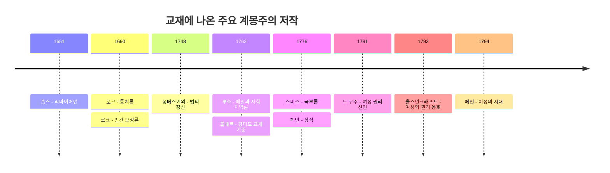
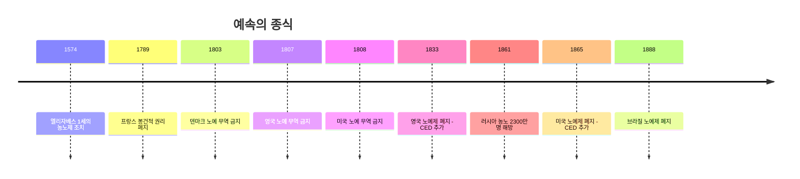
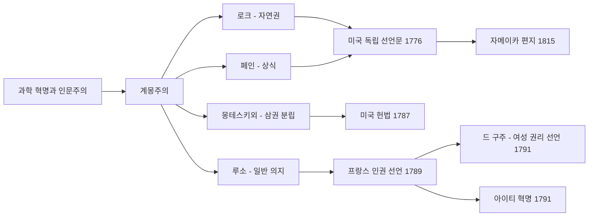
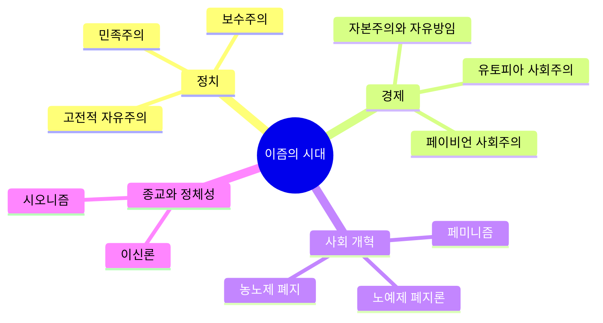

# AP World History: Modern — Topic 5.1: 계몽주의 (The Enlightenment)

*Unit 5: 혁명의 시대 (Revolutions, c. 1750–c. 1900)*

> **핵심 질문 (Focus Question):** 계몽주의는 1750년 이후 개혁과 혁명에 영향을 준 지적·이념적 사고를 어떻게 형성했는가?
>
> **학습 목표 (Learning Objective):** A: 1750–1900년 대서양 세계를 휩쓴 혁명들의 지적·이념적 배경을 설명한다. B: 계몽주의가 시간이 흐르며 사회에 어떤 영향을 주었는지 설명한다.

출처: 교재 『World History Modern: AP® Edition』 5.1 (pp. 275–281)을 제 말로 요약했습니다. (CED 추가) 표시는 교재에 없고 College Board CED 또는 일반 역사 자료에서 가져온 내용입니다.

## 큰 그림 요약 (Big Picture)

- 1600–1700년대 데카르트 같은 사상가들은 전통보다 이성을, 공동체의 가치보다 개인을 앞세웠다. 이 변화를 계몽주의라고 한다.
- 계몽주의의 이상인 개인주의, 자유, 자기 결정은 군주와 교회 지도자의 역할에 도전했고 혁명의 씨앗이 되었다.
- 자유주의·사회주의·보수주의·페미니즘·노예제 폐지론·시오니즘 같은 새로운 '이즘'이 잇따랐기 때문에 이 시기를 '이즘의 시대'라고 부른다.
- 혁명은 대개 두 가지 목표, 즉 제국으로부터의 독립과 헌법에 따른 대표권을 추구했다. 민족주의는 유럽의 다민족 제국을 위협했다.
- 시간이 지나며 같은 사상이 여성 권리, 노예제 폐지, 농노제 폐지를 요구하는 근거가 되었다.

## 1. 새로운 사상의 시대

- 과학 혁명과 르네상스 인문주의에서 출발했다. 자연법칙에 이성을 적용하면 진보할 수 있다고 낙관했다.
- 사상가들은 신을 부정하지 않았지만 인간의 성취를 강조했고, 자연법칙이 사회와 정치도 지배한다고 결론지었다.
- 전통 종교가 사라지지는 않았지만 영향력이 줄었다.
- 민족주의 (Nationalism): 언어와 문화를 공유하는 사람들에 대한 강한 충성. 각 문화 집단이 독립된 국민 국가를 가져야 한다는 생각.

## 2. 새로운 사상과 그 뿌리

- 프랜시스 베이컨 (Francis Bacon, 1600년대): 경험주의 (Empiricism) — 지식은 전통이나 종교적 권위가 아니라 감각 경험과 실험에서 나온다.
- 토머스 홉스 (Thomas Hobbes), 『리바이어던』(1651): 자연 상태의 삶은 '끔찍하고 잔인하며 짧다'. 그래서 사람들은 법과 질서를 얻기 위해 일부 권리를 강력한 중앙 정부에 넘긴다.
- 존 로크 (John Locke), 『통치론』(1690): 생명·자유·재산에 대한 자연권. 시민은 부당한 정부에 저항할 권리, 나아가 의무가 있다.
- 로크, 『인간 오성론』(1690): 아이의 마음은 '백지 상태 (tabula rasa)'다. 혈통이 아니라 환경과 교육이 사람을 만든다는 것으로, 당시로서는 급진적인 생각이었다.

## 3. 필로조프 (The Philosophes)

- 필로조프 (Philosophes): 합리적인 사회·정치·경제 사상을 대중화한 18세기 사상가들(프랑스어 philosophe, '철학자'). 미국의 제퍼슨과 프랭클린, 스코틀랜드의 애덤 스미스, 그리고 여러 프랑스 사상가가 포함된다.
- 몽테스키외 (Baron Montesquieu), 『법의 정신』(1748): 의회를 통한 영국의 권력 견제를 높이 평가했다. 미국은 그의 사상에 따라 행정·입법·사법부를 분리했다.
- 볼테르 (Voltaire, 본명 프랑수아마리 아루에): 풍자 소설 『캉디드』로 유명하다. 영국에 망명했을 때 입헌 군주제와 시민적 권리를 높이 평가했고, 돌아와 프랑스에서 종교 자유와 사법 개혁을 위해 활동했다.
- 볼테르는 예카테리나 2세 (Catherine the Great), 프리드리히 대왕 (Frederick the Great) 같은 군주와 편지를 주고받았고, 디드로의 『백과전서』에 글을 썼으며, 미국 헌법의 종교 자유에 영향을 주었다.
- 장자크 루소 (Jean-Jacques Rousseau): 양육과 교육을 다룬 『에밀』(1762). 『사회 계약론』(1762)에서는 국민의 일반 의지와, 통치자가 그것을 실행할 의무를 제시했다. 1700년대 후반 혁명가들에게 영감을 주었다.
- 애덤 스미스 (Adam Smith), 『국부론』(1776): 중상주의에 맞서 더 자유로운 무역과 자유방임 (laissez-faire, '내버려 두라')을 주장했다. 시장의 '보이지 않는 손'이 개인의 이익 추구를 사회의 이익으로 이끈다고 보았다. 자본주의의 기초가 되었다.
- 스미스도 일부 규제와 세금은 지지했다. 자본주의 (Capitalism): 생산 수단(공장, 천연자원)을 사적으로 소유하고 이윤을 위해 운영하는 체제.

## 4. 이신론 (Deism)

- 이신론 (Deism): 신은 시계공처럼 자연법칙을 움직이게 했을 뿐 개입하지 않는다. 그 법칙은 성경보다 과학으로 가장 잘 이해할 수 있다.
- 많은 이신론자는 여전히 교회 출석을 사회적 의무이자 도덕적 지침을 얻는 방법으로 보았다.
- 토머스 페인 (Thomas Paine): 『상식』(1776)은 영국으로부터의 독립을 주장해 미국에서 큰 인기를 얻었다. 『이성의 시대』(1794)는 이신론을 옹호했는데, 반교회적 주장 때문에 인기를 많이 잃었다.

## 5. 새로운 사상의 시대는 계속된다: 산업 사회에 대한 대응

- 도시화와 산업화로 빈민가, 열악한 위생, 정치적 대표권이 없는 노동자가 생겼고, 사상가들이 해결책을 제시했다.
- 대응은 다양했다. 정부 정책 확대, 기독교의 민간 자선 확대, 또는 (일부 보수주의자처럼) 빈민 자신을 탓하는 입장.
- 보수주의 (Conservatism): 인간이 완벽해질 수 있다는 식의 이념적 이론보다 전통 제도와 실제 경험을 신뢰한다. 유럽 지배층에서 인기가 있었다.
- 사회주의 (Socialism): 생산 수단(공장, 광산, 토지)을 공공 또는 노동자가 직접 소유하는 체제.
- 유토피아 사회주의자 (Utopian socialists)는 이상적인 공동체를 만들려 했다. 앙리 드 생시몽 (Henri de Saint-Simon): 과학자·기술자·기업이 함께 효율적인 일터를 운영하자고 했고, 공공사업을 주장했으며, 수에즈 운하(1869년 개통)를 제안했다.
- 샤를 푸리에 (Charles Fourier): 일을 즐겁게 만들 수 있는 810가지 정념을 제시했다. 마르크스의 계급 투쟁 대신 공동체의 조화로운 생활을 추구했다.
- 로버트 오언 (Robert Owen): 스코틀랜드 뉴래너크와 미국 인디애나주 뉴하모니에 공동체를 세웠다. 일하는 아동을 위한 교육, 공동 소유, 공동체 규칙을 실천했다 (5.8 참고).
- 페이비언 협회 (Fabian Society, 1800년대 후반 영국): 의회를 통한 점진적 사회주의. H. G. 웰스, 버지니아 울프, 조지 버나드 쇼가 회원이었다.
- 고전적 자유주의 (Classical liberalism): 자연권, 입헌 정부, 자유방임, 군대와 국교회 지출 축소. 남성 선거권을 넓힌 영국의 1832·1867·1884년 선거법 개정을 지지했다 (5.8 참고).

## 6. 페미니즘 (Feminism)

- 1789년 프랑스 『인간과 (남성) 시민의 권리 선언』. 1791년 올랭프 드 구주 (Olympe de Gouges)가 『여성과 (여성) 시민의 권리 선언』으로 응답했다.
- 메리 울스턴크래프트 (Mary Wollstonecraft), 『여성의 권리 옹호』(1792): 여성도 남성과 같은 교육을 받아야 정치·직업 생활에 참여하고 스스로 생계를 꾸릴 수 있다.
- 세네카 폴스 대회 (Seneca Falls Convention, 1848): 루크리셔 모트 (Lucretia Mott)와 엘리자베스 케이디 스탠턴 (Elizabeth Cady Stanton)의 『감정 선언문』(Declaration of Sentiments) — '모든 남성과 여성은 평등하게 창조되었다'. 투표권, 공직 취임, 재산 소유, 소득 관리, 자녀 양육권을 요구했다.
- 교재는 여성이 1928년에 완전한 투표권을 얻었다고 쓴다 (영국 기준 연도).

## 7. 노예제 폐지론과 농노제 폐지

- 노예제 폐지론 (Abolitionism): 대서양 노예 무역을 끝내고 모든 노예를 해방하려는 운동. 1700년대에 지지자가 늘었다.
- 노예 무역이 노예제보다 먼저 금지되었다. 덴마크(1803), 영국(1807), 미국(1808).
- 노예제는 새로운 노예 공급에 의존했기 때문에, 대개 노예 무역이 끝난 뒤 30년 안에 사라졌다. 미국은 노예 인구가 계속 늘어난 예외였다. 아메리카에서 마지막으로 폐지한 나라는 브라질(1888)이다.
- 경제가 산업화되고 농민이 봉기하면서 농노제가 쇠퇴했다. 엘리자베스 1세(1574), 프랑스의 귀족 봉건적 권리 폐지(1789), 알렉산드르 2세의 러시아 농노 2,300만 명 해방(1861) — 역사상 최대 규모의 단일 해방이었다.
- 영국은 1833년 제국 전역에서 노예제를 폐지했고, 미국은 1865년에 노예제를 폐지했다. *(CED 추가)*

## 8. 시오니즘 (Zionism)

- 시오니즘 (Zionism): 조상이 살았던 중동 지역에 독립된 유대인 국가를 다시 세우려는 열망 (1800년대 후반).
- 원인: 수백 년간 이어진 반유대주의 (anti-Semitism)와 포그롬 (pogroms, 유대인 공동체에 대한 폭력적 공격). 지도자는 오스트리아-헝가리 출신 유대인 테오도어 헤르츨 (Theodor Herzl)이다.
- 드레퓌스 사건 (Dreyfus Affair, 1894): 유대인 장교 알프레드 드레퓌스가 위조된 증거로 반역죄 판결을 받았다. 프랑스에서도 반유대주의가 퍼져 있음을 보여 주었고, 시오니즘에 대한 지지가 커졌다.
- 장애물: 그 땅은 오스만 제국의 지배 아래 있었고, 대부분 무슬림인 팔레스타인 아랍인이 이미 살고 있었다. 운동은 1948년 이스라엘이 건국될 때까지 성장했다.

## 9. 사상에서 혁명 문서로

- 미국 독립 선언문(1776)은 로크의 자연권을 반영했다. *(CED 추가)*
- 미국 헌법(1787)은 몽테스키외의 삼권 분립을 적용했다 (교재는 사상만 언급하고 연도는 쓰지 않음). *(CED 추가)*
- 시몬 볼리바르의 「자메이카 편지」(1815)가 이 사상을 라틴아메리카로 전했다 (교재에서는 Unit 5 연표 p.273에만 나옴). *(CED 추가)*

## 비교표 (Comparison): 사회 계약 사상가 비교

| 사상가 | 주요 저작 | 핵심 사상 | 영향 |
|---|---|---|---|
| 홉스 (Hobbes) | 리바이어던 (1651) | 질서를 위해 강력한 정부에 권리를 넘김 | 강력한 중앙 통치 정당화 |
| 로크 (Locke) | 통치론 (1690) | 자연권, 저항할 권리와 의무 | 미국 혁명 |
| 몽테스키외 (Montesquieu) | 법의 정신 (1748) | 권력 견제, 삼권 분립 | 미국의 삼권 체제 |
| 루소 (Rousseau) | 사회 계약론 (1762) | 일반 의지, 통치자는 이를 실행해야 함 | 1700년대 후반 혁명가들 |

## 비교표 (Comparison): '이즘의 시대'

| 이념 | 핵심 믿음 | 대표 인물·사례 |
|---|---|---|
| 보수주의 | 전통 제도, 이론보다 경험 | 유럽 지배층 |
| 고전적 자유주의 | 자연권, 헌법, 자유방임 | 1832·1867·1884년 선거법 개정 |
| 유토피아 사회주의 | 이상적 협동 공동체 | 생시몽, 푸리에, 오언 |
| 점진적 (페이비언) 사회주의 | 의회를 통한 개혁 | 페이비언 협회: 웰스, 울프, 쇼 |
| 페미니즘 | 여성의 평등한 권리와 교육 | 드 구주, 울스턴크래프트, 세네카 폴스 |
| 노예제 폐지론 | 노예 무역과 노예제 종식 | 1803·1807·1808년 금지, 브라질 1888 |
| 민족주의 | 각 문화 집단은 자신의 국민 국가를 가져야 함 | 다민족 제국에 대한 위협 |
| 시오니즘 | 중동에 유대인 국가 수립 | 헤르츨, 1894년 드레퓌스 사건 |

## 비교표 (Comparison): 중상주의 vs. 자유 시장 (교재 Connect 과제, 5.7 참고)

| 특징 | 중상주의 | 자유 시장 (애덤 스미스) | 공통점 |
|---|---|---|---|
| 목표 | 국가의 부와 권력 | 경쟁과 선택을 통한 부 | 부의 증대 |
| 정부의 역할 | 강한 통제: 관세, 독점권 | 자유방임 (일부 규제와 세금은 인정) | 정부가 일부 규칙을 정함 |
| 무역 | 수출을 수입보다 많이, 식민지는 본국과 무역 | 국가 간 더 자유로운 무역 | 세계 무역망 |
| 결정 주체 | 국가 | 기업과 소비자 (보이지 않는 손) | — |

## 핵심 용어 (Key Terms)

| 용어 | 뜻 |
|---|---|
| **계몽주의 (Enlightenment)** | 전통보다 이성을, 공동체의 가치보다 개인을 강조한 사상 운동 |
| **경험주의 (Empiricism)** | 지식은 감각 경험과 실험에서 나온다는 믿음 |
| **사회 계약 (Social contract)** | 질서나 권리 보호를 얻는 대가로 정부를 받아들이는 합의 |
| **자연권 (Natural rights)** | 로크: 생명·자유·재산 |
| **백지 상태 (Tabula rasa)** | 로크: 태어날 때의 마음은 환경과 교육으로 채워지는 백지 |
| **필로조프 (Philosophes)** | 합리적 사회·정치·경제 사상을 대중화한 18세기 사상가들 |
| **일반 의지 (General Will)** | 루소: 통치자가 실행해야 하는 국민 전체의 뜻 |
| **자유방임 (Laissez-faire)** | '내버려 두라'. 경제에 대한 정부 개입 최소화 |
| **보이지 않는 손 (Invisible hand)** | 스미스: 시장에서의 이기적 선택이 사회에 이익이 됨 |
| **자본주의 (Capitalism)** | 생산 수단의 사적 소유와 이윤 추구 |
| **이신론 (Deism)** | 신은 시계공처럼 자연법칙을 작동시켰을 뿐 개입하지 않는다는 믿음 |
| **보수주의 (Conservatism)** | 이념적 이론보다 전통 제도와 실제 경험을 신뢰 |
| **사회주의 (Socialism)** | 생산 수단의 공공 또는 노동자 직접 소유 |
| **유토피아 사회주의 (Utopian socialism)** | 이상적인 공동체를 만들어 사회를 좋은 방향으로 이끌려는 사상 |
| **의도적 공동체 (Intentional community)** | 유토피아 사회주의 원칙으로 운영되는 작은 사회 (예: 뉴래너크) |
| **페이비언 협회 (Fabian Society)** | 의회 개혁을 선호한 영국의 점진적 사회주의 단체 |
| **고전적 자유주의 (Classical liberalism)** | 자연권, 입헌 정부, 자유방임, 군대·국교회 지출 축소 |
| **페미니즘 (Feminism)** | 여성의 권리와 평등을 위한 운동 |
| **선거권 (Suffrage)** | 투표할 수 있는 권리 |
| **노예제 폐지론 (Abolitionism)** | 노예 무역을 끝내고 모든 노예를 해방하려는 운동 |
| **민족주의 (Nationalism)** | 언어와 문화를 공유하는 사람들에 대한 강한 충성 |
| **시오니즘 (Zionism)** | 중동에 독립된 유대인 국가를 세우려는 운동 |
| **반유대주의 (Anti-Semitism)** | 유대인에 대한 적대감 |
| **포그롬 (Pogrom)** | 유대인 공동체에 대한 폭력적 공격 |

## 출처 메모 (교재 vs. 일반 자료)

- 『캉디드』: 교재는 1762년, 일반 자료는 1759년.
- 울스턴크래프트 저서 제목: 교재는 'Rights of Women'으로 표기했지만 원제는 A Vindication of the Rights of Woman.
- 몽테스키외 저서는 The Spirit of Laws(교재)와 The Spirit of the Laws 두 가지로 쓰이며, 둘 다 통용되는 번역 제목이다.
- 로크의 자연권: 교재는 'life, liberty, and the pursuit of property', 대부분의 자료는 'life, liberty, and property'. 'pursuit of happiness'는 독립 선언문의 표현.
- 1928년 여성 투표권: 교재는 나라를 밝히지 않았다. 1928년은 영국 기준이다.
- 1574년 농노제: 교재는 엘리자베스 1세가 농노제를 '폐지'했다고 쓰지만, 일반 자료는 전면 폐지보다 왕실 영지의 농노 해방 명령으로 본다.
- 토픽 배치: 교재는 오언과 선거법 개정을 5.1과 5.8에서 다루고, 시오니즘은 5.1에서만 다룬다(5.2에서는 뺐다). 5.8에서 이 토픽을 참고하도록 표시했다.
