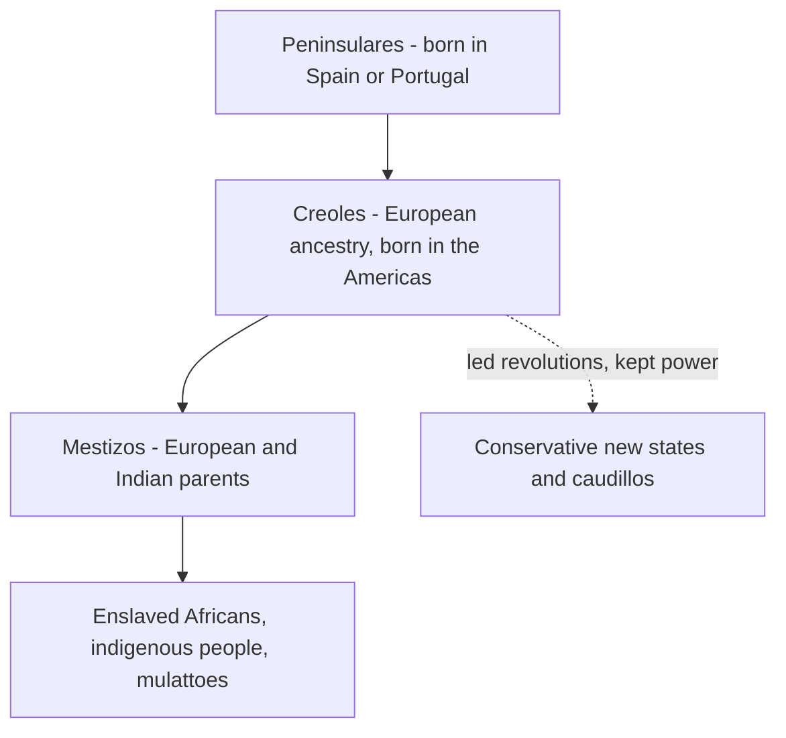
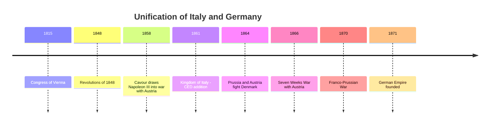
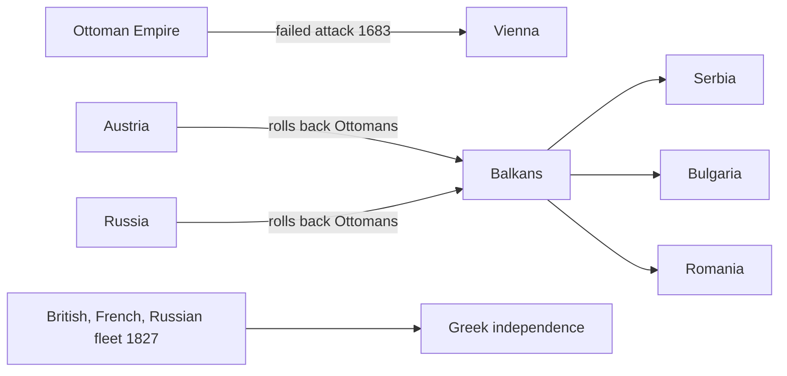

# AP World History: Modern — Topic 5.2: Nationalism and Revolutions

*Unit 5: Revolutions (c. 1750–c. 1900)*

> **Focus Question:** What were the causes and effects of the various revolutions in the period from 1750 to 1900, including influences of the Enlightenment and emerging nationalism?
>
> **Learning Objective:** C: Explain causes and effects of the various revolutions in the period from 1750 to 1900.

Source: textbook World History Modern: AP® Edition, Topic 5.2 (pp. 285–296), from the text you provided, summarized in my own words. Items marked (CED addition) are not in that text.

## Big Picture

- Conservatives such as Edmund Burke and Joseph de Maistre saw revolutions as bloody, disruptive, and unlikely to help, yet demands for constitutional and democratic government erupted throughout the 1800s.
- The American, French, Haitian, and creole Latin American revolutions drew on Enlightenment ideals: progress, reason, and natural law.
- Who led a revolution shaped its results: enslaved people in Haiti ended slavery, while creole elites in Latin America kept a conservative social order.
- Nationalism united Italy and Germany, broke Ottoman control of the Balkans, and inspired resistance to colonial rule (New Zealand, Puerto Rico, Cuba, the Philippines).

## 1. The American Revolution

- Its ideals came from European Enlightenment philosophy; the physiocrats' free-market ideas also opposed English mercantilism.
- Colonists were already politically independent in practice: colonial legislatures made decisions normally made by Parliament, and London was far away.
- Declaration of Independence (July 4, 1776): Thomas Jefferson took the phrase "unalienable rights" from Locke — for him, life, liberty, and the pursuit of happiness.
- The war of 1775–1783, won with French aid, and the U.S. Constitution (1787); the provided text breaks off at this point. *(CED addition)*

## 2. The New Zealand Wars

- The Polynesian Maori lived in New Zealand from at least the mid-1200s, developing a rich culture; they were divided into tribes called iwi that sometimes fought one another.
- Britain annexed New Zealand in 1840; British control over Maori affairs and pressure for Maori land grew.
- The resulting wars united Maori tribes and built Maori nationalism, but Britain had won by 1872.

## 3. The French Revolution

- Slogan: liberté, égalité, fraternité (liberty, equality, fraternity), popularized across Europe by the philosophes.
- Economic cause: France had long spent more than it took in, partly on wars, including aid to the American Revolution.
- Spring 1789: the Estates-General met (clergy, nobility, commoners); commoners were 97% of society but voting was unequal, so they broke away to form the National Assembly.
- Moderates such as the Marquis de Lafayette hoped for a constitutional monarchy; when the king threatened to arrest the leaders, Paris crowds stormed the Bastille (July 14, 1789) and peasants burned manor houses.
- Most lasting early changes: abolition of feudalism and the Declaration of the Rights of Man.
- Louis XVI and the nobles rejected limited monarchy, so radical Jacobins pushed for the First French Republic (1792); the Jacobin-led Reign of Terror executed thousands, including the king and queen.
- After turmoil and war, General Napoleon Bonaparte became emperor in 1804.
- Robespierre led the Terror (1793–1794); the Napoleonic Code (1804) spread legal equality for men. *(CED addition)*

## 4. The Haitian Revolution

- Haiti was France's rich sugar and coffee colony on the western third of the island of Hispaniola.
- Enslaved Africans began the revolt, joined by Maroons (people who had already escaped slavery).
- Inspired by the American and French revolutions, formerly enslaved Toussaint L'Ouverture joined in 1791 and led a general rebellion; well-read in the Enlightenment and a skilled general, he played France, Spain, and Britain against one another.
- 1801 constitution: equality and citizenship for all residents; Toussaint named himself governor for life; land reform divided plantations among formerly enslaved and free black people.
- The French betrayed and imprisoned him; he died in France in 1803, but he had secured the abolition of slavery in Haiti.
- 1804: Jean-Jacques Dessalines declared permanent independence — the first independent country in Latin America, the first black-led country in the Western Hemisphere, and the only country made permanently independent by a slave uprising.

## 5. Creole Revolutions in Latin America

- Social ladder: peninsulares (born in Spain or Portugal) > creoles (European ancestry, born in the Americas) > mestizos (European and Indian parents) > enslaved Africans, indigenous people, and mulattoes (mixed African ancestry).
- Causes: wealthy creoles opposed Spanish mercantilism (buy only from and sell only to Spain) and resented that top jobs went to peninsulares; mestizos wanted power and a share of the wealth.
- Fearing the masses after Haiti's slave uprising and the Reign of Terror, creoles refused support from mestizos, indigenous people, and mulattoes.
- Simón Bolívar (born 1783, Venezuela) used family wealth to free areas that became Venezuela, Colombia, Ecuador, and Peru; he formed Gran Colombia, hoping for a U.S.-style federation, and called himself a liberal favoring free markets and abolition (Jamaica Letter, 1815).
- Long wars produced caudillos — strong regional leaders who made or broke governments and generally ignored representative government and the rule of law.
- Results: constitutions legally ended slavery and some social distinctions, but governments stayed conservative; Peru's first constitution barred people who could not read or write Spanish from voting until 1860; creoles remained the upper class.
- Women gained little (no vote, no contracts, little education); an exception was Manuela Sáenz (1797–1856), who fought near Quito (1822), became a colonel, and saved Bolívar's life — "Liberator of the Liberator."
- José de San Martín freed Argentina and Chile; Miguel Hidalgo began Mexico's revolt (1810; independence 1821); Brazil became independent under Pedro I (1822); Napoleon's invasion of Spain (1808) triggered the revolts. *(CED addition)*

## 6. Later Challenges: Puerto Rico, Cuba, and the Philippines

- Puerto Rico and Cuba were among Spain's last colonies; both rose against Spain beginning in 1868.
- Lola Rodríguez de Tió, a poet, criticized Spain's exploitative rule; her home was a meeting place for revolutionaries, and she wrote lyrics for "La Borinqueña" ("Awake from your sleep, for it's time to fight!").
- She was exiled to Venezuela (1868), returned in 1885, was exiled to Cuba, worked for Cuban independence, was exiled to New York, and returned to Cuba in 1899 to campaign for social justice.
- Philippines: education was limited and controlled by religious authorities, so wealthy young men (often creoles and mestizos) studied in Madrid and Barcelona, where they embraced the nationalism and republicanism of 1880s Europe.
- José Rizal led the Propaganda Movement, which called for greater autonomy, not revolution or independence; his arrest (1892) and execution (1896) shocked Filipinos and helped spark the Philippine Revolution (1896).

## 7. Nationalism and Unification in Europe

- People increasingly felt bonds with those sharing their language, history, and customs; Napoleon's conquests spread nationalism, especially in the German lands of the declining Holy Roman Empire.
- Italy: Count di Cavour, prime minister of Piedmont-Sardinia, sought to unite the peninsula under the House of Savoy, the only native dynasty; most people spoke regional languages, and Cavour spoke French better than Italian.
- Cavour combined classical liberalism with realpolitik: in 1858 he maneuvered Napoleon III into war with Austria; Napoleon III withdrew after two victories, partly fearing the Pope, but regions voted by plebiscite to join Piedmont.
- Cavour adopted Giuseppe Mazzini's romantic Risorgimento (resurgence) and allied with Giuseppe Garibaldi's Red Shirts fighting in the Kingdom of Naples.
- The Kingdom of Italy was proclaimed in 1861. *(CED addition)*
- Germany: nationalism grew from opposition to French occupation; after the Congress of Vienna (1815), the revolutions of 1848 (including in Prussia and Austria) combined nationalism and liberalism.
- Otto von Bismarck used realpolitik and three wars — against Denmark (1864), Austria (Seven Weeks' War, 1866), and France (Franco-Prussian War, 1870) — to found the German Empire in 1871, including Alsace-Lorraine.
- Consequences: competing alliances and extreme nationalism later led to World War I; poverty in southern Italy drove emigration to the U.S. and Argentina, whose 1853 constitution encouraged immigration.

## 8. Balkan and Ottoman Nationalism

- The failed Ottoman attempt to conquer Vienna (1683) began Austrian and Russian efforts to roll back Ottoman power in the Balkans; contact with Western ideas fed Balkan nationalism.
- Greece (under Ottoman rule for over 350 years by 1800): Enlightenment ideas and Europe's admiration for ancient Greece revived Greek pride; a British, French, and Russian fleet destroyed an Ottoman fleet in 1827, helping assure independence.
- Serbia, Bulgaria, and Romania followed similar paths, rallying around language, folk traditions, shared history, and religion, later with help from Russia or Austria.
- Ottomanism (1870s–1880s) tried to build a modern, unified state by minimizing ethnic, linguistic, and religious differences, especially through state-controlled schools and a standard curriculum — but it backfired, sharpening subject peoples' sense of difference and desire for independence.
- Future of nationalism: shared currency, open borders, and coordinated policies in Europe may signal a shift toward larger political groupings.

## Comparison: Atlantic Revolutions

| Revolution | Main causes | Leaders / groups | Outcome |
|---|---|---|---|
| American | Enlightenment ideals; physiocrats vs. mercantilism; colonial self-rule | Jefferson; colonial legislatures | Independence; Declaration 1776 |
| French | Debt from wars; unequal Estates-General voting | Commoners, Lafayette, Jacobins | Feudalism abolished; Republic 1792; Napoleon emperor 1804 |
| Haitian | Slavery; examples of the U.S. and France | Enslaved Africans, Maroons, Toussaint, Dessalines | Slavery ended; independence 1804 |
| Creole (Latin America) | Spanish mercantilism; top jobs for peninsulares | Creoles; Bolívar, Sáenz | Independence; conservative creole rule; caudillos |

## Comparison: Haitian vs. French Revolution (textbook comparison)

| Feature | Haitian | French | Both |
|---|---|---|---|
| Who rebelled | People with no rights at all (enslaved) | Commoners in the estate system | Groups restrained by law |
| Restraint | Slavery — far more severe | Estates (legal social classes) | Claimed Enlightenment natural rights |
| Result | Abolition and independence | End of feudalism; republic, then empire | Old order overturned |

## Comparison: Italian vs. German Unification

| Feature | Italy | Germany |
|---|---|---|
| Leading state | Piedmont-Sardinia (House of Savoy) | Prussia |
| Key leaders | Cavour, Mazzini, Garibaldi | Bismarck |
| Methods | Realpolitik, war with Austria, plebiscites, Red Shirts | Realpolitik, three wars (1864, 1866, 1870) |
| Obstacles | Regional languages; the Pope and Papal States | Divided states; Austria and France |
| Result | Unified kingdom; poverty and emigration from the south | German Empire 1871, incl. Alsace-Lorraine |

## Key Terms

| Term | Definition |
|---|---|
| **Physiocrats** | Economists who defended free-market ideas against mercantilism |
| **Unalienable rights** | Rights that cannot be taken away (Locke; Declaration of Independence) |
| **Iwi** | Maori tribes of New Zealand |
| **Estates-General** | French assembly of clergy, nobility, and commoners |
| **National Assembly** | Body formed by commoners in 1789 |
| **Jacobins** | Radical revolutionaries behind the Republic and the Terror |
| **Reign of Terror** | Period when the revolutionary government executed thousands of opponents |
| **Maroons** | People who had escaped slavery |
| **Peninsulares** | Colonists born in Spain or Portugal |
| **Creoles** | People of European ancestry born in the Americas |
| **Mestizos** | People of European and Indian parentage |
| **Mulattoes** | People of African and European (or indigenous) ancestry |
| **Gran Colombia** | Large state formed by Bolívar's forces |
| **Caudillos** | Strong regional leaders who made or broke governments |
| **Propaganda Movement** | Filipino movement for autonomy led by Rizal |
| **Risorgimento** | Italian "resurgence"; the unification movement |
| **Realpolitik** | Practical politics based on power rather than ideals |
| **Plebiscite** | Popular referendum |
| **Revolutions of 1848** | European revolts driven by nationalism and liberalism |
| **Immigration** | Movement of people into a country from other countries |
| **Ottomanism** | Movement to unify the empire by minimizing differences among subjects |

## Notes on Sources

- The provided text jumps from the American Revolution ("In the war that followed, the colonists...") straight to the New Zealand Wars, so part of p. 286 seems missing; American Revolution details beyond the Declaration are marked (CED addition).
- The textbook calls the island "St. Domingue, also known as Hispaniola"; Hispaniola is the island, and Saint-Domingue was the name of the French colony.
- The textbook calls July 14 "French Independence Day"; it is France's national day (Bastille Day), not an independence day.
- Cavour: the textbook dates the war with Austria to 1858; standard accounts date the secret agreement with Napoleon III to 1858 and the war to 1859.
- The Franco-Prussian War is usually dated 1870–1871; the textbook gives 1870.
- The song title appears as "La Boriqueña" in the text; the standard spelling is "La Borinqueña."
- Ottomanism: the textbook dates it to the 1870s–1880s; many sources link it to the earlier Tanzimat era (1839–1876).
- Mulattoes are defined twice in the textbook with slightly different wording (African and European or indigenous / African and European).
- Zionism and Herzl, which the previous CED-based note put here, are covered in the textbook's 5.1, so they were removed from 5.2.
- The Napoleonic Code, Robespierre, San Martín, Hidalgo, Brazil, and the 1861 Kingdom of Italy are not in the provided text; they are kept as (CED addition).
