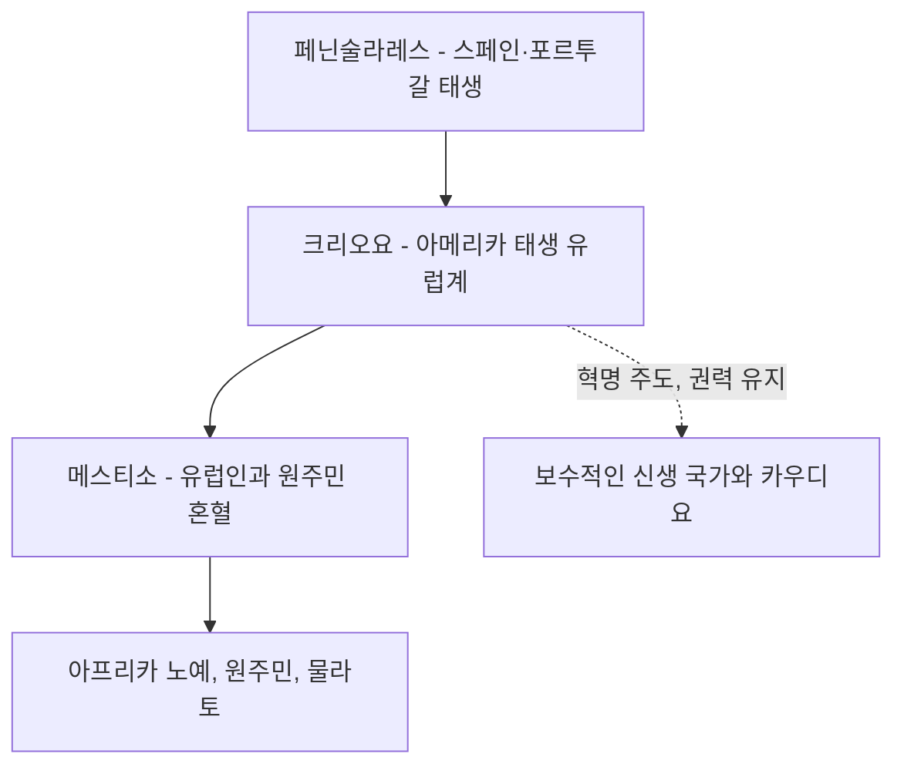
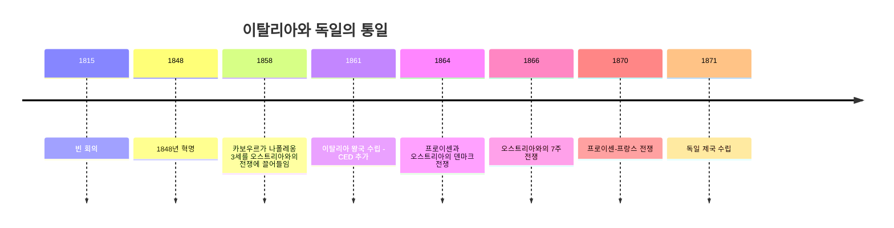
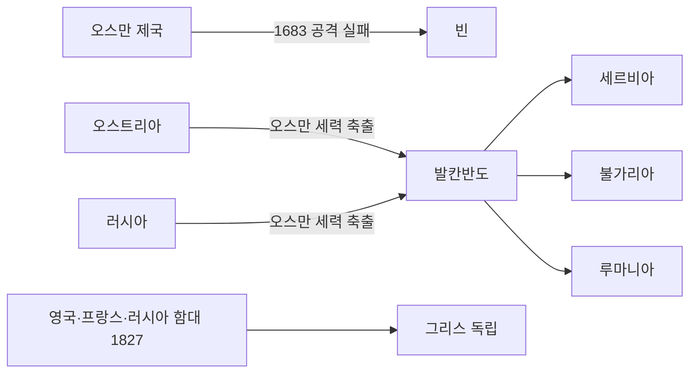

# AP World History: Modern — Topic 5.2: 민족주의와 혁명 (Nationalism and Revolutions)

*Unit 5: 혁명의 시대 (Revolutions, c. 1750–c. 1900)*

> **핵심 질문 (Focus Question):** 계몽주의와 새롭게 등장한 민족주의의 영향을 포함해, 1750–1900년 여러 혁명의 원인과 결과는 무엇이었는가?
>
> **학습 목표 (Learning Objective):** C: 1750–1900년 여러 혁명의 원인과 결과를 설명한다.

출처: 교재 『World History Modern: AP® Edition』 5.2 (pp. 285–296). 제공해 주신 텍스트를 제 말로 요약했습니다. (CED 추가) 표시는 그 텍스트에 없는 내용입니다.

## 큰 그림 요약 (Big Picture)

- 에드먼드 버크 (Edmund Burke)와 조제프 드 메스트르 (Joseph de Maistre) 같은 보수주의자는 혁명이 잔혹하고 혼란스러우며 좋은 결과를 내기 어렵다고 보았다. 그러나 헌법과 민주적 정부에 대한 요구는 1800년대 내내 분출했다.
- 미국·프랑스·아이티·라틴아메리카 크리오요 혁명은 진보, 이성, 자연법이라는 계몽주의 이상에 기반했다.
- 누가 혁명을 이끌었는지가 결과를 좌우했다. 아이티에서는 노예가 노예제를 끝냈고, 라틴아메리카에서는 크리오요 엘리트가 보수적 사회 질서를 유지했다.
- 민족주의는 이탈리아와 독일을 통일하고, 발칸반도에 대한 오스만의 지배를 무너뜨렸으며, 식민 지배에 대한 저항(뉴질랜드, 푸에르토리코, 쿠바, 필리핀)을 일으켰다.

## 1. 미국 혁명 (American Revolution)

- 미국 혁명의 이상은 유럽 계몽사상에서 나왔다. 중농주의자 (physiocrats)의 자유 시장 사상도 영국의 중상주의에 맞서는 근거가 되었다.
- 식민지인들은 이미 실질적으로 정치적 자립 상태였다. 식민지 의회가 원래 영국 의회가 하던 결정을 내렸고, 런던은 멀리 떨어져 있었다.
- 독립 선언문 (1776년 7월 4일): 토머스 제퍼슨 (Thomas Jefferson)은 로크에게서 '양도할 수 없는 권리 (unalienable rights)'라는 표현을 가져왔다. 그에게 이 권리는 생명, 자유, 행복 추구였다.
- 프랑스의 지원으로 승리한 1775–1783년 전쟁과 미국 헌법(1787). 제공된 텍스트는 이 부분에서 끊겨 있다. *(CED 추가)*

## 2. 뉴질랜드 전쟁 (New Zealand Wars)

- 폴리네시아계 마오리족 (Maori)은 적어도 1200년대 중반부터 뉴질랜드에 살며 풍부한 문화를 발전시켰다. 이위 (iwi)라는 부족으로 나뉘어 있었고 때로 서로 싸웠다.
- 영국은 1840년 뉴질랜드를 병합했고, 마오리의 일에 대한 영국의 통제와 토지에 대한 압박이 커졌다.
- 이어진 전쟁으로 마오리 부족들이 함께 싸우며 마오리 민족주의가 생겨났지만, 1872년까지 영국이 승리했다.

## 3. 프랑스 혁명 (French Revolution)

- 구호: 자유, 평등, 박애 (liberté, égalité, fraternité). 필로조프들의 저술로 유럽 전역에 퍼졌다.
- 경제적 원인: 프랑스는 미국 혁명 지원을 포함한 전쟁 비용 때문에 오랫동안 수입보다 많이 지출했다.
- 1789년 봄: 삼부회 (Estates-General, 성직자·귀족·평민)가 소집되었다. 평민은 인구의 97%였지만 투표가 불평등해서, 따로 국민 의회 (National Assembly)를 구성했다.
- 라파예트 후작 (Marquis de Lafayette) 같은 온건파는 입헌 군주제를 기대했다. 국왕이 지도자 체포를 위협하자 파리 군중이 바스티유를 습격했고(1789년 7월 14일), 농민들은 영주의 저택을 불태웠다.
- 초기에 이루어진 가장 영구적인 변화: 봉건제 폐지와 인권 선언.
- 루이 16세와 귀족이 제한 군주제를 거부하자 급진파 자코뱅 (Jacobins)이 제1공화국(1792)을 이끌어 냈다. 자코뱅이 주도한 공포 정치 (Reign of Terror)로 국왕과 왕비를 포함해 수천 명이 처형되었다.
- 혼란과 전쟁 끝에 나폴레옹 보나파르트 장군이 1804년 황제가 되었다.
- 로베스피에르가 공포 정치(1793–1794)를 이끌었고, 나폴레옹 법전(1804)이 남성의 법적 평등을 확산시켰다. *(CED 추가)*

## 4. 아이티 혁명 (Haitian Revolution)

- 아이티는 히스파니올라섬 서쪽 3분의 1을 차지한, 설탕과 커피로 부유한 프랑스 식민지였다.
- 노예가 된 아프리카인들이 봉기를 시작했고, 이미 탈출한 노예인 마룬 (Maroons)이 합류했다.
- 미국 혁명과 프랑스 혁명에 영감을 받은 노예 출신 투생 루베르튀르 (Toussaint L'Ouverture)가 1791년 합류해 전면 봉기를 이끌었다. 계몽사상에 밝고 유능한 장군이었던 그는 프랑스·스페인·영국을 서로 견제하게 했다.
- 1801년 헌법: 모든 주민의 평등과 시민권을 보장했다. 투생은 스스로 종신 총독이 되었고, 토지 개혁으로 플랜테이션을 해방 노예와 자유 흑인에게 나누어 주었다.
- 프랑스가 그를 배신해 투옥했고 그는 1803년 프랑스에서 죽었다. 그러나 그는 아이티의 노예제 폐지를 확고히 해 두었다.
- 1804년: 장자크 데살린 (Jean-Jacques Dessalines)이 영구 독립을 선언했다. 라틴아메리카 최초의 독립국, 서반구 최초의 흑인 주도 국가, 노예 봉기로 영구 독립한 유일한 나라였다.

## 5. 라틴아메리카의 크리오요 혁명 (Creole Revolutions)

- 사회 계층: 페닌술라레스 (peninsulares, 스페인·포르투갈 태생) > 크리오요 (creoles, 아메리카 태생 유럽계) > 메스티소 (mestizos, 유럽인과 원주민 혼혈) > 아프리카 노예, 원주민, 물라토 (mulattoes, 아프리카계 혼혈).
- 원인: 부유한 크리오요는 스페인의 중상주의(스페인에서만 사고 스페인에만 팔기)에 반대했고, 고위직이 페닌술라레스에게 돌아가는 데 분노했다. 메스티소는 권력과 부의 분배를 원했다.
- 아이티의 노예 봉기와 공포 정치를 본 크리오요는 대중을 두려워해 메스티소·원주민·물라토의 지원을 거부했다.
- 시몬 볼리바르 (Simón Bolívar, 1783년 베네수엘라 출생)는 가문의 부를 이용해 지금의 베네수엘라·콜롬비아·에콰도르·페루 지역을 해방했다. 미국식 연방을 기대하며 그란 콜롬비아 (Gran Colombia)를 세웠고, 자유 시장과 노예제 폐지를 지지하는 자유주의자를 자처했다(「자메이카 편지」, 1815).
- 오랜 전쟁으로 카우디요 (caudillos)가 등장했다. 지역 기반의 강력한 지도자로 정부를 세우거나 무너뜨렸고, 대체로 대의 정치와 법치를 무시했다.
- 결과: 헌법이 법적으로 노예제와 일부 신분 차별을 없앴지만 정부는 보수적이었다. 페루의 첫 헌법은 스페인어를 읽고 쓰지 못하는 사람의 투표를 1860년까지 금지했고, 크리오요가 여전히 상류층이었다.
- 여성은 얻은 것이 거의 없었다(투표권·계약권 없음, 교육 부족). 예외로 마누엘라 사엔스 (Manuela Sáenz, 1797–1856)는 키토 근처 전투(1822)에서 싸우고 대령이 되었으며, 볼리바르의 목숨을 구해 '해방자의 해방자'라고 불렸다.
- 호세 데 산마르틴이 아르헨티나와 칠레를 해방했고, 미겔 이달고가 멕시코 봉기를 시작했다(1810, 1821년 독립). 브라질은 페드루 1세 아래 독립했다(1822). 나폴레옹의 스페인 침공(1808)이 봉기의 계기가 되었다. *(CED 추가)*

## 6. 이후의 도전: 푸에르토리코, 쿠바, 필리핀

- 푸에르토리코와 쿠바는 스페인의 마지막 식민지에 속했고, 두 섬 모두 1868년부터 스페인에 맞서 봉기했다.
- 시인 롤라 로드리게스 데 티오 (Lola Rodríguez de Tió)는 스페인의 착취적 지배를 비판했다. 그녀의 집은 혁명가들의 모임 장소였고, 그녀는 「라 보린케냐」('잠에서 깨어나라, 싸울 때가 왔다!')의 가사를 썼다.
- 그녀는 베네수엘라로 망명했다가(1868) 1885년 돌아왔고, 다시 쿠바로 망명해 쿠바 독립을 위해 일하다 뉴욕으로 추방되었다. 1899년 쿠바로 돌아와 사회 정의를 위해 활동했다.
- 필리핀: 교육은 제한적이었고 종교 권력이 통제했다. 그래서 부유한 청년들(주로 크리오요와 메스티소)이 마드리드와 바르셀로나에서 공부하며 1880년대 유럽의 민족주의와 공화주의를 받아들였다.
- 호세 리살 (José Rizal)이 이끈 선전 운동 (Propaganda Movement)은 혁명이나 독립이 아니라 더 큰 자치를 요구했다. 그의 체포(1892)와 처형(1896)은 필리핀인들에게 충격을 주었고 필리핀 혁명(1896)을 촉발했다.

## 7. 유럽의 민족주의와 통일

- 사람들은 언어·역사·관습을 공유하는 사람들과 점점 더 유대감을 느꼈다. 나폴레옹의 정복은 특히 쇠퇴하던 신성 로마 제국의 독일 지역에 민족주의를 퍼뜨렸다.
- 이탈리아: 피에몬테-사르데냐의 총리 카보우르 (Count di Cavour) 백작은 유일한 토착 왕조인 사보이 왕가 아래 반도 통일을 추진했다. 대부분 지역 언어를 썼고, 카보우르 자신도 이탈리아어보다 프랑스어를 더 잘했다.
- 카보우르는 고전적 자유주의와 현실 정치 (realpolitik)를 결합했다. 1858년 나폴레옹 3세를 오스트리아와의 전쟁으로 끌어들였다. 나폴레옹 3세는 두 번 승리한 뒤 교황을 두려워해 물러났지만, 여러 지역이 국민 투표 (plebiscite)로 피에몬테 합류를 결정했다.
- 카보우르는 주세페 마치니 (Giuseppe Mazzini)의 낭만적 리소르지멘토 (Risorgimento, 부흥) 사상을 받아들이고, 나폴리 왕국에서 싸우던 주세페 가리발디 (Giuseppe Garibaldi)의 붉은 셔츠단과 손잡았다.
- 이탈리아 왕국은 1861년에 선포되었다. *(CED 추가)*
- 독일: 프랑스 점령에 대한 반발로 민족주의가 성장했다. 빈 회의(1815) 이후 프로이센과 오스트리아 등에서 일어난 1848년 혁명은 민족주의와 자유주의가 결합된 것이었다.
- 오토 폰 비스마르크는 현실 정치와 세 번의 전쟁 — 덴마크(1864), 오스트리아(7주 전쟁, 1866), 프랑스(프로이센-프랑스 전쟁, 1870) — 을 통해 1871년 알자스-로렌을 포함한 독일 제국을 세웠다.
- 결과: 경쟁하는 동맹과 극단적 민족주의가 훗날 제1차 세계 대전으로 이어졌다. 남부 이탈리아의 빈곤으로 미국과 아르헨티나로의 이민이 늘었는데, 아르헨티나의 1853년 헌법은 이민을 장려했다.

## 8. 발칸과 오스만의 민족주의

- 오스만의 빈 정복 실패(1683)를 계기로 오스트리아와 러시아가 발칸반도에서 오스만 세력을 밀어내기 시작했다. 서구 사상과의 접촉이 발칸 민족주의를 키웠다.
- 그리스(1800년 무렵 350년 넘게 오스만 지배): 계몽사상과 고대 그리스에 대한 유럽의 존경이 그리스인의 자부심을 되살렸다. 1827년 영국·프랑스·러시아 연합 함대가 오스만 함대를 격파해 독립을 확실하게 하는 데 도움을 주었다.
- 세르비아·불가리아·루마니아도 언어, 민속 전통, 공통의 역사, 종교를 중심으로 결집했고, 이후 러시아나 오스트리아의 도움을 받는 비슷한 길을 걸었다.
- 오스만주의 (Ottomanism, 1870–1880년대)는 특히 국가가 통제하는 학교와 표준 교육 과정을 통해 민족·언어·종교의 차이를 줄여 근대적 통합 국가를 만들려 했다. 그러나 오히려 피지배 민족의 차이 의식과 독립 열망을 키우는 역효과를 냈다.
- 민족주의의 미래: 유럽의 공동 화폐, 국경 개방, 정책 공조는 더 큰 정치적 결합으로 옮겨 가는 신호일 수 있다.

## 비교표 (Comparison): 대서양 혁명 비교

| 혁명 | 주요 원인 | 지도자·집단 | 결과 |
|---|---|---|---|
| 미국 | 계몽사상, 중농주의 대 중상주의, 식민지 자치 | 제퍼슨, 식민지 의회 | 독립, 1776년 선언 |
| 프랑스 | 전쟁 부채, 삼부회의 불평등한 투표 | 평민, 라파예트, 자코뱅 | 봉건제 폐지, 1792년 공화국, 1804년 나폴레옹 황제 |
| 아이티 | 노예제, 미국과 프랑스의 선례 | 아프리카 노예, 마룬, 투생, 데살린 | 노예제 폐지, 1804년 독립 |
| 크리오요 (라틴아메리카) | 스페인 중상주의, 페닌술라레스의 고위직 독점 | 크리오요, 볼리바르, 사엔스 | 독립, 보수적 크리오요 지배, 카우디요 |

## 비교표 (Comparison): 아이티 혁명 vs. 프랑스 혁명 (교재 비교)

| 특징 | 아이티 | 프랑스 | 공통점 |
|---|---|---|---|
| 봉기 주체 | 아무 권리도 없는 사람들 (노예) | 신분제 아래의 평민 | 법으로 제약받던 집단 |
| 제약 | 노예제 — 훨씬 혹독함 | 신분 (법적 사회 계급) | 계몽주의 자연권을 주장 |
| 결과 | 노예제 폐지와 독립 | 봉건제 폐지, 공화정 이후 제정 | 구체제 전복 |

## 비교표 (Comparison): 이탈리아 통일 vs. 독일 통일

| 특징 | 이탈리아 | 독일 |
|---|---|---|
| 중심 국가 | 피에몬테-사르데냐 (사보이 왕가) | 프로이센 |
| 주요 지도자 | 카보우르, 마치니, 가리발디 | 비스마르크 |
| 방법 | 현실 정치, 오스트리아와의 전쟁, 국민 투표, 붉은 셔츠단 | 현실 정치, 세 번의 전쟁 (1864, 1866, 1870) |
| 장애물 | 지역 언어, 교황과 교황령 | 분열된 국가들, 오스트리아와 프랑스 |
| 결과 | 통일 왕국, 남부의 빈곤과 이민 | 1871년 독일 제국, 알자스-로렌 포함 |

## 핵심 용어 (Key Terms)

| 용어 | 뜻 |
|---|---|
| **중농주의자 (Physiocrats)** | 중상주의에 맞서 자유 시장 사상을 옹호한 경제학자들 |
| **양도할 수 없는 권리 (Unalienable rights)** | 빼앗을 수 없는 권리 (로크, 독립 선언문) |
| **이위 (Iwi)** | 뉴질랜드 마오리족의 부족 |
| **삼부회 (Estates-General)** | 성직자·귀족·평민으로 구성된 프랑스 의회 |
| **국민 의회 (National Assembly)** | 1789년 평민이 구성한 의회 |
| **자코뱅 (Jacobins)** | 공화국과 공포 정치를 이끈 급진 혁명파 |
| **공포 정치 (Reign of Terror)** | 혁명 정부가 반대자 수천 명을 처형한 시기 |
| **마룬 (Maroons)** | 노예 상태에서 탈출한 사람들 |
| **페닌술라레스 (Peninsulares)** | 스페인·포르투갈 태생 식민지인 |
| **크리오요 (Creoles)** | 아메리카에서 태어난 유럽계 |
| **메스티소 (Mestizos)** | 유럽인과 원주민 사이에서 태어난 사람 |
| **물라토 (Mulattoes)** | 아프리카계와 유럽계(또는 원주민) 혼혈 |
| **그란 콜롬비아 (Gran Colombia)** | 볼리바르 군대가 세운 대국가 |
| **카우디요 (Caudillos)** | 정부를 세우거나 무너뜨린 지역 기반의 강력한 지도자 |
| **선전 운동 (Propaganda Movement)** | 리살이 이끈 필리핀 자치 운동 |
| **리소르지멘토 (Risorgimento)** | 이탈리아의 '부흥', 통일 운동 |
| **현실 정치 (Realpolitik)** | 이상보다 힘에 기반한 실용 정치 |
| **국민 투표 (Plebiscite)** | 국민이 직접 투표하는 것 |
| **1848년 혁명 (Revolutions of 1848)** | 민족주의와 자유주의가 이끈 유럽의 봉기 |
| **이민 (유입) (Immigration)** | 다른 나라에서 한 나라로 사람들이 들어오는 것 |
| **오스만주의 (Ottomanism)** | 신민 간 차이를 줄여 제국을 통합하려는 운동 |

## 출처 메모 (교재 vs. 일반 자료)

- 제공된 텍스트는 미국 혁명('In the war that followed, the colonists...')에서 바로 뉴질랜드 전쟁으로 넘어가서 p.286 일부가 빠진 것으로 보입니다. 독립 선언문 이외의 미국 혁명 내용은 (CED 추가)로 표시했습니다.
- 교재는 섬을 'St. Domingue, also known as Hispaniola'라고 썼지만, 히스파니올라가 섬 이름이고 생도맹그는 프랑스 식민지의 이름입니다.
- 교재는 7월 14일을 'French Independence Day'라고 썼지만, 실제로는 독립 기념일이 아니라 프랑스 국경일(바스티유의 날)입니다.
- 카보우르: 교재는 오스트리아와의 전쟁을 1858년으로 씁니다. 일반 자료는 나폴레옹 3세와의 비밀 협약을 1858년, 전쟁을 1859년으로 봅니다.
- 프로이센-프랑스 전쟁은 보통 1870–1871년으로 표기합니다. 교재는 1870년만 씁니다.
- 노래 제목이 텍스트에는 'La Boriqueña'로 되어 있지만 표준 표기는 'La Borinqueña'입니다.
- 오스만주의: 교재는 1870–1880년대로 보지만, 많은 자료는 그보다 앞선 탄지마트 시기(1839–1876)와 연결합니다.
- 교재는 물라토를 두 번, 조금 다르게 정의합니다 (아프리카계와 유럽계 또는 원주민 / 아프리카계와 유럽계).
- 이전 CED 기준 노트에서 여기에 넣었던 시오니즘과 헤르츨은 교재 5.1에서 다루므로 5.2에서 뺐습니다.
- 나폴레옹 법전, 로베스피에르, 산마르틴, 이달고, 브라질, 1861년 이탈리아 왕국은 제공된 텍스트에 없어서 (CED 추가)로 남겼습니다.
