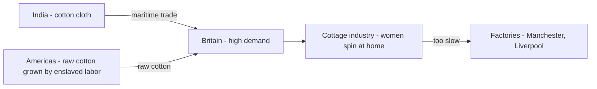
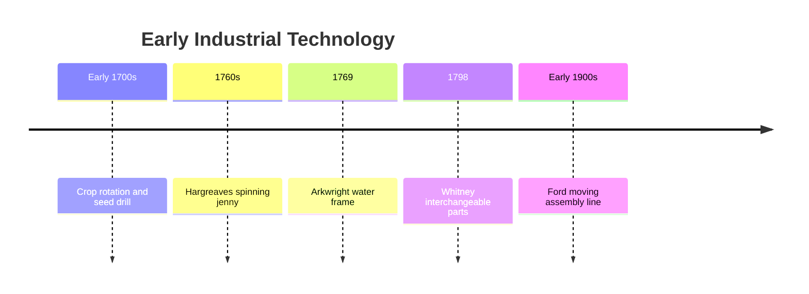
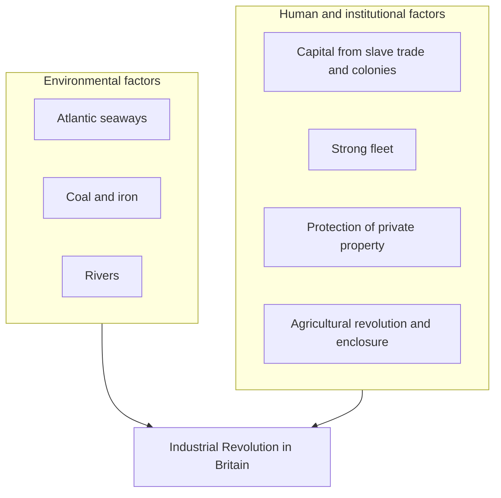

# AP World History: Modern — Topic 5.3: Industrial Revolution Begins

*Unit 5: Revolutions (c. 1750–c. 1900)*

> **Focus Question:** What factors contributed to and characterized industrialization in the period from 1750 to 1900?
>
> **Learning Objective:** D: Explain how environmental factors contributed to industrialization from 1750 to 1900.

Source: textbook World History Modern: AP® Edition, Topic 5.3 (pp. 297–303), from the text you provided, summarized in my own words. Items marked (CED addition) are not in that text.

## Big Picture

- Industrialization: the increased mechanization of production and the social changes that came with it.
- Roots: the Columbian Exchange and maritime trading empires, higher agricultural productivity, and greater accumulation of capital.
- Britain led because of geography (Atlantic seaways, coal, rivers), empire (colonial resources, slave-trade capital), a strong fleet, and legal protection of private property.
- As it spread to Europe, North America, and the world, industrialization raised population, moved people from farm to city, and expanded production and consumption.
- Adam Smith's pin-making example (about 18 separate operations) is a lasting image of factory division of labor.

## 1. Agricultural Improvements

- Early 1700s agricultural revolution: crop rotation (rotating crops in a field each year) and the seed drill (placing seeds efficiently) raised food output.
- The potato from South America added calories to diets.
- More food and better medical care lowered infant mortality and lengthened lives, so population grew — supplying factory workers and buyers for goods.

## 2. Preindustrial Societies and the Cottage Industry

- Most British families in the early 1700s lived in rural areas and made their own food and clothes, mostly from wool and flax.
- Maritime empires brought Indian cotton to Britain, where it became very popular; wool and flax could not compete.
- British investors built their own cotton industry using raw cotton grown by enslaved labor in the Americas.
- Cottage industry (putting-out system): merchants gave raw cotton to women who spun it into cloth at home — hard, low-paid work, but it gave women some independence and kept them near their children.
- Production was slow, so investors pushed for faster machines.

## 3. Growth of Technology

- Spinning jenny (James Hargreaves, 1760s): spun more than one thread at a time.
- Water frame (Richard Arkwright, patented 1769): water power drove spinning; its bulky machines moved production into factories, ending the household cottage industry — Arkwright is called the father of the factory system.
- Interchangeable parts (Eli Whitney, 1798, for U.S. military firearms): a broken part could be replaced with an identical one; the method spread to other products.
- This led to the division (specialization) of labor: owners no longer needed skilled craftsmen, since each worker did one task; Henry Ford later built the moving assembly line for the Model T (early 1900s).
- Flying shuttle (1733), power loom (1785), Newcomen's steam engine (1712), and Whitney's cotton gin (1793); the textbook covers Watt's steam engine in 5.5. *(CED addition)*

## 4. Britain's Industrial Advantages

- Location: on the Atlantic with many seaways, ideal for importing raw materials and exporting goods.
- Coal: huge deposits fueled steam engines and the separation of iron from ore; iron (later steel) built larger bridges, taller buildings, and stronger ships. Coal regions: South Wales, Yorkshire, Lancashire (in the U.S., later West Virginia, Pennsylvania, Kentucky).
- Colonies: resources such as timber for ships; wealth from the trans-Atlantic slave trade gave British capitalists excess capital to invest.
- Rivers plus publicly funded canals and harbors made transport cheap.
- The world's strongest fleet, both naval and commercial.
- Legal protection of private property assured entrepreneurs that their businesses would not be taken away; not all nations offered this.
- Enclosure movement: the government fenced off the commons for paying users or buyers; landless farmers moved to cities such as Manchester and Liverpool and became the industrial workforce.

## 5. Environmental Effects

- Coal smoke polluted industrial cities, and mining and factory waste damaged land and rivers. *(CED addition)*

## Comparison: Cottage Industry vs. Factory System

| Feature | Cottage industry (putting-out) | Factory system |
|---|---|---|
| Place | Workers' homes | Factories big enough for bulky machines |
| Power | Human labor | Water power, later steam |
| Workers | Mostly women spinners | Unskilled workers doing one task each |
| Advantages | Some independence; near children | Much faster and cheaper output |
| Drawbacks | Slow; low pay | Strict, repetitive work |

## Comparison: Why Britain Industrialized First

| Type | Factor | Why it mattered |
|---|---|---|
| Environmental | Coal deposits | Fuel for steam engines and iron smelting |
| Environmental | Atlantic location; rivers | Cheap import, export, and inland transport |
| Economic | Colonies; slave-trade capital | Raw materials and money to invest |
| Political | Strong fleet; property protection | Safe trade and secure investment |
| Social | Agricultural revolution; enclosure | Population growth and urban workforce |

## Key Terms

| Term | Definition |
|---|---|
| **Industrialization** | Increased mechanization of production and accompanying social changes |
| **Crop rotation** | Rotating different crops in a field each year |
| **Seed drill** | Device that places seeds efficiently in the ground |
| **Cottage industry / putting-out system** | Merchants supplied raw cotton to women who spun it at home |
| **Spinning jenny** | Hargreaves's machine spinning several threads at once |
| **Water frame** | Arkwright's water-powered spinning machine (1769) |
| **Factory system** | Production in large buildings housing machines and workers |
| **Interchangeable parts** | Identical parts that can replace one another |
| **Division of labor** | Each worker specializes in one task |
| **Assembly line** | Ford's moving line where each worker adds one part |
| **Fossil fuel** | Energy source derived from plant and animal remains, such as coal |
| **Capital** | Money available to invest in businesses |
| **The commons** | Public land where villagers farmed or grazed sheep |
| **Enclosure movement** | Fencing off the commons for exclusive private use |
| **Urbanization** | Movement of people from rural areas to cities |

## Notes on Sources

- Watt's steam engine is not in 5.3; the textbook covers it in 5.5 and dates it 1765 (standard references: the separate-condenser idea in 1765, patented 1769). The previous CED-based note gave 1769.
- Interchangeable parts: the textbook credits Eli Whitney (1798); historians note the idea was also developed in France and fully achieved in U.S. armories only later.
- The textbook mentions Whitney only for interchangeable parts, not the cotton gin (1793), which is kept as (CED addition).
- Spinning jenny: the textbook says "1760s"; it is commonly dated c. 1764 (patented 1770).
- The textbook says the jenny let "a weaver" spin more than one thread; strictly, it was a spinning machine used by spinners.
- The textbook has no section on environmental damage; that section is a (CED addition).
