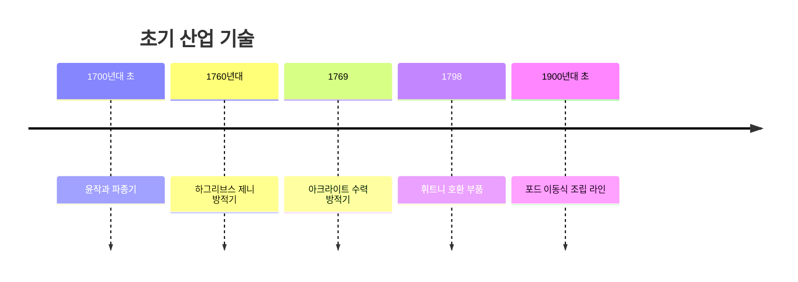
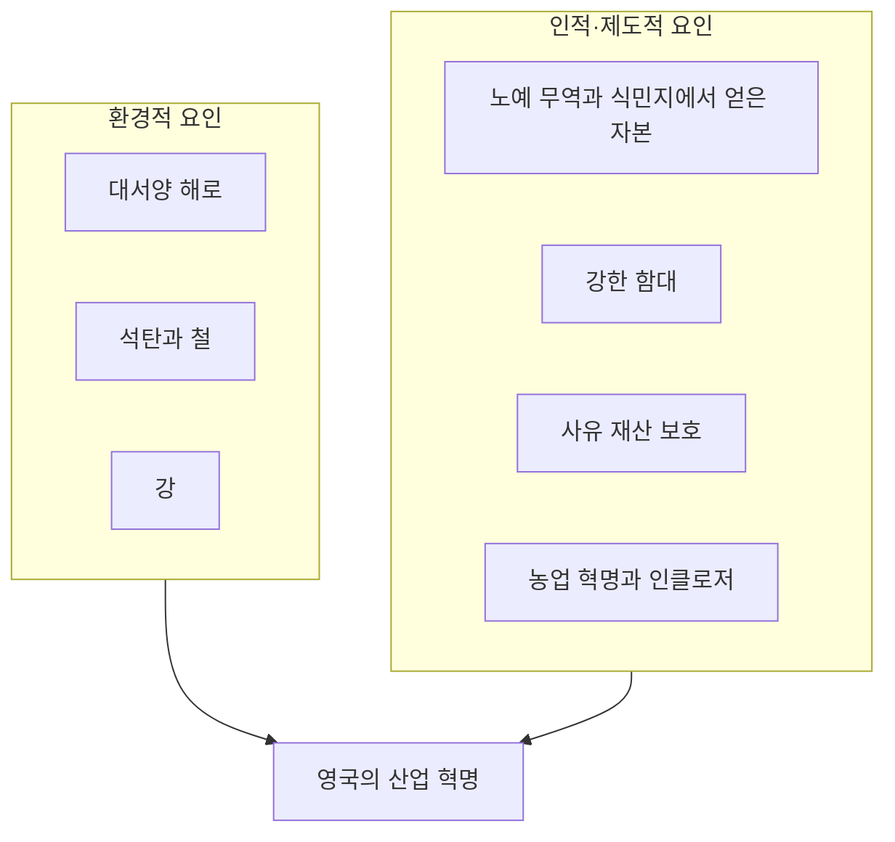

# AP World History: Modern — Topic 5.3: 산업 혁명의 시작 (Industrial Revolution Begins)

*Unit 5: 혁명의 시대 (Revolutions, c. 1750–c. 1900)*

> **핵심 질문 (Focus Question):** 1750–1900년 산업화에 기여하고 산업화를 특징지은 요인은 무엇이었는가?
>
> **학습 목표 (Learning Objective):** D: 1750–1900년 환경적 요인이 산업화에 어떻게 기여했는지 설명한다.

출처: 교재 『World History Modern: AP® Edition』 5.3 (pp. 297–303). 제공해 주신 텍스트를 제 말로 요약했습니다. (CED 추가) 표시는 그 텍스트에 없는 내용입니다.

## 큰 그림 요약 (Big Picture)

- 산업화 (Industrialization): 생산의 기계화가 늘어난 것과 그에 따른 사회 변화.
- 뿌리: 콜럼버스 교환과 해상 무역 제국, 농업 생산성 향상, 자본 축적의 증가.
- 영국이 앞선 이유는 지리(대서양 해로, 석탄, 강), 제국(식민지 자원, 노예 무역 자본), 강한 함대, 사유 재산의 법적 보호였다.
- 산업화가 유럽·북아메리카·세계로 퍼지면서 인구가 늘고, 사람들이 농촌에서 도시로 옮겨 갔으며, 생산과 소비가 확대되었다.
- 애덤 스미스의 핀 제조 사례(약 18개의 분리된 공정)는 공장 분업을 보여 주는 대표적 이미지다.

## 1. 농업의 발전

- 1700년대 초 농업 혁명: 윤작 (crop rotation, 해마다 밭의 작물을 바꿈)과 파종기 (seed drill, 씨앗을 효율적으로 심는 기구)가 식량 생산을 늘렸다.
- 남아메리카에서 들어온 감자가 식단의 열량을 높였다.
- 식량 증가와 의료 개선으로 영아 사망률이 낮아지고 수명이 늘어 인구가 증가했다. 이는 공장 노동력과 상품 구매자를 공급했다.

## 2. 산업화 이전 사회와 가내 공업

- 1700년대 초 대부분의 영국 가정은 농촌에 살며 식량과 옷을 직접 만들었고, 옷은 주로 양모와 아마로 만들었다.
- 해상 제국을 통해 인도 면직물이 영국에 들어와 큰 인기를 끌었고, 양모와 아마는 경쟁이 되지 않았다.
- 영국 투자자들은 아메리카에서 노예 노동으로 재배된 원면을 써서 자국 면직물 산업을 세웠다.
- 가내 공업 (cottage industry, 선대제 putting-out system): 상인이 원면을 주면 여성들이 집에서 실을 잣고 천을 만들었다. 고되고 임금이 낮았지만 여성에게 어느 정도 자율성을 주었고 아이들 곁에 있을 수 있었다.
- 생산이 느렸기 때문에 투자자들은 더 빠른 기계를 요구했다.

## 3. 기술의 발전

- 제니 방적기 (spinning jenny, 제임스 하그리브스 James Hargreaves, 1760년대): 한 번에 여러 가닥의 실을 자았다.
- 수력 방적기 (water frame, 리처드 아크라이트 Richard Arkwright, 1769년 특허): 물의 힘으로 방적기를 돌렸다. 기계가 커서 생산이 공장으로 옮겨 갔고 가내 공업이 사라졌다. 아크라이트는 공장제의 아버지라 불린다.
- 호환 부품 (interchangeable parts, 엘리 휘트니 Eli Whitney, 1798, 미군 총기): 고장 난 부품을 똑같은 새 부품으로 바꿀 수 있었다. 이 방식은 다른 제품으로 퍼졌다.
- 이는 분업 (division of labor, 노동의 전문화)으로 이어졌다. 노동자가 각자 한 가지 작업만 했기 때문에 숙련 장인이 필요 없어졌다. 이후 헨리 포드 (Henry Ford)가 모델 T를 위한 이동식 조립 라인을 만들었다(1900년대 초).
- 플라잉 셔틀(1733), 역직기(1785), 뉴커먼의 증기 기관(1712), 휘트니의 조면기(1793). 와트의 증기 기관은 교재 5.5에서 다룬다. *(CED 추가)*

## 4. 영국의 산업적 이점

- 위치: 해로가 많은 대서양에 접해 있어 원료 수입과 상품 수출에 유리했다.
- 석탄: 막대한 매장량이 증기 기관과 철광석에서 철을 분리하는 데 쓰였다. 철(이후 강철)로 더 큰 다리, 더 높은 건물, 더 튼튼한 배를 만들었다. 탄광 지역: 사우스웨일스, 요크셔, 랭커셔 (미국에서는 이후 웨스트버지니아, 펜실베이니아, 켄터키).
- 식민지: 배를 만들 목재 같은 자원. 대서양 노예 무역에서 얻은 부가 영국 자본가에게 투자할 잉여 자본을 주었다.
- 강과 공공 자금으로 만든 운하·항구 덕분에 운송비가 쌌다.
- 세계 최강의 함대(해군과 상선 모두).
- 사유 재산의 법적 보호가 기업가에게 사업을 빼앗기지 않는다는 확신을 주었다. 모든 나라가 이를 보장하지는 않았다.
- 인클로저 운동 (enclosure movement): 정부가 공유지 (the commons)에 울타리를 쳐 비용을 내거나 땅을 산 사람만 쓰게 했다. 땅을 잃은 농민들이 맨체스터와 리버풀 같은 도시로 가서 산업 노동력이 되었다.

## 5. 환경에 끼친 영향

- 석탄 연기가 공업 도시를 오염시켰고, 광산과 공장 폐기물이 토지와 강을 훼손했다. *(CED 추가)*

## 비교표 (Comparison): 가내 공업 vs. 공장제

| 특징 | 가내 공업 (선대제) | 공장제 |
|---|---|---|
| 장소 | 노동자의 집 | 큰 기계를 둘 수 있는 공장 |
| 동력 | 사람의 노동 | 물의 힘, 이후 증기 |
| 노동자 | 주로 여성 방적공 | 한 가지 작업만 하는 비숙련 노동자 |
| 장점 | 어느 정도의 자율성, 아이들 곁에 있음 | 훨씬 빠르고 저렴한 생산 |
| 단점 | 느림, 낮은 임금 | 엄격하고 반복적인 노동 |

## 비교표 (Comparison): 영국이 먼저 산업화한 이유

| 유형 | 요인 | 중요한 이유 |
|---|---|---|
| 환경 | 석탄 매장 | 증기 기관과 제철의 연료 |
| 환경 | 대서양 입지, 강 | 저렴한 수입·수출·내륙 운송 |
| 경제 | 식민지, 노예 무역 자본 | 원료와 투자 자금 |
| 정치 | 강한 함대, 재산 보호 | 안전한 무역과 투자 |
| 사회 | 농업 혁명, 인클로저 | 인구 증가와 도시 노동력 |

## 핵심 용어 (Key Terms)

| 용어 | 뜻 |
|---|---|
| **산업화 (Industrialization)** | 생산의 기계화가 늘어난 것과 그에 따른 사회 변화 |
| **윤작 (Crop rotation)** | 해마다 밭의 작물을 바꾸어 심는 것 |
| **파종기 (Seed drill)** | 씨앗을 효율적으로 땅에 심는 기구 |
| **가내 공업 / 선대제 (Cottage industry / putting-out system)** | 상인이 원면을 주면 여성들이 집에서 실을 잣던 방식 |
| **제니 방적기 (Spinning jenny)** | 여러 가닥의 실을 동시에 잣는 하그리브스의 기계 |
| **수력 방적기 (Water frame)** | 물의 힘으로 돌리는 아크라이트의 방적기 (1769) |
| **공장제 (Factory system)** | 기계와 노동자를 모은 큰 건물에서의 생산 |
| **호환 부품 (Interchangeable parts)** | 서로 바꿔 끼울 수 있는 똑같은 부품 |
| **분업 (Division of labor)** | 노동자가 각자 한 가지 작업을 전문으로 하는 것 |
| **조립 라인 (Assembly line)** | 노동자가 각자 부품 하나씩을 더하는 포드의 이동식 생산 라인 |
| **화석 연료 (Fossil fuel)** | 석탄처럼 동식물의 잔해에서 나온 에너지원 |
| **자본 (Capital)** | 사업에 투자할 수 있는 돈 |
| **공유지 (The commons)** | 마을 사람들이 경작하거나 양을 치던 공공의 땅 |
| **인클로저 운동 (Enclosure movement)** | 공유지에 울타리를 쳐 사적으로 독점하게 한 것 |
| **도시화 (Urbanization)** | 사람들이 농촌에서 도시로 이동하는 것 |

## 출처 메모 (교재 vs. 일반 자료)

- 와트의 증기 기관은 5.3에 없고 교재 5.5에서 1765년으로 다룹니다(일반 자료: 분리 응축기 착상 1765년, 특허 1769년). 이전 CED 기준 노트는 1769년으로 썼습니다.
- 호환 부품: 교재는 엘리 휘트니(1798)의 공으로 보지만, 역사가들은 이 개념이 프랑스에서도 발전했고 미국 병기창에서 나중에야 완전히 실현되었다고 봅니다.
- 교재는 휘트니를 호환 부품으로만 언급하고 조면기(1793)는 다루지 않아서, 조면기는 (CED 추가)로 남겼습니다.
- 제니 방적기: 교재는 '1760년대'로 쓰고, 일반 자료는 보통 1764년경(1770년 특허)으로 봅니다.
- 교재는 제니 방적기로 '직조공 (weaver)'이 여러 실을 자았다고 쓰지만, 엄밀히 말하면 방적공이 쓰는 방적 기계입니다.
- 교재에는 환경 피해에 관한 내용이 없어서, 그 섹션은 (CED 추가)입니다.
