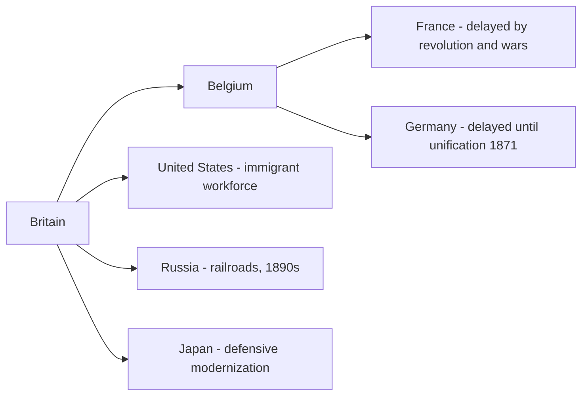
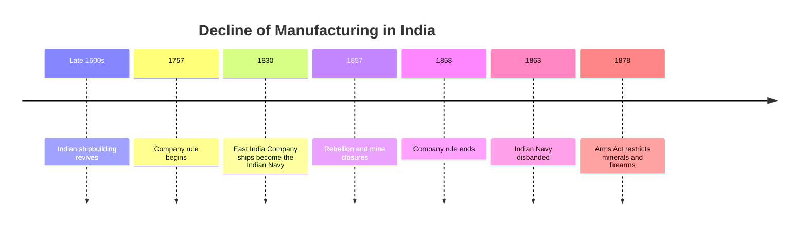

# AP World History: Modern — Topic 5.4: Industrialization Spreads

*Unit 5: Revolutions (c. 1750–c. 1900)*

> **Focus Question:** How did different types and locations of production develop and change over time?
>
> **Learning Objective:** E: Explain how different modes and locations of production have developed and changed over time.

Source: textbook World History Modern: AP® Edition, Topic 5.4 (pp. 304–309), from the text you provided, summarized in my own words. Items marked (CED addition) are not in that text.

## Big Picture

- Factory cotton manufacturing replaced Britain's cottage industry, and cheap British cotton replaced Indian and Middle Eastern goods on the world market.
- Industrialization spread from Britain to Belgium, then France and Germany, and later the U.S., Russia, and Japan — countries with capital, natural resources, and water transportation.
- Middle Eastern and Asian regions kept manufacturing, but their share of global manufacturing fell.
- British colonial policy actively weakened Indian shipbuilding, mining, metalworking, and textiles; Egypt lost its textile markets to European competition.

## 1. France and Germany

- France had favorable factors, but sparsely populated cities limited factory labor.
- The French Revolution (1789–1799) and later wars absorbed elites' attention and capital, delaying French industrialization.
- Germany was fragmented into many small states, which delayed industrialization; after unification in 1871 it quickly became a leading producer of steel and coal.
- Belgium industrialized first on the continent, using coal and iron deposits and British skills; the Zollverein (1834) and the Ruhr Valley aided German growth. *(CED addition)*

## 2. The United States

- Its industrial revolution began in the 1800s; by 1900 it was a leading industrial force.
- Human capital (the workforce) was key: political upheaval and poverty brought many immigrants from Europe and East Asia, joined by migrants from rural America.
- Samuel Slater brought British textile technology in the 1790s, and the Lowell mills employed young women. *(CED addition)*

## 3. Russia and Japan

- Russia focused on railroads and exports: over 36,000 miles of railroad by 1900; the Trans-Siberian Railroad linked Moscow to the Pacific for trade with China and Japan.
- Coal, iron, and steel grew with the railroad, mostly in the 1890s; by 1900 Russia was the world's fourth-largest steel producer, but the economy stayed overwhelmingly agricultural until after the Communists took power in 1917.
- Japan, the Asian country with the least contact with Europe since the 1600s, was the first in Asia to industrialize.
- Defensive modernization: Japan consciously adopted Western technology and institutions to protect its traditional culture, and became a leading world power in the last four decades of the 1800s (see 5.6).
- Sergei Witte led Russia's state-funded industrial drive in the 1890s. *(CED addition)*

## 4. Shifts in Manufacturing: India

- Shipbuilding: revived in India in the late 1600s thanks to alliances with Western countries, but declined under British mismanagement; Britain made East India Company ships the Indian Navy (1830), then disbanded it by 1863 when the Royal Navy took full control of the Indian Ocean.
- Company rule (British East India Company, 1757–1858): steep British tariffs weakened Indian mining and metalworking.
- After the Rebellion of 1857, Britain closed mines it believed supplied lead for ammunition; the Arms Act of 1878 restricted minerals and firearms production, and mining in Rajasthan died out.
- Mining and metalworking stayed almost nonexistent into the 1900s; crude, labor-intensive methods created the false impression that India's minerals were inaccessible.
- Textiles: as Bombay's more than 80 mills competed with Lancashire ("Lancaster") mills, British owners pressured the government in India to impose an "equalizing" 5% tax on Bombay textiles.

## 5. Shifts in Manufacturing: Egypt

- In the 1700s Egypt exported carpets, silks, and other textiles to Europe.
- By the mid-1800s, huge growth in European textile output cost Egypt its export market and much of its domestic market.

## Comparison: Paths to Industrialization

| Country | Delaying factors | Key drivers | Status by 1900 |
|---|---|---|---|
| France | Sparse urban labor; revolution and wars | Capital, resources, water transport | Industrialized later than Britain |
| Germany | Many small states | Unification 1871 | Leading steel and coal producer |
| United States | — | Immigrant and rural-migrant workforce | Leading industrial force |
| Russia | Mostly agricultural economy | Railroads, exports; 1890s heavy industry | 4th in steel; still agricultural |
| Japan | Isolation since the 1600s | Defensive modernization | Leading world power |

## Comparison: How Britain Weakened Manufacturing in India and Egypt

| Industry | Region | British action or pressure | Effect |
|---|---|---|---|
| Shipbuilding | India | Mismanagement; Indian Navy disbanded by 1863 | Royal Navy controls Indian Ocean |
| Mining and metalworking | India | Tariffs; mine closures after 1857; Arms Act 1878 | Rajasthan mining extinct |
| Textiles | India | 5% "equalizing" tax on Bombay mills | Lower profits for Indian mills |
| Textiles | Egypt | European mass production | Lost export and domestic markets |

## Key Terms

| Term | Definition |
|---|---|
| **Human capital** | The workforce and its skills |
| **Defensive modernization** | Adopting Western technology and institutions to protect one's own culture |
| **Trans-Siberian Railroad** | Russian railroad from Moscow to the Pacific |
| **Company rule** | British East India Company control over parts of India (1757–1858) |
| **Rebellion of 1857** | Indian uprising against British company rule |
| **Arms Act of 1878** | British law restricting Indian access to minerals and firearms production |
| **Tariff** | Tax on imported or exported goods |
| **Deindustrialization** | Decline of a region's manufacturing |
| **Global share of manufacturing** | A region's portion of the world's total manufactured output |

## Notes on Sources

- "British colonial rule ended in 1948": India became independent in 1947.
- The text says Rajasthan's mines were abandoned "by the early 19th century" but also links closures to the 1857 rebellion and the 1878 Arms Act; the order of events is unclear in the textbook.
- "Lancaster" textile mills: the British cotton center is usually called Lancashire.
- Belgium appears only as a name in the textbook; the explanation of why it industrialized early is a (CED addition).
- Removed from the previous CED-based note because they are not in the textbook's 5.4: the approximate start-year Gantt chart, Muhammad Ali's mills (now in 5.6), China, and the core–periphery term.
