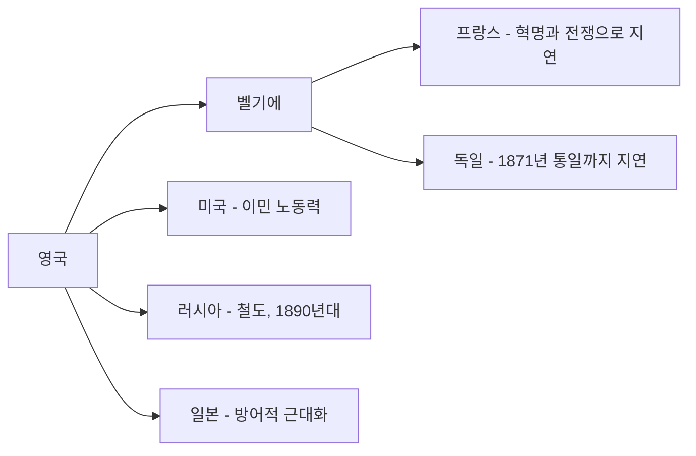
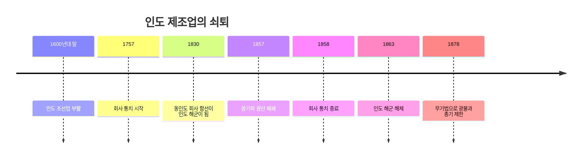

# AP World History: Modern — Topic 5.4: 산업화의 확산 (Industrialization Spreads)

*Unit 5: 혁명의 시대 (Revolutions, c. 1750–c. 1900)*

> **핵심 질문 (Focus Question):** 생산의 형태와 장소는 시간이 흐르며 어떻게 발전하고 변했는가?
>
> **학습 목표 (Learning Objective):** E: 생산 방식과 생산 장소가 시간이 흐르며 어떻게 발전하고 변했는지 설명한다.

출처: 교재 『World History Modern: AP® Edition』 5.4 (pp. 304–309). 제공해 주신 텍스트를 제 말로 요약했습니다. (CED 추가) 표시는 그 텍스트에 없는 내용입니다.

## 큰 그림 요약 (Big Picture)

- 공장식 면직물 생산이 영국의 가내 공업을 대체했고, 값싼 영국 면직물이 세계 시장에서 인도와 중동의 상품을 대신했다.
- 산업화는 영국에서 벨기에로, 이어 프랑스와 독일로, 이후 미국·러시아·일본으로 퍼졌다. 이 나라들은 자본, 천연자원, 수상 운송을 갖추고 있었다.
- 중동과 아시아 지역도 제조업을 계속했지만, 세계 제조업에서 차지하는 비중은 줄었다.
- 영국의 식민 정책은 인도의 조선업·광업·금속 가공·섬유 산업을 의도적으로 약화시켰다. 이집트는 유럽과의 경쟁으로 섬유 시장을 잃었다.

## 1. 프랑스와 독일

- 프랑스는 유리한 요인이 있었지만, 도시 인구가 적어 공장 노동력이 부족했다.
- 프랑스 혁명(1789–1799)과 이후의 전쟁이 엘리트의 관심과 자본을 빼앗아 프랑스의 산업화를 늦추었다.
- 독일은 여러 작은 국가로 나뉘어 있어 산업화가 늦어졌다. 1871년 통일 후에는 빠르게 철강과 석탄의 주요 생산국이 되었다.
- 벨기에는 석탄·철 매장지와 영국 기술로 유럽 대륙에서 가장 먼저 산업화했다. 관세 동맹(1834)과 루르 지방이 독일의 성장을 도왔다. *(CED 추가)*

## 2. 미국

- 미국의 산업 혁명은 1800년대에 시작되었고, 1900년에는 세계적인 공업 강국이 되었다.
- 인적 자본 (human capital, 노동력)이 핵심이었다. 정치적 격변과 빈곤 때문에 유럽과 동아시아에서 많은 이민자가 왔고, 미국 농촌 출신 이주민도 합류했다.
- 새뮤얼 슬레이터가 1790년대 영국 섬유 기술을 들여왔고, 로웰 공장은 젊은 여성을 고용했다. *(CED 추가)*

## 3. 러시아와 일본

- 러시아는 철도와 수출에 집중했다. 1900년까지 3만 6천 마일이 넘는 철도를 놓았고, 시베리아 횡단 철도가 모스크바와 태평양을 이어 중국·일본과의 무역을 쉽게 했다.
- 석탄·철·강철 산업이 주로 1890년대에 철도와 함께 성장했다. 1900년 러시아는 세계 4위의 강철 생산국이었지만, 1917년 공산당이 집권할 때까지 경제는 압도적으로 농업 중심이었다.
- 일본은 1600년대 이후 유럽과의 접촉이 가장 적었던 아시아 국가였지만, 아시아에서 가장 먼저 산업화했다.
- 방어적 근대화 (defensive modernization): 일본은 전통문화를 지키기 위해 서구의 기술과 제도를 의식적으로 받아들였고, 1800년대 마지막 40년 동안 세계 강국으로 떠올랐다 (5.6 참고).
- 세르게이 비테가 1890년대 러시아의 국가 자금 기반 산업화를 이끌었다. *(CED 추가)*

## 4. 제조업의 변화: 인도

- 조선업: 서구 국가와의 동맹 덕분에 1600년대 말 인도에서 되살아났지만, 영국의 관리 실패로 쇠퇴했다. 영국은 동인도 회사의 배를 인도 해군으로 지정했다가(1830), 영국 해군이 인도양을 완전히 장악한 1863년까지 해체했다.
- 회사 통치 (company rule, 영국 동인도 회사, 1757–1858): 높은 영국 관세가 인도의 광업과 금속 가공을 약화시켰다.
- 1857년 봉기 이후 영국은 탄약용 납을 캐는 데 쓰인다고 의심한 광산을 폐쇄했다. 1878년 무기법 (Arms Act)은 광물과 총기 생산을 제한했고, 라자스탄의 광업은 사라졌다.
- 광업과 금속 가공은 1900년대까지 거의 존재하지 않았다. 원시적이고 노동 집약적인 방법 때문에 인도의 광물 자원은 접근하기 어렵다는 잘못된 인상이 생겼다.
- 섬유: 봄베이의 80개가 넘는 공장이 랭커셔('Lancaster') 공장과 경쟁하자, 영국 공장주들은 인도 정부에 압력을 넣어 봄베이 섬유에 '균등화' 5% 세금을 물리게 했다.

## 5. 제조업의 변화: 이집트

- 1700년대 이집트는 카펫·비단 등의 섬유를 유럽에 수출했다.
- 1800년대 중반에는 유럽 섬유 생산이 크게 늘면서 이집트는 수출 시장뿐 아니라 국내 시장의 상당 부분도 잃었다.

## 비교표 (Comparison): 산업화 경로 비교

| 국가 | 지연 요인 | 주요 동력 | 1900년경 상태 |
|---|---|---|---|
| 프랑스 | 도시 노동력 부족, 혁명과 전쟁 | 자본, 자원, 수상 운송 | 영국보다 늦게 산업화 |
| 독일 | 여러 작은 국가로 분열 | 1871년 통일 | 주요 철강·석탄 생산국 |
| 미국 | — | 이민자와 농촌 이주민 노동력 | 세계적 공업 강국 |
| 러시아 | 농업 중심 경제 | 철도, 수출, 1890년대 중공업 | 강철 세계 4위, 여전히 농업 중심 |
| 일본 | 1600년대 이후 고립 | 방어적 근대화 | 세계 강국 |

## 비교표 (Comparison): 영국이 인도와 이집트의 제조업을 약화시킨 방식

| 산업 | 지역 | 영국의 조치·압력 | 결과 |
|---|---|---|---|
| 조선업 | 인도 | 관리 실패, 1863년까지 인도 해군 해체 | 영국 해군의 인도양 장악 |
| 광업·금속 가공 | 인도 | 관세, 1857년 이후 광산 폐쇄, 1878년 무기법 | 라자스탄 광업 소멸 |
| 섬유 | 인도 | 봄베이 공장에 5% '균등화' 세금 | 인도 공장의 수익성 저하 |
| 섬유 | 이집트 | 유럽의 대량 생산 | 수출·국내 시장 상실 |

## 핵심 용어 (Key Terms)

| 용어 | 뜻 |
|---|---|
| **인적 자본 (Human capital)** | 노동력과 그 기술 |
| **방어적 근대화 (Defensive modernization)** | 자국 문화를 지키기 위해 서구 기술과 제도를 받아들이는 것 |
| **시베리아 횡단 철도 (Trans-Siberian Railroad)** | 모스크바에서 태평양까지 이어진 러시아 철도 |
| **회사 통치 (Company rule)** | 영국 동인도 회사의 인도 일부 지배 (1757–1858) |
| **1857년 봉기 (Rebellion of 1857)** | 영국의 회사 통치에 맞선 인도의 봉기 |
| **1878년 무기법 (Arms Act of 1878)** | 인도의 광물 접근과 총기 생산을 제한한 영국 법 |
| **관세 (Tariff)** | 수입품이나 수출품에 매기는 세금 |
| **탈산업화 (Deindustrialization)** | 한 지역 제조업의 쇠퇴 |
| **세계 제조업 비중 (Global share of manufacturing)** | 세계 전체 제조업 생산에서 한 지역이 차지하는 몫 |

## 출처 메모 (교재 vs. 일반 자료)

- '영국의 식민 지배가 1948년에 끝났다': 인도는 1947년에 독립했습니다.
- 텍스트는 라자스탄 광산이 '19세기 초까지' 버려졌다고 쓰면서, 광산 폐쇄를 1857년 봉기와 1878년 무기법과도 연결합니다. 교재 안에서 사건 순서가 분명하지 않습니다.
- 'Lancaster' 섬유 공장: 영국 면직물 산업의 중심지는 보통 랭커셔 (Lancashire)라고 부릅니다.
- 교재에는 벨기에의 이름만 나옵니다. 벨기에가 일찍 산업화한 이유는 (CED 추가)입니다.
- 교재 5.4에 없어서 이전 CED 기준 노트에서 뺀 것: 산업화 시작 연도 간트 차트, 무함마드 알리의 공장(5.6에서 다룸), 중국, 중심부–주변부 용어.
