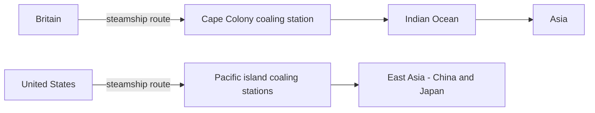
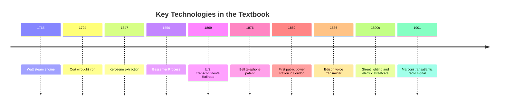
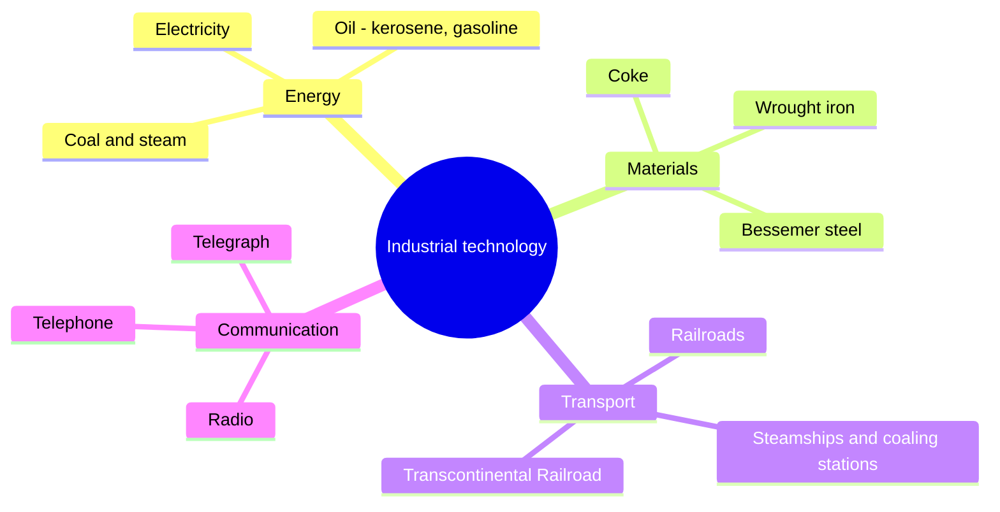

# AP World History: Modern — Topic 5.5: Technology in the Industrial Age

*Unit 5: Revolutions (c. 1750–c. 1900)*

> **Focus Question:** How did technology shape economic production during the period from 1750 to 1900?
>
> **Learning Objective:** F: Explain how technology shaped economic production over time.

Source: textbook World History Modern: AP® Edition, Topic 5.5 (pp. 310–316), from the text you provided, summarized in my own words. Items marked (CED addition) are not in that text.

## Big Picture

- Steam engines, and later internal combustion engines, powered railroads, ships, and factories, increasing access to resources and the distribution of goods.
- First industrial revolution: textiles, steam power, and iron. Second industrial revolution (late 1800s–early 1900s): steel, chemicals, precision machinery, and electronics.
- Electrification, the telephone, and radio made worldwide, nearly instant communication possible.
- Railroads, steamships, and the telegraph linked farmers, miners, manufacturers, customers, and investors globally for the first time, opened interior regions, and pushed industrial states to seek colonies.
- Emerson called railroad iron "a magician's rod," though he later became troubled by technology's role.

## 1. The Coal Revolution

- Coal was a more mobile power source than the streams that ran the first water-powered factories.
- James Watt's steam engine (1765) cheaply turned coal into steam power for textile machinery; within 50 years steam powered trains.
- Coal made energy mobile and dependable: engines could be built anywhere and switched on or off, unlike rivers or wind.

## 2. Water Transportation

- Steamships no longer depended on wind; on rivers they traveled upstream at up to five miles per hour instead of being towed from shore.
- Over time steamships replaced sailing ships worldwide.
- Coaling stations at key points on trade routes — Cape Colony in South Africa and Pacific islands — became important refueling points.

## 3. Iron

- Coal also made mass production of iron possible; coke, a refined form of coal, allowed much larger furnaces.
- Cast iron was strong but brittle; in 1794 Henry Cort patented a process for wrought iron, less strong but much more workable.

## 4. A Second Industrial Revolution

- Key players: the United States, Great Britain, and Germany.
- Steel (an alloy of iron and carbon): the Bessemer Process (1856) blasted molten metal with air to remove impurities, enabling mass production; steel became the backbone of industrial society.
- Oil: the first commercial wells were drilled in the mid-1800s; petroleum is a fossil fuel. Kerosene for lamps and heaters was first the main product (extraction techniques developed in 1847); gasoline became more important once automobiles appeared in the early 1900s.
- These chemical techniques led to precision machinery and the internal combustion engine, and then to automobiles and airplanes.
- Electricity: required an effective generator; the first public power station opened in London in 1882; street lighting and electric streetcars followed in the 1890s.
- Communication: Alexander Graham Bell patented the telephone in 1876; Thomas Edison's improved transmitter (1886) made it practical; Guglielmo Marconi sent a radio signal across the Atlantic in 1901, and radio became mass media.
- Edison's practical light bulb (1879) and Karl Benz's automobile (1886). *(CED addition)*

## 5. Global Trade and Migration

- Railroads, steamships, and the telegraph made exploration, development, and communication possible; the telegraph allowed immediate communication.
- The U.S. Transcontinental Railroad (1869) connected the Atlantic and Pacific; like canals, railroads were heavily subsidized with public funds.
- Vast U.S. resources (timber, coal, iron, oil) plus efficient transport made the U.S. an industrial nation.
- The desire for capital drove investment at home and abroad.
- Industrial states (Britain, Germany, the U.S.) needed more resources and established colonies to protect access to resources and markets.
- Earlier trade and migration centered on coasts; new technology opened interior regions worldwide, increasing trade and migration.
- The Suez Canal (1869) and the transatlantic telegraph cable (1866). *(CED addition)*

## Comparison: First vs. Second Industrial Revolution

| Feature | First | Second (late 1800s–early 1900s) |
|---|---|---|
| Main innovations | Textiles, steam power, iron | Steel, chemicals, precision machinery, electronics |
| Energy | Coal and steam | Oil and electricity |
| Key materials | Cast and wrought iron | Bessemer steel |
| Communication | Telegraph | Telephone, radio |
| Leading countries | Britain | United States, Britain, Germany |

## Comparison: Energy Sources Compared

| Energy | Advantages | Limits |
|---|---|---|
| Water power | Free, steady flow | Fixed to rivers |
| Wind | Free | Cannot be switched on when needed |
| Coal / steam | Mobile, dependable, on demand | Needs coaling stations |
| Oil | Kerosene for light; gasoline for engines | Needed new chemical techniques |
| Electricity | Lighting, streetcars, communication | Needed effective generators |

## Key Terms

| Term | Definition |
|---|---|
| **Second industrial revolution** | Late-1800s–early-1900s wave in steel, chemicals, precision machinery, electronics |
| **Steam engine** | Engine using coal-generated steam to power machines |
| **Coaling station** | Port where steamships refueled with coal |
| **Coke** | Refined coal used in large iron furnaces |
| **Cast iron** | Strong but brittle iron |
| **Wrought iron** | Less strong but more workable iron (Cort, 1794) |
| **Steel** | Alloy of iron and carbon |
| **Bessemer Process** | Blasting molten metal with air to mass-produce steel (1856) |
| **Petroleum** | Fossil fuel refined into kerosene and gasoline |
| **Kerosene** | Petroleum product first used for lighting and heating |
| **Internal combustion engine** | Engine burning fuel inside it; led to cars and airplanes |
| **Electrification** | Spread of electric power for lights and transport |
| **Telegraph** | Device allowing immediate communication over wires |
| **Transcontinental Railroad** | U.S. railroad linking the Atlantic and Pacific (1869) |
| **Subsidy** | Public money supporting a project such as railroads |

## Notes on Sources

- Watt's steam engine: the textbook says 1765; standard references date his separate-condenser idea to 1765 and the patent to 1769. The mind map now shows 1765, following the textbook.
- Kerosene 1847: the textbook dates kerosene extraction techniques to 1847; standard references usually credit Abraham Gesner (1846) and Ignacy Łukasiewicz (1850s).
- First public power station: the textbook says London, 1882 (Holborn Viaduct); New York's Pearl Street Station also opened in 1882.
- The text spells the physicist "Gugliemo Marconi"; the correct spelling is Guglielmo.
- Removed from the previous CED-based note because they are not in the textbook's 5.5: Fulton, Stephenson, Morse, Nobel, and the Liverpool–Manchester railway; Edison's bulb, Benz, Suez, and the transatlantic cable are kept as (CED addition).
