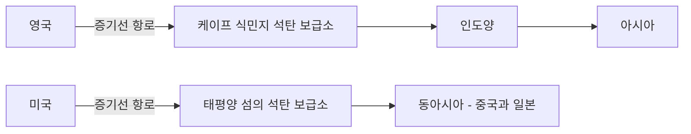
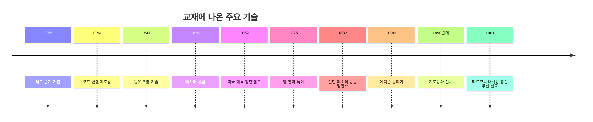
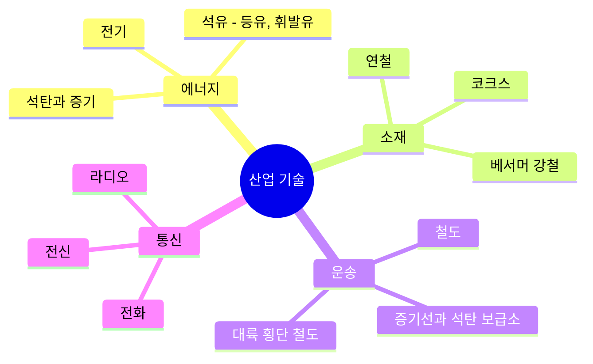

# AP World History: Modern — Topic 5.5: 산업 시대의 기술 (Technology in the Industrial Age)

*Unit 5: 혁명의 시대 (Revolutions, c. 1750–c. 1900)*

> **핵심 질문 (Focus Question):** 1750–1900년 기술은 경제적 생산을 어떻게 형성했는가?
>
> **학습 목표 (Learning Objective):** F: 기술이 시간이 흐르며 경제적 생산을 어떻게 형성했는지 설명한다.

출처: 교재 『World History Modern: AP® Edition』 5.5 (pp. 310–316). 제공해 주신 텍스트를 제 말로 요약했습니다. (CED 추가) 표시는 그 텍스트에 없는 내용입니다.

## 큰 그림 요약 (Big Picture)

- 증기 기관과 이후의 내연 기관이 철도·배·공장을 움직여 자원에 대한 접근과 상품의 유통을 늘렸다.
- 제1차 산업 혁명: 섬유, 증기 동력, 철. 제2차 산업 혁명(1800년대 후반–1900년대 초): 강철, 화학, 정밀 기계, 전자.
- 전기화, 전화, 라디오가 전 세계적이고 거의 즉각적인 통신을 가능하게 했다.
- 철도·증기선·전신은 역사상 처음으로 농민·광부·제조업자·소비자·투자자를 전 세계적으로 연결했고, 내륙 지역을 열었으며, 공업국이 식민지를 찾게 만들었다.
- 에머슨은 철도의 철을 '마법사의 지팡이'라고 불렀지만, 나중에는 기술의 역할을 걱정하게 되었다.

## 1. 석탄 혁명

- 석탄은 초기 수력 공장을 움직이던 개울보다 훨씬 이동성이 좋은 동력원이었다.
- 제임스 와트 (James Watt)의 증기 기관(1765)은 석탄을 값싸게 증기 동력으로 바꾸어 섬유 기계를 돌렸다. 50년 안에 증기가 기차를 움직였다.
- 석탄은 에너지를 이동 가능하고 믿을 수 있게 만들었다. 강이나 바람과 달리 엔진은 어디에나 지을 수 있고 필요할 때 켜고 끌 수 있었다.

## 2. 수상 운송

- 증기선은 더 이상 바람에 의존하지 않았다. 강에서는 기슭에서 끌려가는 대신 시속 5마일까지 상류로 거슬러 올라갔다.
- 시간이 지나며 증기선이 전 세계에서 범선을 대체했다.
- 남아프리카의 케이프 식민지와 태평양의 섬들처럼 무역로의 요충지에 있는 석탄 보급소 (coaling stations)가 중요한 연료 보급지가 되었다.

## 3. 철

- 석탄은 철의 대량 생산도 가능하게 했다. 석탄을 정제한 코크스 (coke) 덕분에 훨씬 큰 용광로를 쓸 수 있었다.
- 주철 (cast iron)은 단단하지만 잘 부서졌다. 1794년 헨리 코트 (Henry Cort)가 덜 단단하지만 훨씬 가공하기 쉬운 연철 (wrought iron) 제조법의 특허를 받았다.

## 4. 제2차 산업 혁명

- 주도국: 미국, 영국, 독일.
- 강철 (철과 탄소의 합금): 베서머 공법 (Bessemer Process, 1856)은 녹은 금속에 공기를 불어 넣어 불순물을 없앴고, 대량 생산을 가능하게 했다. 강철은 산업 사회의 뼈대가 되었다.
- 석유: 1800년대 중반 최초의 상업용 유정이 뚫렸다. 석유는 화석 연료다. 처음에는 등불과 난방용 등유가 주요 제품이었고(1847년 추출 기술 개발), 1900년대 초 자동차가 등장하면서 휘발유가 더 중요해졌다.
- 이러한 화학 기술은 정밀 기계와 내연 기관으로 이어졌고, 이후 자동차와 비행기로 이어졌다.
- 전기: 효과적인 발전기가 필요했다. 1882년 런던에 최초의 공공 발전소가 문을 열었고, 1890년대에 가로등과 전차가 뒤따랐다.
- 통신: 알렉산더 그레이엄 벨 (Alexander Graham Bell)이 1876년 전화 특허를 받았고, 토머스 에디슨 (Thomas Edison)의 개량 송화기(1886)가 전화를 실용적으로 만들었다. 굴리엘모 마르코니 (Guglielmo Marconi)가 1901년 대서양 너머로 무선 신호를 보냈고, 라디오는 대중 매체가 되었다.
- 에디슨의 실용 전구(1879)와 카를 벤츠의 자동차(1886). *(CED 추가)*

## 5. 세계 무역과 이주

- 철도·증기선·전신이 탐험·개발·통신을 가능하게 했다. 전신은 즉각적인 통신을 가능하게 했다.
- 미국 대륙 횡단 철도 (Transcontinental Railroad, 1869)는 대서양과 태평양을 연결했다. 운하처럼 철도도 공공 자금의 막대한 보조를 받았다.
- 미국의 막대한 자원(목재, 석탄, 철, 석유)과 효율적인 운송이 미국을 공업국으로 만들었다.
- 자본에 대한 욕구가 국내외 투자를 이끌었다.
- 공업국(영국, 독일, 미국)은 더 많은 자원이 필요해졌고, 자원과 시장에 대한 접근을 지키려고 식민지를 세웠다.
- 이전의 무역과 이주는 해안 도시 중심이었지만, 새 기술이 세계의 내륙 지역을 열어 무역과 이주를 늘렸다.
- 수에즈 운하(1869)와 대서양 횡단 전신 케이블(1866). *(CED 추가)*

## 비교표 (Comparison): 제1차 vs. 제2차 산업 혁명

| 특징 | 제1차 | 제2차 (1800년대 후반–1900년대 초) |
|---|---|---|
| 주요 혁신 | 섬유, 증기 동력, 철 | 강철, 화학, 정밀 기계, 전자 |
| 에너지 | 석탄과 증기 | 석유와 전기 |
| 핵심 소재 | 주철과 연철 | 베서머 강철 |
| 통신 | 전신 | 전화, 라디오 |
| 주도 국가 | 영국 | 미국, 영국, 독일 |

## 비교표 (Comparison): 에너지원 비교

| 에너지 | 장점 | 한계 |
|---|---|---|
| 수력 | 무료, 꾸준한 흐름 | 강에 묶임 |
| 바람 | 무료 | 필요할 때 켤 수 없음 |
| 석탄·증기 | 이동 가능, 믿을 수 있음, 원할 때 사용 | 석탄 보급소가 필요 |
| 석유 | 조명용 등유, 엔진용 휘발유 | 새로운 화학 기술이 필요 |
| 전기 | 조명, 전차, 통신 | 효과적인 발전기가 필요 |

## 핵심 용어 (Key Terms)

| 용어 | 뜻 |
|---|---|
| **제2차 산업 혁명 (Second industrial revolution)** | 1800년대 후반–1900년대 초 강철·화학·정밀 기계·전자의 혁신 물결 |
| **증기 기관 (Steam engine)** | 석탄으로 만든 증기로 기계를 움직이는 기관 |
| **석탄 보급소 (Coaling station)** | 증기선이 석탄을 보급받던 항구 |
| **코크스 (Coke)** | 큰 용광로에 쓰인 정제된 석탄 |
| **주철 (Cast iron)** | 단단하지만 잘 부서지는 철 |
| **연철 (Wrought iron)** | 덜 단단하지만 가공하기 쉬운 철 (코트, 1794) |
| **강철 (Steel)** | 철과 탄소의 합금 |
| **베서머 공법 (Bessemer Process)** | 녹은 금속에 공기를 불어 넣어 강철을 대량 생산하는 방법 (1856) |
| **석유 (Petroleum)** | 등유와 휘발유로 정제되는 화석 연료 |
| **등유 (Kerosene)** | 처음에 조명과 난방에 쓰인 석유 제품 |
| **내연 기관 (Internal combustion engine)** | 내부에서 연료를 태우는 기관. 자동차와 비행기로 이어짐 |
| **전기화 (Electrification)** | 조명과 교통을 위한 전력의 보급 |
| **전신 (Telegraph)** | 전선을 통해 즉각적인 통신을 가능하게 한 장치 |
| **대륙 횡단 철도 (Transcontinental Railroad)** | 대서양과 태평양을 잇는 미국 철도 (1869) |
| **보조금 (Subsidy)** | 철도 같은 사업을 지원하는 공공 자금 |

## 출처 메모 (교재 vs. 일반 자료)

- 와트의 증기 기관: 교재는 1765년으로 씁니다. 일반 자료는 분리 응축기 착상을 1765년, 특허를 1769년으로 봅니다. 마인드맵은 교재를 따라 1765년으로 바꿨습니다.
- 등유 1847년: 교재는 등유 추출 기술을 1847년으로 씁니다. 일반 자료는 보통 에이브러햄 게스너(1846)와 이그나치 우카시에비치(1850년대)의 공으로 봅니다.
- 최초의 공공 발전소: 교재는 1882년 런던(홀본 고가교)이라고 씁니다. 뉴욕의 펄 스트리트 발전소도 1882년에 문을 열었습니다.
- 텍스트는 물리학자 이름을 'Gugliemo Marconi'로 표기했지만, 올바른 철자는 Guglielmo입니다.
- 교재 5.5에 없어서 이전 CED 기준 노트에서 뺀 것: 풀턴, 스티븐슨, 모스, 노벨, 리버풀–맨체스터 철도. 에디슨의 전구, 벤츠, 수에즈 운하, 대서양 케이블은 (CED 추가)로 남겼습니다.
