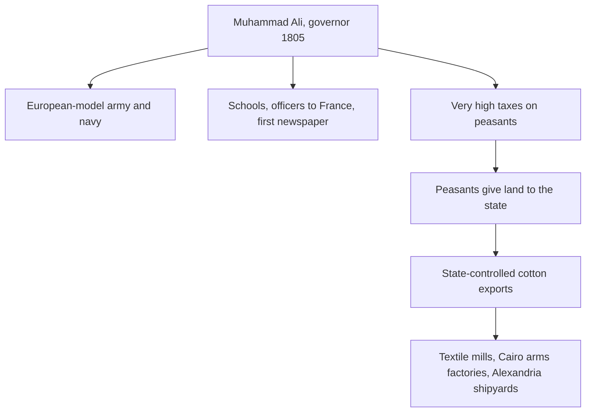
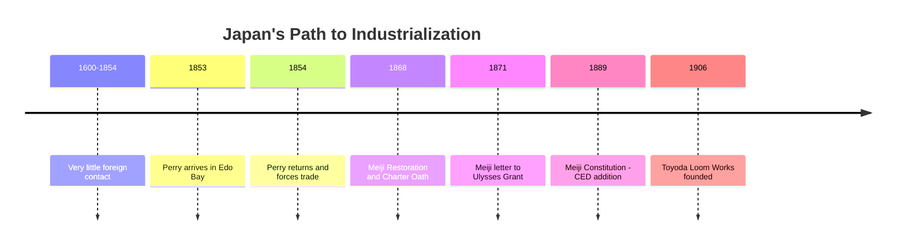
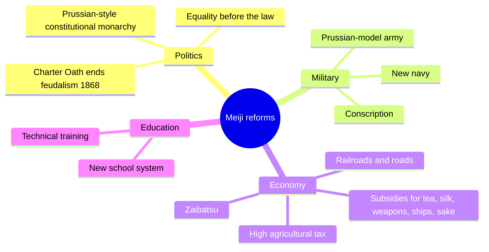

# AP World History: Modern — Topic 5.6: Industrialization: Government's Role

*Unit 5: Revolutions (c. 1750–c. 1900)*

> **Focus Question:** What economic strategies did different states and empires adopt, and what were the causes and effects of those strategies?
>
> **Learning Objective:** G: Explain the causes and effects of economic strategies of different states and empires.

Source: textbook World History Modern: AP® Edition, Topic 5.6 (pp. 317–324), from the text you provided, summarized in my own words. Items marked (CED addition) are not in that text.

## Big Picture

- As Western domination and technology spread, every country faced competing pressures between preserving traditional values and modernizing.
- Egypt adopted industrial innovations, such as the steam engine, early to boost textile output.
- Japan changed many institutions along Western lines to compete with modern countries and stay independent — in less than half a century, faster than any other country.
- China was less willing to accept European influence and products, and its weakened government could not promote industrialization effectively (see Topic 6.5).
- Emperor Meiji (letter to Ulysses Grant, 1871): select the institutions of "enlightened nations" best suited to Japan and adopt them gradually, so as to be equal with them.

## 1. Ottoman Decline

- Although it bordered Europe, the Ottoman Empire had not adopted Western technology or Enlightenment ideas.
- Widespread corruption caused rapid decline, and ethnic nationalism among its diverse peoples caused unrest; it was nicknamed "the sick man of Europe."
- After World War I it was broken up into the Republic of Turkey and several small independent countries.
- Not every territory declined in the same way as the empire weakened in the 1600s–1700s — Egypt is the key example.
- The Tanzimat reforms (1839–1876) attempted legal, military, and educational modernization (see 5.8). *(CED addition)*

## 2. The Rise of Muhammad Ali in Egypt

- In Egypt the sultan ruled in name only; the Mamluks — formerly enslaved Turks who formed a military class — had ruled for about 600 years.
- 1801: the sultan sent an army to retake Egypt; Albanian Ottoman officer Muhammad Ali rose to prominence, local leaders chose him as governor, and the sultan had to agree.
- He acted somewhat independently: he joined the sultan's campaigns when it suited him and fought in Sudan and Syria without permission.
- Reforms: a European-model military, new schools, officers sent to study in France, and an official newspaper — the first in the Islamic world.
- Economy: taxes so high that peasants surrendered land to the state; the state controlled valuable cotton production and profited from exporting cotton and other crops.
- Secularizing religious lands put more produce in state hands, bringing large profits during the Napoleonic Wars (1799–1815), when European wheat prices were high.
- Industry: textile factories to compete with France and Britain, armaments factories in Cairo, shipbuilding in Alexandria for a navy, and many small Cairo shops making locks, cloth, and parts for uniforms and weapons.
- He is called the first great modern ruler of Egypt, partly for his vision of state-sponsored industrialization.
- Over time Egypt's factories struggled against British competition; later debts led to British occupation in 1882. *(CED addition)*

## 3. Japan: A Challenge to Isolation

- From 1600 to 1854 Japan had very little contact with the rest of the world.
- Britain, the Netherlands, and Russia wanted to sell goods in Japan, and coal-powered ships needed refueling stops on the way to China and East Asia.
- 1853: Commodore Matthew Perry's squadron sailed into Edo (Tokyo) Bay asking for trade privileges; in 1854 he returned with more ships and demanded trade with the U.S.
- Facing U.S. warships, Japan gave in, and soon yielded to similar demands from other countries.
- Leaders had watched Britain humiliate China, going to war to force it to accept opium imports, and feared the same fate.
- Reformers argued Japan should adopt enough Western technology and methods to protect its traditional culture; they overthrew the shogun and restored the emperor in 1868 — the Meiji Restoration.

## 4. Reforms by the Meiji State

- Japan sent missions to Europe and the U.S. and invited foreign experts to study Western institutions, then adopted what it admired:
- Formally abolished feudalism in 1868 through the Charter Oath.
- Constitutional monarchy on the Prussian model: the emperor ruled through a subordinate political leader.
- Equality before the law; cruel punishments abolished.
- Military reorganized on the Prussian army model, with a new navy and conscription.
- A new school system expanded education, especially in technical fields.
- Built railroads and roads.
- Subsidized key industries: tea, silk, weaponry, shipbuilding, and sake (rice wine).
- A high agricultural tax paid for the reforms; it stimulated rapid growth and funded a bureaucracy centered in Tokyo.
- Japan also copied industrial society's problems: abuse and exploitation of female mill workers resembled what British women had recorded decades earlier.
- The Meiji Constitution was adopted in 1889; the samurai class was abolished; Japan defeated China (1895) and Russia (1905). *(CED addition)*

## 5. The Role of Private Investment

- Government–industry ties were central to Japan's modernization, but private investment, including from overseas, also mattered.
- Once new industries flourished, they were often sold to zaibatsu — powerful family business organizations similar to U.S. conglomerates.
- Attracting investors encouraged innovation: a carpenter founded Toyoda Loom Works (1906), which made an automatic loom and later became Toyota Motor Company.

## 6. China's Limited Response

- China resisted European influence and goods and suffered from Western economic and political expansion; its weakened government and population could not drive industrialization (Topic 6.5).
- Russia also used state-led industrialization under Sergei Witte (1890s), including the Trans-Siberian Railway (begun 1891); see 5.4. *(CED addition)*

## Comparison: Responses to Western Industrial Power

| State | Leader | Strategy | Result |
|---|---|---|---|
| Ottoman Empire | Sultans | Did not adopt Western technology or Enlightenment ideas | Corruption, nationalist unrest; "sick man of Europe"; dismantled after WWI |
| Egypt | Muhammad Ali | State control of land and cotton; state factories; European-model army | First great modern ruler of Egypt; semi-independent of the sultan |
| Japan | Emperor Meiji | Selective Westernization; subsidies; high land tax; later zaibatsu | Fastest industrialization of any country |
| China | Qing government | Resisted European influence and products | Weak government; could not industrialize effectively |

## Comparison: Japan vs. the West (textbook Connect task; see 5.3)

| Feature | Britain / the West | Meiji Japan | Similarity |
|---|---|---|---|
| Who drove it | Private entrepreneurs and investors | The state first, then zaibatsu | Capital investment was essential |
| Speed | Gradual, over about a century | Less than half a century | Textiles were a leading industry |
| Funding | Trade, empire, slave-trade capital | High agricultural tax | Agriculture supported industry |
| Workers | Exploited female mill workers | Exploited female mill workers | Same social problems |

## Key Terms

| Term | Definition |
|---|---|
| **State-sponsored industrialization** | Government plans, funds, and builds industry |
| **"Sick man of Europe"** | Nickname for the declining Ottoman Empire |
| **Mamluks** | Formerly enslaved Turks who formed a ruling military class in Egypt |
| **Secularization** | Transferring religious land or institutions to state or non-religious control |
| **Shogun** | Military ruler who held real power in Japan before 1868 |
| **Meiji Restoration** | 1868 overthrow of the shogun and restoration of the emperor's power |
| **Charter Oath** | 1868 statement that formally abolished feudalism in Japan |
| **Constitutional monarchy** | Monarchy limited by a constitution |
| **Conscription** | Required military service |
| **Subsidy** | Government money given to support an industry |
| **Zaibatsu** | Powerful Japanese family business organizations |

## Notes on Sources

- The epigraph's 1871 letter: Emperor Meiji's 1871 message to President Grant is associated with the Iwakura Mission, which reached the U.S. in 1872.
- The text says Perry sailed into "Yedo and Tokyo Bay"; Yedo (Edo) was the old name of Tokyo, so this is one bay, Edo Bay.
- Charter Oath (1868): standard references describe it as a statement of reform goals; feudal domains were formally abolished in 1871.
- Muhammad Ali: the text says local leaders selected him governor without giving a year; standard references date this to 1805.
- Mamluk rule "for some 600 years": standard references date Mamluk power in Egypt from 1250.
- The previous version of this note (CED-based) included Russia's Witte, the Tanzimat, the Crimean War, and the 1882 British occupation; these are not in the textbook's 5.6 and are now marked (CED addition) or moved to cross-references.
