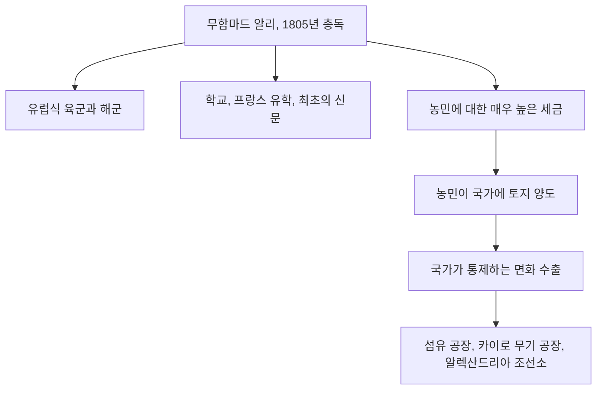
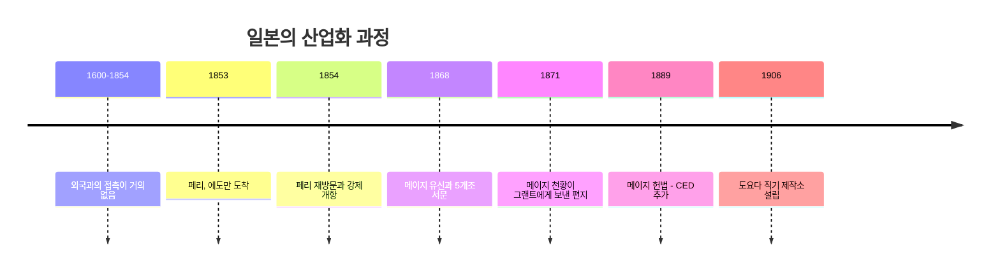
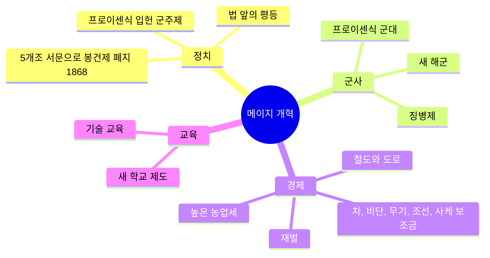

# AP World History: Modern — Topic 5.6: 산업화와 정부의 역할 (Industrialization: Government's Role)

*Unit 5: 혁명의 시대 (Revolutions, c. 1750–c. 1900)*

> **핵심 질문 (Focus Question):** 여러 국가와 제국은 어떤 경제 전략을 택했으며, 그 전략의 원인과 결과는 무엇이었는가?
>
> **학습 목표 (Learning Objective):** G: 여러 국가와 제국의 경제 전략의 원인과 결과를 설명한다.

출처: 교재 『World History Modern: AP® Edition』 5.6 (pp. 317–324). 제공해 주신 텍스트를 제 말로 요약했습니다. (CED 추가) 표시는 그 텍스트에 없는 내용입니다.

## 큰 그림 요약 (Big Picture)

- 서구의 지배와 기술이 퍼지면서, 모든 나라는 전통적 가치의 보존과 근대화라는 서로 다른 압력 사이에 놓였다.
- 이집트는 섬유 생산을 늘리려고 증기 기관 같은 산업 기술을 일찍 받아들였다.
- 일본은 근대 국가들과 경쟁하고 독립을 지키기 위해 여러 제도를 서구식으로 바꾸었다. 반세기도 안 되는 기간으로, 어느 나라보다 빨랐다.
- 중국은 유럽의 영향과 상품을 받아들이는 데 소극적이었고, 약해진 정부는 산업화를 효과적으로 추진하지 못했다 (6.5 참고).
- 메이지 천황 (율리시스 그랜트에게 보낸 편지, 1871): '개화된 나라들'의 제도 가운데 일본에 가장 맞는 것을 골라 점진적으로 받아들여, 그들과 대등해지겠다.

## 1. 오스만 제국의 쇠퇴

- 오스만 제국은 유럽과 맞닿아 있었지만 서구의 기술이나 계몽사상을 받아들이지 않았다.
- 만연한 부패로 빠르게 쇠퇴했고, 다양한 민족의 민족주의가 소요를 일으켰다. '유럽의 병자 (the sick man of Europe)'라는 별명을 얻었다.
- 제1차 세계 대전 이후 터키 공화국과 여러 작은 독립국으로 해체되었다.
- 1600–1700년대 제국이 약해질 때 모든 영토가 똑같이 쇠퇴한 것은 아니었다. 이집트가 대표적인 예다.
- 탄지마트 개혁(1839–1876)은 법·군사·교육의 근대화를 시도했다 (5.8 참고). *(CED 추가)*

## 2. 이집트 무함마드 알리의 부상

- 이집트에서 술탄은 이름뿐인 통치자였다. 군사 계급을 이룬 노예 출신 튀르크인 맘루크 (Mamluks)가 약 600년 동안 실제로 다스렸다.
- 1801년: 술탄이 이집트를 되찾으려고 군대를 보냈다. 알바니아 출신 오스만 장교 무함마드 알리 (Muhammad Ali)가 두각을 나타냈고, 지역 지도자들이 그를 총독으로 뽑자 술탄은 동의할 수밖에 없었다.
- 그는 어느 정도 독자적으로 행동했다. 유리할 때만 술탄의 원정에 참여했고, 허락 없이 수단과 시리아에서 전쟁을 벌였다.
- 개혁: 유럽식 군대, 새 학교 설립, 프랑스로 장교 유학 파견, 관보 창간 — 이슬람 세계 최초의 신문.
- 경제: 세금이 너무 높아 농민들이 땅을 국가에 넘겼다. 국가는 값비싼 면화 생산을 통제하고 면화와 다른 작물의 수출로 이익을 얻었다.
- 종교 토지를 세속화해 더 많은 농산물이 국가 손에 들어왔고, 유럽의 밀값이 높았던 나폴레옹 전쟁(1799–1815) 동안 큰 이익을 얻었다.
- 산업: 프랑스·영국과 경쟁할 섬유 공장, 카이로의 무기 공장, 해군을 위한 알렉산드리아의 조선소, 그리고 자물쇠·옷감·군복과 무기 부품을 만드는 카이로의 수많은 작은 작업장.
- 그는 국가 주도 산업화에 대한 구상 덕분에 이집트 최초의 위대한 근대 통치자로 불린다.
- 시간이 지나며 이집트 공장들은 영국과의 경쟁에서 고전했고, 이후 부채 때문에 1882년 영국에 점령되었다. *(CED 추가)*

## 3. 일본: 고립에 대한 도전

- 1600년부터 1854년까지 일본은 바깥 세계와 거의 접촉하지 않았다.
- 영국·네덜란드·러시아는 일본에 상품을 팔고 싶어 했고, 석탄으로 움직이는 배는 중국과 동아시아로 가는 길에 연료를 보충할 곳이 필요했다.
- 1853년: 매슈 페리 (Matthew Perry) 제독의 함대가 에도(도쿄)만에 들어와 무역 특권을 요구했다. 1854년 더 많은 배를 이끌고 돌아와 미국과의 무역을 요구했다.
- 미국 군함 앞에서 일본은 굴복했고, 곧 다른 나라들의 비슷한 요구에도 응했다.
- 일본 지도자들은 영국이 아편 수입을 강요하려고 전쟁을 벌여 중국을 굴복시키는 것을 보았고, 같은 운명을 두려워했다.
- 개혁가들은 전통문화를 지킬 수 있을 만큼 서구의 기술과 방식을 받아들여야 한다고 주장했다. 그들은 쇼군을 무너뜨리고 1868년 천황에게 권력을 돌려주었다 — 메이지 유신 (Meiji Restoration).

## 4. 메이지 정부의 개혁

- 일본은 유럽과 미국에 사절단을 보내고 외국 전문가를 초빙해 서구 제도를 연구한 뒤, 좋다고 판단한 것을 받아들였다.
- 1868년 5개조 서문 (Charter Oath)으로 봉건제를 공식 폐지했다.
- 프로이센식 입헌 군주제: 천황이 하위 정치 지도자를 통해 통치했다.
- 법 앞의 평등, 잔혹한 형벌 폐지.
- 프로이센 군대를 본떠 군대를 개편하고, 새 해군과 징병제 (conscription)를 도입했다.
- 새 학교 제도로 특히 기술 분야의 교육 기회를 넓혔다.
- 철도와 도로를 건설했다.
- 핵심 산업에 보조금을 주었다: 차, 비단, 무기, 조선, 사케(청주).
- 높은 농업세로 개혁 자금을 마련했다. 이 세금은 급속한 경제 성장을 이끌었고 도쿄 중심의 관료제 재원이 되었다.
- 일본은 산업 사회의 문제도 함께 들여왔다. 여성 방적 공장 노동자에 대한 학대와 착취는 수십 년 전 영국 여성 노동자들이 기록한 경험과 비슷했다.
- 메이지 헌법은 1889년에 채택되었다. 사무라이 계급이 폐지되었고, 일본은 청(1895)과 러시아(1905)를 이겼다. *(CED 추가)*

## 5. 민간 투자의 역할

- 정부와 산업의 관계가 일본 근대화의 핵심이었지만, 해외를 포함한 민간 투자도 중요해졌다.
- 새 산업이 번창하면 재벌 (zaibatsu)에 매각되는 경우가 많았다. 재벌은 미국의 대기업 집단과 비슷한 강력한 가족 기업 조직이었다.
- 투자자를 끌어들일 가능성이 기술 혁신을 자극했다. 한 목수가 자동 직기를 만드는 도요다 직기 제작소 (Toyoda Loom Works, 1906)를 세웠고, 이 회사는 훗날 도요타 자동차가 되었다.

## 6. 중국의 제한적 대응

- 중국은 유럽의 영향과 상품에 저항했고 서구의 경제적·정치적 팽창으로 피해를 입었다. 약해진 정부와 백성은 산업화를 이끌 수 없었다 (6.5).
- 러시아도 세르게이 비테 아래 국가 주도 산업화(1890년대)를 추진했고, 시베리아 횡단 철도(1891년 착공)를 건설했다. 5.4 참고. *(CED 추가)*

## 비교표 (Comparison): 서구 산업력에 대한 대응 비교

| 국가 | 지도자 | 전략 | 결과 |
|---|---|---|---|
| 오스만 제국 | 술탄 | 서구 기술과 계몽사상을 받아들이지 않음 | 부패, 민족주의 소요, '유럽의 병자', 1차 대전 후 해체 |
| 이집트 | 무함마드 알리 | 토지와 면화의 국가 통제, 국영 공장, 유럽식 군대 | 이집트 최초의 위대한 근대 통치자, 술탄으로부터 반독립 |
| 일본 | 메이지 천황 | 선택적 서구화, 보조금, 높은 토지세, 이후 재벌 | 가장 빠른 산업화 |
| 중국 | 청 정부 | 유럽의 영향과 상품에 저항 | 약한 정부, 효과적 산업화 실패 |

## 비교표 (Comparison): 일본 vs. 서구 (교재 Connect 과제, 5.3 참고)

| 특징 | 영국·서구 | 메이지 일본 | 공통점 |
|---|---|---|---|
| 주도 주체 | 민간 기업가와 투자자 | 처음에는 국가, 이후 재벌 | 자본 투자가 필수 |
| 속도 | 약 한 세기에 걸친 점진적 변화 | 반세기 미만 | 섬유가 선도 산업 |
| 자금 | 무역, 제국, 노예 무역 자본 | 높은 농업세 | 농업이 산업을 뒷받침 |
| 노동자 | 착취당한 여성 방적공 | 착취당한 여성 방적공 | 같은 사회 문제 |

## 핵심 용어 (Key Terms)

| 용어 | 뜻 |
|---|---|
| **국가 주도 산업화 (State-sponsored industrialization)** | 정부가 산업을 계획하고 자금을 대고 건설하는 것 |
| **'유럽의 병자' ("Sick man of Europe")** | 쇠퇴하는 오스만 제국의 별명 |
| **맘루크 (Mamluks)** | 이집트의 지배 군사 계급을 이룬 노예 출신 튀르크인 |
| **세속화 (Secularization)** | 종교 토지나 기관을 국가나 비종교적 통제로 옮기는 것 |
| **쇼군 (Shogun)** | 1868년 이전 일본의 실권을 쥔 군사 통치자 |
| **메이지 유신 (Meiji Restoration)** | 1868년 쇼군을 무너뜨리고 천황의 권력을 회복한 사건 |
| **5개조 서문 (Charter Oath)** | 1868년 일본의 봉건제를 공식 폐지한 선언 |
| **입헌 군주제 (Constitutional monarchy)** | 헌법으로 제한되는 군주제 |
| **징병제 (Conscription)** | 의무 병역 |
| **보조금 (Subsidy)** | 산업을 지원하기 위해 정부가 주는 돈 |
| **재벌 (Zaibatsu)** | 강력한 일본의 가족 기업 조직 |

## 출처 메모 (교재 vs. 일반 자료)

- 인용문의 1871년 편지: 메이지 천황이 그랜트 대통령에게 보낸 1871년 서한은 1872년 미국에 도착한 이와쿠라 사절단과 관련이 있습니다.
- 텍스트는 페리가 'Yedo and Tokyo Bay'로 들어왔다고 쓰지만, 예도(에도)는 도쿄의 옛 이름이므로 같은 만, 즉 에도만입니다.
- 5개조 서문(1868): 일반 자료는 이를 개혁 목표의 선언으로 보고, 봉건 영지(번)는 1871년 폐번치현으로 공식 폐지되었다고 봅니다.
- 무함마드 알리: 텍스트는 지역 지도자들이 그를 총독으로 뽑았다고만 쓰고 연도는 없습니다. 일반 자료는 1805년으로 봅니다.
- 맘루크 지배 '약 600년': 일반 자료는 이집트 맘루크 권력의 시작을 1250년으로 봅니다.
- 이 노트의 이전(CED 기준) 버전에는 러시아의 비테, 탄지마트, 크림 전쟁, 1882년 영국 점령이 있었습니다. 교재 5.6에는 없는 내용이라 (CED 추가)로 표시하거나 다른 토픽 참고로 옮겼습니다.
