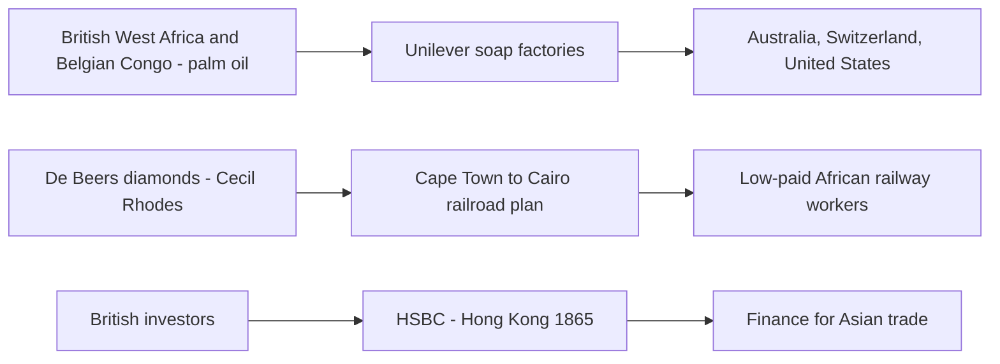

# AP World History: Modern — Topic 5.7: Economic Developments and Innovations

*Unit 5: Revolutions (c. 1750–c. 1900)*

> **Focus Question:** How did the development of economic systems, ideologies, and institutions contribute to change between 1750 and 1900?
>
> **Learning Objective:** H: Explain the development of economic systems, ideologies, and institutions and how they contributed to change in the period from 1750 to 1900.

Source: textbook World History Modern: AP® Edition, Topic 5.7 (pp. 325–331), from the text you provided, summarized in my own words. Items marked (CED addition) are not in that text.

## Big Picture

- Adam Smith's The Wealth of Nations (1776) argued that humans are naturally transactional ("Man is an animal that makes bargains") and became a foundational text for capitalism and private entrepreneurship.
- Mercantilism, a system of economic protectionism, gave way to laissez-faire: minimal government involvement in commerce and lower tariffs.
- New institutions — corporations, monopolies, transnational companies (HSBC, Unilever, De Beers), banks, and insurance — organized business on a new scale.
- As trade grew, consumer goods became more available, affordable, and varied, and a culture of consumerism and leisure developed.

## 1. From Mercantilism to Laissez-Faire

- Smith's ideas supported capitalism and shaped the economics and politics of the industrial age and later centuries.
- Mercantilism (economic protectionism) was replaced by laissez-faire (French for "leave alone"), which encouraged countries to reduce tariffs on trade.
- Britain moved toward free trade by repealing the Corn Laws (1846). *(CED addition)*

## 2. Corporations

- A corporation is a business chartered by a government as a legal entity owned by stockholders, who buy shares from the company or on a stock market.
- Stockholders may receive dividends from profits; if the company fails, they lose at most what they paid for their stock (limited liability).
- Other forms: a sole proprietorship (one owner) and a partnership (a small group making all decisions); corporations were more flexible for large-scale activity.
- Corporations replaced single entrepreneurs taking high risks with larger companies sharing lower risks, making investment safer and more attractive.
- Critics said corporations undermined individual responsibility, but they came to dominate banking, manufacturing, and services and gained great economic and political power — a single factory decision could create thousands of jobs.

## 3. Monopolies

- A monopoly is control of a specific business with all competition eliminated.
- Alfred Krupp of Essen, Germany, used the Bessemer process to gain a monopoly in German steel.
- John D. Rockefeller created a monopoly in the U.S. oil industry.
- Andrew Carnegie dominated U.S. steel. *(CED addition)*

## 4. Companies Working Across Boundaries

- Transnational companies operated across national boundaries and gained wealth and influence on a scale rarely seen before.
- Cecil Rhodes, founder of De Beers Diamonds, backed a Cape Town–to–Cairo railroad to link British colonies for easier governance and war; it was never finished because Britain never controlled all the land.
- Most African railway workers were natives paid far less than Europeans, so railroads extracted resources while paying colonial laborers as little as possible.
- HSBC (Hong Kong and Shanghai Banking Corporation): British-owned bank opened in Hong Kong in 1865 for finance, corporate investment, and global banking.
- Unilever: British-Dutch maker of household goods, especially soap; by 1890 it had factories in Australia, Switzerland, the U.S., and elsewhere, using palm oil from British West Africa and later its plantations in the Belgian Congo.

## 5. Banking and Finance

- Insurance, especially marine insurance, reduced risk; Lloyd's of London began in a coffee house where merchants and sailors gathered for reliable shipping news.
- Banks multiplied as merchants and entrepreneurs needed safe deposits and loans to build factories and hire workers.

## 6. Effects on Mass Culture

- A culture of consumerism and leisure developed among Britain's working and middle classes, and some people's living standards rose.
- Consumption had to keep up with production, so producers advertised heavily, especially to the middle class, who had disposable income.
- Biking and boating became popular in the late 1800s; in the 1880s the chain-driven safety bicycle replaced the dangerous penny-farthing.
- Companies encouraged worker athletics, believing sports taught self-discipline and following rules; sports equipment became a business.
- Soccer (football) spread in Europe and baseball in the U.S.; sports followed class lines — tennis and golf for England's upper classes, some types of rugby for lower classes.
- Music halls and public parks (second half of the 1800s) mixed social classes, partly so the lower classes would copy "civilized" behavior.

## Comparison: Forms of Business Ownership

| Form | Owners | Risk | Scale |
|---|---|---|---|
| Sole proprietorship | One person | Owner bears all risk | Small |
| Partnership | Small group making all decisions | Shared by partners | Small to medium |
| Corporation | Stockholders | Limited to the stock price paid | Large-scale; could become a monopoly |

## Comparison: Transnational Companies in the Textbook

| Company | Base / origin | Business | Global reach |
|---|---|---|---|
| HSBC | British-owned, Hong Kong, 1865 | Finance, investment, global banking | Asian and global trade |
| Unilever | British and Dutch | Household goods, soap | Factories in Australia, Switzerland, U.S.; palm oil from West Africa and Congo |
| De Beers | Cecil Rhodes, southern Africa | Diamonds | Backed the Cape-to-Cairo railroad plan |

## Comparison: Mercantilism vs. Laissez-Faire Capitalism

| Feature | Mercantilism | Laissez-faire capitalism |
|---|---|---|
| Basic idea | Economic protectionism | Humans naturally bargain; markets work best alone |
| Government role | Tight regulation of trade | Minimal involvement in commerce |
| Tariffs | High, to protect home industry | Reduced to encourage trade |
| Typical businesses | State-chartered trading companies | Corporations and transnational companies |

## Key Terms

| Term | Definition |
|---|---|
| **Laissez-faire** | "Leave alone"; minimal government involvement in commerce |
| **Mercantilism** | System of economic protectionism |
| **Capitalism** | Economy based on private ownership and private entrepreneurship |
| **Corporation** | Government-chartered legal entity owned by stockholders |
| **Stockholder** | Person who owns part of a corporation by buying stock |
| **Stock market** | Market where shares of companies are bought and sold |
| **Dividend** | Share of a corporation's profit paid to stockholders |
| **Limited liability** | Stockholders can lose at most what they paid for stock |
| **Sole proprietorship** | Business owned by a single person |
| **Partnership** | Business run by a small group making all decisions |
| **Monopoly** | Control of a business with all competition eliminated |
| **Transnational company** | Company operating across national boundaries |
| **Marine insurance** | Insurance that reduces the risk of shipping losses |
| **Consumerism** | Culture centered on buying goods |
| **Disposable income** | Money that can be spent on nonessential goods |

## Notes on Sources

- Unilever: in 1890 the company was Lever Brothers (founded 1885, British); Unilever was formed in 1929 when it merged with the Dutch Margarine Unie. Its Belgian Congo plantations began in 1911.
- Krupp: the textbook calls it a monopoly in German steel; standard references describe Krupp as the dominant firm rather than the only one.
- Limited liability: the textbook describes the idea without naming it; the term was added because it is common on AP exams.
- John Stuart Mill was in the previous CED-based 5.7; the textbook covers him in 5.8, so he was moved there. Department stores and On Liberty were removed.
