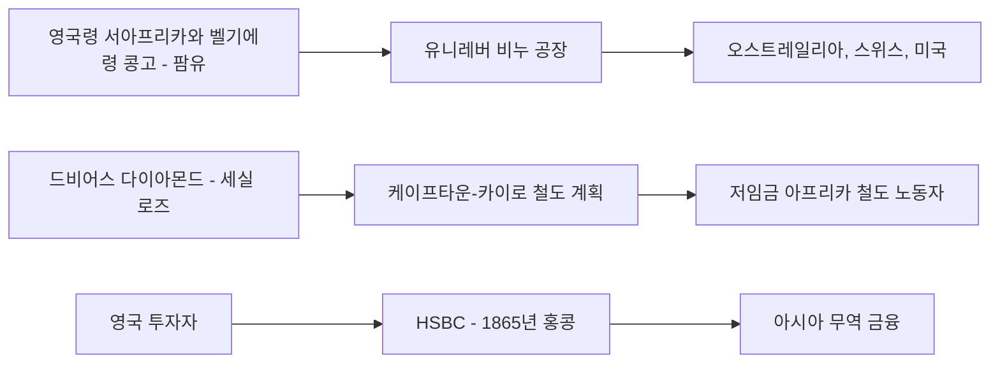

# AP World History: Modern — Topic 5.7: 경제 발전과 혁신 (Economic Developments and Innovations)

*Unit 5: 혁명의 시대 (Revolutions, c. 1750–c. 1900)*

> **핵심 질문 (Focus Question):** 1750–1900년 경제 체제·이념·제도의 발전은 변화에 어떻게 기여했는가?
>
> **학습 목표 (Learning Objective):** H: 1750–1900년 경제 체제·이념·제도의 발전과 그것이 변화에 어떻게 기여했는지 설명한다.

출처: 교재 『World History Modern: AP® Edition』 5.7 (pp. 325–331). 제공해 주신 텍스트를 제 말로 요약했습니다. (CED 추가) 표시는 그 텍스트에 없는 내용입니다.

## 큰 그림 요약 (Big Picture)

- 애덤 스미스의 『국부론』(1776)은 인간이 본래 거래하는 존재라고 주장했고('인간은 흥정하는 동물이다'), 자본주의와 민간 기업 활동의 기초 문헌이 되었다.
- 경제적 보호주의 체제인 중상주의가 자유방임으로 바뀌었다. 상업에 대한 정부 개입을 최소화하고 관세를 낮추는 정책이다.
- 기업, 독점 기업, 다국적 기업(HSBC, 유니레버, 드비어스), 은행, 보험 같은 새로운 제도가 전에 없던 규모로 사업을 조직했다.
- 무역이 늘면서 소비재는 더 구하기 쉽고, 더 싸고, 더 다양해졌으며, 소비와 여가의 문화가 생겨났다.

## 1. 중상주의에서 자유방임으로

- 스미스의 사상은 자본주의를 뒷받침했고, 산업 시대와 그 이후 수 세기의 경제와 정치를 형성했다.
- 중상주의(경제적 보호주의)는 자유방임 (laissez-faire, 프랑스어로 '내버려 두라')으로 대체되었고, 자유방임은 각국이 무역 관세를 낮추도록 장려했다.
- 영국은 곡물법 폐지(1846)로 자유 무역으로 나아갔다. *(CED 추가)*

## 2. 기업 (Corporations)

- 기업 (corporation)은 정부가 법인으로 인가하고 주주 (stockholders)가 소유하는 사업체다. 주주는 회사에서 직접, 또는 주식 시장에서 지분을 산다.
- 주주는 이익이 나면 배당금 (dividends)을 받을 수 있다. 회사가 망해도 주식을 산 금액 이상은 잃지 않는다(유한 책임).
- 다른 형태: 개인 사업 (sole proprietorship, 소유주 1명)과 동업 (partnership, 소수가 모든 결정을 내림). 기업은 대규모 경제 활동에 더 유연한 구조였다.
- 기업은 높은 위험을 혼자 지는 기업가 대신, 여럿이 함께 낮은 위험을 지는 대기업 체제를 만들어 투자를 더 안전하고 매력적으로 만들었다.
- 비판자들은 기업이 개인의 책임을 약화시킨다고 했지만, 기업은 은행·제조업·서비스업을 지배하며 큰 경제적·정치적 힘을 얻었다. 공장 하나를 어디에 지을지에 따라 수천 개의 일자리가 생길 수 있었다.

## 3. 독점 (Monopolies)

- 독점 (monopoly)은 특정 사업을 지배하고 모든 경쟁을 없애는 것이다.
- 독일 에센의 알프레트 크루프 (Alfred Krupp)는 베서머 공법을 이용해 독일 철강 산업을 독점했다.
- 존 D. 록펠러 (John D. Rockefeller)는 미국 석유 산업을 독점했다.
- 앤드루 카네기는 미국 철강을 지배했다. *(CED 추가)*

## 4. 국경을 넘나드는 기업

- 다국적 기업 (transnational companies)은 국경을 넘어 활동하며 전례가 드문 규모의 부와 영향력을 얻었다.
- 드비어스 다이아몬드를 세운 세실 로즈 (Cecil Rhodes)는 영국 식민지를 연결해 통치와 전쟁을 쉽게 하려고 케이프타운–카이로 철도를 후원했다. 영국이 모든 땅을 차지하지 못해 철도는 완성되지 않았다.
- 아프리카 철도 노동자 대부분은 유럽인보다 훨씬 낮은 임금을 받는 원주민이었다. 철도는 식민지 노동자에게 최소한의 임금만 주면서 자원을 최대한 빼내는 수단이었다.
- HSBC (홍콩상하이은행): 1865년 영국 식민지 홍콩에 문을 연 영국 소유 은행. 금융, 기업 투자, 국제 은행 업무를 했다.
- 유니레버 (Unilever): 생활용품, 특히 비누를 만든 영국·네덜란드 기업. 1890년에는 오스트레일리아·스위스·미국 등에 공장이 있었고, 영국령 서아프리카와 이후 벨기에령 콩고의 대규모 플랜테이션에서 팜유를 얻었다.

## 5. 은행과 금융

- 보험, 특히 해상 보험이 위험을 줄였다. 런던의 로이즈 (Lloyd's of London)는 상인과 선원들이 믿을 만한 해운 소식을 얻으려고 모이던 커피 하우스에서 시작되었다.
- 상인과 기업가가 안전하게 돈을 맡기고, 공장을 짓고 노동자를 고용할 돈을 빌릴 곳이 필요해지면서 은행이 늘어났다.

## 6. 대중문화에 끼친 영향

- 영국의 노동 계급과 중산층 사이에서 소비와 여가의 문화가 생겨났고, 일부 사람들의 생활 수준이 올랐다.
- 소비가 생산을 따라가야 했기 때문에, 생산자들은 특히 가처분 소득 (disposable income)이 있는 중산층을 상대로 광고를 많이 했다.
- 1800년대 후반 자전거와 보트 타기가 인기를 끌었다. 1880년대에는 체인으로 움직이는 안전 자전거가 위험한 페니파딩 자전거를 대신했다.
- 기업들은 스포츠가 자기 절제와 규칙 준수를 가르친다고 믿어 노동자의 운동을 장려했다. 스포츠 용품도 하나의 사업이 되었다.
- 유럽에서는 축구, 미국에서는 야구가 퍼졌다. 스포츠는 계급에 따라 나뉘었다. 영국에서 테니스와 골프는 상류층, 일부 럭비는 하층 계급이 했다.
- 뮤직홀과 공원(1800년대 후반)은 여러 계급을 섞이게 했는데, 하층 계급이 '교양 있는' 행동을 따라 하게 하려는 목적도 있었다.

## 비교표 (Comparison): 사업 소유 형태

| 형태 | 소유자 | 위험 | 규모 |
|---|---|---|---|
| 개인 사업 | 한 사람 | 소유주가 모든 위험 부담 | 소규모 |
| 동업 | 모든 결정을 내리는 소수 | 동업자끼리 분담 | 소·중규모 |
| 기업 | 주주 | 산 주식 금액까지만 | 대규모, 독점이 될 수 있음 |

## 비교표 (Comparison): 교재에 나온 다국적 기업

| 기업 | 본거지·출신 | 사업 | 세계적 활동 |
|---|---|---|---|
| HSBC | 영국 소유, 홍콩, 1865 | 금융, 투자, 국제 은행 업무 | 아시아·세계 무역 |
| 유니레버 | 영국·네덜란드 | 생활용품, 비누 | 오스트레일리아·스위스·미국 공장, 서아프리카·콩고 팜유 |
| 드비어스 | 세실 로즈, 남아프리카 | 다이아몬드 | 케이프-카이로 철도 계획 후원 |

## 비교표 (Comparison): 중상주의 vs. 자유방임 자본주의

| 특징 | 중상주의 | 자유방임 자본주의 |
|---|---|---|
| 기본 생각 | 경제적 보호주의 | 인간은 본래 흥정하며, 시장은 내버려 둘 때 가장 잘 작동 |
| 정부의 역할 | 엄격한 무역 규제 | 상업 개입 최소화 |
| 관세 | 자국 산업 보호를 위해 높음 | 무역 장려를 위해 인하 |
| 대표 기업 | 국가 인가 무역 회사 | 기업과 다국적 기업 |

## 핵심 용어 (Key Terms)

| 용어 | 뜻 |
|---|---|
| **자유방임 (Laissez-faire)** | '내버려 두라'. 상업에 대한 정부 개입 최소화 |
| **중상주의 (Mercantilism)** | 경제적 보호주의 체제 |
| **자본주의 (Capitalism)** | 사적 소유와 민간 기업 활동에 기반한 경제 |
| **기업 (법인) (Corporation)** | 정부가 인가하고 주주가 소유하는 법인 |
| **주주 (Stockholder)** | 주식을 사서 기업의 일부를 소유한 사람 |
| **주식 시장 (Stock market)** | 기업의 주식을 사고파는 시장 |
| **배당금 (Dividend)** | 기업이 이익의 일부를 주주에게 지급하는 돈 |
| **유한 책임 (Limited liability)** | 주주는 주식을 산 금액까지만 잃을 수 있음 |
| **개인 사업 (Sole proprietorship)** | 한 사람이 소유한 사업 |
| **동업 (Partnership)** | 소수가 모든 결정을 내리며 운영하는 사업 |
| **독점 (Monopoly)** | 경쟁을 모두 없애고 사업을 지배하는 것 |
| **다국적 기업 (Transnational company)** | 국경을 넘어 활동하는 기업 |
| **해상 보험 (Marine insurance)** | 해운 손실의 위험을 줄이는 보험 |
| **소비주의 (Consumerism)** | 상품 구매를 중심으로 한 문화 |
| **가처분 소득 (Disposable income)** | 필수품이 아닌 상품에 쓸 수 있는 돈 |

## 출처 메모 (교재 vs. 일반 자료)

- 유니레버: 1890년에는 영국 회사 레버 브라더스(1885년 설립)였고, 유니레버는 1929년 네덜란드의 마가린 우니와 합병하며 생겼습니다. 벨기에령 콩고 플랜테이션은 1911년에 시작되었습니다.
- 크루프: 교재는 독일 철강의 독점이라고 쓰지만, 일반 자료는 유일한 기업이라기보다 지배적인 기업으로 봅니다.
- 유한 책임: 교재는 개념만 설명하고 용어는 쓰지 않습니다. AP 시험에 자주 나오는 용어라서 추가했습니다.
- 존 스튜어트 밀은 이전 CED 기준 5.7에 있었지만 교재는 5.8에서 다루므로 옮겼습니다. 백화점과 『자유론』은 뺐습니다.
