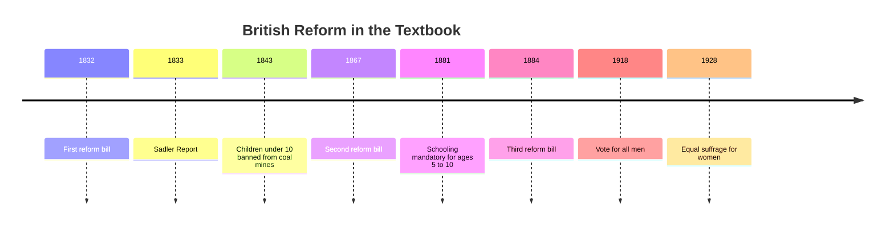
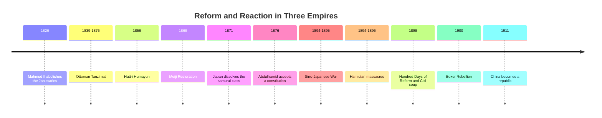

# AP World History: Modern — Topic 5.8: Reactions to the Industrial Economy

*Unit 5: Revolutions (c. 1750–c. 1900)*

> **Focus Question:** What conditions led to calls for change in industrial societies, and what were the effects of those efforts?
>
> **Learning Objective:** I: Explain the causes and effects of calls for changes in industrial societies from 1750 to 1900.

Source: textbook World History Modern: AP® Edition, Topic 5.8 (pp. 332–342), from the text you provided, summarized in my own words. Items marked (CED addition) are not in that text.

## Big Picture

- Harsh industrial conditions provoked resistance; labor organizer Mary Harris "Mother" Jones described coal miners who worked underground all day.
- Some sought reform within capitalism (John Stuart Mill, unions, Parliament); others wanted to replace it (utopian socialists, Karl Marx).
- Unions led to wider voting rights and child labor laws in Britain.
- The Ottoman Empire, China, and Japan reformed to promote industrialization, and each faced reactions against the results.

## 1. Labor Unions

- Factory work in the 1800s meant dangerous, unsanitary conditions, low wages, and long hours; Parliament's Sadler Report (1833) exposed these conditions and built support for reform.
- Labor unions: organizations of workers that bargain with employers and put agreements into contracts.
- In Britain unions had to organize in secret for most of the 1800s because the government saw them as enemies of trade; they became more accepted by the 1900s.
- Unions eventually won minimum wage laws, hour limits, overtime pay, and the five-day work week.
- Luddites (1811–1816) smashed machines; the Factory Act (1833) and Ten Hours Act (1847) limited child and women's labor. *(CED addition)*

## 2. Voting Rights and Child Labor

- Reform bills of 1832, 1867, and 1884 lowered property requirements, expanded the male electorate, and gave cities more representation.
- This led to the vote for all men in 1918; British women won equal suffrage in 1928.
- 1843: children under 10 banned from coal mines; 1881: schooling mandatory for British children aged 5–10 — permanently redefining children's role in cities.

## 3. The Intellectual Reaction

- Smith wrote in an age of small businesses; the rise of large transnational firms pushed people to rethink society, and utopian socialists built communities as alternatives to capitalism (see 5.1).
- John Stuart Mill (1806–1873) called laissez-faire capitalism inhumane and championed legal unions, limits on child labor, and safe factories; many of his ideas were later adopted.
- Utilitarianism (Mill): seek "the greatest good for the greatest number"; utilitarians wanted gradual reform of capitalism, not its replacement.
- Karl Marx (1818–1883) called his approach "scientific socialism" and scorned utopian socialists for escaping problems instead of confronting them.
- Communist Manifesto (1848, with Friedrich Engels): capitalism was an advance over feudalism but produced needless poverty by dividing society into the proletariat (workers) and the bourgeoisie (owners of the means of production).
- Competition drove the bourgeoisie to exploit workers; Marx urged the proletariat to unite, take the means of production, and share wealth. Socialism would replace capitalism, then give way to communism, with no classes.
- Anarchism rejected all state authority. *(CED addition)*

## 4. Ottoman Response to Industrialization

- Sultan Mahmud II (ruled 1808–1839) abolished the Janissaries in 1826, created a European-trained artillery unit, and had the revolting Istanbul Janissaries massacred.
- Abolishing the feudal system (1831) sent taxes to the central government, which paid the military directly and secured its loyalty.
- He also built roads, a postal service, a government directory of charities, and European-style ministries.
- Tanzimat ("reorganization," 1839–1876): fought corruption; created secular schools and colleges, ending the ulama's control of education; codified laws, including a commercial code (1850) and penal code (1858), which helped foreign business.
- Hatt-i Humayun (Ottoman Reform Edict, 1856): equality for all men in education, office, and justice regardless of religion or ethnicity; it regulated the millets (religious community courts). Balkan Christians feared lost autonomy, and Muslims objected to breaks with tradition.
- Religious equality was not achieved, but effects on the military and education lasted.

## 5. Ottoman Economy, Society, and Opposition to Reform

- After 1815 crop prices fell, workers were increasingly paid in cash, banking grew, and industry spread slowly; most new industrial jobs went to men.
- Secular legal reforms ended women's right under shariah to pass property or cash to family through trusts; the 1839 Tanzimat did not even mention women.
- Sultan Abdulhamid (took power 1876) accepted a new constitution and kept expanding primary education and secular law; a few girls attended secondary schools by the early 1900s.
- But he kept tight control, exiled the reformist Young Turks, and stirred anger at minorities; the Hamidian massacres (1894–1896) killed 100,000–250,000 Armenians, earning him the name "Red Sultan."

## 6. Reform Efforts in China

- Self-Strengthening Movement: the Qing improved military technology and trained artisans for shipyards and arsenals, with French and British advisors; it also created a diplomatic corps and a customs service to collect trade taxes.
- Strategy: graft modern ideas and technology onto Chinese tradition rather than make major change.
- After defeat in the Sino-Japanese War (1894–1895), reform clubs formed; Kang Youwei persuaded Emperor Guangxu to launch the Hundred Days of Reform (Western-style industrial, commercial, and medical systems).
- Empress Dowager Cixi, the most powerful figure, staged a coup, imprisoned the emperor, repealed the edicts, and stopped railroads and telegraphs from reaching the interior.
- Later, Cixi recognized civil-service corruption (bribes, purchased posts) and China abandoned its long Confucian civil-service tradition — but her overall conservatism kept China from meeting modern demands.
- Europeans encouraged change; after the Boxer Rebellion (1900), China kept modernizing, accepted Western territorial "protection" in return for trade concessions, became a republic in 1911, and was aided by the U.S.-brokered Treaty of Portsmouth (1905).

## 7. Resistance to Reform in Japan

- 1871: Japan gave samurai a final lump-sum payment and legally dissolved their class; they could no longer carry swords, and bushido became a personal matter.
- Some served as genro (elder statesmen); others, especially from Satsuma and Choshu, resisted to keep traditional dress, hair, and local autonomy.
- The last samurai battle came in the 1870s; samurai became the main victims of modernization — ironically, some had supported the Meiji Restoration.
- Liberalization: literacy rose, industry grew, and a free press, strong unions, and individual liberties developed — but by the 1920s army officers again dominated the government.

## Comparison: Limits to Reform: Ottoman Empire, China, Japan

| Feature | Ottoman Empire | China | Japan |
|---|---|---|---|
| When reform began | Earliest (Mahmud II, 1826; Tanzimat 1839) | Later in the century (Self-Strengthening; 1898) | 1868 Meiji Restoration |
| Key ruler | Abdulhamid | Cixi | Meiji government |
| Ruler's direction | Supported reform, then grew conservative | Skeptical at first, then more liberal | Dramatic, rapid change |
| Backlash | Balkan Christians and Muslims; Young Turks exiled; Hamidian massacres | Cixi's coup; Boxer Rebellion | Samurai resistance (Satsuma, Choshu) |

## Comparison: Utopian vs. Marxist Thought (textbook Connect task)

| Feature | Utopian socialism (5.1) | Marxism ("scientific socialism") | Utilitarianism (Mill) |
|---|---|---|---|
| View of capitalism | Flawed; build alternatives | Advance over feudalism but creates needless poverty | Inhumane in places; fixable |
| Method | Model communities (New Lanark, New Harmony) | Workers unite and seize the means of production | Legal reforms: unions, child labor limits, safety |
| Key thinkers | Saint-Simon, Fourier, Owen | Marx, Engels | John Stuart Mill |
| Goal | Harmony and cooperation | Socialism, then classless communism | Greatest good for the greatest number |
| Marx's opinion | Scorned: escaping, not confronting, problems | — | — |

## Key Terms

| Term | Definition |
|---|---|
| **Sadler Report** | 1833 parliamentary study exposing factory conditions |
| **Labor union** | Workers' organization that bargains with employers for contracts |
| **Franchise** | The right to vote |
| **Suffrage** | Voting rights |
| **Utilitarianism** | Seeking the greatest good for the greatest number |
| **Scientific socialism** | Marx's analysis of how the economy actually works |
| **Proletariat** | The working class in factories and mines |
| **Bourgeoisie** | Middle class and investors who own factories and machinery |
| **Means of production** | Machines, factories, mines, and land |
| **Communism** | Marx's final stage, in which all class distinctions end |
| **Janissaries** | Ottoman military corps abolished by Mahmud II in 1826 |
| **Tanzimat** | Ottoman "reorganization" reforms (1839–1876) |
| **Ulama** | Educated class of Muslim scholars |
| **Hatt-i Humayun** | 1856 edict declaring legal equality regardless of religion |
| **Millet** | Separate legal courts of religious communities |
| **Young Turks** | Ottoman reform advocates exiled by Abdulhamid |
| **Hamidian massacres** | Killing of Armenians, 1894–1896 |
| **Self-Strengthening Movement** | Qing effort to graft Western technology onto tradition |
| **Hundred Days of Reform** | Guangxu's sweeping reforms, repealed by Cixi |
| **Coup d'état** | Sudden seizure of government power |
| **Bushido** | Samurai code of conduct |
| **Genro** | Elder statesmen of Meiji Japan |

## Notes on Sources

- The text first calls the sultan "Mahmud I (ruled 1808–1839)" and later "Mahmud II"; the sultan who ruled 1808–1839 was Mahmud II.
- Sadler Report: standard references date it to 1832; the Factory Act followed in 1833.
- Coal-mine ban "1843": the Mines and Collieries Act of 1842 banned women and boys under 10 from underground work (5.9 says women were banned in the 1840s).
- Compulsory schooling "1881": usually dated to the Elementary Education Act of 1880.
- Samurai "1871": standard references date the sword ban and the end of samurai stipends to 1876; 1871 is when the feudal domains were abolished.
- "The last battle between the samurai shogunate forces and those loyal to the emperor occurred in the 1870s": the 1877 Satsuma Rebellion was samurai against the imperial army; the shogunate's last war was the Boshin War (1868–1869).
- Hundred Days of Reform: the textbook gives no year (1898), and the sentence listing the reforms is garbled in the text.
- Civil service: China abolished the examination system in 1905 (no year in the text). The written exams date to the Sui dynasty (about 605), so "2,500 years" fits the Confucian bureaucratic tradition, not the exams themselves.
- Abdulhamid II suspended the 1876 constitution in 1878; the textbook does not mention this.
- Japan's army dominance "by the 1920s": most references place it in the 1930s.
- Bismarck's social insurance moved to 5.10, where the textbook covers it; the British Labour Party (1900) was removed.
