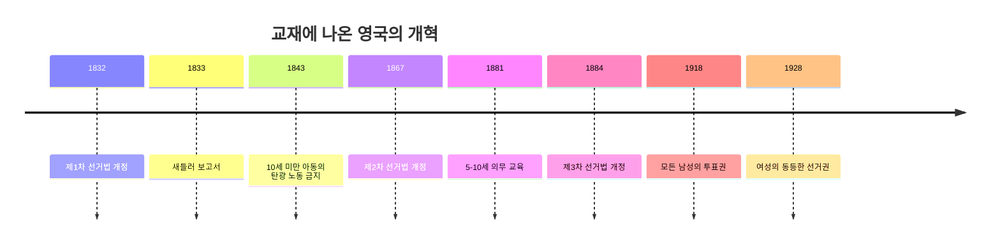
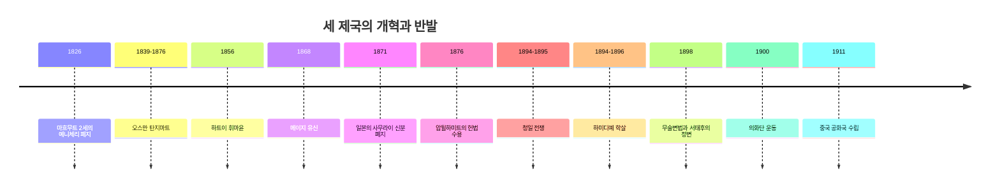

# AP World History: Modern — Topic 5.8: 산업 경제에 대한 반응 (Reactions to the Industrial Economy)

*Unit 5: 혁명의 시대 (Revolutions, c. 1750–c. 1900)*

> **핵심 질문 (Focus Question):** 어떤 조건이 산업 사회에서 변화 요구를 낳았으며, 그 노력의 결과는 무엇이었는가?
>
> **학습 목표 (Learning Objective):** I: 1750–1900년 산업 사회에서 변화를 요구한 움직임의 원인과 결과를 설명한다.

출처: 교재 『World History Modern: AP® Edition』 5.8 (pp. 332–342). 제공해 주신 텍스트를 제 말로 요약했습니다. (CED 추가) 표시는 그 텍스트에 없는 내용입니다.

## 큰 그림 요약 (Big Picture)

- 혹독한 산업 환경이 저항을 불렀다. 노동 운동가 메리 해리스 '마더' 존스 (Mother Jones)는 하루 종일 지하에서 일하는 광부들의 고통을 묘사했다.
- 일부는 자본주의 안에서의 개혁을 추구했고(존 스튜어트 밀, 노동조합, 의회), 다른 이들은 자본주의를 대체하려 했다(유토피아 사회주의자, 카를 마르크스).
- 노동조합은 영국에서 선거권 확대와 아동 노동법으로 이어졌다.
- 오스만 제국, 중국, 일본은 산업화를 위해 개혁했고, 세 나라 모두 그 결과에 대한 반발에 부딪혔다.

## 1. 노동조합

- 1800년대 공장 노동은 위험하고 비위생적인 환경, 낮은 임금, 긴 노동 시간을 뜻했다. 영국 의회의 새들러 보고서 (Sadler Report, 1833)가 이를 폭로해 개혁에 대한 지지를 모았다.
- 노동조합 (labor unions): 고용주와 교섭하고 그 합의를 계약으로 남기는 노동자 조직.
- 영국 정부가 노동조합을 무역의 적으로 보았기 때문에 1800년대 대부분 동안 조합은 비밀리에 조직해야 했다. 1900년대에 들어 더 받아들여졌다.
- 노동조합은 결국 최저 임금법, 노동 시간 제한, 초과 근무 수당, 주 5일 근무를 얻어 냈다.
- 러다이트(1811–1816)는 기계를 부수었다. 공장법(1833)과 10시간 노동법(1847)은 아동과 여성의 노동을 제한했다. *(CED 추가)*

## 2. 선거권과 아동 노동

- 1832·1867·1884년 선거법 개정은 재산 자격을 낮추고 남성 유권자를 늘렸으며, 도시의 의석을 늘렸다.
- 이는 1918년 모든 남성의 투표권으로 이어졌다. 영국 여성은 1928년에 동등한 선거권을 얻었다.
- 1843년: 10세 미만 아동의 탄광 노동 금지. 1881년: 5–10세 영국 아동의 의무 교육. 도시 사회에서 아동의 역할을 영구적으로 바꾸었다.

## 3. 지식인의 반응

- 스미스는 소기업의 시대에 글을 썼다. 거대한 다국적 기업이 등장하자 사람들은 사회를 다시 생각하게 되었고, 유토피아 사회주의자들은 자본주의의 대안으로 공동체를 세웠다 (5.1 참고).
- 존 스튜어트 밀 (John Stuart Mill, 1806–1873)은 자유방임 자본주의가 비인간적이라고 비판하고, 노동조합 합법화, 아동 노동 제한, 안전한 공장을 주장했다. 그의 생각 상당수는 훗날 받아들여졌다.
- 공리주의 (utilitarianism, 밀): '최대 다수의 최대 행복'을 추구한다. 공리주의자는 자본주의를 대체하기보다 점진적으로 개혁하려 했다.
- 카를 마르크스 (Karl Marx, 1818–1883)는 자신의 방식을 '과학적 사회주의 (scientific socialism)'라고 불렀고, 유토피아 사회주의자들이 문제와 맞서지 않고 도피한다고 경멸했다.
- 『공산당 선언』(1848, 프리드리히 엥겔스와 공저): 자본주의는 봉건제보다 발전한 것이지만, 사회를 프롤레타리아(노동자)와 부르주아(생산 수단의 소유자)로 나누어 불필요한 빈곤을 낳았다.
- 경쟁 때문에 부르주아는 노동자를 착취했다. 마르크스는 프롤레타리아가 단결해 생산 수단을 차지하고 부를 공정하게 나누라고 촉구했다. 사회주의가 자본주의를 대체하고, 이어 계급이 없는 공산주의로 넘어간다고 보았다.
- 무정부주의는 모든 국가 권위를 거부했다. *(CED 추가)*

## 4. 산업화에 대한 오스만의 대응

- 술탄 마흐무트 2세 (Mahmud II, 재위 1808–1839)는 1826년 예니체리 (Janissaries)를 폐지하고 유럽식 훈련을 받은 포병대를 만들었으며, 반란을 일으킨 이스탄불의 예니체리를 학살했다.
- 봉건 제도 폐지(1831)로 세금이 중앙 정부로 가게 되었고, 정부가 군대에 직접 급여를 주어 충성을 확보했다.
- 그는 도로와 우편 제도를 만들고, 정부의 자선 단체 명부와 유럽식 부처를 설치했다.
- 탄지마트 (Tanzimat, '재편', 1839–1876): 부패를 척결하고, 세속 학교와 대학을 세워 울라마 (ulama)의 교육 독점을 끝냈으며, 상법(1850)과 형법(1858) 등 법을 정비해 외국인의 사업을 쉽게 했다.
- 하트이 휘마윤 (Hatt-i Humayun, 오스만 개혁 칙령, 1856): 종교나 민족에 관계없이 모든 남성의 교육·관직·사법상 평등을 선언하고, 밀레트 (millets, 종교 공동체 법정)를 규제했다. 발칸의 기독교도는 자치를 잃을까 두려워했고, 무슬림은 전통과 어긋난다며 반대했다.
- 종교적 평등은 이루지 못했지만, 군대와 교육에 대한 영향은 오래 지속되었다.

## 5. 오스만의 경제·사회와 개혁에 대한 반대

- 1815년 이후 농산물 가격이 떨어지고, 노동자는 점점 현금으로 임금을 받았으며, 은행업이 성장하고 산업이 천천히 퍼졌다. 새 산업 일자리는 대부분 남성에게 돌아갔다.
- 세속 법 개혁은 여성이 샤리아에 따라 신탁을 통해 재산이나 현금을 가족에게 물려주던 권리를 없앴다. 1839년 탄지마트는 여성을 언급조차 하지 않았다.
- 술탄 압뒬하미트 (Abdulhamid, 1876년 즉위)는 새 헌법을 받아들이고 초등 교육과 세속 법을 계속 확대했다. 1900년대 초에는 소수의 여학생이 중등학교에 다녔다.
- 그러나 그는 강력한 통제를 유지하며 개혁파 청년 튀르크당 (Young Turks)을 추방하고 소수 민족에 대한 증오를 부추겼다. 하미디예 학살 (Hamidian massacres, 1894–1896)로 아르메니아인 10만–25만 명이 죽었고, 그는 '붉은 술탄'이라 불렸다.

## 6. 중국의 개혁 노력

- 양무운동 (Self-Strengthening Movement): 청은 프랑스·영국 고문의 도움으로 군사 기술을 개선하고 조선소와 무기 공장의 장인을 훈련했다. 외교 조직과 무역세를 걷는 세관도 만들었다.
- 전략: 큰 변화 대신, 근대적 사상과 기술을 중국 전통에 접목한다.
- 청일 전쟁(1894–1895) 패배 후 개혁 단체들이 생겼다. 캉유웨이 (Kang Youwei)가 광서제 (Emperor Guangxu)를 설득해 무술변법 (Hundred Days of Reform, 서구식 산업·상업·의료 제도)을 시작했다.
- 가장 강력한 인물이던 서태후 (Empress Dowager Cixi)는 정변을 일으켜 황제를 가두고 개혁 칙령을 폐지했으며, 철도와 전신이 내륙으로 뻗어 가는 것을 막았다.
- 이후 서태후는 관료제의 부패(뇌물, 관직 매매)를 인정했고, 중국은 오랜 유교적 관료 선발 전통을 버렸다. 그러나 전반적인 보수성 때문에 근대의 요구에 대응하지 못했다.
- 유럽인들은 변화를 부추겼다. 의화단 운동(1900) 이후에도 중국은 근대화를 계속했고, 무역 이권을 주는 대가로 서구의 영토 '보호'를 받아들였다. 1911년 공화국이 되었고, 미국이 중재한 포츠머스 조약(1905)의 도움을 받았다.

## 7. 일본의 개혁에 대한 저항

- 1871년: 일본은 사무라이에게 마지막 일시금을 주고 그 신분을 법적으로 없앴다. 그들은 더 이상 칼을 찰 수 없었고, 무사도 (bushido)는 개인적인 문제가 되었다.
- 일부는 겐로 (genro, 원로 정치가)로 정부에서 일했다. 다른 이들, 특히 사쓰마와 조슈 출신은 전통 복장과 머리 모양, 지방 자치를 지키려고 저항했다.
- 마지막 사무라이 전투는 1870년대에 일어났다. 사무라이는 근대화의 가장 큰 피해자가 되었다. 아이러니하게도 그 지도자 일부는 메이지 유신을 지지했던 사람들이었다.
- 자유화: 문해율이 높아지고 산업이 성장했으며, 언론의 자유·강한 노동조합·개인의 자유가 발전했다. 그러나 1920년대에는 군 장교들이 다시 정부를 지배했다.

## 비교표 (Comparison): 개혁의 한계: 오스만 제국, 중국, 일본

| 특징 | 오스만 제국 | 중국 | 일본 |
|---|---|---|---|
| 개혁 시작 | 가장 이름 (마흐무트 2세 1826, 탄지마트 1839) | 세기 후반 (양무운동, 1898) | 1868년 메이지 유신 |
| 핵심 통치자 | 압뒬하미트 | 서태후 | 메이지 정부 |
| 통치자의 변화 방향 | 개혁 지지에서 보수로 | 처음엔 회의적, 이후 더 개방적 | 극적이고 빠른 변화 |
| 반발 | 발칸 기독교도와 무슬림, 청년 튀르크당 추방, 하미디예 학살 | 서태후의 정변, 의화단 운동 | 사무라이의 저항 (사쓰마, 조슈) |

## 비교표 (Comparison): 유토피아 사상 vs. 마르크스주의 (교재 Connect 과제)

| 특징 | 유토피아 사회주의 (5.1) | 마르크스주의 ('과학적 사회주의') | 공리주의 (밀) |
|---|---|---|---|
| 자본주의관 | 결함이 있음, 대안을 만듦 | 봉건제보다 진보했지만 불필요한 빈곤을 낳음 | 비인간적인 면이 있지만 고칠 수 있음 |
| 방법 | 모범 공동체 (뉴래너크, 뉴하모니) | 노동자가 단결해 생산 수단을 장악 | 법 개혁: 노동조합, 아동 노동 제한, 안전 |
| 대표 사상가 | 생시몽, 푸리에, 오언 | 마르크스, 엥겔스 | 존 스튜어트 밀 |
| 목표 | 조화와 협력 | 사회주의, 이후 계급 없는 공산주의 | 최대 다수의 최대 행복 |
| 마르크스의 평가 | 경멸: 문제와 맞서지 않고 도피함 | — | — |

## 핵심 용어 (Key Terms)

| 용어 | 뜻 |
|---|---|
| **새들러 보고서 (Sadler Report)** | 공장 실태를 폭로한 1833년 의회 보고서 |
| **노동조합 (Labor union)** | 고용주와 교섭해 계약을 맺는 노동자 조직 |
| **선거권 (franchise) (Franchise)** | 투표할 권리 |
| **참정권 (suffrage) (Suffrage)** | 투표권 |
| **공리주의 (Utilitarianism)** | 최대 다수의 최대 행복을 추구하는 사상 |
| **과학적 사회주의 (Scientific socialism)** | 경제가 실제로 어떻게 작동하는지에 대한 마르크스의 분석 |
| **프롤레타리아 (Proletariat)** | 공장과 광산의 노동 계급 |
| **부르주아 (Bourgeoisie)** | 공장과 기계를 소유한 중산층과 투자자 |
| **생산 수단 (Means of production)** | 기계, 공장, 광산, 토지 |
| **공산주의 (Communism)** | 모든 계급 구분이 사라지는 마르크스의 마지막 단계 |
| **예니체리 (Janissaries)** | 1826년 마흐무트 2세가 폐지한 오스만 군단 |
| **탄지마트 (Tanzimat)** | 오스만의 '재편' 개혁 (1839–1876) |
| **울라마 (Ulama)** | 무슬림 학자 계층 |
| **하트이 휘마윤 (Hatt-i Humayun)** | 종교와 관계없는 법적 평등을 선언한 1856년 칙령 |
| **밀레트 (Millet)** | 종교 공동체별로 분리된 법정 |
| **청년 튀르크당 (Young Turks)** | 압뒬하미트가 추방한 오스만 개혁파 |
| **하미디예 학살 (Hamidian massacres)** | 1894–1896년 아르메니아인 학살 |
| **양무운동 (Self-Strengthening Movement)** | 서구 기술을 전통에 접목하려 한 청의 노력 |
| **무술변법 (Hundred Days of Reform)** | 서태후가 폐지한 광서제의 대대적 개혁 |
| **쿠데타 (Coup d'état)** | 정부 권력을 갑자기 빼앗는 것 |
| **무사도 (Bushido)** | 사무라이의 행동 규범 |
| **겐로 (원로) (Genro)** | 메이지 일본의 원로 정치가 |

## 출처 메모 (교재 vs. 일반 자료)

- 텍스트는 처음에 'Mahmud I (재위 1808–1839)'라고 썼다가 뒤에서 'Mahmud II'라고 씁니다. 1808–1839년에 재위한 술탄은 마흐무트 2세입니다.
- 새들러 보고서: 일반 자료는 1832년으로 보고, 공장법이 1833년에 뒤따랐습니다.
- 탄광 금지 '1843년': 1842년 광산법이 여성과 10세 미만 소년의 지하 노동을 금지했습니다 (5.9는 여성 금지를 1840년대라고 씁니다).
- 의무 교육 '1881년': 보통 1880년 초등 교육법으로 봅니다.
- 사무라이 '1871년': 일반 자료는 칼 착용 금지와 사무라이 녹봉 폐지를 1876년으로 봅니다. 1871년은 번이 폐지된 해입니다.
- '사무라이 막부군과 천황 지지 세력의 마지막 전투는 1870년대': 1877년 세이난 전쟁은 사무라이 대 정부군이었고, 막부의 마지막 전쟁은 보신 전쟁(1868–1869)입니다.
- 무술변법: 교재에 연도가 없고(1898년), 개혁 내용을 나열한 문장이 텍스트에서 깨져 있습니다.
- 관료 선발: 중국은 1905년 과거 제도를 폐지했습니다(텍스트에 연도 없음). 과거 시험은 수나라(약 605년)부터이므로, '2,500년'은 시험이 아니라 유교적 관료 전통에 해당합니다.
- 압뒬하미트 2세는 1878년 1876년 헌법을 정지했습니다. 교재에는 이 내용이 없습니다.
- 일본 군부의 지배 '1920년대': 대부분의 자료는 1930년대로 봅니다.
- 비스마르크의 사회 보험은 교재가 다루는 5.10으로 옮겼고, 영국 노동당(1900)은 뺐습니다.
