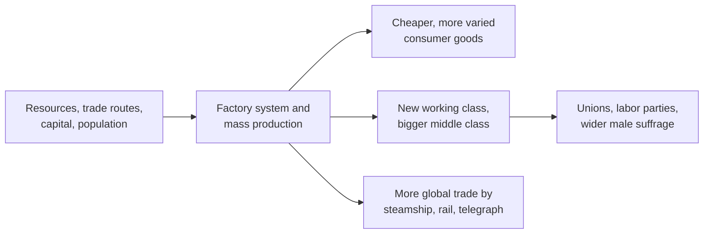

# AP World History: Modern — Topic 5.10 Summary: Continuity and Change in the Industrial Age (c. 1750–1900)

> Source: Summary of AP_WH_5.10_Notes_EN.md

**Unit 5: Revolutions (c. 1750–c. 1900)**

---

## In One Sentence

Industrialization brought the **biggest changes** since the first Agricultural Revolution (how goods were made, how people earned a living, and who held wealth), but many things **continued**: Western Europe stayed on top, the same regions supplied raw materials, Enlightenment ideas of **natural rights** kept shaping politics, and women were still paid less.

## The Big Picture

Topic 5.10 asks **how much** industrialization changed the world from 1750 to 1900. The **factory system** and **mass production** changed work, goods, and social classes. New classes then pushed for **unions**, labor parties, and the vote. Still, some old patterns stayed: rivalries among nations, strict social orders, and a world economy in which other regions sent raw materials to Western Europe and the U.S.

## Key Points

### 1. The Economy: Big Changes
- Skilled **artisans** who made unique goods at their own pace gave way to unskilled **assembly-line** workers who made identical goods.
- Consumer goods became **more available, cheaper, and more varied**.
- Western Europe moved from **mercantilism** to **capitalism**. Adam Smith said private profit would bring wealth for all, while Marx said owners exploited workers.

### 2. The World Economy: Old Patterns, New Speed
- **Continuity:** Western Europe and the U.S. kept **dominating** the world economy, while manufacturing in the Middle East and Asia declined.
- **Continuity:** the **same regions** supplied raw materials. Latin America and Africa sent minerals and metals; Egypt, South Asia, and the Caribbean sent cotton; Southeast Asia sent spices, rubber, tin, and timber.
- **Change:** **steamships, railroads, and the telegraph** reached untapped inland areas and made moving goods and people cheaper, so global trade grew.

### 3. Society: New Classes, Old Limits
- A new **working class** had low wages, long hours, and poor housing. Workers formed **unions** that used strikes and **collective bargaining** (one group bargaining for all workers).
- The **middle class** kept its doctors, lawyers, and shopkeepers (continuity) and added managers of factories, banks, and trading companies (change). Owners who made money from **investments** passed the land-owning aristocracy in wealth.
- **Women:** on farms their work was rarely paid. Under industry their wages became **essential** to families, but they were still **paid less** and kept out of high-wage jobs.

### 4. Politics: Old Ideas, New Voters
- **Continuity:** like Enlightenment thinkers, people demanded **natural rights**, sometimes based on **nationalism**.
- **Change:** movements now served the growing middle and working classes. In the **Revolutions of 1848**, Paris wanted press freedom, Berlin a parliament, and Hungarian cities freedom from Austria.
- The vote spread to city dwellers, people without land, and finally workers, but **only to men**. Women in Western industrial countries did not win the vote until the 1900s.
- Bismarck's Germany created **social insurance**, such as accident insurance and old-age pensions, to head off socialist demands. **Labor parties** pushed for minimum wages and shorter workdays.

## Must-Know Terms & People

| Term | What it is | Why it matters |
|---|---|---|
| Continuity | Something that stays the same over time | Half of every "extent of change" answer |
| Mass production | Making many identical goods by machine | The central economic change |
| Proto-industrial system | Production at home before factories, such as cottage textiles | The "before" picture for work and women's pay |
| Collective bargaining | A union negotiating with owners for all workers | A new tool of the working class |
| Revolutions of 1848 | European uprisings for press freedom, parliaments, and national freedom | Shows old Enlightenment ideas in new movements |
| Labor party | A political party for the working class | A new political change |
| Social insurance | Accident insurance and old-age pensions in Bismarck's Germany | A government answer to socialist demands |
| Coerced labor | Work forced through slavery, serfdom, or debt | A major continuity in this era |

## Key Dates

| Year | Event |
|---|---|
| 1848 | Marx and Engels publish the Communist Manifesto |
| 1848 | Revolutions of 1848 in Paris, Berlin, and Hungarian cities |
| 1861 | Serfdom ends in Russia |
| 1865 | Slavery ends in the U.S. |
| 1888 | Slavery ends in Brazil |

## How the Exam Asks About It

- **Legitimacy & consolidation:** governments kept power by giving some ground. Britain widened rights through laws, and Bismarck's Germany offered social insurance to head off socialist demands.
- **Continuity, innovation, diversity:** continuity is Enlightenment natural rights shaping politics; innovation is the factory system and mass production; diversity is how industry spread, as the U.S., Russia, and Japan built railroads and Japan and Egypt tried state-led modernization with different results.
- **Likely comparison:** **women's work before vs. during industrialization.** In both periods women earned less than men. On farms their work was rarely paid, whereas under industry their wages became essential to their families.
- **Common trap:** saying that industrialization changed **everything**. The question asks "to what extent," so name continuities too: slavery lasted in the U.S. until 1865 and in Brazil until 1888, serfdom in Russia until 1861, and the same regions kept supplying raw materials.

## Check Yourself

1. Give one economic change and one economic continuity from 1750 to 1900.

▶ Answer
A change is the factory system and mass production, which made goods cheaper and more varied. A continuity is that Western Europe and the U.S. kept dominating the world economy while the same regions supplied raw materials.

2. How did the middle class show both continuity and change?

▶ Answer
It kept its doctors, lawyers, and shopkeepers, which is continuity. It also added managers of factories, banks, and trading companies, which is change.

3. Why did Bismarck's Germany create social insurance?

▶ Answer
To head off socialist demands. It protected workers with programs such as accident insurance and old-age pensions.

