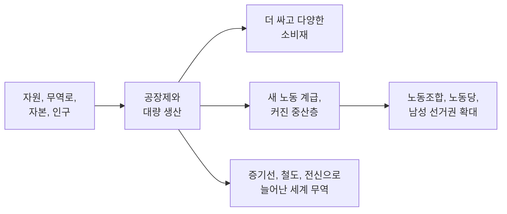

# AP 세계사: 모던 — 토픽 5.10 요약: 산업 시대의 연속성과 변화 (Continuity and Change in the Industrial Age)

> 출처: AP_WH_5.10_Notes_KR.md 요약

**Unit 5: 혁명의 시대 (Revolutions, c. 1750–c. 1900)**

---

## 한 문장 요약

산업화는 최초의 농업 혁명 (Agricultural Revolution) 이후 **가장 큰 변화**(상품을 만드는 방식, 생계를 꾸리는 방식, 부를 가진 사람)를 가져왔지만, 서유럽이 계속 우위에 있고, 같은 지역이 원료를 공급하며, 계몽주의의 **자연권 (Natural rights)** 사상이 계속 정치를 형성하고, 여성이 여전히 임금을 덜 받는 등 많은 것이 **이어졌다**.

## 큰 그림

토픽 5.10은 1750–1900년 산업화가 세계를 **어느 정도** 바꾸었는지 묻는다. **공장제** (Factory system)와 **대량 생산** (Mass production)은 일, 상품, 사회 계급을 바꾸었다. 이어 새로운 계급들은 **노동조합 (Labor union)**, 노동당 (Labor party), 투표권을 요구했다. 그래도 국가 간 경쟁, 경직된 사회 질서, 그리고 다른 지역이 서유럽과 미국에 원료를 보내는 세계 경제 같은 옛 패턴은 남았다.

## 핵심 정리

### 1. 경제: 큰 변화
- 자기 속도로 독특한 제품을 만들던 숙련 **장인 (Artisan)** 대신, 똑같은 상품을 만드는 비숙련 **조립 라인 (Assembly line)** 노동자가 등장했다.
- 소비재는 **더 구하기 쉽고, 더 싸고, 더 다양해졌다**.
- 서유럽은 **중상주의** (Mercantilism)에서 **자본주의** (Capitalism)로 바뀌었다. 애덤 스미스 (Adam Smith)는 사적 이윤 추구가 모두에게 부를 가져온다고 했고, 반면 마르크스 (Marx)는 소유주가 노동자를 착취한다고 했다.

### 2. 세계 경제: 옛 패턴, 새로운 속도
- **연속성:** 서유럽과 미국은 세계 경제를 계속 **지배**했고, 중동과 아시아의 제조업은 쇠퇴했다.
- **연속성:** **같은 지역**이 원료를 공급했다. 라틴아메리카와 아프리카는 광물과 금속을, 이집트·남아시아·카리브해는 면화를, 동남아시아는 향신료·고무·주석·목재를 보냈다.
- **변화:** **증기선, 철도, 전신**이 아직 개발되지 않은 내륙 지역에 닿고 상품과 사람의 이동을 싸게 만들어, 세계 무역이 늘었다.

### 3. 사회: 새로운 계급, 옛 한계
- 새 **노동 계급** (Working class)은 낮은 임금, 긴 노동 시간, 열악한 주거 속에서 살았다. 노동자들은 파업과 **단체 교섭** (Collective bargaining, 한 집단이 노동자 전체를 대표해 협상하는 것)을 하는 **노동조합**을 만들었다.
- **중산층** (Middle class)에는 의사·변호사·상점 주인이 그대로 있었고(연속성), 공장·은행·무역 회사의 관리자가 새로 더해졌다(변화). **투자**로 돈을 번 소유주들은 부에서 토지 귀족을 앞질렀다.
- **여성:** 농사에서 여성의 일은 거의 보수를 받지 못했다. 산업화 이후 여성의 임금은 가족에게 **필수**가 되었지만, 여성은 여전히 **임금을 덜 받았고** 고임금 일자리에서 배제되었다.

### 4. 정치: 옛 사상, 새 유권자
- **연속성:** 계몽사상가들처럼 사람들은 **자연권**을 요구했고, 때로는 **민족주의** (Nationalism)에 기반했다.
- **변화:** 이제 운동은 성장하는 중산층과 노동 계급의 이익을 대변했다. **1848년 혁명** (Revolutions of 1848)에서 파리는 언론 자유를, 베를린은 의회를, 헝가리 도시들은 오스트리아로부터의 자유를 요구했다.
- 투표권은 도시 거주자, 토지가 없는 사람, 결국 노동자에게까지 퍼졌지만, **남성에게만** 해당되었다. 서구 공업국의 여성은 1900년대에 들어서야 투표권을 얻었다.
- 비스마르크 (Bismarck)의 독일은 사회주의자의 요구를 막으려고 산재 보험과 노령 연금 같은 **사회 보험** (Social insurance)을 만들었다. **노동당**은 최저 임금과 노동 시간 단축을 요구했다.

## 꼭 알아야 할 용어·인물

| 용어 | 무엇인가 | 왜 중요한가 |
|---|---|---|
| 연속성 (Continuity) | 시간이 지나도 그대로 유지되는 것 | 모든 '변화의 정도' 답안의 절반 |
| 대량 생산 (Mass production) | 기계로 똑같은 상품을 많이 만드는 것 | 핵심적인 경제적 변화 |
| 원시 산업 체제 (Proto-industrial system) | 가내 섬유업처럼 공장 이전에 집에서 하던 생산 | 일과 여성 임금의 '이전' 모습 |
| 단체 교섭 (Collective bargaining) | 노동조합이 노동자 전체를 대표해 소유주와 협상하는 것 | 노동 계급의 새로운 수단 |
| 1848년 혁명 (Revolutions of 1848) | 언론 자유, 의회, 민족의 자유를 요구한 유럽의 봉기 | 옛 계몽사상이 새 운동에 이어졌음을 보여 준다 |
| 노동당 (Labor party) | 노동 계급을 대표하는 정당 | 새로운 정치적 변화 |
| 사회 보험 (Social insurance) | 비스마르크 독일의 산재 보험과 노령 연금 | 사회주의자의 요구에 대한 정부의 대응 |
| 강제 노동 (Coerced labor) | 노예제, 농노제, 부채를 통해 강요된 노동 | 이 시대의 중요한 연속성 |

## 주요 연도

| 연도 | 사건 |
|---|---|
| 1848 | 마르크스와 엥겔스 (Engels)가 『공산당 선언 (Communist Manifesto)』 출간 |
| 1848 | 파리, 베를린, 헝가리 도시들에서 1848년 혁명 (Revolutions of 1848) |
| 1861 | 러시아 농노제 (Serfdom) 폐지 |
| 1865 | 미국 노예제 (Slavery) 폐지 |
| 1888 | 브라질 노예제 (Slavery) 폐지 |

## 시험에서는 이렇게 묻는다

- **정당화와 공고화:** 정부들은 일부를 양보해 권력을 지켰다. 영국은 법으로 권리를 넓혔고, 비스마르크의 독일은 사회주의자의 요구를 막으려고 사회 보험을 제공했다.
- **연속성·혁신·다양성:** 연속성은 계몽주의의 자연권이 계속 정치를 형성한 것이다. 혁신은 공장제와 대량 생산이다. 다양성은 산업화가 퍼진 방식이다. 미국·러시아·일본은 철도를 놓았고, 일본과 이집트는 국가 주도 근대화를 시도해 서로 다른 결과를 얻었다.
- **자주 나오는 비교:** **산업화 이전과 산업화 시기의 여성 노동.** 두 시기 모두 여성은 남성보다 적게 벌었다. 농사에서 여성의 일은 거의 보수를 받지 못했고, 반면 산업화 이후 여성의 임금은 가족에게 필수가 되었다.
- **자주 하는 실수:** 산업화가 **모든 것**을 바꾸었다고 쓰는 것이다. 문제는 '어느 정도'를 묻기 때문에 연속성도 들어야 한다. 노예제는 미국에서 1865년, 브라질에서 1888년까지, 러시아 농노제는 1861년까지 이어졌고, 같은 지역이 계속 원료를 공급했다.

## 스스로 확인하기

1. 1750–1900년의 경제적 변화 하나와 경제적 연속성 하나를 들어라.

▶ 정답
변화는 상품을 더 싸고 다양하게 만든 공장제와 대량 생산이다. 연속성은 같은 지역이 원료를 공급하는 가운데 서유럽과 미국이 세계 경제를 계속 지배한 것이다.

2. 중산층은 연속성과 변화를 어떻게 함께 보여 주었는가?

▶ 정답
의사, 변호사, 상점 주인이 그대로 남은 것은 연속성이다. 공장, 은행, 무역 회사의 관리자가 새로 더해진 것은 변화이다.

3. 비스마르크의 독일은 왜 사회 보험을 만들었는가?

▶ 정답
사회주의자의 요구를 막기 위해서였다. 산재 보험과 노령 연금 같은 제도로 노동자를 보호했다.

