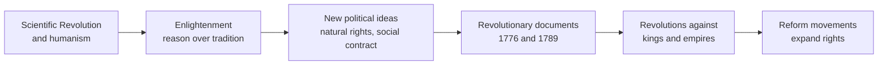

# AP World History: Modern — Topic 5.1 Summary: The Enlightenment (c. 1650–1900)

> Source: Summary of AP_WH_5.1_Notes_EN.md

**Unit 5: Revolutions (c. 1750–1900)**

---

## In One Sentence

The Enlightenment put reason above tradition and gave people new ideas about natural rights, the social contract, and nationalism; these ideas pushed people to resist kings and empires after 1750, and later to demand votes for women, the end of slavery, and the end of serfdom.

## The Big Picture

In the 1600s and 1700s, thinkers put reason above tradition and the individual above community values. This shift is called the Enlightenment. Its ideals of individualism, freedom, and self-determination challenged monarchs and church leaders and planted the seeds of revolution. Revolutions usually wanted two things: independence from empires and a constitution with representation. Over time, people used the same ideas to demand rights for women, the end of slavery, and the end of serfdom.

## Key Points

### 1. A New Way of Thinking
- The Enlightenment grew out of the **Scientific Revolution** and Renaissance humanism.
- Thinkers believed that using **reason** to understand natural laws would bring progress. They decided that natural laws also governed society and politics.
- **Empiricism** means knowledge comes from what we sense and from experiments, not from tradition or religious authority. Francis Bacon taught this idea.
- Thinkers did not deny God, but traditional religion became **less dominant** in public life.
- **Deism** said a divinity set natural laws in motion, like a **watchmaker**, and then did not interfere.

### 2. Thinkers of the Social Contract
- A **social contract** is an agreement: people accept a government in return for order or the protection of their rights.
- **Thomas Hobbes** (*Leviathan*, 1651) said life without government is "nasty, brutish, and short," so people give some rights to a **strong government** for law and order.
- **John Locke** (*Two Treatises of Government*, 1690) said people have **natural rights** to life, liberty, and property. Citizens have the right, and even the duty, to **revolt** against an unjust government.
- **Montesquieu** (*The Spirit of Laws*, 1748) praised **checks on power**. The United States later split its government into executive, legislative, and judicial branches based on his ideas.
- **Rousseau** (*The Social Contract*, 1762) said the ruler must carry out the **General Will**, the will of the people as a whole.

### 3. The Philosophes Spread the Ideas
- The **philosophes** were 18th-century thinkers who made reason-based ideas popular. They included Jefferson, Franklin, Adam Smith, and French writers.
- **Voltaire** admired England's constitutional monarchy and campaigned in France for **religious liberty** and fairer courts.
- **Thomas Paine** wrote *Common Sense* (1776), which urged Americans to seek **independence** from Britain.
- **Adam Smith** (*The Wealth of Nations*, 1776) argued against mercantilism and for freer trade and **laissez-faire** ("leave alone"), meaning little government control of the economy.
- Smith said the **invisible hand** of the market turns self-interest into good for society. His ideas became a foundation of **capitalism**.

### 4. From Ideas to Revolutions and Nationalism
- Enlightenment ideas often **came before** revolutions. The **Declaration of Independence** (1776) echoes Locke's natural rights.
- France's **Declaration of the Rights of Man and of the Citizen** (1789) also reflected these ideas, and the **Haitian Revolution** followed in 1791.
- Simón Bolívar's **Jamaica Letter** (1815) carried these ideas to Latin America.
- **Nationalism** is strong loyalty to people who share your language and culture. It holds that each culture should have its own **nation-state**, so it threatened Europe's multiethnic empires.
- So many new "isms" appeared, such as liberalism, socialism, conservatism, and Zionism, that the era is called the **"Age of Isms."**

### 5. Rights for Women
- **Feminism** is the movement for women's rights and equality. **Suffrage** means the right to vote.
- In 1791 **Olympe de Gouges** answered France's 1789 declaration with the *Declaration of the Rights of Woman and of the Female Citizen*.
- **Mary Wollstonecraft** (*A Vindication of the Rights of Woman*, 1792) said women deserve the **same education** as men, so they can take part in political and professional life.
- At the **Seneca Falls Convention** (1848), Lucretia Mott and Elizabeth Cady Stanton declared that "all men and women are created equal" and demanded **the vote**, property rights, and more.

### 6. Ending Slavery and Serfdom
- **Abolitionism** was the movement to end the Atlantic slave trade and free all enslaved people. It grew in the 1700s.
- The **slave trade was banned first**: Denmark (1803), Britain (1807), and the United States (1808).
- Slavery itself ended later: Britain in 1833, the United States in 1865, and **Brazil** last in the Americas in 1888.
- **Serfdom** declined as economies industrialized and peasants revolted. France ended nobles' feudal rights in 1789.
- In 1861 **Alexander II** freed 23 million Russian serfs, the largest single emancipation in history.

## Must-Know Terms & People

| Term | What it is | Why it matters |
|---|---|---|
| Enlightenment | A movement that put reason above tradition and the individual above community values | Its ideas came before many revolutions |
| Empiricism | The idea that knowledge comes from senses and experiments | A new way to study nature and society |
| Social contract | People accept a government in return for order or rights | The base of Hobbes's, Locke's, and Rousseau's ideas |
| Natural rights | Locke's rights to life, liberty, and property | Echoed in the Declaration of Independence |
| John Locke | Thinker who wrote *Two Treatises of Government* (1690) | Said people may revolt against unjust rulers |
| Montesquieu | Thinker who wrote *The Spirit of Laws* (1748) | Inspired the U.S. three branches of government |
| General Will | Rousseau's idea of the will of the people as a whole | The ruler must carry it out |
| Laissez-faire | "Leave alone"; little government control of the economy | Adam Smith's challenge to mercantilism |
| Deism | Belief that a divinity set natural laws in motion and does not interfere | Shows religion's smaller role in public life |
| Nationalism | Loyalty to people who share a language and culture | Each culture wants its own nation-state |
| Mary Wollstonecraft | Writer of *A Vindication of the Rights of Woman* (1792) | Demanded equal education for women |
| Abolitionism | The movement to end the slave trade and slavery | Expanded rights over time |

## Key Dates

| Year | Event |
|---|---|
| 1690 | Locke publishes *Two Treatises of Government* |
| 1776 | Declaration of Independence; Smith's *The Wealth of Nations*; Paine's *Common Sense* |
| 1789 | France's Declaration of the Rights of Man and of the Citizen |
| 1791 | De Gouges's Declaration of the Rights of Woman |
| 1807 | Britain bans the slave trade |
| 1848 | Seneca Falls Convention |
| 1861 | Alexander II frees 23 million Russian serfs |
| 1888 | Brazil abolishes slavery, the last in the Americas |

## How the Exam Asks About It

- **Legitimacy & consolidation:** Enlightenment thinkers changed what made a government legitimate. Hobbes defended a strong government for order, but Locke said rulers must protect natural rights or the people may revolt, and Rousseau said the ruler must carry out the General Will.
- **Continuity, innovation, diversity:** Continuity: traditional religion did not disappear, and many Deists still went to church. Innovation: empiricism used experiments and the senses, not tradition, to find truth. Diversity: thinkers disagreed, from Hobbes's strong government to Locke's right to revolt.
- **Likely comparison:** Hobbes vs. Locke. Similarity: both used the idea of a social contract between people and government. Difference: Hobbes said people should give rights to a strong government for order; Locke said government must protect natural rights, and people may revolt if it does not.
- **Common trap:** Students think the Enlightenment ended slavery and gave women the vote right away. Fix: the ideas came first, and the changes took a long time; for example, Britain banned the slave trade in 1807 but Brazil did not end slavery until 1888.

## Check Yourself

1. How did Locke's ideas connect to the American Revolution?

▶ Answer
Locke said people have natural rights to life, liberty, and property and may revolt against an unjust government. The Declaration of Independence (1776) echoes these natural rights.

2. How did feminists use Enlightenment ideas?

▶ Answer
They argued that the rights of man should apply to women too. Olympe de Gouges answered France's 1789 declaration with a declaration of women's rights, and the Seneca Falls Convention (1848) demanded the vote for women.

3. What is the difference between banning the slave trade and abolishing slavery?

▶ Answer
Banning the slave trade stopped the buying and shipping of new captives, as Britain did in 1807. Abolishing slavery freed the people already enslaved, which came later, for example in Britain in 1833 and Brazil in 1888.

