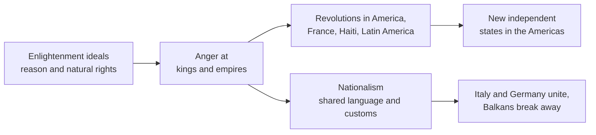

# AP World History: Modern — Topic 5.2 Summary: Nationalism and Revolutions (c. 1750–1900)

> Source: Summary of AP_WH_5.2_Notes_EN.md

**Unit 5: Revolutions (c. 1750–1900)**

---

## In One Sentence

Enlightenment ideals and anger at kings and empires caused revolutions in America, France, Haiti, and Latin America that created new independent states, while nationalism later united Italy and Germany, broke Ottoman control of the Balkans, and inspired resistance to colonial rule.

## The Big Picture

The American, French, Haitian, and Latin American revolutions all drew on Enlightenment ideals such as reason and natural law. Who led each revolution shaped its results: in Haiti enslaved people ended slavery, but in Latin America rich creole elites kept the old social order. In the 1800s, **nationalism**, a feeling of unity among people who share a language, history, and customs, became a major force. It united Italy and Germany, helped Balkan peoples break away from the Ottoman Empire, and inspired fights against colonial rule.

## Key Points

### 1. The American and French Revolutions
- American colonists already ran much of their own affairs through **colonial legislatures**. The **Declaration of Independence** (1776) drew on Locke's idea of rights that cannot be taken away.
- France was deep in **debt**, partly from wars, including its aid to the American Revolution.
- In 1789 the **Estates-General** met. Commoners were 97% of society but had unequal votes, so they formed the **National Assembly**. Crowds stormed the **Bastille** on July 14, 1789.
- The early revolution **abolished feudalism** and issued the **Declaration of the Rights of Man**.
- Radical **Jacobins** created a republic (1792) and led the **Reign of Terror**, which executed thousands, including the king and queen. **Napoleon** became emperor in 1804.

### 2. The Haitian Revolution
- Haiti was France's rich **sugar and coffee** colony. **Enslaved Africans** began the revolt, and **Maroons** (people who had escaped slavery) joined them.
- **Toussaint L'Ouverture**, who had been enslaved, led a general rebellion from 1791. He knew Enlightenment ideas and played France, Spain, and Britain against one another.
- His 1801 constitution gave **equality and citizenship** to all residents. The French imprisoned him, and he died in France in 1803.
- In 1804 **Jean-Jacques Dessalines** declared independence. Haiti became the **first black-led country** in the Western Hemisphere and the only country made permanently independent by a **slave uprising**.

### 3. Creole Revolutions in Latin America
- At the top of society were **peninsulares** (born in Spain or Portugal), then **creoles** (European ancestry, born in the Americas), then **mestizos** (European and Indian parents).
- Rich creoles hated **Spanish mercantilism**, which forced them to trade only with Spain, and resented that the top jobs went to peninsulares.
- Afraid of the masses after Haiti's slave uprising and the Terror, creoles **refused help** from mestizos, indigenous people, and mulattoes.
- **Simón Bolívar** freed lands that became Venezuela, Colombia, Ecuador, and Peru. His **Jamaica Letter** (1815) shows his liberal ideas, such as free markets and abolition.
- Results: new constitutions ended slavery by law, but governments stayed **conservative**. Creoles stayed the upper class, women gained little, and strong regional leaders called **caudillos** often ignored the rule of law.

### 4. Resisting Colonial Rule
- **New Zealand:** Britain annexed New Zealand in 1840 and pushed for Maori land. The wars united Maori tribes and built **Maori nationalism**, but Britain had won by 1872.
- **Puerto Rico and Cuba:** both rose against Spain beginning in 1868. The poet **Lola Rodríguez de Tió** criticized Spanish rule and wrote the words of "La Borinqueña."
- **Philippines:** **José Rizal** led the **Propaganda Movement**, which asked for more self-rule, not independence. His execution (1896) helped spark the Philippine Revolution.

### 5. Unifying Italy and Germany
- **Napoleon's** conquests spread nationalism, especially in the German lands. The **revolutions of 1848** combined nationalism with liberalism.
- **Italy:** **Cavour**, prime minister of Piedmont-Sardinia, used **realpolitik** (practical politics based on power, not ideals), a war with Austria, and votes called plebiscites. He worked with **Mazzini** and **Garibaldi's** Red Shirts. The Kingdom of Italy was proclaimed in 1861.
- **Germany:** **Otto von Bismarck** used realpolitik and **three wars**, against Denmark (1864), Austria (1866), and France (1870), to found the **German Empire** in 1871.
- Later, competing alliances and extreme nationalism helped lead to **World War I**.

### 6. Balkan Nationalism and Ottomanism
- After the Ottomans failed to take **Vienna** in 1683, Austria and Russia began pushing them out of the **Balkans**.
- In **Greece**, Enlightenment ideas and Europe's admiration for ancient Greece revived Greek pride. In 1827 a British, French, and Russian fleet destroyed an Ottoman fleet, which helped assure Greek **independence**.
- Serbia, Bulgaria, and Romania rallied around their **language**, folk traditions, history, and religion.
- **Ottomanism** tried to unite the empire by playing down ethnic, language, and religious differences through state schools. It **backfired**: subject peoples felt more different and wanted independence even more.

## Must-Know Terms & People

| Term | What it is | Why it matters |
|---|---|---|
| Estates-General | France's assembly of clergy, nobles, and commoners | Unequal voting there started the French Revolution |
| Reign of Terror | The time when the revolutionary government executed thousands | Made creole elites in Latin America fear the masses |
| Toussaint L'Ouverture | A formerly enslaved man who led the Haitian Revolution | Secured the end of slavery in Haiti |
| Maroons | People who had escaped slavery | Joined the Haitian revolt |
| Peninsulares | Colonists born in Spain or Portugal | Held the top jobs, which angered creoles |
| Creoles | People of European ancestry born in the Americas | Led the Latin American revolutions and kept power |
| Simón Bolívar | Creole leader who freed much of northern South America | Wrote the Jamaica Letter (1815) |
| Caudillos | Strong regional leaders who made or broke governments | They often ignored representative government and the rule of law |
| Propaganda Movement | Filipino movement for more self-rule, led by Rizal | An example of nationalism against colonial rule |
| Realpolitik | Practical politics based on power, not ideals | How Cavour and Bismarck unified their nations |
| Otto von Bismarck | Leader who unified Germany through three wars | Founded the German Empire in 1871 |
| Ottomanism | A plan to unite the Ottoman Empire by playing down differences | It backfired and fed nationalism |

## Key Dates

| Year | Event |
|---|---|
| 1776 | Declaration of Independence |
| 1789 | Storming of the Bastille; Declaration of the Rights of Man |
| 1804 | Haiti declares independence; Napoleon becomes emperor |
| 1815 | Bolívar's Jamaica Letter |
| 1840 | Britain annexes New Zealand |
| 1861 | Kingdom of Italy proclaimed |
| 1871 | German Empire founded |
| 1896 | Rizal executed; Philippine Revolution begins |

## How the Exam Asks About It

- **Legitimacy & consolidation:** Revolutionaries justified resistance with Enlightenment ideas of natural rights, as in the Declaration of Independence and the Declaration of the Rights of Man. New rulers then worked to hold power: Napoleon made himself emperor, Bismarck used realpolitik and wars, and the Ottomans tried to build unity through state schools.
- **Continuity, innovation, diversity:** Continuity: in Latin America, creoles stayed the upper class after independence. Innovation: Haiti became the first black-led country in the Western Hemisphere. Diversity: the leaders differed, from enslaved people in Haiti to commoners in France and creole elites in Latin America.
- **Likely comparison:** Haitian vs. French Revolution. Similarity: both overturned the old order and claimed Enlightenment natural rights. Difference: in Haiti enslaved people with no rights rebelled and won abolition and independence; in France commoners in the estate system rebelled and ended feudalism.
- **Common trap:** Students think every revolution in the Americas brought social equality. Fix: in Latin America, creole elites led the revolutions, refused help from the masses, and kept a conservative social order.

## Check Yourself

1. Why did creoles in Latin America refuse help from mestizos, indigenous people, and mulattoes?

▶ Answer
After Haiti's slave uprising and France's Reign of Terror, creoles feared the masses. They wanted independence from Spain but not a change in the social order.

2. How did Bismarck unify Germany?

▶ Answer
He used realpolitik and three wars, against Denmark (1864), Austria (1866), and France (1870). The German Empire was founded in 1871.

3. Why did Ottomanism fail?

▶ Answer
It tried to unite the empire by playing down differences through state schools. Instead, subject peoples felt more different and wanted independence even more.

