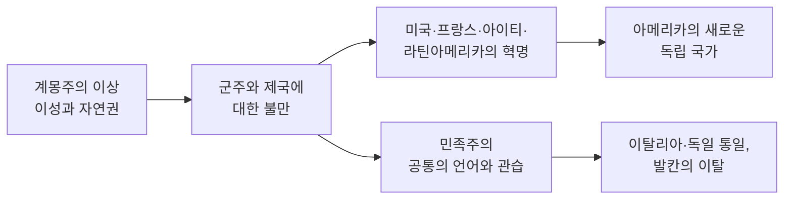

# AP 세계사: 모던 — 토픽 5.2 요약: 민족주의와 혁명 (Nationalism and Revolutions)

> 출처: AP_WH_5.2_Notes_KR.md 요약

**Unit 5: 혁명의 시대 (Revolutions, c. 1750–1900)**

---

## 한 문장 요약

계몽주의 (Enlightenment) 이상과 군주·제국에 대한 불만은 미국, 프랑스, 아이티, 라틴아메리카에서 혁명을 일으켜 새로운 독립 국가를 낳았고, 뒤이어 민족주의 (Nationalism)는 이탈리아와 독일을 통일하고 발칸반도에 대한 오스만의 지배를 무너뜨렸으며 식민 지배에 대한 저항을 불러일으켰다.

## 큰 그림

미국 혁명, 프랑스 혁명, 아이티 혁명, 라틴아메리카 혁명은 모두 이성과 자연법 같은 계몽주의 이상에 기반했다. 누가 혁명을 이끌었는지가 결과를 좌우했다. 아이티에서는 노예가 노예제를 끝냈지만, 라틴아메리카에서는 부유한 크리오요 (Creoles) 엘리트가 기존 사회 질서를 유지했다. 1800년대에는 언어·역사·관습을 공유하는 사람들 사이의 일체감인 **민족주의**가 큰 힘이 되었다. 민족주의는 이탈리아와 독일을 통일하고, 발칸 민족이 오스만 제국에서 떨어져 나가도록 도왔으며, 식민 지배에 맞선 싸움을 일으켰다.

## 핵심 정리

### 1. 미국 혁명과 프랑스 혁명
- 미국 식민지인들은 이미 **식민지 의회**를 통해 많은 일을 스스로 결정했다. **독립 선언문**(1776)은 빼앗을 수 없는 권리라는 로크 (Locke)의 생각을 바탕으로 했다.
- 프랑스는 미국 혁명 지원을 포함한 전쟁 비용 때문에 큰 **빚**을 지고 있었다.
- 1789년 **삼부회** (Estates-General)가 열렸다. 평민은 인구의 97%였지만 투표가 불평등해서 **국민 의회** (National Assembly)를 따로 구성했다. 1789년 7월 14일 군중이 **바스티유**를 습격했다.
- 혁명 초기에 **봉건제가 폐지**되었고 **인권 선언**이 발표되었다.
- 급진파 **자코뱅** (Jacobins)은 공화국(1792)을 세우고 **공포 정치** (Reign of Terror)를 이끌어 국왕과 왕비를 포함한 수천 명을 처형했다. **나폴레옹** (Napoleon)은 1804년 황제가 되었다.

### 2. 아이티 혁명 (Haitian Revolution)
- 아이티는 **설탕과 커피**로 부유한 프랑스 식민지였다. **노예가 된 아프리카인**들이 봉기를 시작했고, 노예 상태에서 탈출한 **마룬** (Maroons)이 합류했다.
- 노예 출신 **투생 루베르튀르** (Toussaint L'Ouverture)는 1791년부터 전면 봉기를 이끌었다. 그는 계몽사상에 밝았고 프랑스·스페인·영국을 서로 견제하게 했다.
- 그의 1801년 헌법은 모든 주민에게 **평등과 시민권**을 보장했다. 프랑스는 그를 투옥했고, 그는 1803년 프랑스에서 죽었다.
- 1804년 **장자크 데살린** (Jean-Jacques Dessalines)이 독립을 선언했다. 아이티는 서반구 **최초의 흑인 주도 국가**이자, **노예 봉기**로 영구 독립한 유일한 나라가 되었다.

### 3. 라틴아메리카의 크리오요 혁명
- 사회의 맨 위에는 **페닌술라레스 (Peninsulares)**(스페인·포르투갈 태생)가 있었고, 그다음이 **크리오요**(아메리카 태생 유럽계), 그다음이 **메스티소 (Mestizos)**(유럽인과 원주민 혼혈)였다.
- 부유한 크리오요는 스페인하고만 무역하게 하는 **스페인의 중상주의**를 싫어했고, 고위직이 페닌술라레스에게 돌아가는 데 분노했다.
- 아이티의 노예 봉기와 공포 정치를 본 크리오요는 대중을 두려워해 메스티소, 원주민, 물라토 (Mulattoes)의 **도움을 거부했다**.
- **시몬 볼리바르** (Simón Bolívar)는 지금의 베네수엘라·콜롬비아·에콰도르·페루 지역을 해방했다. 그의 **「자메이카 편지」**(1815)에는 자유 시장과 노예제 폐지 같은 자유주의 사상이 담겨 있다.
- 결과: 새 헌법은 법적으로 노예제를 없앴지만 정부는 **보수적**이었다. 크리오요는 여전히 상류층이었고, 여성은 얻은 것이 거의 없었으며, **카우디요** (Caudillos)라는 지역의 강력한 지도자들은 법치를 자주 무시했다.

### 4. 식민 지배에 맞선 저항
- **뉴질랜드:** 영국은 1840년 뉴질랜드를 병합하고 마오리 (Maori)의 땅을 압박했다. 전쟁으로 마오리 부족들이 뭉치며 **마오리 민족주의**가 생겨났지만, 1872년까지 영국이 승리했다.
- **푸에르토리코와 쿠바:** 두 섬 모두 1868년부터 스페인에 맞서 봉기했다. 시인 **롤라 로드리게스 데 티오** (Lola Rodríguez de Tió)는 스페인의 지배를 비판하고 「라 보린케냐」의 가사를 썼다.
- **필리핀:** **호세 리살** (José Rizal)이 이끈 **선전 운동** (Propaganda Movement)은 독립이 아니라 더 큰 자치를 요구했다. 그의 처형(1896)은 필리핀 혁명을 촉발하는 데 한몫했다.

### 5. 이탈리아와 독일의 통일
- **나폴레옹**의 정복은 특히 독일 지역에 민족주의를 퍼뜨렸다. **1848년 혁명** (Revolutions of 1848)은 민족주의와 자유주의가 결합된 것이었다.
- **이탈리아:** 피에몬테-사르데냐의 총리 **카보우르** (Cavour)는 **현실 정치 (Realpolitik)**(이상보다 힘에 기반한 실용 정치), 오스트리아와의 전쟁, 국민 투표 (Plebiscite)를 활용했다. 그는 **마치니 (Mazzini)**, **가리발디** (Garibaldi)의 붉은 셔츠단과 손잡았다. 이탈리아 왕국은 1861년에 선포되었다.
- **독일:** **오토 폰 비스마르크** (Otto von Bismarck)는 현실 정치와 덴마크(1864), 오스트리아(1866), 프랑스(1870)를 상대로 한 **세 번의 전쟁**을 통해 1871년 **독일 제국**을 세웠다.
- 훗날 경쟁하는 동맹과 극단적 민족주의는 **제1차 세계 대전**으로 이어졌다.

### 6. 발칸 민족주의와 오스만주의
- 오스만이 1683년 **빈** 정복에 실패한 뒤, 오스트리아와 러시아가 **발칸반도**에서 오스만 세력을 밀어내기 시작했다.
- **그리스**에서는 계몽사상과 고대 그리스에 대한 유럽의 존경이 그리스인의 자부심을 되살렸다. 1827년 영국·프랑스·러시아 연합 함대가 오스만 함대를 격파해 그리스 **독립**을 확실하게 하는 데 도움을 주었다.
- 세르비아·불가리아·루마니아는 **언어**, 민속 전통, 역사, 종교를 중심으로 결집했다.
- **오스만주의** (Ottomanism)는 국가가 통제하는 학교를 통해 민족·언어·종교의 차이를 줄여 제국을 통합하려 했다. 그러나 **역효과**를 냈다. 피지배 민족은 차이를 더 크게 느끼고 독립을 더 원하게 되었다.

## 꼭 알아야 할 용어·인물

| 용어 | 무엇인가 | 왜 중요한가 |
|---|---|---|
| 삼부회 (Estates-General) | 성직자·귀족·평민으로 구성된 프랑스 의회 | 이곳의 불평등한 투표가 프랑스 혁명의 출발점이 되었다 |
| 공포 정치 (Reign of Terror) | 혁명 정부가 수천 명을 처형한 시기 | 라틴아메리카 크리오요 엘리트가 대중을 두려워하게 만들었다 |
| 투생 루베르튀르 (Toussaint L'Ouverture) | 아이티 혁명을 이끈 노예 출신 지도자 | 아이티의 노예제 폐지를 확고히 했다 |
| 마룬 (Maroons) | 노예 상태에서 탈출한 사람들 | 아이티 봉기에 합류했다 |
| 페닌술라레스 (Peninsulares) | 스페인·포르투갈 태생 식민지인 | 고위직을 차지해 크리오요의 분노를 샀다 |
| 크리오요 (Creoles) | 아메리카에서 태어난 유럽계 | 라틴아메리카 혁명을 이끌고 권력을 유지했다 |
| 시몬 볼리바르 (Simón Bolívar) | 남아메리카 북부 대부분을 해방한 크리오요 지도자 | 「자메이카 편지」(1815)를 썼다 |
| 카우디요 (Caudillos) | 정부를 세우거나 무너뜨린 지역의 강력한 지도자 | 대의 정치와 법치를 자주 무시했다 |
| 선전 운동 (Propaganda Movement) | 리살 (Rizal)이 이끈 필리핀 자치 운동 | 식민 지배에 맞선 민족주의의 예다 |
| 현실 정치 (Realpolitik) | 이상보다 힘에 기반한 실용 정치 | 카보우르와 비스마르크가 나라를 통일한 방법이다 |
| 오토 폰 비스마르크 (Otto von Bismarck) | 세 번의 전쟁으로 독일을 통일한 지도자 | 1871년 독일 제국을 세웠다 |
| 오스만주의 (Ottomanism) | 차이를 줄여 오스만 제국을 통합하려는 계획 | 역효과를 내 민족주의를 키웠다 |

## 주요 연도

| 연도 | 사건 |
|---|---|
| 1776 | 미국 독립 선언문 (Declaration of Independence) |
| 1789 | 바스티유 (Bastille) 습격, 인권 선언 (Declaration of the Rights of Man) |
| 1804 | 아이티 (Haiti) 독립 선언, 나폴레옹 (Napoleon)이 황제가 됨 |
| 1815 | 볼리바르 (Bolívar)의 「자메이카 편지」 (Jamaica Letter) |
| 1840 | 영국이 뉴질랜드 (New Zealand)를 병합 |
| 1861 | 이탈리아 왕국 (Kingdom of Italy) 선포 |
| 1871 | 독일 제국 (German Empire) 수립 |
| 1896 | 리살 (Rizal) 처형, 필리핀 혁명 (Philippine Revolution) 시작 |

## 시험에서는 이렇게 묻는다

- **정당화와 공고화:** 혁명가들은 독립 선언문과 인권 선언에서 보이듯 계몽주의의 자연권 사상으로 저항을 정당화했다. 그 뒤 새 지도자들은 권력을 지키려 했다. 나폴레옹은 스스로 황제가 되었고, 비스마르크는 현실 정치와 전쟁을 활용했으며, 오스만 제국은 국가가 통제하는 학교로 통합을 이루려 했다.
- **연속성·혁신·다양성:** 연속성 (Continuity): 라틴아메리카에서는 독립 후에도 크리오요가 상류층으로 남았다. 혁신 (Innovation): 아이티는 서반구 최초의 흑인 주도 국가가 되었다. 다양성 (Diversity): 아이티의 노예, 프랑스의 평민, 라틴아메리카의 크리오요 엘리트처럼 혁명을 이끈 집단이 서로 달랐다.
- **자주 나오는 비교:** 아이티 혁명과 프랑스 혁명. 공통점: 둘 다 구체제를 무너뜨렸고 계몽주의의 자연권을 내세웠다. 차이점: 아이티에서는 아무 권리도 없던 노예가 봉기해 노예제 폐지와 독립을 얻었고, 프랑스에서는 신분제 아래의 평민이 봉기해 봉건제를 끝냈다.
- **자주 하는 실수:** 아메리카의 모든 혁명이 사회적 평등을 가져왔다고 생각한다. 바로잡기: 라틴아메리카에서는 크리오요 엘리트가 혁명을 이끌었고, 대중의 도움을 거부했으며, 보수적인 사회 질서를 유지했다.

## 스스로 확인하기

1. 라틴아메리카의 크리오요는 왜 메스티소, 원주민, 물라토의 도움을 거부했는가?

▶ 정답
아이티의 노예 봉기와 프랑스의 공포 정치를 본 크리오요는 대중을 두려워했다. 그들은 스페인으로부터의 독립은 원했지만 사회 질서가 바뀌는 것은 원하지 않았다.

2. 비스마르크는 독일을 어떻게 통일했는가?

▶ 정답
그는 현실 정치와 덴마크(1864), 오스트리아(1866), 프랑스(1870)를 상대로 한 세 번의 전쟁을 활용했다. 독일 제국은 1871년에 수립되었다.

3. 오스만주의는 왜 실패했는가?

▶ 정답
오스만주의는 국가가 통제하는 학교로 차이를 줄여 제국을 통합하려 했다. 그러나 오히려 피지배 민족은 차이를 더 크게 느끼고 독립을 더 원하게 되었다.

