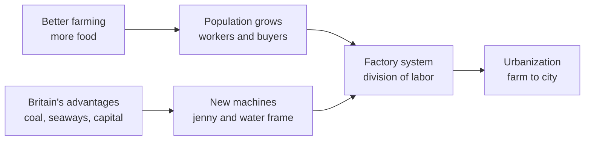

# AP World History: Modern — Topic 5.3 Summary: Industrial Revolution Begins (c. 1700–1900)

> Source: Summary of AP_WH_5.3_Notes_EN.md

**Unit 5: Revolutions (c. 1750–1900)**

---

## In One Sentence

Industrialization began in Britain because it had coal, iron, rivers, and Atlantic seaways, plus more food, a growing population, capital from its empire, and laws that protected private property, and it moved production from homes into factories where each worker did one task.

## The Big Picture

**Industrialization** means using more and more machines to make goods, along with the social changes that came with them. It grew from the Columbian Exchange, maritime trading empires, better farming, and a build-up of money to invest. Britain led because of its geography, its empire, its strong fleet, and its laws. Machines moved work out of homes and into **factories**, and people moved from farms to cities.

## Key Points

### 1. More Food, More People
- In the early 1700s an **agricultural revolution** began. **Crop rotation** (changing the crop in a field each year) and the **seed drill** raised food output.
- The **potato** from South America added calories to people's diets.
- More food and better medical care made the **population grow**. This gave factories both workers and buyers.

### 2. From Homes to Factories
- Britain loved **Indian cotton** cloth. British investors built their own cotton industry using raw cotton grown by **enslaved labor** in the Americas.
- In the **cottage industry** (putting-out system), merchants gave raw cotton to women, who spun it at home. The work was slow and low-paid.
- Investors wanted faster machines: the **spinning jenny** (1760s) spun several threads at once, and Arkwright's water-powered **water frame** (1769) was so big that work moved into **factories**.

### 3. The Factory System and Division of Labor
- The **factory system** put machines and workers together in one large building, so production was in one place.
- **Interchangeable parts** were identical parts that could replace a broken one. The textbook credits Eli Whitney (1798, for U.S. army guns).
- This led to the **division of labor**: each worker did one task, so owners no longer needed skilled craftsmen. Adam Smith's example showed pin-making split into about 18 steps.

### 4. Britain's Environmental Advantages
- **Location:** Britain sat on the Atlantic with many seaways, good for importing raw materials and exporting goods.
- **Coal:** huge deposits fueled steam engines and helped separate **iron** from ore. Iron built bigger bridges, taller buildings, and stronger ships.
- **Rivers**, plus canals and harbors paid for with public money, made transport cheap.

### 5. Britain's Human and Legal Advantages
- **Colonies** gave resources such as timber for ships, and wealth from the slave trade gave investors extra **capital** (money to invest).
- **Legal protection of private property** assured business owners that their businesses would not be taken away. Britain also had the world's strongest fleet.
- The **enclosure movement** fenced off the commons (shared village land). Farmers who lost land moved to cities such as **Manchester** and Liverpool and became factory workers.

## Must-Know Terms & People

| Term | What it is | Why it matters |
|---|---|---|
| Industrialization | More use of machines to make goods, plus the social changes it brought | The main idea of this topic |
| Cottage industry | Women spun raw cotton at home for merchants | The slow system that factories replaced |
| Water frame | Arkwright's water-powered spinning machine (1769) | Moved production into factories |
| Factory system | Production in large buildings full of machines and workers | Put all production in one place |
| Division of labor | Each worker does one task | Made output faster and needed fewer skilled workers |
| Capital | Money available to invest in businesses | Britain had extra capital from its empire and the slave trade |
| Enclosure movement | Fencing off the commons for private use | Pushed farmers into cities to work in factories |
| Urbanization | People moving from the countryside to cities | Supplied the industrial workforce |

## Key Dates

| Year | Event |
|---|---|
| Early 1700s | Agricultural revolution: crop rotation and the seed drill |
| 1760s | Hargreaves's spinning jenny |
| 1769 | Arkwright patents the water frame |
| 1798 | Interchangeable parts for U.S. army guns (the textbook credits Whitney) |
| Early 1900s | Ford's moving assembly line |

## How the Exam Asks About It

- **Legitimacy & consolidation:** This topic is about the economy, not rulers. The closest link is the government's role: Britain protected private property by law, paid for canals and harbors, and kept the strongest fleet.
- **Continuity, innovation, diversity:** Continuity: Britain still relied on its maritime empire and enslaved labor in the Americas for raw cotton. Innovation: the water frame moved spinning from homes into factories. Diversity: the causes were of many kinds, from coal and rivers to capital, laws, and farming.
- **Likely comparison:** Cottage industry vs. factory system. Similarity: both turned raw cotton into thread for sale. Difference: cottage work was done at home by hand, mostly by women, and was slow; factory work used water power and later steam, with each worker doing one task, and was much faster and cheaper.
- **Common trap:** Students list only coal as the cause. Fix: the exam expects several factors, both environmental (coal, iron, rivers, seaways) and human (capital, property laws, farming, urbanization, foreign resources).

## Check Yourself

1. Name two environmental factors that helped Britain industrialize first.

▶ Answer
Britain had huge coal deposits to fuel steam engines and make iron. It also had rivers and Atlantic seaways, which made transport, imports, and exports cheap.

2. How did the water frame change where people worked?

▶ Answer
Its water-powered machines were too big for homes, so spinning moved into factories. This helped end the cottage industry.

3. How did the enclosure movement help industrialization?

▶ Answer
Fencing off the commons left many farmers without land. They moved to cities such as Manchester and Liverpool and became the industrial workforce.

